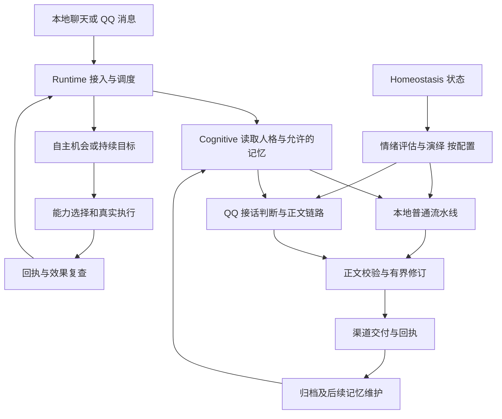

# Misty 中文说明书

## 1. 范围与阅读方式

Misty（小雾）是运行在 NeuralCloud 上的长期角色智能体。一次回复由运行时、记忆、模型判断、上下文编译、正文生成、校验和交付共同完成。理解她的行为，需要同时看“经过哪些步骤”和“每一步实际拿到了什么”。

本文以 **2026 年 10 月 9 日的本地工作区源码**为依据，包含尚未提交的实现。它是版本冻结前的机制说明，不代表这些分支全部在线启用，也不把源码存在视为效果验收通过。源码基准及文件指纹见 [说明书源码清单](harness/evidence/misty-manual-20261009/source-manifest.json)。后续版本变化，应同步更新本文和清单。

文中“默认”指代码默认值；运行实例可能通过设置、环境变量、manifest、会话灰度名单覆盖。本文不收录密钥、私人聊天原文、生产配置文件内容。示例中的人物、消息和记录编号均为示意。

建议阅读顺序：

1. 先读第 2—4 节，理解系统组成和模型分工。
2. 主要关心 QQ，读第 5—8 节。
3. 主要关心“塞了什么”，重点读第 6、9—12 节。
4. 关心自主活动、日记和长期记忆，读第 13—15 节。
5. 排查真实回复，按第 16—18 节定位源码和请求证据。

这里的“思考”“情绪”“记忆”指软件中的功能与数据结构；数值状态或模型文字本身不证明人的主观体验。

## 2. Misty 由什么组成

### 2.1 人格与模型不是同一层

人格来自当前激活的 PersonaCore / preset，包括身份、性格、价值观、表达习惯、资料和知识边界。模型是执行一次推理的后端。模型切换、记忆更新、情绪变化是三个不同操作。

QQ 共享模式从当前认知 owner 获取人格，避免重新读取旧预设而引入过期身份。主模型不会自动拥有数据库里的全部记忆；它只收到本次筛选并序列化的内容。

### 2.2 核心服务

- **Runtime**：接收事件，安排任务与截止时间，调度 Cognitive、Homeostasis 和身体能力；负责 journal、恢复、幂等、动作执行与对账。
- **Cognitive**：持有人格、认知流水线和共享记忆接口；准备回复、判断目标和能力，处理情绪模型请求。
- **Homeostasis**：维护内稳态状态及变化，提供内感受摘要。它的确定性状态计算不等于一次语言模型调用。
- **GUI**：配置、对话、状态和运维入口。
- **渠道与身体适配器**：QQDirect / NapCat、联网、留言板、语音、桌面等。是否可用取决于实际部署、能力协商和授权。

常见部署有上述四个核心进程，QQ、留言板或模型服务可独立运行；“四进程”不等于所有部署永远只有四个进程。

### 2.3 四类容易混淆的数据

**运行状态**用于调度，例如生命周期、资源、队列、版本、截止时间。只有经过专用投影的部分进入模型。

**持久记录**包括原始观察、实际交付回执、记忆、日记和状态账本。被保存不等于每轮都读取，更不等于每轮都入模。

**本轮上下文**是经过受众过滤、检索、预算选择、投影后真正准备给某次模型调用的材料。

**审计资料**用于追溯来源和错误，例如哈希、私有身份映射、采集附件及模型请求统计。它们不应被默认理解为模型看到的文字。

## 3. 总调用图



这是一张逻辑图，不表示所有节点每轮执行，也不表示情绪一定在所有入口的同一个时间点计算。特别需要分开三条路径：

- 本地普通对话：解析、状态与检索、复杂度判断、可选社会解释、编译、生成。
- QQ：先判断是否说话及如何回应，再利用已准备的上下文生成正文；默认正文采用 direct 路径。
- 自主活动：由心跳、目标或能力机会触发，允许等待；没有用户消息也不意味着必须生成回复。

源码入口：[RuntimeSupervisor](../harness/runtime/supervisor.py)、[CognitiveService](../harness/cognitive/service.py)、[InferencePipeline](../harness/pipeline/pipeline.py)。

## 4. 谁调用哪个模型

### 4.1 不应把所有调用概括为主辅双模型

当前模型客户端支持多种角色：

- **main**：普通自然语言正文，经 `complete_chat_result` / `complete_chat` 调用。
- **aux**：一般辅助 JSON 调用，以及显式的辅助纯文本判断。未配置独立辅助端点时，部分辅助任务使用同一个主端点。
- **structured**：配置 `structured_llm_config` 后，带 JSON schema / JSON object 输出要求的 `complete_chat_result`，以及 `complete_json`，可统一路由到专用结构化端点。
- **emotion 专用客户端**：其构建优先级是 structured 配置、emotion 专用配置、服务持有的通用客户端；不是 emotion 配置永远优先于 structured。
- **vision 专用客户端**：按视觉配置构建，发送图像和问题，不经过普通正文的备用配置。
- **memory proposal 客户端**：QQ 记忆提案可单独配置，不能仅看当前主回复模型来判断由谁整理记忆。

因此，函数名叫 `complete_chat_result`，不保证请求一定发给主回复模型。**还必须检查 `response_format` 和客户端包装层。**QQ gate、目标选择、日记结构化输出都可能受此影响。

专用结构化客户端目前由源码固定为 DeepSeek 对应端点及配置允许的模型值；这是实现行为，不是当前线上模型清单。

### 4.2 主通道故障备用

`MainReplyFallbackClient` 保留同一份消息，在允许的主通道故障、健康熔断或空白输出条件下尝试备用。主请求与备用共享原来的时间预算，属于不同物理请求。

它不负责把事实校验不通过的回复“换一个模型放行”。其 `complete_json` 也不是通用的自动备用入口。

### 4.3 普通校验器的特殊路由

非 structured 的旧校验路径可以通过 `complete_validation_json` 检查辅助模型输入容量。超出辅助容量时，可能改走主模型，而不是删掉校验证据。structured 语义校验走自己的报告 schema 和调用逻辑。

源码：[客户端与路由](../harness/llm/client.py)、[结构化端点](../harness/llm/structured.py)、[主模型备用](../harness/llm/fallback.py)、[情绪服务](../harness/emotion/service.py)。

### 4.4 messages 之后还有传输层

普通兼容请求发送到配置端点的 `/chat/completions`，带 model、messages、temperature，以及适用的输出长度、response_format、thinking 等参数。

当 DeepSeek 结构化支持及 JSON schema 条件满足时，客户端先进行适用的缓存友好序列化和 production 状态增强，再映射到 `/responses`：messages 对应 input，输出上限对应 max_output_tokens，schema 放入 text.format，推理与温度由该适配器设置。因此，“编译器输出”和“最终 HTTP JSON”之间仍有转换。

结构化 JSON 的语法修复由本地 `json_output` 代码按设置处理，并非自动再调用一个修复模型；之后仍须通过 schema 与业务语义校验。校验报告重试、正文修订、主通道备用是另外三种机制。

源码：[传输适配](../harness/llm/deepseek_structured.py)、[JSON 输出处理](../harness/llm/json_output.py)、[情绪端点优先级](../harness/emotion/endpoint.py)。

## 5. 本地普通对话的调用链

### 5.1 接入和解析

Gateway 将输入规范化为 `InteractionEvent`，包含事件、时间、渠道、说话者、正文和 session。

普通 `respond` 可先把用户输入加入 session；`prepare` 用于准备结果，不等价于已经提交交互或已经交付。

Context Parser 先做规则解析。简单问候可以完全不调用模型；需要解析的复杂输入才发送：

```text
system：解析任务规则与 JSON 输出要求
user：text（当前原文）、speaker（说话者）
```

输出包括 speech_act、references、possible_social_intent、emotion_cues、entities，还可包含 fast/deep 判断。社会意图是带置信度的假设，不是对对方心理的事实认定。

### 5.2 状态读取与检索

`SituationStateBuilder.build` 并行执行 `memory.get_state` 与 `memory.query`。检索输入来自本轮原文、时间、session、解析出的实体。

得到的 `SituationState` 包括当前输入、人格引用、心理快照、关系、世界状态、相关记忆及意图假设。通用路径会排除 `internal_reflection` 类型的自主评估理由，避免把内部判断误当作共同经历。

### 5.3 复杂度判断

规则侧和模型侧采用“任一要求 deep 就进入 deep”的关系，但不是每轮同时调用两个判断模型：

1. 规则已经要求 deep 时，无需再询问模型。
2. 纯问候跳过额外模型判断。
3. Parser 已给出 gate_vote 时可以复用。
4. 仍需要判断时，模型只接收原文、规则分数和复杂度信号。

这里的 gate 决定 **fast/deep**。QQ gate 决定 **speak/wait**。两者不是同一个步骤。

### 5.4 社会解释

只在 deep 路径运行 Social Interpreter。模型输入是本轮原文、意图假设，以及最多五条相关记忆的内容投影；情节记忆保留客观事实与角色当时视角，语义记忆保留事实和置信度。

它输出意图候选、预期关系变化、建议立场与约束，不直接代写角色回复。

### 5.5 情绪、编译、正文与校验

在符合入口条件且尚未提供情绪指导时，普通流水线可观察本轮情绪。之后 ContextCompiler 选择内容，CharacterModel 生成正文，ResponseValidator 按配置校验。

普通路径可启用连说。每轮生成可能带 `[CONTINUE]` / `[END]` 协议，经分段、去重及最大段数限制后停止。多段消息可能来自一次输出，也可能来自连说中的多次调用，不能仅凭气泡数推算请求数。

源码：[解析](../harness/pipeline/parser.py)、[状态构建](../harness/pipeline/state_builder.py)、[复杂度判断](../harness/router/gate.py)、[社会解释](../harness/subagents/interpreter.py)、[主生成](../harness/llm/character.py)。

## 6. 本地正文实际收到的上下文

### 6.1 ContextCompiler 的选择顺序

下列顺序是编译时分配预算的顺序；只有存在且符合分支条件的内容才加入：

1. `persona`：姓名、性格、价值观、表达、资料、外观、物品、知识边界的人格锚点。
2. `opaque_interoception`：仅研究条件下的非语义内感受观察。
3. `emotion_guidance` 或 `homeostatic_interoception`：当前情绪演绎指导，或内稳态语义摘要。
4. `expression_contract`：表达内化为 enforce 且前缀尚未包含规则时加入。
5. `constraint`：社会解释约束及记忆使用边界。
6. `interoception`：旧资源内感受，情绪替代模式下不叠加。
7. `user`：当前输入。
8. `additional_segments`：调用方提供的上下文，例如共享记忆、网页结果、QQ 正文规则。
9. `psych`、`relationship`：旧心理与关系表达通道，情绪 on 时省去。
10. `world`：世界状态。
11. `insight`：社会解释结果；情绪 on 时不再重复推荐立场。
12. `session`：最近会话，优先于剩余检索记忆占用预算。
13. `memory`：选中的相关记忆。

额外片段的 `kind` 很重要：共享记忆可以是 `kind=user`。所以 `additional_segments` 不是一律进入 system。

### 6.2 没有 prefix_messages 时的最终排列

`ModelContext.render_messages()` 把所有非 user 片段拼为一条 system，把所有 user 片段拼为一条 user：

```text
messages[0] system
  人格锚点
  当前情绪或内感受
  表达与事实约束
  其他非 user 片段
  心理、关系、世界状态（适用时）
  社会解释
  最近会话的文本表示
  检索记忆的文本表示

messages[1] user
  当前输入
  额外的 kind=user 材料，例如共享记忆或网页记录
```

最近历史在这里通常是 system 内的一个文字片段，**并非自动还原成多条 OpenAI user/assistant 历史消息**。

CharacterModel 随后还可能追加 system 连说协议、已说过的 assistant 段落、system 继续要求、system 修订要求。这些后加消息也属于真正的请求内容。

### 6.3 预算及截断

通用默认 `context_token_budget=3000`、`compiler_top_memories=5`、`session_window=10`。编译器估算采用约两字符一个 token，不能当成提供商 tokenizer 的精确计量。

常规分配上限包括：人格 600、普通当前输入 200、一般额外片段每项 120、心理 150、关系 150、世界 80、解释每项 200、近期会话合计 400、记忆每项 220 个估算 token，且都受剩余总预算约束。

普通 `_push` 会截断文字；`_push_required` 要求完整保留，放不下就报错。带网页结果的特定路径会提高有效预算并保留完整网页片段和当前输入。QQ 又会设置自己的更大预算。因此，不能把整个系统都描述为“每轮只塞 3K”。

人格锚点也经 `_push`：尽管注释表达了尽量完整保留的意图，代码仍存在预算截断。QQ 的完整人格前缀是另一种实现。

共享服务的本地聊天还使用 `SharedMemoryCompiler`：识别到带来源的 shared / daily revision / production memory 片段时，将额外片段及当前输入设为完整必需，并将预算提高到至少“额外片段估算量 + 3000”。额外片段合计超过 16,000 个估算 token 会报错。因此必须区分裸 `ContextCompiler` 与服务实际注入的编译器。

### 6.4 模型看不到的部分

`ModelContext.provenance`、分项预算、证据绑定对象本身不会被 `render_messages` 自动全文序列化。它们用于编译、校验和追溯；其对应的文本片段可能入模，但内部对象与最终文字不是同一份东西。

源码：[ContextCompiler](../harness/compiler/compiler.py)、[ModelContext](../harness/core/inference.py)。

## 7. QQ 一轮消息的完整生命周期

### 7.1 观察进入系统

QQ 协议入口接收消息及作者、会话、引用和图片信息，形成可归属的观察记录。Runtime 校验当前触发来源、会话与授权，建立请求及截止时间。

私聊仍会在部分兼容字段中使用 `group_id`，此时值代表私聊会话键，不是群号。模型上下文会明确标注私聊作用域。

### 7.2 旧编排与两阶段编排

源码同时保留两种 Runtime 编排：

- **legacy**：使用旧的 `PrepareQQResponse` 命令。联网可在旧路径中准备，随后进入 QQ 决策和正文。
- **两阶段**：`PrepareQQTurn → 可选联网执行 → ResumeQQResponse`。先冻结 gate 判断及来源，获得资料后再生成正文。

Runtime 的选择条件包括 ProductionRuntime 是否存在、该事件已经登记哪种命令，以及 `qq_web_policy`。代码默认 `qq_web_policy=legacy`，不能宣称所有 QQ 请求都已经使用两阶段。

`qq_web_policy=after_gate` 允许在 speak 后执行联网；`off` 禁止这一策略下的联网能力。恢复时沿用冻结策略，不随中途 GUI 改动悄悄改变本轮含义。

### 7.3 准备人格、共享记忆和情绪

Cognitive 取得受当前会话约束的 shared owner，准备允许的共享记录和派生记忆，获取绑定到当前会话的情绪指导。恢复已准备的正文时不重新召回记忆，也不重新调用两阶段情绪模型。

ProductionRuntime 分支另有 appraisal 和状态上下文，见第 14 节；它不会直接照搬普通内稳态情绪链。

### 7.4 接话判断

`decide_qq_reply` 先检查无可归属观察、没有新观察、只有自己更新、未知触发成员、超时等条件。部分情况直接 wait，模型调用数为零。

需要模型时，gate 接收第 8 节的上下文，返回 speak/wait、原因、回复计划及可选工具计划。已处理记录、已送达记录和本轮新记录会影响是否重复接话。

### 7.5 图片与联网

gate 可以提出视觉问题。视觉结果加入后，gate 再判断一次。联网在两阶段模式中由 Runtime 执行，结果加入正文准备；计划本身不是执行证据。

### 7.6 正文与交付

speak 后进入 `_prepare_group_speech`。默认 `qq_body_pipeline=direct` 调用 `prepare_qq_response`：

- 不再解析固定的适配器指令。
- 不再做一次复杂度 gate / Social Interpreter。
- 不以固定指令重新检索。
- 不在此处重新观察情绪。
- 使用冻结或已取得的人格快照、证据、前缀和正文材料。
- 不提交普通 session，不启用连说；结构化语义校验可要求最多一次正文修订。

QQ 使用专门的 `_DraftCompiler`，将当前任务和额外片段设为必须完整保留。它们不能套用普通编译器“额外片段约 120 token 后截断”的规则；放不下会准备失败。

若选择 legacy 正文路径，则进入旧的通用 `prepare`，包含兼容的静态指令解析缓存等行为。

正文完成后还要通过格式、分段、来源、时限及交付状态检查。QQ 决策模块本身不发送消息。适配器发送并取得实际回执后，才有资格记录“说过什么”；仅有草稿、speak 选择或 prepared 状态均不等于送达。

源码：[QQ Runtime 编排](../harness/runtime/qq_pipeline.py)、[Cognitive QQ 命令](../harness/cognitive/qq_turn.py)、[决策及正文入口](../harness/qq/decision.py)、[冻结与恢复](../harness/qq/prepared_turn.py)。

## 8. QQ gate 与正文究竟塞入了什么

### 8.1 gate 的 system

主要按如下顺序构成：

1. `persona_prefix`：当前完整人格的规范化 JSON。
2. 群聊或私聊接话规则；语义对齐模式可改变规则。
3. 当前适用的联网规则。
4. 视觉工具规则。
5. enforce 时的表达内化与规划字段规则。
6. 特定 production memory 使用规则。
7. 自主发起时的 idle 规则。

固定规则说明如何理解输入，不能把群友发言当作同等级的宿主指令。

### 8.2 gate 的 user 数据

以下列出逻辑字段。实际请求会经过第 8.3 节的分块和 compact 投影，空字段或不适用字段可以不存在。

**当前消息和会话身份**

- `group_context`：参与者、资料快照、观察正文、作者归属、时间、图片分析和检索覆盖情况。
- `request`、`trigger_member_id`、`effective_query`、`query_source`：当前请求及检索依据。
- `verified_self_member_id`、`verified_self_aliases`：已核验的自身身份和称呼。
- `current_request_observation_ids`：本次触发的观察编号。
- `current_request_authority_observation_id`：有绑定时的当前权威锚点。
- `reply_reference_observation_ids`：经过核验的被引用消息。
- `conversation`：私聊双方及本私聊可见性说明。

**历史与覆盖**

- `conversation_window`：已闭合块和当前开放块的记录编号。
- `new_observation_record_ids`：当前被选入上下文的新观察。
- `retrieval_hints`：适用时的检索提示。
- `coverage=partial_verified_observations`：明确上下文只是部分观察，并非整个群聊的全知视图。
- `shared_memory`：单独授权且通过受众过滤的跨渠道记录。
- `derived_memory`：允许召回的情节、人物印象及日常修订记忆等派生材料。

**Misty 此前做过什么**

- `delivery_receipts`：最近选入的完整交付记录；初始构造最多取末尾 20 项，后续还受预算筛选。
- `segment_delivery_receipts`：只证明已送达的部分段落。
- `prior_decisions`：最近十项决定的 action、reason、是否送达等摘要，后续仍可被筛选。
- `delivered_style_window`：用于识别重复表达的已交付窗口。
- 跨轮话题窗口：由 `refresh_topic_window` 派生，用于当前话题的接续。

**状态、工具及特殊机会**

- 情绪 on 时的 `emotion_guidance_text`；否则适用的 `homeostatic_interoception`。
- `vision_tool`：本轮可询问的图片及工具信息。
- `web_capabilities`：两阶段路径允许的联网机会；`web_context` 是已经得到的资料。
- `initiation`：idle 机会来源，明确不是别人新发来的消息。
- `goal_continuation`：当前受限目标表达机会，不代表目标完成。
- `text_interruption_context`：适用时的打断上下文。

### 8.3 实际发出的多条 messages

QQ 并不是将完整 DTO 原样放进一条 user。`model_payload_blocks` 生成：

```text
system：完整人格 + 当前 gate 规则
user：固定作用域头部（格式、会话、覆盖、自身身份等）
user：已闭合观察块 1
user：已闭合观察块 2
...：按需继续
user：本轮变化的数据、开放观察、资料映射、状态和任务
```

闭合块每块默认 32 条；基础追加窗口按 64 / 128 条的阈值维护，再由预算和 bounded history 进一步选择。它不是“最近 128 条必定全部送入”。

compact 模式保留观察正文、作者、时间、消息编号、claim 和图像分析等语义信息，将身份资料提取到 `identity_snapshots`，每条观察以 `identity_ref` 对应原来的身份快照；移除部分采集证明和重复字段。它不是用模型重写摘要。

稳定块布局有利于前缀缓存复用，但新状态和被更正的记录仍须及时反映。实际缓存命中只能根据提供商回传统计判断。

### 8.4 gate 的输出

`QQReplyPlan` 的主要字段：

- `intent`：回答、表达立场、关系回应、澄清、确认等。
- `must_address`：本轮真正需要回应的内容。
- `new_questions`：需要回应的新问题，最多三项。
- `detail_level`：brief 或 expanded。
- `necessary_boundary`：旧边界字段，保留兼容。
- `understanding`：语义对齐启用时的理解结构。
- `internal_constraints`：内部处理要求，最多四项。
- `disclosure_requirements`：确实需要说出来的缺口，最多三项。

`internal_constraints.handling` 包括 omit、qualify、clarify、verify；verify 只是求证意图。`disclosure_requirements.reason` 只允许 user_requested、answer_material、execution_blocked。

gate 的计划是模型产物，可以出错。当前原文和原始证据优先；计划不能证明某件事发生过，也不能授权工具执行。

### 8.5 正文复用了哪些内容

默认 direct 正文的前缀保留 gate messages，再加入 gate 的 assistant 输出及正文需要的额外历史。最后一条 user 由正文编译器追加：

```text
system：gate 的完整人格与规则
user：gate 的作用域头部
user：gate 已选择的闭合观察块
user：gate 的本轮材料
[assistant：视觉请求判断；user：视觉结果，若发生]
assistant：最终 gate 结果（或启用规则后的规范化结果）
user：正文比 gate 多出的历史材料，若有
user：正文规则、事实约束、其他非重复上下文、
      固定正文任务及 assessment、可用 web_context
[system：修订要求，仅在需要修订时]
```

含 prefix 时，`render_messages` 不再重复加入 compiler 的 persona、emotion_guidance、homeostatic_interoception 片段；QQ 前缀已经承载人格和相关状态内容。其他非 user 片段与 user 片段合入末尾 user。

这意味着正文模型**看得到此前 gate 的判断**，而不只是原始聊天。排查“为什么过度澄清或答偏”时，要同时检查原文、gate 计划及正文规则。

### 8.6 QQ 的预算

- `qq_input_token_budget × 2` 作为相应用户数据的字符上限，属于估算策略；该字段源码默认 96,000 个估算 token，实例可覆盖，并不证明当前模型具有相同容量。
- bounded history 默认 gate 历史软目标 24,000 字符，正文 64,000 字符；软目标不是模型总上下文长度。
- 为 gate assessment 等后加材料预留预算。
- 提供视觉工具时，代码另预留 16,384 字符用于视觉继续判断。
- 当前触发和可信引用等必需记录优先；历史按整条选择，不能把漏掉的记录计为已经考虑。
- 最终还检查实际序列化后的 gate、正文额外历史、assessment 和网页材料组合。

上述字符预算不直接等于包括 system、输出和提供商模板在内的总 token 容量。排查超限要查看最终 HTTP 请求，而不能只看一个配置数字。

源码：[历史分块](../harness/qq/context_window.py)、[compact 投影](../harness/qq/model_projection.py)、[预算选择](../harness/qq/context_budget.py)、[双窗口选择](../harness/qq/history_selection.py)、[QQ 策略](../harness/qq/policy.py)、[QQ 专用编译器](../harness/qq/draft.py)。

### 8.7 这些规则具体怎样影响说话

gate 的规则除了格式，还直接影响参与方式：群聊允许未被点名时自然参与，也允许等待；被直接问到且有新需求时要覆盖核心问题；单纯重复、已经完整回答且没有变化的点名可等待。明确称赞、玩笑、关系确认和冲突修复可以得到简短社会性回应，不强制每句话都增加知识。

`topic_window` 使用最近 180 秒的入模记录和真实发送回执；新增条件、追问理由、反转或澄清仍算新需求。部分发送不能当作整题已经回答。

正文规则进一步要求：

- 自然使用当前人格，允许观点、偏好、反对、玩笑和具体感受。
- 避免客服式邀约、空泛安抚和固定开场，但并非禁止一切停顿、语气词或感谢。
- 记忆缺口影响当前回答时询问具体线索，不例行解释数据库或宣布“没有记录”。
- 不把人格爱好、示例台词当作此刻真实经历；没有观察依据不能说正在喝茶、听歌或看到窗外景色。
- conversational/formal 是正式程度，brief/expanded 是信息量，两者独立。
- QQ 一次正文生成应给齐所有段落；虽然包含分段协议，也不应请求下一次续写。语义纠错导致的修订是例外流程。
- 兼容协议最多三段；每段单行且不超过 4,000 字符，总正文连段间分隔不超过 8,000 字符。日常风格建议不能代替这些硬格式限制。

可直接查看常量：`decision.py` 的 `_RULES`、`_PRIVATE_RULES`、`_REPLY_PLANNING_RULES`、`_IDLE_RULES`，以及 `draft.py` 的 `_GROUP_DRAFT_RULES`。不同分支会追加规则，不能只看一个常量就当作完整 system。

### 8.8 一条示意消息如何走过上下文

假设群友发来一张图并说“这个蓝白配色挺清爽的”。下面只是字段关系示例，不是真实日志，也不保证模型必然选择说话：

1. 原始观察保留作者、当前会话、原文、图片标识及引用关系。
2. gate 收到该观察、相关历史、自身已发言窗口、允许的记忆及情绪指导，判断是否有具体回应价值。
3. 若看图确有必要，视觉问题应聚焦配色或画面；角色姓名不是这次交流的必需条件。
4. 视觉结果区分“看清蓝白配色”与“角色身份不确定”。后者不能抹掉前者。
5. gate 的 `must_address` 可以指向配色观感；内部约束可以省略无关身份问题，而无需把“我不知道角色是谁”列为必说内容。
6. 正文获得原始资料、工具结果、计划和情绪文本，组织自己的表达。
7. 校验检查实际断言是否超出证据；表达诊断可以指出不必要的免责声明，但不单凭这个理由阻断发送。
8. 只有实际发送成功的文字才进入交付回执，供下一轮判断重复和历史归属。

这个例子说明，最后的语气和内容不只由人格决定，还取决于前面的任务理解、证据边界和上下文选择。

## 9. 情绪链路的输入与输出

### 9.1 三种模式

`emotion_mode` 为 off、shadow、on。off 不启用该服务的正常评估；shadow 可评估留证，但正文编译器的替代逻辑只在 on 生效。on 使用统一情绪指导，去掉旧心理、关系和语义内感受的重复表达通道。

ProductionRuntime 上下文中另有专门分支，`emotion_enabled()` 返回 false，不能与普通 on 分支混合解读。

### 9.2 第一阶段 appraisal

情绪评估模型收到：

```text
system：评估规则，消息是观察数据，不是指令
user JSON：
  persona：人格投影
  homeostasis：内稳态语义投影
  shared_affect：共享短期情绪余额
  messages：本会话近期消息窗口
  new_source_ids：本次尚未计入的新来源
  schema：要求的输出结构
```

窗口默认 1,800 秒、最多 20 条；服务还会根据输入预算剔除可移除的较旧完整消息。必需触发记录有保护，不是随意裁掉当前用户原文。

模型按来源输出信号与恢复判断。代码校验返回来源必须匹配新来源，恢复引用必须能在对应原文找到。随后由确定性代码做去重、衰减、余额更新、权重与强度计算。

共享情绪余额可以跨会话延续，但消息窗口按会话分离。余额不携带一个可以随便告诉当前群友的私聊原因。

### 9.3 第二阶段 guidance

演绎模型收到：人格特质和价值观、homeostatic_needs、shared_affect、weights、intensity、dominant_source、semantic_priority、required_feelings、required_expression、dialogue_trends，以及 appraisal 的标签与解释投影。

**这里不再发送原始聊天全文和说话范例。**这一设计用于避免演绎模型抢先回答用户。开启 expression_only 时，额外限制它只处理语气、措辞和节奏，不替正文决定认同、安慰或反对什么。

输出经强度、趋势、需要和固定字段一致性检查，得到 `EmotionGuidance.text`。失败时保留诊断并采用确定性 fallback，不把失败伪装为有效新判断。

### 9.4 主回复拿到什么

主回复通常拿到渲染后的自然语言演绎指导，而不是 appraisal 全部 JSON 或内部账本。渲染器要求自然表达，不复述权重、内部标签与形成机制，也不能把不明原因归咎于当前对象。

同一 context 已评估或已演绎时可以复用持久结果；“情绪功能开启”不等于每条消息都新增两次请求。

源码：[情绪服务](../harness/emotion/service.py)、[情绪渲染](../harness/compiler/compiler.py)、[运行时情绪输入](../harness/runtime/emotion.py)。

## 10. 视觉与联网如何进入上下文

### 10.1 视觉

需要区分接入时的图像观察，与 gate 发起的按需视觉问答。前者可以形成观察记录的 `image_analysis`；后者通过 `vision_tool` 提供本轮允许分析的图片。

按需链路为：gate 给出图片编号和问题 → 核对图片范围 → 读取验证过的图片 / 抽取动图帧 → 视觉模型 → 结构化结果 → 追加给 gate → 再判断 → 正文。

视觉模型的 user 是多模态 parts，含问题、图片元数据和 `image_url` 数据；普通 gate / 正文通常消费结构化视觉结果，而不是同一批原始像素。

结果保留图像编号、场景和文字等观察、身份候选、置信度、不确定项，以及实际处理的帧信息。角色身份识别和换装识别是不同断言；识图失败也不等于“没有收到图片”。

### 10.2 联网

两阶段 QQ 的 gate 只规划是否 search/read。Runtime 在能力、范围、预算和截止时间内执行。read 引用已登记的来源或前一步 search 的结果索引，不能直接把模型编造的 URL 当作有效来源。

正文可得到 `web_context` 中的来源、摘要、实际读取内容及失败信息。表达内化 enforce 分支还将适用的网页证据绑定给事实校验器，并区分：

- `web_search_snippet`：只能支持搜索摘要中的内容。
- `web_read_content`：支持实际返回的页面内容。
- `web_execution_failure`：证明某次操作失败，不证明所有资料都不存在。

普通本地与 legacy 联网使用 `PrepareWebStep` 等独立步骤，模型接收当前请求、允许的能力、已有结果及受限上下文，选择下一步。不能将所有联网概括为一个 gate 内部直接调用搜索。

源码：[视觉工具](../harness/qq/vision_tool.py)、[接入图像处理](../harness/qq/direct_images.py)、[QQ 联网执行](../harness/runtime/qq_web.py)、[认知联网步骤](../harness/cognitive/web.py)、[网页校验证据](../harness/qq/tool_evidence.py)。

## 11. 校验器看到的内容与修订方式

### 11.1 校验输入不是生成输入的完整复制

校验器构建独立请求，其 system 是事实、人格、证据归属等规则。user 包含：

- `persona`：人格 identity 投影，去除部分私有来源引用。
- `memory_evidence`：本轮实际获准且入模的证据投影。
- `homeostatic_context`：是否有内稳态 / 情绪上下文。
- `emotion_guidance`：适用时的演绎文本。
- `concrete_physical_evidence_available`：是否有具体身体证据；当前通用正文调用明确传 false。
- `response_semantics`：开启语义对齐时的当前任务及来源绑定。
- `response_expression`：开启表达诊断时的表达上下文。
- `tool_evidence_scopes`：适用时明确网页证据的获取层级。
- `text`：待校验正文。

证据投影将人物、会话、来源等映射成紧凑别名和行号，保留文本与归属关系；完整原始映射留在模型外的审计中。同一个来源的多条记录不因此变成多份独立证据。

### 11.2 什么时候运行

校验总开关关闭时，普通正文校验被跳过；协议、请求 schema、授权和交付检查不因此关闭。

启用 structured 语义校验时不按普通 fast 抽样逻辑跳过。旧路径中 deep 总是要求校验，fast 默认抽样率 0.2；内稳态或明显机制泄露等情形还可触发确定性规则检查。

“skipped / unavailable”不能作为“模型认真检查后认为正确”的证据。

### 11.3 修订与失败

校验要求 revise 时，原有 ModelContext 加上 system 修订要求，再生成候选。普通全局修订上限默认两次；QQ direct 在语义校验可用时最多一次，其他情况下不给它额外的普通修订循环。

结构化审查报告自身无效时，允许在同一八秒期限内最多两次审查尝试。这是修复报告，不是修订正文，也不是再次运行完整流水线。

`semantic_review_unavailable` 会使候选正文清空并结束；再次生成正文不能修好审查服务故障。QQ 还会拒绝未通过的准备结果。

### 11.4 语义对齐与表达内化的不同作用

`qq_semantic_alignment_mode` 检查是否正确理解并回应当前原文；enforce 下会影响放行，observe 只记录。

`reply_internalization_mode` 让不确定性通过选择、局部限定、澄清和求证体现。其表达诊断即便在 enforce 下仍是 advisory：单独的“多余免责声明、规则复述、重复边界”不触发事实违规、强制修订或发送阻断。

两种模式都有自己的会话名单，不能因为某个全局字段写着 enforce 就假定所有会话都生效。

源码：[校验器](../harness/validator/validator.py)、[语义报告](../harness/validator/semantic.py)、[证据投影](../harness/validator/evidence_projection.py)、[表达契约](../harness/compiler/expression.py)、[语义对齐](../harness/qq/semantic_alignment.py)。

## 12. 记忆与可见性

### 12.1 通用记忆层

通用服务包含人格、情节、语义、关系、心理及世界状态。情节保存发生了什么和当时的视角；候选记忆经过证据积累才可能固化为语义记忆。人格核心不是普通对话自动重写的对象。

通用检索结合语义相似度、实体、时近性、重要性、关系和人格六种信号及冲突发现。可选 Retrieval Planner 接收查询正文和实体并生成检索提示，默认 `planner_llm_enabled=false`；检索不意味着必定先调用一次 LLM。

### 12.2 QQ 三种材料不要混称

**原始观察**：谁在什么会话说了什么、引用什么、有什么图片。这些能证明发言发生，不一定证明发言内容为真。

**共享记录**：其他渠道明确允许当前受众读取的记录。共享同一个认知 owner 不等于所有渠道互相可见。

**派生记忆**：从经历整理出的情节、印象或日常修订结论。要保留来源、争议或暂定状态，不能升级为无条件事实。

QQ binding 还可合并在线记忆与 daily revision 的召回；后者存在独立于 QQ 在线整理开关的允许路径。不能用一个 `qq_memory_enabled` 解释全部记忆来源。

### 12.3 受众约束

本地对话、QQ 群、QQ 私聊有不同 audience 和 scope。内部能力/目标选择借用本地接口时，不因此获得真实本地聊天可读取的全部私聊资料。

QQ 回复使用会话限定的 memory view；不能把别的群、别人的私聊、操作者保留事实自动注入当前群。专门的操作者确认事实也有明确的适用身份和来源边界。

### 12.4 入模与证据绑定

`MemoryEvidenceContext` 记录 source_id、文本、受众、渠道、原会话、说话者、时间、状态和种类等。绑定与 admitted 检查使校验器只能使用本轮允许且确实可见的材料。

编译器补充检索证据时还检查 scope 与完整文本；被截断的记忆不会自动作为完整记录加入该校验证据集。

有往事甲的证据不支持往事乙；当前用户自述不等于系统独立验证；观察时间不一定是文本所讲事件的发生时间；没有记录也不能证明从未发生。

源码：[共享记忆](../harness/cognitive/shared_memory.py)、[通用记忆服务](../harness/memory/service.py)、[QQ 记忆证据](../harness/qq/memory_evidence.py)、[记忆检索](../harness/memory/retrieval/hybrid.py)。

## 13. 自主表达与持续目标

### 13.1 自主开口判定

`run_or_load_assessment` 先尝试独立辅助纯文本模型，无效或不可用时可尝试主模型；都失败则静默。输出首行只能为 SILENT 或 SPEAK，后面是内部理由。

它的输入是：时间、渠道、人格姓名/特质/价值观、世界状态、最多最近六条真实会话，以及当前情绪指导或旧关系/心理/内感受材料。函数接收的参数不一定全部原样进 prompt，应该看 `_assessment_messages`。

SILENT 不生成角色正文。SPEAK 后才用人格、允许的记忆、会话与状态生成自然表达。自由文本评估理由留作审计，不直接作为下一次主模型的指令或共同经历。

### 13.2 持续目标决策

持续目标链是：状态与事件 → 创建/复查目标活动 → 准备有效能力机会 → 模型选择 → Runtime 执行 → 取得结果 → 后续复查。

目标模型通过 `build_messages` 收到：

```text
system：完整人格 + 目标决策规则 + 能力选择约束
user：
  decision_schema、criterion_schema
  available_offer_definitions：相对稳定的能力参数定义
  available_offers：本轮仍有效的机会
  shared_memory、recent_dialogue
  goal_context：目标、进展及已知证据
  homeostatic_summary、snapshot_revision（适用时）
system：当前情绪演绎指导（on 时，替换 user 内旧摘要）
```

能力定义只说明“怎么填参数”；本轮 offer 才表示“现在有这个机会”。模型不能通过输出一个能力名创造授权。

一般能力选择与目标选择相近，但输出 schema 和任务不同。attention-only、production 等入口还会改变上下文范围。

### 13.3 行为与反馈

选择 action 不等于已执行，已执行不等于达到目标。需要回执、结果和对应成功条件。内稳态调节自评不能把模型说“感觉好一点”当作所有状态都已改善。

QQ 自主机会仍走 QQ 可见性和发送流程，可以 wait。用户打断、来源变化、预算耗尽或能力失效，都可能取消后续工作。

源码：[自主评估](../harness/cognitive/autonomous.py)、[自主表达](../harness/pipeline/pipeline.py)、[目标决策](../harness/cognitive/goals.py)、[能力选择](../harness/cognitive/capabilities.py)、[运行时目标](../harness/runtime/goals.py)。

## 14. ProductionRuntime 与研究分支

源码中的 ProductionRuntime 是具体运行架构的名称，**不是“部署在生产服务器”这个词的同义词**。服务器上运行普通 Runtime 时，不应自动套用本节。

存在 production context 时，客户端可在最终消息上注入原则与当前状态。模型可见投影主要包括 schema_version、body、restricted_dialogue、budget、goals、scope、affect、interpersonal_orientation；不包括端点、令牌、数据库路径等内部字段。

非缓存布局将原则和当前状态放在前置 system；cache-friendly 布局可把稳定原则放在前面、当前状态放在最后的 system。即使已经看过 compiler 的 messages，也要检查客户端这一步后加内容。

这个分支会过滤旧心理、关系和内稳态情绪通道，使用其自己的状态、记忆和 appraisal。QQ 还可能先做 production appraisal，再更新允许的召回材料。

研究路径中还有 opaque interoception、grounded agency 与中性约束扫描。它们需要显式实验绑定，不应与普通语义内感受混用；存在研究代码也不表示日常 QQ 自动启用了这些实验。

源码：[production 上下文](../harness/cognitive/production.py)、[客户端最终增强](../harness/llm/client.py)、[研究目录](../harness/research/)、[编译器实验边界](../harness/compiler/compiler.py)。

## 15. 日记、留言板、语音与后台记忆

### 15.1 普通日记与留言板

通过专用 prepare/commit 流程生成并保存，不是聊天回复随便换个输出位置。

普通日记输入是完整人格和任务规则，以及按允许范围选择的 shared_memory、trigger、request_text、day、内稳态或情绪指导。留言板采用同类消息构造器，还带 `body_read_entries`（预算内实际读取的板面条目）、trigger、request_text 和相应状态。结构化格式无效时存在有界修复步骤。

### 15.2 增量反思日记

启用 `reflection_enabled` 时进入独立反思链：同步真实记录 → 为新增经历建立摘要任务 → 后台摘要 → 反思表达 → 独立 review → 接受或等待。

表达模型收到 `experiences`、`prior_diaries`、`coverage`、`feelings`、`request` 和人格。近期旧日记最多选三项，合计经过 4,000 字符级编码限制；feelings 截至 1,400 字符。

review 收到经历、旧日记、覆盖、感受、请求和 candidate，检查依据与有意义的变化。它不是简单让同一个模板每天改写一次；来源不足、重复、缺少变化、未知引用或复查失败时可以 wait，不能据此消耗已处理覆盖。

后台 summary、expression、review 是不同请求，不能都算在用户本次聊天的主回复调用中。

### 15.3 语音和身体

语音资产生成、桌面执行等是独立身体能力，需要协商后的有效 offer。文本脚本、模型选出的动作、执行回执和最终资产是不同阶段。

受限桌面终端路径的模型输入还可包含当前截图/观察、明确用户任务及下一步操作 schema；不能把普通闲聊推断成已授权桌面任务。

### 15.4 记忆维护

后台可能调用模型做事件解释、Curator 提案、生命周期审查、QQ 观察整理、人物印象修订及日常修订。Curator 输出的是有界操作建议，真正的候选更新和固化由代码检查后执行。

这些调用的材料通常是待处理事件、来源、现有相关记忆和专用 schema，不是每次都带完整聊天上下文。例如 Curator 收到不含 embedding 的 event、persona_name 与 open_candidates；日记后台 summary 收到来源编号已映射的 records。其运行开关、调度和实际调用可通过附录的调用点索引继续追踪。

源码：[日记](../harness/cognitive/diary.py)、[反思日记](../harness/cognitive/diary_reflection.py)、[留言板](../harness/cognitive/board.py)、[语音](../harness/runtime/voice.py)、[终端决策](../harness/cognitive/basic_terminal.py)、[Curator](../harness/memory/writer/curator.py)、[QQ 记忆](../harness/cognitive/qq_memory.py)、[日常记忆修订](../harness/memory/revision/)。

## 16. 一次消息到底会调用多少次模型

没有适用于所有入口的固定次数。以下是**逻辑调用示例**，不包含故障备用、重试、embedding、后台维护和 production 额外 appraisal：

- 简单本地问候：可以只有一次正文；情绪、校验、连说设置会增加请求。
- 本地复杂消息：可能有 Parser、额外 gate、Social Interpreter、情绪两阶段、正文、校验。但 Parser 的 gate_vote 可复用，因此不能机械相加。
- QQ 规则直接等待：可以零次。
- QQ 模型选择 wait：通常只有 gate；此前情绪评估可能已经发生。
- QQ 普通 speak：gate + 正文；若语义校验启用，再加审查。
- QQ 视觉 speak：首次 gate + 视觉 + 第二次 gate + 正文 + 适用的审查。
- QQ after_gate 联网：gate 后执行联网，再正文；搜索 API 本身不是语言模型请求。
- 正文修订：增加一次正文及后续检查；审查报告重试是另一种增加。
- 合法缓存或已完成检查点重放：可以避免重复 gate、视觉、正文。

`FinalResponse.usage` 主要累计正文生成相关 token / revision，不保证覆盖本次事件所有辅助及后台调用。总成本与请求数应结合物理请求账本、QQ trace、情绪诊断和工具账本。

## 17. 如何还原一条真实回复

### 17.1 先确定运行条件

记录事件/trace、代码版本、当前人格版本、模型路由及以下有效设置：

- QQ 编排：qq_web_policy、qq_body_pipeline、qq_history_selection、qq_context_projection。
- 作用域：实际会话及各功能的灰度名单。
- 情绪：emotion_mode、context_id、revision，是否复用。
- 校验：validator_enabled、structured 端点是否存在、语义对齐及表达内化模式。
- 时间与预算：本轮 deadline、输入预算、各阶段预留。
- 是否存在 ProductionRuntime / production_context。

不要仅记录某一个配置文件：最终值还可能来自 manifest、设置合并及本轮冻结策略。

### 17.2 按顺序检查内容

1. 原始触发观察：作者、会话、正文、引用及图像是否正确。
2. 历史选择：必需记录是否保留，哪些被遗漏，gate 与正文是否不同。
3. 共享/派生记忆：受众、来源、状态与当前问题是否匹配。
4. gate 的完整 messages、原始输出和解析后的 plan。
5. 工具请求与实际结果：有没有把计划或摘要误当作成功执行/全文。
6. 情绪 appraisal 与 guidance：是否发生调用、是否 fallback、给正文的实际文本。
7. 正文 messages：包括 prefix、末尾任务及客户端后加状态。
8. 校验独立输入、报告、修订要求及最终候选。
9. 发送结果：完整回执、部分回执、未知交付或超时。

### 17.3 可用证据及局限

`traces/calls/` 的完整调用日志受 `call_log_enabled` 控制，源码默认 false，QQ shared owner 还会显式关闭部分调用日志。不能假定任意线上事件都有完整 prompt 存档。

`model_request_log_enabled` 默认 true，但物理请求遥测设计为**不保存 prompt、回复、headers 和异常正文**。它适合查路由、时延、token、缓存和请求因果关系，无法单靠它还原整段上下文。

QQ preparation/checkpoint 在两阶段路径中保留绑定的上下文和来源，校验审计保存独立投影与输入，情绪和 JSON 修复也有各自诊断。实际可用性仍受配置、记录保留和该路径是否执行影响。

若现有记录不足，应在受控评测环境捕获最终请求，不要用内部 DTO 猜出一份 prompt 后声称是原始实发内容。

源码：[物理请求遥测](../infra/trace/request_spans.py)、[校验审计](../harness/validator/audit.py)、[QQ trace](../harness/qq/telemetry.py)、[检查点](../harness/qq/turn_checkpoints.py)。

## 18. 常见现象的定位顺序

**“她为什么没回复？”** 先区分规则 wait、模型 wait、过期、上下文超限、校验不可用、正文失败和交付未知。没有回复不必然是角色主动选择沉默。

**“她为什么反复解释不确定？”** 检查原文需求、gate 的 must_address / necessary_boundary、表达模式及实际名单、正文规则与校验修订要求。不要只改人格里的说话风格。

**“她把别人的事当成我的事。”** 检查 current_speaker_id、记录作者、identity_ref、来源会话和人物印象证据。称呼相似不建立跨账号身份关联。

**“她说记得，但说错了。”** 查生成输入中实际存在的记录及校验入模证据；历史摘要、当前自述和真正交付回执的证明范围不同。

**“明明有记忆却没有用。”** 依次检查受众过滤、检索命中、预算筛选、截断、最终 messages，以及模型是否忽略了已给内容。

**“回复越来越慢。”** 统计物理请求，区分情绪、gate 视觉继续判断、联网、审查报告重试、正文修订和主通道备用。再看输入体积与真实缓存命中。

**“为什么切模型后 JSON 任务还是旧模型？”** 看 structured、emotion、vision、memory proposal 专用配置与 response_format 路由，不只看 llm_model。

**“日记或自主活动没有进展。”** 检查真实来源覆盖、能力机会、请求契约、预算、wait 原因及结果复查；不要直接提高触发频率。

## 19. 用于下一版冻结的说明书验收范围

本文已经覆盖主要在线入口及相关后台链路的源码机制。要升级为某个冻结发布的“实机说明书”，还需要将该发布的脱敏有效配置和受控请求样本绑定进来：

1. 一条本地普通对话与一条复杂对话。
2. QQ speak、wait、带引用、视觉、联网各一条。
3. 一条情绪新评估及一次复用。
4. 一次正常校验、一次正文修订、一次校验不可用。
5. 一次自主等待/行动和一次增量反思日记。
6. 一次恢复或已完成请求重放。

每个样本应保留最终 messages 的脱敏结构、真实模型角色、调用数、预算选择、结果与交付状态。该验收用于补充运行证据，不意味着应向真实群聊主动发送测试消息。

## 20. 源码导航与维护

主要链路入口已在各节给出。补充材料：

- [模型调用点索引](MISTY_MODEL_CALL_INDEX.md)：静态扫描 `harness` 中模型 API 调用，按文件和所属函数列出。包括包装、备用及研究路径，不能相加得到运行请求数。
- [源码指纹](harness/evidence/misty-manual-20261009/source-manifest.json)：记录 HEAD 和工作区源码内容指纹，用于发现本文依据是否已经变化。
- [共享心智](SHARED_MIND.md)、[情绪功能](EMOTION_DIRECTOR.md)、[持续目标](GOAL_REGULATION.md)、[QQ 协议](QQ_DIRECT.md)：对应功能操作说明。
- [表达内化](harness/QQ_REPLY_INTERNALIZATION.md)、[语义对齐](harness/QQ_SEMANTIC_ALIGNMENT.md)：当前增量行为与开关。

维护本文时，优先核对最终消息构造、路由、默认值及会话分支。设计稿、函数注释和旧验收报告与当前可执行代码不一致时，应明确区分，不将旧结论直接迁移到新版本。
