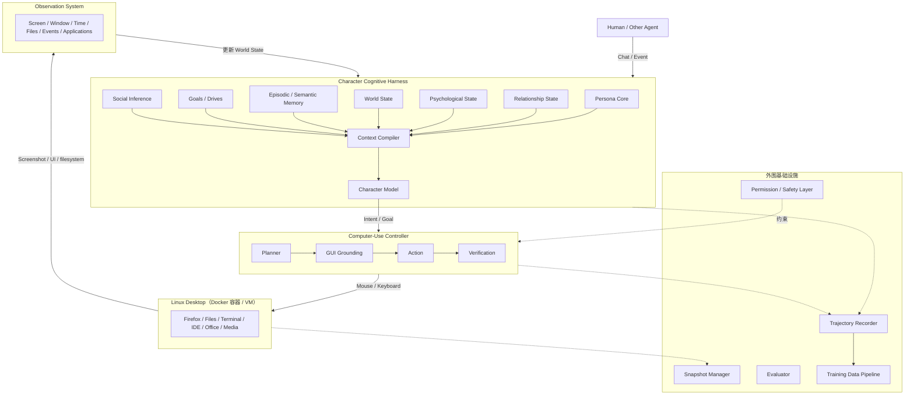

# NeuralCloud Harness 方案 · 总览与核心原则

> 本文档集是 NeuralCloud 项目的总纲。目标：为一个经过角色后训练的模型搭建完整的**认知 Harness（语境支撑系统）**与 **Linux Desktop 数字身体**，使其能够在隔离的数字环境中长期存在、自主活动、积累经验，并为后续后训练与实体机器人迁移提供数据和架构基础。
>
> 方案来源：基于模型规模-角色扮演表现研究与多轮架构讨论整理。本文档兼作全文档集索引。

---

## 1. 项目定位

我们要搭建的不是一个 chatbot，也不是一个一次性的 GUI 自动化脚本，而是：

> **Character Runtime V1 —— 一个长期运行的角色智能体运行时。**

它由两个并行但解耦的子系统构成：

| 子系统 | 职责 | 本质 |
| --- | --- | --- |
| **A. Character Cognitive Harness**（认知 Harness） | 为角色模型提供记忆、状态、关系、目标、语境和决策支撑 | 角色"基于什么现实进行思考" |
| **B. Linux Desktop Digital Body**（数字身体） | 为 AI 提供一个可以长期生活、观察和行动的数字环境 | 角色的"第一副身体" |

后训练决定角色"会如何思考"；Harness 决定角色"基于什么现实进行思考"。两者结合，才有机会让一个 20–30B 级模型获得接近更大模型的长期人物表现，同时保留本地部署所需的响应速度。

### 为什么用 Linux Desktop 当"身体"

今天的 `Screen / Mouse / Keyboard`，就是未来的 `Camera / Arm / Hand`。

数字身体阶段的观察、记忆、状态、决策、评估架构，与实体机器人时代基本同构。等系统稳定以后：

- **更换 3B / 30B / 80B 主模型** = 更换 Cognition Engine；
- **更换 Linux Desktop 为人形机器人** = 更换 Perception / Action Backend。

Harness 主体不需要推倒重来。因此本项目不是一次性的 GUI Agent 玩具，而是面向具身角色 AI 的第一代架构。

---

## 2. 十条核心设计原则

以下原则是全套方案的根基，后续所有文档中的设计决策都应能回溯到其中一条或多条。

1. **模型负责判断，程序负责现实。** 能 deterministic 获取的信息（当前窗口、时间、文件位置），绝不让 LLM 猜。LLM 只承担语义推断与生成。
2. **不要让主模型自己承担"记住世界的一切"。** 模型负责"理解与表演"，Harness 负责"事实与状态"。
3. **上下文不是越多越好，而是每个 token 都应该尽量有用。** 相关信息密度优先于上下文长度。
4. **Fast Path / Deep Path 分离。** 绝大多数简单输入走低延迟直通路径；只有高价值、高复杂度输入才触发深层推理。会话节奏（conversational rhythm）是不可牺牲的体验指标。
5. **Persona Core 锁定，Developed Self 可成长。** 核心人格由后训练与设定定义，AI 无权自行修改；生活经验形成的发展人格可以演化，但必须带证据链。角色会成长，但不会人格漂移（persona drift）。
6. **记忆是事件，不是聊天摘要；且必须带证据链。** 防止"hallucination → 写入记忆 → 检索取出 → 更强 hallucination"的记忆反馈闭环污染。
7. **Subagent 按需触发（gated），不做多模型开会。** 子代理输出结构化判断依据，绝不直接替角色说话，更不做每轮全量的多 agent 自由讨论。
8. **AI 可以自由形成经验，但不能自由决定什么是真理。** 允许观察、假设、探索、积累候选经验；不允许绕过证据累积直接改写长期事实库，不允许越过安全层取得无约束执行权。
9. **一切重要判断必须可追溯到 Observation / State / Memory。** 从第一天起完整记录 `Perception → State → Decision → Action → Outcome` 链路，否则后期调试、训练、schema 演进都不可行。
10. **Harness 可以"长出来"，而不是全部预先设计。** 初始 schema 只是起点；让 AI 在受控环境中活动，真实失败会暴露出需要新增的状态变量（如物体所有权、用户可打扰性）。

---

## 3. 总体架构

外围五套设施（Trajectory Recorder、Snapshot Manager、Evaluator、Permission/Safety、Training Data Pipeline）与主链路同等重要，从 V0 就必须存在，详见 [04-autonomy-and-data.md](04-autonomy-and-data.md)。

---

## 4. 十大核心模块

| # | 模块 | 第一阶段作用 | 实体机器人时代的对应 |
| --- | --- | --- | --- |
| 1 | Desktop Environment | AI 的数字环境 | 现实环境 |
| 2 | Observation System | 屏幕/系统感知 | 视觉/听觉/触觉 |
| 3 | Action System | 鼠标键盘 | 手脚/机械执行 |
| 4 | World State | 当前电脑世界 | 现实世界模型 |
| 5 | Memory System | 长期经验 | 长期生活记忆 |
| 6 | Persona / State | 人格与心理状态 | 同样保留 |
| 7 | Goal / Drive | 自主活动 | 自主生活 |
| 8 | Cognitive Harness | 组织判断语境 | 同样保留 |
| 9 | Evaluation / Trace | 观察并生成训练数据 | 机器人经验 |
| 10 | Safety / Permissions | 限制数字行为 | 实体安全控制 |

关键判断：**模块 1/2/3 未来会大幅替换；模块 4–9 基本可以沿用到机器人时代。** 因此接口抽象层（Perception / Action Backend）的设计质量决定本项目的长期价值。模块 1–3 详见 [03-digital-body.md](03-digital-body.md)，模块 4–8 详见 [01-cognitive-harness.md](01-cognitive-harness.md)，模块 9 详见 [04-autonomy-and-data.md](04-autonomy-and-data.md)，模块 10 贯穿所有文档。

---

## 5. 范围边界：V0 明确不做什么

为防止项目范围爆炸，第一阶段明确排除：

- **多 Agent 自由讨论**：不做"5 个模型每轮开会"。延迟、成本、误差传播、调试难度都会失控。
- **公网访问**：第一阶段 Internet = OFF，提供离线"小型数字世界"。
- **AI 自主修改 Persona Core**：核心人格锁定。
- **边运行边自动训练自己**：模型版本必须可追踪，训练是独立的离线流程。
- **真实机器人硬件**：第一阶段完全不碰实体机器人。
- **复杂分布式存储**：PostgreSQL + pgvector + 本地文件系统即可，不上 Redis / MinIO / Kafka 全家桶。
- **真实凭据**：不给真实邮箱、SSH key、API token、浏览器 cookies。

---

## 6. 里程碑总表（M0–M5）

| 里程碑 | 目标 | 一句话出口条件 |
| --- | --- | --- |
| **M0 Digital Body** | 模型能看到桌面并稳定控制鼠标键盘 | 基础 GUI 动作成功率 >95% |
| **M1 Computer Agent** | AI 可自主完成 GUI 小任务 | 完成打开文件/整理目录等任务并可验证 |
| **M2 Cognitive Harness** | 接入人格、记忆、状态、检索 | 从 GUI agent 变为 persistent character agent |
| **M3 Autonomous Life** | 无人指挥时自主活动 | Drive/Goal 系统可生成、暂停、失败、完成目标 |
| **M4 Experience Learning** | 正式产出后训练数据 | 五类数据集可从 trajectory 自动导出 |
| **M5 Long-running Experiment** | 连续运行并观察演化 | 24–72h 连续运行，数据反哺 Harness V2 |

各里程碑的目标、交付物、出口条件详见 [05-roadmap-and-stack.md](05-roadmap-and-stack.md)。

---

## 7. 文档集索引

> 完成态的、可一次性验收的方案/规格文档统一在文件名中使用 `-DONE.md`；旧路径只保留轻量兼容跳转。README、TECHNICAL、GETTING_STARTED、runbook、ADR 等持续维护文档不使用 Done 命名。

| 文档 | 内容 |
| --- | --- |
| [00-overview.md](00-overview.md) | 本文：定位、原则、范围、总架构、模块与里程碑总表 |
| [01-cognitive-harness.md](01-cognitive-harness.md) | 六层记忆/状态体系、混合检索、门控 Subagent、Context Compiler |
| [02-inference-flow-DONE.md](02-inference-flow-DONE.md) | **Done**：在线推理 9 阶段数据流、Fast/Deep Path、贯穿案例 |
| [03-digital-body.md](03-digital-body.md) | Linux Desktop 数字身体：WSL2 环境适配、观察/动作系统、快照、权限分层 |
| [04-autonomy-and-data.md](04-autonomy-and-data.md) | 渐进自治、自主驱动系统、轨迹记录、数据分级与训练闭环 |
| [05-roadmap-and-stack.md](05-roadmap-and-stack.md) | 里程碑 M0–M5、V1 验收标准、技术栈、实体机器人扩展路径 |
| [06-memory-subsystem-usage-DONE.md](06-memory-subsystem-usage-DONE.md) | **Done**：记忆子系统 V1 使用说明；对应能力已经落地 |
| [07-08-main-merge-alignment-plan-DONE.md](07-08-main-merge-alignment-plan-DONE.md) | **Done**：07 / 08 与主分支合并后的对齐方案，已批准并执行 |
| [07-homeostatic-harness-research-design.md](07-homeostatic-harness-research-design.md) | 情感陪伴型具身智能内稳态 Harness V2 研究提案：七维状态、主动推断、闭环调节与三条件长期实验 |
| [08-runtime-supervisor.md](08-runtime-supervisor.md) | Runtime Supervisor V2 架构提案：Runtime、Cognitive、Homeostatic 三服务拓扑，以及常驻循环、抢占、持久化恢复与控制面 |
| [09-character-import-and-embodied-instance.md](09-character-import-and-embodied-instance.md) | 角色导入、运行实例身份与 embodied instance 生命周期边界 |
| [10-startup-and-situational-context-plan.md](10-startup-and-situational-context-plan.md) | Runtime 启动、恢复与 situational context 组装方案 |
| [11-mistyai-body-state-integration-code-design.md](11-mistyai-body-state-integration-code-design.md) | MistyAI BodyState 接入、内感受投影、Homeostasis sensor assimilation 与实验条件隔离 |
| [12-autonomous-relationship-formation.md](12-autonomous-relationship-formation.md) | 自主关系形成的证据边界、实验条件与评测框架 |
| [13-relationship-belief-and-care-code-design.md](13-relationship-belief-and-care-code-design.md) | Relationship Belief、Other Model、other-regarding goal 与 costly care 代码设计 |
| [14-embodiment-port-and-capability-negotiation.md](14-embodiment-port-and-capability-negotiation.md) | Stable Domain Port、Canonical Contract、Provider Adapter 三层边界与 capability negotiation / 降级策略 |
| [TECHNICAL.md](../TECHNICAL.md) | 已落地代码的架构、数据流与实现细节（工程师手册） |

## 8. 环境基线（适配说明）

原始方案默认 Linux 宿主机 + KVM/QEMU + 本地 GPU。本项目实际环境为 **Windows 主机 + WSL2**，因此做如下适配（详细论证见 [03-digital-body.md](03-digital-body.md)）：

- **数字身体 V0**：Docker Desktop（WSL2 backend）容器内运行 Ubuntu + Xvfb + XFCE + xdotool/PyAutoGUI + noVNC，替代完整 VM 起步；
- **V1+ 升级路径**：WSL2 嵌套虚拟化跑 KVM/QEMU，或 Hyper-V VM；
- **模型推理**：Windows 本机 GPU。当前推荐 **Ollama**（主 30B-A3B instruct + 辅 4B instruct）；llama.cpp / vLLM 仍可用。Harness 经 OpenAI 兼容 HTTP 调用；
- **Harness 主体**：Python，可在 Windows 或 WSL2 Ubuntu 运行。当前可视化 GUI 默认跑在 Windows 本机。

所有与原始方案存在环境差异的位置，各文档均以"**适配说明**"标注，保持对应关系可追溯。