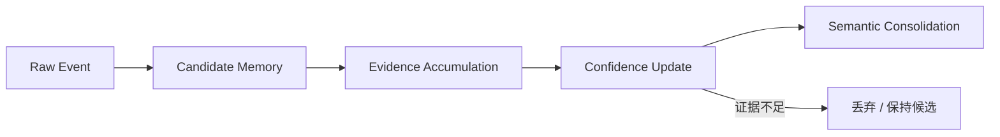
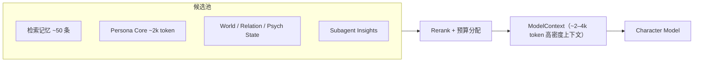
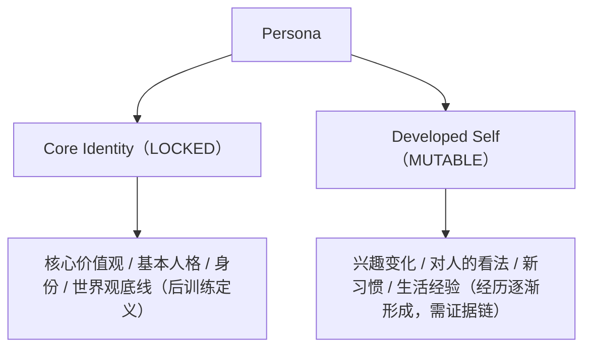

# 01 · Character Cognitive Harness（认知 Harness）

> 本文定义认知 Harness 的内部构造：六层记忆/状态体系、Dual Memory、混合检索、门控 Subagent、Context Compiler，以及贯穿全系统的核心数据结构。
>
> 核心命题：**Harness 的重要性最终不低于模型本身。** 结构化记忆与状态管理能让 8B 级模型逼近大模型的角色表现——大模型天然在一次前向中自动完成"检索 → 状态更新 → 冲突消解 → 行为选择"，而小模型可以通过外部架构补齐同一件事。

---

## 1. 设计总纲

把整个 Harness 看成一个"认知操作系统"，而不是"RAG + Prompt"：

- **RAG：一定需要。**
- **结构化数据库：比 RAG 更需要。**
- **Subagent：需要，但按需触发。**
- **多 Agent 自由讨论：不做。**

最值得追求的不是"让更多模型参与回答"，而是：

> **在主模型生成第一枚 token 之前，让它所看到的"此刻世界"尽可能正确。**

Memory-Driven Role-Playing 研究将角色行为拆为 **Anchoring（锚定人物身份）→ Selecting（选择相关记忆）→ Bounding（判断知识与行为边界）→ Enacting（生成行为）** 四阶段。Harness 的职责是替模型完成前三个阶段，让主模型专注最有价值的第四步。结构化记忆利用可以让 Qwen3-8B 接近大得多的闭源模型——这正是 Harness 价值的实证。

---

## 2. 六层记忆/状态体系

传统 RAG 解决"文档里写过什么"，角色系统要解决的是"三个月前用户随口一句话，现在是否应影响角色态度"。因此至少需要六层。

### 2.1 Persona Core —— 角色本体（Identity Layer，LOCKED）

来自后训练与角色设定，**极其稳定，AI 无权自动修改**。

```json
{
  "identity": {
    "name": "Vaelith",
    "core_traits": ["傲慢", "善良", "高自尊", "不直接表达关心"],
    "values": ["承诺必须兑现", "不轻易求助"],
    "speech_style": ["短句", "偶尔毒舌", "生气时反而正式"],
    "knowledge_boundary": ["不知道现代社会常识之外的事"],
    "locked": true
  }
}
```

为什么必须锁定：如果允许每轮聊天都对 persona 做总结覆盖，几千轮后"傲慢、有自尊"会被逐渐平均化成"温柔体贴"——这是 persona drift 的主要来源。长期人格研究（Dynamic Persona Coherence 等）明确指出，必须将**稳定身份**与**动态心理状态**分离管理。

### 2.2 Episodic Memory —— "发生过什么"

**记忆是事件，不是聊天摘要。** 不保存"用户喜欢猫"，而保存具体事件：

```json
{
  "event_id": "evt_03812",
  "time": "2026-08-14T21:32:00+08:00",
  "participants": ["user", "character"],
  "summary": "用户提到上周收养的猫生病了",
  "character_action": "放下手里的事，主动询问细节",
  "outcome": "用户情绪缓和",
  "importance": 0.72,
  "emotional_valence": -0.3,
  "evidence": ["traj_T928100_step_44", "traj_T928100_step_45"],
  "tier": "short",
  "uniqueness": 0.72,
  "expire_at": "2026-08-14T22:02:00+08:00",
  "hit_count": 0
}
```

写入默认 `tier=short`，并打 `uniqueness`（0–1）与 `expire_at`。低 uniqueness 在 5–30 分钟后到期，高 uniqueness 留存更久。到期时小模型决定升格 `mid`/`long` 或标记 `forgotten`；检索中反复命中也会 `short → mid → long`，或刷新短期窗口。遗忘是标记而不是删除，`forgotten` 不进入检索池。结构化长期认识仍走独立的 Semantic 固化管线（§2.3 / §5），与 tier 并存。

### 2.3 Semantic Memory —— "已经形成的认识"

长期重复事件抽象为稳定认识。Episodic 是"我记得那次具体发生了什么"，Semantic 是"我知道这个人喜欢什么"。

```json
{
  "fact_id": "sem_0019",
  "subject": "user",
  "predicate": "preference",
  "value": "喜欢猫",
  "confidence": 0.86,
  "supporting_events": ["evt_03812", "evt_02941", "evt_01877"],
  "formed_at": "2026-08-15T08:00:00+08:00"
}
```

升级路径必须是 `候选记忆 → 证据累积 → 置信度更新 → 语义固化`（详见 §5 Memory Writer）。

### 2.4 Relationship State —— 人物关系（独立数据库层）

角色 AI 最容易被忽视的一层。**单独设计数据库，不靠 prompt 隐含表示。**

```json
{
  "relation_id": "rel_user_001",
  "target": "user",
  "closeness": 0.68,
  "trust": 0.74,
  "attachment": 0.55,
  "recent_tension": 0.31,
  "shared_history_summary": "共同经历过三次重要事件",
  "last_major_event": "evt_03812",
  "updated_at": "2026-08-20T22:10:00+08:00"
}
```

同一句"你又来了？"，面对 closeness=0.1 和 0.9 的人，表达方式完全不同。大模型擅长的 `persona × relationship × context` 乘积，Harness 可以**替小模型提前算好其中一部分**——14B/30B 不必自己从几万 token 历史中重新推导关系，模型只负责"在这个状态下角色会怎样表现"，难度大幅下降。

### 2.5 Psychological State —— "角色现在是什么状态"（L/M/S 三层）

不能写进长期 persona。采用 Dynamic Persona Coherence 的 Long / Mid / Short 三层心理状态：

| 层 | 时间尺度 | 示例 |
| --- | --- | --- |
| **Long** | 几乎永久 | "对被背叛高度敏感"（源于核心经历） |
| **Mid** | 几小时～几个月 | "最近在准备一个作品，处于专注期" |
| **Short** | 几秒～几小时 | "刚被用户打断了思路，略有烦躁" |

```json
{
  "psych_state": {
    "long": {"sensitivity_to_betrayal": 0.85},
    "mid": {"current_focus": "project_alpha", "energy_level": 0.6},
    "short": {"mood": "slightly_irritated", "arousal": 0.4, "ttl_seconds": 7200}
  }
}
```

这层解决一个关键问题：**人格稳定 ≠ 每次反应完全一样。**

### 2.6 World State —— 数字身体当前生活的现实

```json
{
  "world": {
    "time": "2026-08-21T13:54:00+08:00",
    "active_application": "Firefox",
    "active_window_title": "本地 Wiki - 角色设定",
    "open_windows": ["Files", "Terminal"],
    "recent_files_modified": ["~/Documents/Notes/2026-08-21.md"],
    "user_presence": "active",
    "user_activity": "reading"
  }
}
```

原则：**能 deterministic 获取的直接由程序获取**（当前窗口、时间、文件位置），不问模型"你现在在哪个程序"。SQL / KV 风格状态存储比向量库更适合这一层。

---

## 3. Dual Memory：事实与角色视角分离

不只保存"发生了什么"，还要保存"**这个角色认为这件事意味着什么**"。

```json
{
  "event_id": "evt_04010",
  "objective_fact": "用户昨晚 23:40 说'你以后不用管我了'，随后关闭了对话窗口",
  "persona_conditioned_insight": "她说'不用管'的时候处于情绪激动状态；以她的表达习惯，这是寻求关注而非真实拒绝",
  "insight_confidence": 0.64,
  "supporting_evidence": ["evt_02201", "rel_user_001.history"]
}
```

事实完全一样，但不同角色的人格化解读完全不同。DualMem / RoleMemo 类工作表明：4B 模型配合这种分离设计，持续人格表现可以超过使用大模型的 persona-agnostic 记忆框架。这让世界第一次真正出现"**不同人物对同一现实拥有不同认识**"——对角色扮演是质变。

---

## 4. 混合检索（Hybrid Retrieval）与反向检索

### 4.1 检索不是普通 Top-K 向量搜索

评分至少结合六个信号（权重后续用真实数据训练调优）：

```
Score = 0.30·S_semantic
      + 0.15·S_entity
      + 0.10·S_recency
      + 0.15·S_importance
      + 0.15·S_relationship
      + 0.15·S_persona
```

示例：用户突然说"还记得那场雨吗？"。普通 embedding 会搜出所有"雨"的记录；但角色真正需要的可能是"两年前两人关系第一次重大变化的那场雨"。因此 importance、participants、relationship delta 必须进入检索。

检索前先形成**检索计划**，而非直接把用户原句丢给 embedding：

```json
{
  "retrieval_plan": {
    "time_scope": "yesterday",
    "entities": ["user", "character"],
    "event_type": "commitment_or_statement",
    "emotional_relevance": "high",
    "channels": ["chat"]
  }
}
```

### 4.2 反向检索（Conflict Retrieval）

不只检索"与当前话题相似的记忆"，还要检索"**可能与当前判断冲突的记忆**"。例如当前推断"用户现在信任度很高"时，数据库应同时尝试找到"用户上周明确表达过失望"的反证，交给系统仲裁。这样才能避免角色越来越相信自己错误的总结。

---

## 5. Memory Writer：必须独立的组件

**不能**让模型输出直接写入长期记忆。**必须**走候选与证据链：



```json
{
  "candidate_memory": {
    "claim": "用户不喜欢被突然打扰",
    "source": "inference_from_evt_03955",
    "confidence": 0.35,
    "status": "candidate",
    "evidence": ["evt_03955"]
  }
}
```

没有这条管线，就会构成危险闭环：**hallucination → 写入 memory → RAG 取出 hallucination → 模型看到"数据库都这么写" → 越来越确信**。Inside Out 类工作已验证轻量级 MemListener（1–3B 小模型即可担任）输出结构化 `ADD / UPDATE / DELETE / NO_OP` 操作、维护演化中的长期 PersonaTree 是可行的——**微模型非常适合当 memory daemon，而不是当最终角色。**

---

## 6. 门控 Subagent（Gated Subagent Architecture）

原则：**不要让所有 subagent 每轮都运行。** 简单输入走 Fast Path 直通；复杂情况才触发。且 subagent **不回答用户**，只给主角色模型提供结构化判断依据。

V1 只做三个，不一开始做十几个：

### 6.1 Memory Curator

职责：候选记忆筛选、证据累积、冲突检测、语义固化建议。可由 1–3B 小模型承担。

```json
{
  "curator_output": {
    "ops": [
      {"op": "ADD", "type": "episodic", "ref": "evt_04021", "importance": 0.6},
      {"op": "UPDATE", "type": "semantic", "ref": "sem_0019", "confidence_delta": 0.05},
      {"op": "NO_OP", "reason": "evidence_insufficient"}
    ]
  }
}
```

### 6.2 Social / Intent Interpreter

有人与角色互动时，判断"用户到底是什么意思"。输入为当前交互 + 相关状态，输出假设与置信度：

```json
{
  "social_inference": {
    "surface_act": "questioning",
    "possible_intents": [
      {"intent": "seeking_reassurance", "confidence": 0.58},
      {"intent": "testing_boundary", "confidence": 0.27}
    ],
    "recommended_stance": "acknowledge_without_overexplaining",
    "constraint": "avoid_explicit_psychological_explanation"
  }
}
```

最后一条约束至关重要：subagent 可以知道"用户在寻找安全感"，但角色不能张嘴说"我检测到你正在寻求关系确认"——否则角色扮演直接死亡。

### 6.3 Experience Evaluator

一段活动结束后做离线复盘：判断是否成功、哪里出错、是否值得进入训练数据。必须结合**外部证据**（文件系统状态、应用状态、屏幕状态、测试），防止"自己提出任务 → 自己宣布成功"的自我确认偏差。

> V1 未实现本模块（离线复盘依赖数字身体外部证据）。在线链路只落地 Memory Curator 与 Social Interpreter。

---

## 7. Context Compiler：Harness 最值得认真做的模块之一

数据库最终可能有几百条记忆、几千 token 的 Persona Core、完整世界状态、subagent 推理——**不能全塞进 prompt**。Context Compiler 负责 Context Budget Management：



假设当前请求检索 50 条记忆，rerank 后可能只给模型 5 条。原则重申：**上下文越长 ≠ 上下文越好；真正重要的是相关信息密度。**

---

## 8. 核心数据结构

### 8.1 SituationState —— Harness 内部 canonical state

所有模块不互发自然语言"小作文"，统一传结构化对象。SituationState 是整个 Harness 最核心的中间对象——**它是机器内部状态，还不是 prompt**。`relevant_memories` 最多陈列 5 条：

```json
{
  "situation_id": "sit_55201",
  "trigger": {"type": "user_message", "ref": "evt_04030"},
  "actor": {"persona_core_ref": "persona_v3", "psych_state": {"short": {"mood": "guarded"}}},
  "relationship": {"target": "user", "closeness": 0.68, "recent_tension": 0.31},
  "world": {"time": "2026-08-21T13:54:00+08:00", "active_application": "Firefox"},
  "relevant_memories": [
    {"event_id": "evt_04010", "relevance": 0.91, "why_retrieved": ["entity:user", "commitment_conflict"]}
  ],
  "hypotheses": [
    {"about": "user_intent", "value": "seeking_reassurance", "confidence": 0.58}
  ],
  "complexity": {"score": 0.74, "requires_deep_path": true}
}
```

### 8.2 ContextPackage —— 全链路统一传输对象

```typescript
interface ContextPackage {
  situation: SituationState;
  personaCore: PersonaCore;          // 锁定层，只读
  developedSelf: DevelopedSelf;      // 可成长层，带证据链
  relationship: RelationshipState;
  psychState: PsychState;            // L / M / S 三层
  worldState: WorldState;
  memories: ScoredMemory[];          // 含 why_retrieved 追踪
  insights: StructuredInsight[];     // subagent 结构化输出
  budget: ContextBudget;             // token 预算分配
  provenance: ProvenanceRecord;      // 每条上下文来源可追踪
}
```

整个流水线就是在不断地**变换与富化这个对象**，而不是拼接字符串。前者容易 debug、测试和后训练；后者几乎不可维护。

V1 落地时没有单独的 `ContextPackage` 类：`SituationState` 是 Harness 内部 canonical state；Compiler 产出的 `ModelContext`（分段 + 预算 + provenance）才是送进主模型的对象。设计期的 `ContextPackage` 对应这两份对象的并集。实现细节见 [TECHNICAL.md](../TECHNICAL.md) §4–5。

---

## 9. Persona 双层结构：成长而不漂移



预期效果：**同一个 base character，在不同家庭生活几年后，会长成有细微差异的"同一个人"**——而不是每台实例永远完全一样，也不是逐渐漂回默认 assistant。

> 注意：所有规模模型都会发生 persona drift（3B 漂得快，30B 漂得慢，80B+ 更慢更隐蔽）。长期角色系统必须依靠角色记忆、状态数据库、关系变量、事件摘要、persona refresh 等外部机制对冲——这正是本 Harness 存在的意义。

---

## 10. 与其他文档的关系

- 状态/记忆如何在单轮对话中被消费：见 [02-inference-flow.md](02-inference-flow.md)（在线推理数据流）。
- World State 如何从数字身体采集：见 [03-digital-body.md](03-digital-body.md)。
- 记忆如何离线演化、反哺训练：见 [04-autonomy-and-data.md](04-autonomy-and-data.md)。
- 存储选型（PostgreSQL + pgvector + 原始日志）：见 [05-roadmap-and-stack.md](05-roadmap-and-stack.md) §技术栈。
- 记忆子系统 V1 代码如何安装与调用：见 [06-memory-subsystem-usage.md](06-memory-subsystem-usage.md)。
- 已落地代码的架构与实现细节：见 [TECHNICAL.md](../TECHNICAL.md)。
