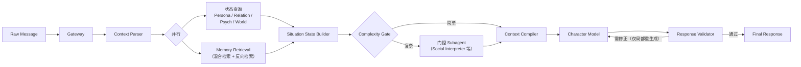

# 02 · 在线推理数据流（Online Inference Path）

> 本文定义从"他人向角色说一句话"到"角色回答被发出"之间经过的完整数据流。只描述**在线推理主链路**；训练、离线记忆整理、人格更新等后台流程见 [04-autonomy-and-data.md](04-autonomy-and-data.md)。
>
> 全链路用一个贯穿案例演示：用户对角色说——**"你昨天不是说不会再管我了吗？"**

---

## 1. 核心同步链路



一条必须遵守的元原则：

> **越好的 Harness，最终主模型承担的工作越纯粹。** Harness 完成 Anchoring / Selecting / Bounding（锚定身份、选择记忆、界定边界），主模型只做 Enacting——**persona-conditioned decision + generation**。

不是让模型自己从 50,000 token 里找昨天发生了什么、自己判断关系、自己检查世界状态、自己记人格，最后再表演；而是 Harness 已把这一切整理成高密度的 ModelContext。

---

## 2. 逐阶段定义

### 阶段 1 · Gateway：输入不是字符串，是事件

别人对角色说"你昨天不是说不会再管我了吗？"，进系统时不应只是 `{"text": "..."}`，至少标准化为 `InteractionEvent`：

```json
{
  "event_id": "evt_04030",
  "timestamp": "2026-08-21T13:54:00+08:00",
  "channel": "chat",
  "speaker": "user",
  "modality": "text",
  "raw_text": "你昨天不是说不会再管我了吗？",
  "session_id": "sess_0881"
}
```

从第一步起，系统处理的就是**事件（Event）**而非字符串（String）——这是整个 Harness 的基础。

### 阶段 2 · Context Parser：理解输入结构，但不裁决语义

Parser 可能把这句话处理成：

```json
{
  "parsed": {
    "speech_act": "question",
    "references": [{"type": "past_event", "time_hint": "yesterday", "about": "character_statement"}],
    "possible_social_intent": {"value": "seeking_reassurance", "confidence": 0.58},
    "emotion_cues": {"hurt": 0.5, "testing": 0.3}
  }
}
```

原则：**Parser 不宣布"用户是在撒娇"，而输出 `hypothesis + confidence`。** 对人的判断经常存在歧义，Harness 必须保存假设与置信度，而不是过早把猜测变成事实。

### 阶段 3 · 并行状态查询（响应速度优化的关键）

Parser 完成后**并行**查询四类状态：

```yaml
# Persona Core
identity: 傲慢但善良；不直接表达关心；生气时会变正式

# Relationship State
target: user
closeness: 0.68
recent_tension: 0.31        # 昨天发生过争执

# Current Psychological State
short: guarded, slightly_defensive

# World State
time: 2026-08-21 13:54
channel: chat
user_presence: active
```

### 阶段 4 · Memory Retrieval：找到"昨天那件事"

不能只对原句做 embedding，先形成检索计划：

```json
{
  "retrieval_plan": {
    "time_scope": "yesterday",
    "entities": ["user", "character"],
    "event_type": "commitment_or_statement",
    "channels": ["chat"]
  }
}
```

混合检索（评分公式见 [01-cognitive-harness.md](01-cognitive-harness.md) §4）命中关键记忆：

```json
{
  "event_id": "evt_04010",
  "objective_fact": "用户昨晚 23:40 说'你以后不用管我了'，随后关闭对话窗口",
  "persona_conditioned_insight": "角色当时处于愤怒状态；该表述在其表达习惯中属于气话",
  "insight_confidence": 0.64,
  "relevance": 0.91,
  "why_retrieved": ["entity:user", "time:yesterday", "commitment_conflict"]
}
```

注意这里检索到的是 **Dual Memory**：客观事实 + 角色视角解读。主模型看到的不是"数据库说她承诺不管了"，而是"她确实说了这句话，但当时的心理状态表明那是愤怒中的表达"——这极大提高行为合理性。

### 阶段 5 · Situation State Builder：汇成 canonical state

到此产生整个 Harness 最核心的中间对象 `SituationState`（完整定义见 [01-cognitive-harness.md](01-cognitive-harness.md) §8.1）：触发事件、人格、关系、心理、世界、相关记忆、假设与置信度、复杂度评分。**它是机器内部状态，还不是 prompt。**

### 阶段 6 · Complexity Gate：决定走哪条路

这一步决定整个请求的延迟与成本。

| 输入示例 | complexity score | 路径 |
| --- | --- | --- |
| "早上好。" / "你在干嘛？" / "一起吃饭吗？" | ~0.1 | Fast Path 直通 |
| "你还记得昨天你说了什么吗？" | ~0.42 | Deep Path（带日期的记忆探针强制走深路径） |
| "你昨天不是说不会再管我了吗？" | ~0.74 | Deep Path，触发 Social Interpreter |
| "你还记得三个月前答应我的事情吗？" | ~0.8 | Deep Path + 深检索 |
| "如果救我意味着放弃你一直追求的目标呢？" | ~0.9 | Deep Path + 多 subagent |

除打格外，以下信号组合**强制** Deep Path（`_force_deep`）：价值冲突；`three_months` / `last_month` 级远程时间；承诺词 +（时间词或记忆探针）；记忆探针 + 时间词。

#### 灰色地带仲裁

规则打分落在灰色区 `[complexity_gray_lower, complexity_threshold)`（默认 `[0.15, 0.5)`）时，Pipeline 会用小模型做一次仲裁（prompt 附规则得分与已命中信号作为弱先验，模型可按语义推翻正则表——例如识别"8月20号"这类具体日期、间接表达）。仲裁**只升不降**：可能把 Fast 提升为 Deep，不会把规则判定的 Deep 降为 Fast。`complexity_gray_lower` 可用 `NC_COMPLEXITY_GRAY_LOWER` 覆盖；MockLLM 或仲裁异常时完全回退规则判定，仲裁结论记录在 gate trace 的 `reasons` 中（`llm_arbitrated:deep|fast`）。两端区间（明显简单 / 明显复杂 / 强制规则命中）不产生额外调用。

复杂输入触发 Social Interpreter（拿到完整 SituationState）：

```json
{
  "social_inference": {
    "possible_intents": [
      {"intent": "seeking_reassurance", "confidence": 0.58},
      {"intent": "resentment_check", "confidence": 0.3}
    ],
    "relationship_delta_expected": "positive_if_handled_well",
    "recommended_stance": "承认昨天的话，但用角色自己的方式，不过度解释",
    "constraint": "avoid_explicit_psychological_explanation"
  }
}
```

最后一条约束是红线：subagent 知道"用户在寻找安全感"，但角色绝不能说"我检测到你正在寻求关系确认"。

### 阶段 7 · Context Compiler：制作真正送进主模型的上下文

此时手里可能有几百条记忆、几千 token 的 Persona Core、世界状态、关系状态、subagent 推理——**不能全塞进去**。Compiler 按预算编译出高密度 ModelContext，大约 2–4k token：精简人格锚点 + 当前心理状态 + 关系状态 + 3–5 条最相关记忆（含角色视角解读）+ 结构化社交判断 + 近期对话窗口。

### 阶段 8 · Main Model：唯一负责"演出"的组件

主模型收到编译后的 ModelContext，承担全链路最有价值的一步：**persona-conditioned decision + generation**。模型选型与推理性能见 [05-roadmap-and-stack.md](05-roadmap-and-stack.md)。

### 阶段 8.1 · 连说循环与自主收尾

角色可以在用户不再说话的情况下继续说下一段（追补、换话题）。**是否继续由主模型判断**，Harness 只负责循环与硬性兜底——符合「模型负责判断，程序负责现实」。

**标记约定**（只认段尾；标记不会展示给用户）：

| 段尾标记 | 含义 |
| --- | --- |
| `[CONTINUE]` | 还有话要说。Harness 复用同一 `ModelContext`，追加续说指令后再生成下一段 |
| `[END]` 或无标记 | 这轮说完。无标记默认收尾，避免漏标导致死循环 |

循环条件：每段先走现有 Validator（含局部重生成），再剥离标记。正文为空则立即停止（`stopped_by=empty`），且不写入会话窗。

程序兜底：

- `max_reply_segments`（默认 3）到达后强制收尾（`stopped_by=max_segments`）；
- `continuation_enabled=false` 时退回单段生成（`stopped_by=disabled`）。

多段在会话窗里各成一条气泡；写入长期记忆时角色侧仍是**一条** episodic（全文拼接），避免记忆碎片化。

### 阶段 9 · Response Validator：生成后不立即发送

假设主模型生成：

> "因为我还是担心你啊。昨天只是生气了，说的都是气话。对不起。"

语言没问题，但可能严重违反这个角色（不直接表达关心、不轻易道歉、高自尊）。Validator 对照 Persona Core 与状态输出：

```json
{
  "verdict": "revise",
  "violations": ["direct_care_expression", "premature_apology"],
  "severity": 0.72,
  "instruction": "保持嘴硬的表达外壳，关心只能通过行动或迂回措辞体现"
}
```

**不重跑整个 pipeline，只做局部重生成。** 修正后：

> "……我说的是不想管。"
>
> 她把视线挪回书上。
>
> "又没说真的会不管。"

更符合人物。Dynamic Persona Coherence 的 Persona Consistency Critic + Drift Suppressor 已验证这类闭环对 persona coherence 有显著改善。但注意：Validator 若每句全量运行会使延迟翻倍，因此 Fast Path 上应轻量化或采样运行（见 §3）。

#### 空记忆防捏造

当检索结果为空（`relevant_memories` 为空，连回退候选都没有）时，Compiler 会注入一条红线 segment（`no_fabricated_memory`）：禁止编造共同经历、引用不存在的往事或对话，不记得就坦率回应。Validator 侧同步激活 `fabricated_memory` 检测（`memory_empty=True` 时）：回复若引用"你上次说过/我们以前"等不存在的共同过去，直接判 `revise` 并附重写指令。两条路径都生效——Fast Path 靠生成端红线约束，Deep Path 外加全量校验兜底。

---

## 3. Fast Path / Deep Path 分流

### Fast Path（绝大多数普通聊天）

`Gateway → Parser → 状态查询（缓存优先）→ Compiler → Main Model → 轻量 Validator → 输出`

要求低延迟；subagent 不触发；Validator 轻量或采样运行。

### Deep Path（高价值输入）

触发条件（满足其一即可）：

- 涉及历史承诺 / 久远记忆（"三个月前……"）；
- 高歧义社交信号（言行不一致、潜台词重）；
- 剧情重大选择 / 价值观冲突；
- complexity score 超过阈值。

Deep Path 才值得多跑几个 inference pass（Social Interpreter、反向检索仲裁、完整 Validator）。

---

## 4. 延迟预算（面向未来语音/具身形态的参考）

以下是把本链路搬进"1.5 秒内开始回复"目标时的工程预算参考（当前桌面形态不必严格执行，但架构必须留出空间）：

| 环节 | 目标预算 |
| --- | --- |
| 结束语音检测 + ASR finalize | 200–350 ms |
| Harness / RAG / 状态 | 30–100 ms |
| 条件 Subagent | 0–150 ms |
| Context compile | <20 ms |
| 主模型 TTFT | 150–300 ms |
| 首个 TTS chunk 就绪 | 70–200 ms |
| TTS 首音频 | 80–200 ms |
| **Fast Path 总计** | **约 0.5–0.9 s** |
| **Deep Path 总计** | **约 0.8–1.3 s** |
| 预留抖动 | 约 0.2 s |
| **设计 SLA** | **≤1.5 s（P95）** |

两个关键工程手段：

1. **流式重叠**：绝不等主模型整句生成完再启动 TTS；LLM generation 与 TTS 重叠进行。
2. **预测式计算**：用户还在说话时（ASR 部分结果），Harness 就提前开始检索与状态装配——用户说话的 3–5 秒也是机器的计算时间。

---

## 5. 九阶段与数据对象总表

| 阶段 | 输入 | 输出 |
| --- | --- | --- |
| Gateway | Raw Message | `InteractionEvent` |
| Parser | InteractionEvent | `ParsedInteraction`（hypothesis + confidence） |
| Retrieval | ParsedInteraction | `RelevantMemory[]`（含 why_retrieved） |
| State Builder | 世界/人格/关系/记忆 | `SituationState` |
| Cognitive Router | SituationState | `InferenceRequest`（Fast/Deep 决策） |
| Subagents | InferenceRequest | `StructuredInsight[]` |
| Context Compiler | 所有上述数据 | `ModelContext` |
| Character Model | ModelContext | `CandidateResponse`（段尾可带 `[CONTINUE]` / `[END]`） |
| Validator | CandidateResponse + State | `ValidationResult`（不通过则局部重生成） |
| Continuation | 校验后的段落 | `FinalResponse`（`text` / `segments` / `stopped_by`） |

---

## 6. 一句话工程定义

这套系统实际是：`Event → Understanding → World State + Memory + Persona → Situation → Judgment → Expression`。从角色视角看，就是"发生了什么 → 这对我意味着什么 → 我此刻是谁、处于什么状态 → 我该怎么做 → 我该怎么表现"——最后一步才是**生成文字**。

真正的模型输入不应只是 `messages[]`，而应演化为结构化 `ContextPackage`。此时搭建的已不再是普通 LLM wrapper，而是一个轻量的 **Character Cognitive Runtime**；后训练模型则是这个 runtime 中最关键的人物决策与表达引擎。
