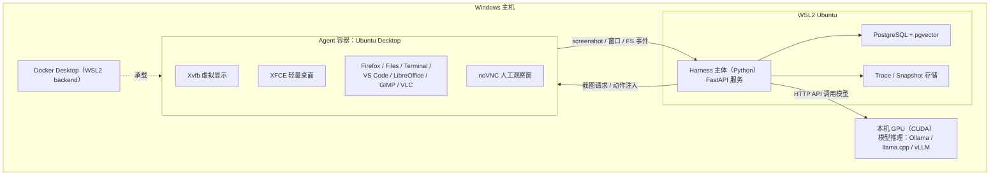
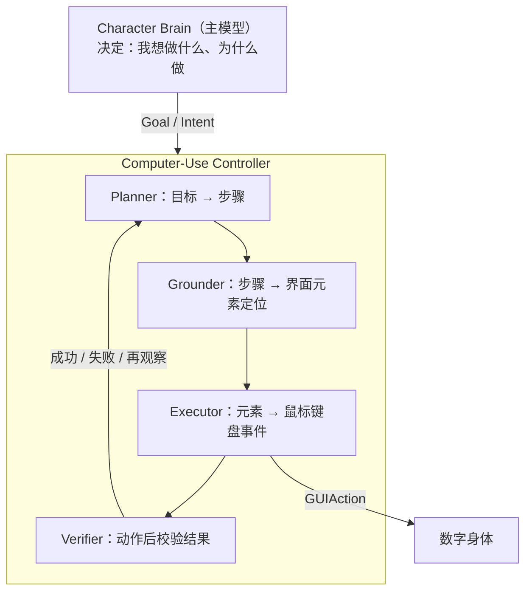

# 03 · Linux Desktop 数字身体（Windows + WSL2 适配版）

> 本文定义数字身体子系统：隔离环境、观察系统、动作系统、快照管理、权限分层。
>
> 定位：Linux Desktop 是角色 AI 的**第一副身体**——在装上机械身体之前，先在数字环境中完成"Observe → Think → Act → Observe → Learn"闭环。OSWorld 已证明 Ubuntu 桌面 + 鼠标键盘 action space 的可行性。

---

## 1. 环境拓扑与适配决策

### 适配说明（对原方案的主要修改点）

原方案默认 `Linux Host → KVM/QEMU → Ubuntu Agent VM`，模型与 Harness 同机部署。本项目实际环境为 **Windows 主机 + WSL2**，适配为：



### 虚拟化方案对比与选型

| 方案 | 隔离性 | 快照能力 | GUI 自动化便利性 | V0 采用 |
| --- | --- | --- | --- | --- |
| **Docker（WSL2 backend）+ Xvfb** | 中（容器级） | 镜像层 + `docker commit` | 极高（XTEST 注入、无嵌套虚拟化开销） | **首选** |
| WSL2 嵌套虚拟化 + KVM/QEMU | 高（VM 级） | 强（libvirt snapshot/overlay） | 中 | V1+ 评估 |
| Hyper-V VM | 高（VM 级） | 强（检查点） | 中 | V1+ 备选 |

**V0 首选 Docker + Xvfb 的理由**：第一阶段目标是快速验证"观察 → 决策 → 动作 → 记录"闭环；Xvfb 提供确定的虚拟显示器，xdotool/PyAutoGUI 经 XTEST 注入输入，截图直接从 X 抓取，无需穿透完整 VM 图形栈。OSWorld 系环境同样证明 desktop agent 环境可以容器化。

**V1+ 升级触发条件**：需要更强隔离（不可信代码执行）、需要完整系统级快照回滚做严格 A/B 重放、或需要模拟多机/多用户环境时，迁移到 WSL2 嵌套 KVM（需先检测嵌套虚拟化支持）或 Hyper-V VM。**Observation / Action 接口已经抽象（见 §3、§4），迁移时 Harness 主体不动。**

Wayland 不用于第一阶段：Wayland 的应用隔离对通用输入注入限制更多；第一阶段 GUI 自动化最重要的是简单、确定、容易 debug，故选 Xorg/Xvfb。

### 模型推理部署

- 主模型与辅助小模型运行在 **Windows 本机 GPU**，以 OpenAI 兼容 HTTP API 暴露给 Harness。当前推荐 **Ollama**（主 `neuralcloud-main` + 辅 `qwen3:4b-instruct`）；llama.cpp / vLLM 仍可用。
- Harness 主体（Python）跑在 WSL2 Ubuntu，与模型推理、数字身体容器三者解耦——任何一环都可独立替换。
- 模型规格建议与硬件对照见 [05-roadmap-and-stack.md](05-roadmap-and-stack.md)。

---

## 2. Agent 环境：一个真正的"账号"

给 AI 一个属于自己的用户身份与家目录：

```yaml
hostname: eva-sandbox-01
user: vaelith
home: /home/vaelith/
```

```text
/home/vaelith/
├── Desktop/
├── Documents/
├── Downloads/
├── Pictures/
├── Music/
├── Projects/
└── Memory/
```

第一阶段预装一个**离线"小型数字世界"**（Internet = OFF）：Firefox/Chromium、Files、Terminal、LibreOffice、VS Code、GIMP、VLC、Calculator、Text Editor、简单小游戏、本地 Wiki/知识库、本地文档库。后期再加 Blender、开发环境、模拟邮件、模拟聊天、本地社交网站、synthetic NPC。

观察价值示例：如果没人要求它整理电脑，它会不会逐渐建立自己的文件组织方式？两个月后 `Documents/` 下自发出现 `Notes / People / Projects / Things_I_Learned` 这类结构，就是真正的 **behavioral phenotype**（角色行为风格）数据。

---

## 3. Observation System：AI 怎么"看电脑"

不要只做 screenshot。设计统一 `Observation` 对象：

```typescript
interface Observation {
  timestamp: string;
  screenshot_ref: string;          // 对象存储引用，不入库
  active_window: WindowInfo;
  window_list: WindowInfo[];
  a11y_tree?: A11yNode;            // 可获取时附带
  fs_events: FileSystemEvent[];    // inotify 增量
  running_apps: string[];
  time_context: TimeContext;
}
```

第一版至少包含：screenshot、active_window、time、可见实体；后续扩展 a11y tree、声音事件、系统通知。

第一阶段采用 **Screenshot + 可获得的 A11y/系统状态**，而非坚持纯视觉。理由：项目目标是研究"人格 Agent 如何长期生活和积累经验"，视觉 grounding 是子问题，不应吃掉整个项目。感知后端抽象后，未来换成摄像头/麦克风/触觉皮肤时 Harness 主体不变。

---

## 4. Action System：第一版数字运动神经

### 4.1 统一动作抽象

```typescript
type GUIAction =
  | { type: "move"; x: number; y: number }
  | { type: "click"; button?: "left" | "right" | "middle" }
  | { type: "double_click" }
  | { type: "drag"; x1: number; y1: number; x2: number; y2: number }
  | { type: "type"; text: string }
  | { type: "press"; key: string }
  | { type: "hotkey"; keys: string[] }
  | { type: "scroll"; amount: number }
  | { type: "wait"; ms: number }
  // 三个特殊控制动作
  | { type: "DONE" }      // 任务完成
  | { type: "WAIT" }      // 等待环境变化
  | { type: "ASK" }       // 向人类请求信息
  | { type: "OBSERVE" };  // 本步不行动，再观察一次
```

`OBSERVE` 很重要：现实 agent 不应每次 inference 都必须产生动作。该 action space 与 OSWorld 的 PyAutoGUI 类接口同构，外部 benchmark 可直接复用。

### 4.2 高层认知与 GUI grounding 分层（关键架构决策）

**不要**让 Character Model 输出坐标，也不要强行让它学习"文件管理器图标的 X 坐标是多少"。分层如下：



示例：主模型输出 `{"goal": "打开 Documents 中昨天写的日记", "reason_summary": "我想确认昨天记录的事情", "priority": 0.61}`，Controller 再执行"找到 Files → click → 找到 Documents → double click → 找到 journal.md → double click"。

这与未来机器人完全同构：`Character Brain → Goal → VLA/Skill System → Action → Robot body`。Agent S2 等 computer-use 研究也已验证 generalist planning 与 specialist grounding 分层的优越性。

---

## 5. Snapshot Manager：可复现实验的根基

三个层级的快照：

| 层级 | 内容 | 机制 | 用途 |
| --- | --- | --- | --- |
| **环境快照** | 完整桌面状态 | 镜像 tag / `docker commit`（V1+ 换 VM disk snapshot） | 出错回滚 |
| **状态快照** | DB 中全部 state/memory | PostgreSQL 定时导出 | 记忆/状态回溯 |
| **实验快照** | 环境 + 状态 + 模型版本 + prompt/schema 版本 | 组合元数据记录 | 严格 A/B 重放 |

价值：`snapshot #4721` 恢复后，用**完全相同的状态**分别跑 3B / 14B / 30B / 70B 模型比较行为差异——这本身就是极好的研究数据，也是未来最强的 A/B benchmark 框架。

---

## 6. 权限与网络分层

**权限层必须从 V0 存在，而不是以后补。** agent runtime 的通行教训：一旦暴露文件系统/网络，等于把同等访问能力交给 agent。

### 6.1 网络开放阶段

| Phase | 开放范围 |
| --- | --- |
| Phase 0 | 完全离线 VM/容器（本地小世界） |
| Phase 1 | 本地知识服务器（局域网 Wiki/文档） |
| Phase 2 | Internet allowlist（白名单站点） |
| Phase 3 | 通用 web，不可登录任何账号 |
| Phase 4 | 沙箱账号（专用测试邮箱/账号） |
| Phase 5 | 真实外部动作——必须经许可门（permission gate） |

第一天绝不给：真实邮箱、GitHub token、SSH key、银行卡、云平台账号、个人浏览器 cookies。这不是对模型"不信任"，是正常的软件权限工程。OSWorld 2.0 显示顶尖 agent 在 500 步长程任务上的完整成功率仍只有约 20%，且存在误判隐藏状态、缺少验证等问题——前期放任公网会严重污染实验。

### 6.2 数字行为的 Risk Engine（对应未来的实体安全层）

即使在数字世界，动作也按风险分级：

```text
LOW      → 自动执行（浏览文件、打开应用、写自己的笔记）
MEDIUM   → 降速/二次确认执行（删除自己创建的文件、修改系统设置）
HIGH     → 请求人类确认（安装软件、访问新域名、发送任何消息）
FORBIDDEN → 拒绝执行（读写宿主文件、访问凭据目录、对外发布内容）
```

这套 Risk Engine 的接口与未来实体机器人的独立 Safety Controller 同构：上层可以要求执行，安全层有权说"不"。

---

## 7. 与 Harness 的接口

数字身体对认知 Harness 只暴露两个抽象端口：

- **Perception Backend**：`observe() → Observation`（当前为 screenshot+a11y+fs events；未来为 camera+mic+tactile）
- **Action Backend**：`act(Goal) → ActionResult`（当前为鼠标键盘；未来为机械执行器）

只要这两个接口保持稳定，**数字身体与实体机器人对 Harness 完全透明**——这就是"今日之 Screen/Mouse/Keyboard，即未来之 Camera/Arm/Hand"的工程落实。

---

## 8. 与其他文档的关系

- 观察到的世界如何进入六层状态：见 [01-cognitive-harness.md](01-cognitive-harness.md)。
- 动作决策在单轮链路中的位置：见 [02-inference-flow.md](02-inference-flow.md)。
- 自主活动（无外部指令时的行为来源）与轨迹记录：见 [04-autonomy-and-data.md](04-autonomy-and-data.md)。
- M0 里程碑（数字身体打通）的验收标准：见 [05-roadmap-and-stack.md](05-roadmap-and-stack.md)。
