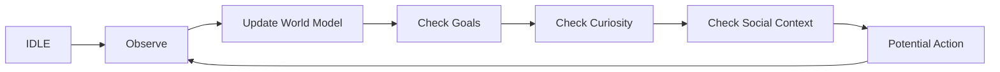
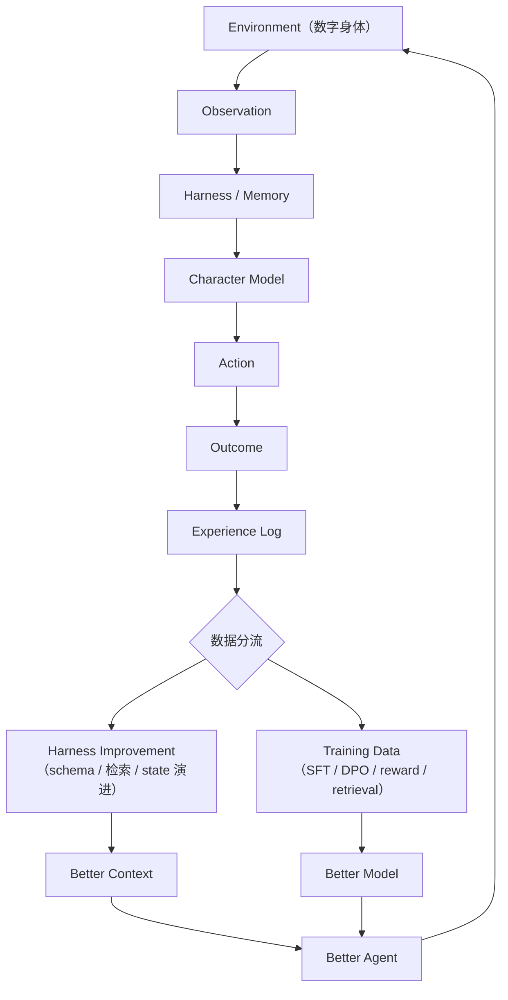

# 04 · 自主探索与数据闭环

> 本文定义 Harness 开发阶段的核心环节——**Observation → Exploration → Memory Formation → Harness Refinement**：让 AI 在可观测、可回放、权限受限的环境中自主活动，完整记录经验轨迹，并以此同时产出后训练数据与 Harness schema 的演进依据。
>
> 基本原则：**允许 AI 自由地观察、提出假设、探索和积累候选经验；不允许它自由决定什么是真理，也不允许它越过实时安全控制取得无约束的执行权。**

---

## 1. 为什么第一阶段就要"让 AI 自由活动"

很多真正有价值的状态变量只有在模型长期活动后才会暴露。坐在纸面上预先规定所有 `WorldState` / `Memory` 字段，不如让真实失败告诉我们缺什么：

| 观察到的失败 | 暴露出的缺失状态 |
| --- | --- |
| 知道"杯子在厨房"，却不知道"杯子是别人正在用的" | `Ownership / Usage State` |
| 知道"用户在卧室"，却不知道"用户在睡觉不应打扰" | `ActivityState` / `InterruptibilityState` |
| 记得"用户喜欢咖啡"，凌晨两点问"要喝咖啡吗" | `Preference × TemporalContext × CurrentCondition` |
| 知道"用户和 A 关系好"，不知道"两人昨天刚吵架" | `RelationshipState + RecentRelationshipEvents` |

**Harness 的 schema 通过这些真实失败不断演进**——这就是"Harness 可以长出来，而不是全部预先设计"（原则 10）。

---

## 2. 渐进自治四阶段

| 阶段 | AI 权限 | 主要目的 |
| --- | --- | --- |
| **Stage 0 · Shadow Mode** | 观察，不执行 | 收集认知/决策数据 |
| **Stage 1 · Simulation Exploration** | 仿真中自由行动 | 发现状态与记忆需求 |
| **Stage 2 · Supervised Autonomy** | 现实中低风险行动 | 收集真实交互数据 |
| **Stage 3 · Bounded Autonomy** | 权限边界内长期自主 | 持续完善世界模型 |

### Stage 0 · Shadow Mode（最先做）

AI 能看、听、记、推理、提出"我想做什么"，但**身体不执行**：

```json
{
  "observation": "用户进入厨房",
  "proposed_action": "approach_user",
  "reason": "用户似乎准备做饭，我应过去看看是否需要帮忙",
  "confidence": 0.72,
  "actual_human_outcome": "user_started_cooking"
}
```

由此可判断 AI 的世界理解准不准——**几乎没有安全成本**。

### Stage 1 · Simulation Exploration

放进可大规模并行的仿真环境（数字身体容器天然支持多实例：Environment #1…#1000）。摔了、打翻杯子、撞墙都没关系，大规模制造经验。

### Stage 2 · Supervised Autonomy

真实（数字）环境中按 Risk Engine 分级执行（见 [03-digital-body.md](03-digital-body.md) §6.2）：LOW 自动执行，MEDIUM 降速/受限执行，HIGH 请求确认，FORBIDDEN 拒绝。

### Stage 3 · Bounded Autonomy：真正的"自由生活"

无人给任务时，AI 处于 IDLE 但并不停止：



示例：09:17 看到桌上有个杯子（记忆：用户早上通常在此喝水；观察：今天杯子是空的；推断：可能需要加水，confidence=0.43；决定：不直接倒水，先问"今天还要水吗？"）——这才是**生活经验**的开始积累。

---

## 3. Autonomous Drive System：自由活动 ≠ 无目标 random walk

只告诉模型"自己随便玩电脑"，大概率得到"打开浏览器 → 看网页 → 重复 → 陷入固定模式"的低价值数据。需要**驱动力系统**——不规定具体任务，只提供驱动：

```json
{
  "drives": {
    "curiosity": 0.72,
    "social": 0.44,
    "creation": 0.63,
    "organization": 0.31,
    "learning": 0.81,
    "entertainment": 0.38
  }
}
```

Idle 时驱动 `Goal proposal`：学习一个不会的软件功能、整理下载目录、读一篇文章、写个小程序、给自己写笔记、回顾以前的事、尝试解决一个错误……

### Curiosity / Unknown Queue

```json
{"unknown_entity": "Blender", "knowledge_confidence": 0.21, "curiosity": 0.74}
```

空闲时出队："这个东西是什么？" → 打开 → 观察界面 → 尝试菜单 → 看帮助文档 → 建立 semantic memory。这是真正意义上的自主探索数据，也是一种自然的 **active learning**（`Observation → 发现不确定性 → 主动询问/实验 → 获得 ground truth → 记忆更新`）。

### Goal Manager：防"自己提出任务 → 自己宣布成功"

每个目标必须有成功标准，评估权不全在提出者手里：

```json
{
  "goal_id": "goal_1042",
  "title": "学会 GIMP 裁剪图片",
  "proposed_by": "self",
  "drive_source": "learning",
  "status": "active",
  "success_criteria": ["存在裁剪后的输出文件", "输出尺寸与原图不同", "源文件未被破坏"],
  "created_at": "2026-08-21T09:00:00+08:00"
}
```

Evaluator 使用文件系统状态、应用状态、屏幕状态、测试、独立 critic、人工抽检作为**外部证据**——`success_criteria` 字段是硬要求，缺此字段的目标不允许创建。

---

## 4. Trajectory Recorder：从第一天必须存在

整个项目未来能否真正产生训练价值，取决于此。每一步产生：

```json
{
  "trajectory_id": "T928102",
  "step": 184,
  "observation": {
    "screenshot_ref": "obj://shots/T928102/184.png",
    "active_window": "Firefox",
    "time": "2026-08-21T09:31:00+08:00",
    "visible_entities": ["dialog:save_confirm"]
  },
  "internal_state": {
    "goal": "把整理好的笔记存入 Documents",
    "psychological_state": {"short": {"mood": "focused"}},
    "relationship_state": "rel_user_001@rev88",
    "retrieved_memories": ["evt_03812", "sem_0019"]
  },
  "decision": {
    "selected_action": "click_save_button",
    "confidence": 0.83,
    "reason_summary": "保存按钮可见，保存后完成目标第 3 步"
  },
  "computer_action": {"type": "click", "x": 418, "y": 726},
  "result": {"screen_changed": true, "expected_result": true},
  "provenance": {
    "model_version": "rp-30b-a3b-v3",
    "prompt_version": "ctx-compiler-v11",
    "schema_version": "state-v7",
    "why_context_selected": "rerank_scores#T928102/184"
  }
}
```

两个关键要求：

1. **记录结构化 decision summary**，不依赖模型内部不可控的长篇推理文本；
2. **记录"为什么选到了这些上下文"**（检索分数、编译决策、模型/prompt/schema 版本）——否则后期无法回答"到底是哪条 memory 把角色带偏了"，debug 几乎不可行。

---

## 5. 五类数据分级与训练用途

一条 autonomous trajectory 可同时训练系统的六七个组件：

| 级别 | 数据形态 | 训练用途 |
| --- | --- | --- |
| **A. Observation data** | screen → UI understanding | 视觉 grounding |
| **B. Action data** | state → mouse/keyboard action | computer use |
| **C. Cognitive data** | state + memory → goal | 角色决策 |
| **D. Outcome data** | decision → outcome | world model / value function |
| **E. Correction data** | 错误动作 → 失败 → 纠正动作 → 成功 | preference / DPO / reward model / critic / error predictor |

由此可分别生成：Persona SFT、Cognitive SFT、Computer-use SFT、Preference data、Memory 训练数据、Retrieval 训练数据。

### 失败数据必须保留

很多 autonomous agent 项目只挑成功轨迹做 SFT——对本项目远远不够。失败数据保存完整链路 `State → Wrong Action → Failure → Corrected Action → Success`，构造成 `Chosen / Rejected` 偏好对。示例：

```text
State S
  Bad（rejected）:  "你不是说不需要吗？那我就不管了。"
  Good（chosen）:   "……我知道你说不需要。"  "但你看起来不像没事。"
```

此时训练的不再只是文风，而是 **persona-conditioned decision making**。

---

## 6. 人格双层结构的生长规则（复习与落实）

回顾 [01-cognitive-harness.md](01-cognitive-harness.md) §9：**绝对不能让 AI 直接修改核心人格和事实库。**

用户随口说"你其实特别喜欢猫吧"，模型不能直接置 `Persona.likes_cats = true`，必须走：

```text
Raw Event → Candidate Memory → Evidence accumulation → Confidence update → Semantic consolidation
```

`event_17: 有人说角色喜欢猫，confidence=0.15` → 之后角色多次主动接近猫 → 才可能形成 `Preference: cats, confidence=0.71`。且这属于 **Developed Self**（允许成长），与锁定的 **Persona Core** 严格区分——否则"自由成长"最后必然变成 persona drift。

---

## 7. 飞轮闭环



运行数月后，拥有的数据将远丰富于普通 `User → Assistant` 对话：

```text
Observation + Relevant Memory + World State + Relationship
+ AI Interpretation + Chosen Action + Human Reaction + Actual Outcome
```

普通聊天数据是"今天怎么样？/还不错。"；而本系统的数据是"09:07 主动整理昨天的实验文件 → 09:23 看到没理解的错误 → 检索昨天记忆 → 尝试 → 失败 → 修改假设 → 成功 → 写进 Notes"；当用户 10:18 问"你上午做什么了"，回答之所以像"真正生活过的人"，不是因为 system prompt 写了什么，而是因为**它真的有一条上午折腾程序的 episodic trajectory**。这和单纯角色卡 RP 是质变。

---

## 8. V0 纪律

- **模型版本可追踪**：不让它边生活边自动训练自己；训练是离线流程（见 [05-roadmap-and-stack.md](05-roadmap-and-stack.md) M4）。
- **evaluator 与执行者分离**：自我评估只作参考，成功判定依赖外部证据。
- **全部轨迹落盘**：JSONL + DB metadata，原始日志永久保存，永不自动覆盖（Raw Experience 层）。

---

## 9. 与其他文档的关系

- 记忆写入的证据链管线：见 [01-cognitive-harness.md](01-cognitive-harness.md) §5。
- 数字身体的权限/风险分级：见 [03-digital-body.md](03-digital-body.md) §6。
- M3（Autonomous Life）/ M4（Experience Learning）/ M5（Long-running）出口条件：见 [05-roadmap-and-stack.md](05-roadmap-and-stack.md)。
