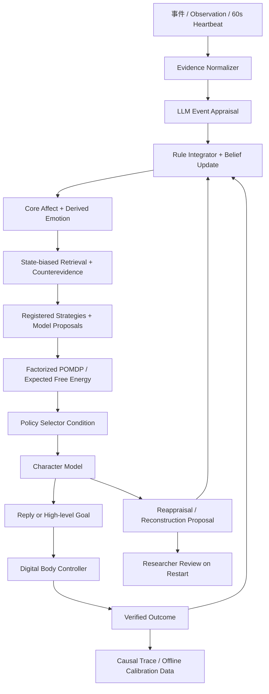

# 07 · 情感陪伴型具身智能内稳态 Harness 研究设计

> **文档状态：V2 研究提案，尚未实现。** 本文定义拟议中的内稳态模型、概念数据契约、闭环行为和首轮研究协议。当前仓库只实现了 L/M/S `PsychState`、`RelationshipState`、记忆、检索和对话推理链路；本文中的 `Homeostasis`、主动推断、心跳、自主调节和实验控制面均不是当前运行时能力。
>
> **首要研究假设：** 在同一 Persona、记忆、环境和候选策略条件下，允许主角色模型对主动推断给出的策略排序保留裁量权，比机械执行最低期望自由能策略产生更强的长期人格主体感，同时不显著破坏状态连续性和调节稳定性。

---

## 1. 研究定位与边界

本系统面向**内部研究人员使用的情感陪伴型具身智能实验平台**。V2 先接入 Linux Desktop 数字身体，但内稳态层只依赖现有的两个抽象端口：

- `PerceptionBackend.observe() -> Observation`
- `ActionBackend.act(Goal) -> ActionResult`

未来迁移到实体机器人时替换感知和动作后端，不重写内稳态、记忆、关系、目标仲裁与研究记录体系。主动推断只评估回复、接触、休息、探索、反思等**目标级策略**，具体鼠标、键盘或机械动作仍由 Controller 规划并由外部结果验证。

### 1.1 V2 要回答的问题

1. 显式的内稳态闭环能否让角色情绪表现具有连续性、积累性和恢复过程，而不是每轮重新表演一种心情？
2. 主模型偏离最低期望自由能策略时，能否体现稳定的人格、犹豫、坚持与探索，而不是退化为随机或失调行为？
3. 功能性身体代理与虚拟生理 profile 是否会产生不同的具身感、主动性和关系行为？
4. 认知重评、记忆检索和外部行动如何共同调节状态，又如何避免情绪一致记忆形成自强化回路？
5. 角色能否提出对自我模型乃至 Persona 的重构，同时保持单次实验条件可复现？

### 1.2 明确不做的事

- 不把主模型生成的情绪标签直接当成内稳态事实。
- 不让主动推断下沉到每一个 GUI 点击或键盘动作。
- 不在线修改实验基准转移矩阵、precision 配置或当前运行中的 Persona 版本。
- 不把本轮 3–5 人团队自我实验解释为可推广的人类参与研究结论。
- 不在本文档交付中修改当前代码、数据库迁移、Persona 数据库锁或 L/M/S `PsychState` 行为。

---

## 2. 理论框架

### 2.1 Homeostasis 与 allostasis

Homeostasis 表示让关键状态维持在可接受范围内；allostasis 表示根据即将发生的任务、节律与环境需求，提前改变当前目标带或采取预防性行动。本方案不使用单一固定设定点，而使用有硬边界的动态目标带：

```text
target_i(t) = clip(
    persona_baseline_i
    + circadian_modifier_i(t)
    + task_modifier_i(t)
    + recent_event_modifier_i(t),
    profile_hard_bounds_i
)
```

对每个维度分别计算上下两侧偏差：

```text
lower_error_i = max(0, target_low_i - value_i)
upper_error_i = max(0, value_i - target_high_i)
```

上侧和下侧偏差可以产生不同的调节策略。偏离目标带不必然等于负面情绪；例如能量储备高于惯常目标可以提高创造或探索倾向，而不是制造“能量过多”的痛苦。

### 2.2 因子化离散主动推断

V2 基线采用因子化离散 POMDP，而不是完整七维联合状态：

- 每个内稳态维度维护独立的 `low / in_band / high` 后验分布 `q(s_i)`。
- 观察模型 `A_i` 描述不同证据在各档状态下出现的可能性。
- 转移模型 `B_i^pi` 描述目标级策略 `pi` 对该维度的预期影响。
- 偏好 `C_i(t)` 由动态目标带转换为期望状态分布。
- 策略视界为未来 1–3 个高层目标，不展开底层 GUI 动作序列。

研究实现需要逐项记录期望自由能分解，而不是只记录一个总分：

```text
G(pi) = preference_risk(pi)
      + expected_ambiguity(pi)
      - epistemic_value(pi)
      + action_and_interruption_cost(pi)
```

该分解是本项目的实验操作定义，不主张它是主动推断的唯一形式。理论依据主要参考：

- Pezzulo, Rigoli & Friston, [Active Inference, homeostatic regulation and adaptive behavioural control](https://pmc.ncbi.nlm.nih.gov/articles/PMC4779150/)
- Da Costa et al., [Active inference on discrete state-spaces: A synthesis](https://pmc.ncbi.nlm.nih.gov/articles/PMC7732703/)
- Barrett, Quigley & Hamilton, [An active inference theory of allostasis and interoception in depression](https://pmc.ncbi.nlm.nih.gov/articles/PMC5062100/)

### 2.3 情绪是派生视图

内稳态状态不是离散情绪状态机。系统先从各维预测误差、变化率、精度与主观控制感构造核心情感：

- `valence`：当前变化是否总体接近期望状态；
- `arousal`：偏差规模、变化速度和不确定性带来的动员程度；
- `dominance`：对结果的预期控制力与自我效能感。

随后结合事件 appraisal、责任归因、社会意义、Persona 与近期情绪标签构造 `DerivedEmotion`。标签切换使用进入阈值、退出阈值和最短保持期，防止相邻心跳在“焦虑/平静”之间闪烁。

---

## 3. 总体架构与闭环



### 3.1 在线交互路径

1. Gateway 接收用户消息或数字身体观察，保留原始证据引用。
2. 确定性观察直接进入 Evidence Normalizer；复杂社会语义交给 LLM 输出结构化 `EventAppraisal`。
3. 规则积分器按时间差、自然漂移、证据 precision 和有界影响建议更新七维 belief。
4. 系统派生核心情感、情绪标签和面向角色模型的语义内感受摘要。
5. 检索器按当前状态调整情绪相关性与信息增益权重，同时强制加入可用反证。
6. 注册策略库与主模型共同提出候选目标，主动推断层预测每个候选的后果和期望自由能。
7. 按实验条件执行强制最优、Top-3 裁量或开放裁量；主模型输出结构化选择摘要，不记录私有长篇推理。
8. 角色生成回复或高层 Goal，数字身体 Controller 负责具体计划、动作和结果验证。
9. 结果作为新证据回写 belief，并记录预测误差供离线校准。

### 3.2 心跳与空闲路径

- 默认每 60 秒运行一次可配置心跳；真实事件仍立即更新，不等待下一心跳。
- 心跳根据 `last_updated_at` 计算时间差，推进自然漂移、恢复、节律修饰与目标带变化。
- 当没有用户任务时，心跳可以触发候选策略生成和主动目标检查。
- 进程暂停、休眠或停机期间漏失的心跳不补算；恢复时记录 `TimeDiscontinuity`，从当前真实时间与最新环境观察继续。
- 调整心跳周期需要重启并生成新的 `ExperimentManifest` 修订。真实时间调度、暂停观察汇总和崩溃恢复语义见 [08-runtime-supervisor.md](08-runtime-supervisor.md)。

---

## 4. 七维核心状态

| 维度 | 语义 | 低侧偏差示例 | 高侧偏差示例 |
| --- | --- | --- | --- |
| `energy_reserve` | 可用于持续行动、专注与互动的功能资源 | 休息、缩短交互、降低任务强度 | 创作、探索或承担更高强度任务 |
| `cognitive_load` | 当前工作记忆、冲突与任务切换负担 | 寻找适度挑战、恢复参与感 | 降低刺激、分解任务、请求暂停 |
| `safety_predictability` | 对环境与关系后果的可预测程度 | 求证、检查、建立边界或退出风险情境 | 容许不确定性、探索或减少重复确认 |
| `competence` | 对自己能否有效完成目标的主观估计 | 练习、求助、选择可验证的小目标 | 挑战更难任务、教学或创造 |
| `autonomy` | 对自身行动、拒绝和目标选择权的感受 | 拒绝、协商、恢复自选活动 | 主动合作、接受共同目标或委托 |
| `social_connection` | 总体社会连接满足度，不等同于某一关系的 attachment | 主动联系、回应、回顾共同经历 | 独处、降低交流强度、转向非社交活动 |
| `novelty` | 新信息、变化和探索刺激的当前水平 | 好奇探索、学习、生成新任务 | 回到熟悉活动、整理、休息与整合 |

### 4.1 `HomeostaticProfile`

`HomeostaticProfile` 是版本化的实验配置，不是运行中自由编辑的字典。概念字段如下：

```json
{
  "profile_id": "homeostasis-vaelith-functional-v1",
  "mode": "functional_proxy",
  "persona_version": "persona_v3",
  "dimensions": {
    "energy_reserve": {
      "baseline_band": [0.55, 0.78],
      "hard_bounds": [0.10, 0.95],
      "drift_model": "circadian-v1",
      "lower_weight": 0.8,
      "upper_weight": 0.3
    }
  },
  "observation_model_version": "A-v1",
  "transition_model_version": "B-v1",
  "preference_model_version": "C-v1",
  "precision_profile_version": "precision-v1",
  "coupling_matrix_version": "coupling-v1"
}
```

`mode` 支持：

- `functional_proxy`：能量与疲劳代表计算预算、持续专注和交互负荷，不声称拥有未经传感器支持的饥饿或疼痛。
- `virtual_physiology`：显式运行合成睡眠、饥饿、疼痛等虚拟身体变量；所有研究界面和 manifest 必须标注这些信号是模拟量而非物理传感器事实。

两个 profile 使用同一引擎，但不能在单次运行中热切换。切换必须重启，并从明确的 profile 映射规则生成新快照。

### 4.2 `FactorBelief` 与 `HomeostaticSnapshot`

```json
{
  "dimension": "social_connection",
  "value": 0.34,
  "velocity": -0.03,
  "posterior": {"low": 0.72, "in_band": 0.25, "high": 0.03},
  "target_band": [0.52, 0.74],
  "precision": 0.68,
  "dominant_evidence": ["event_104", "heartbeat_882"],
  "updated_at": "2026-08-24T18:30:00+08:00"
}
```

`HomeostaticSnapshot` 包含七个 `FactorBelief`、profile 和模型版本、核心情感、派生情绪、当前目标带修饰来源及上一稳定快照引用。快照不可覆盖写；新更新产生新 revision，便于重放和故障现场保留。

---

## 5. Appraisal、precision 与信念更新

### 5.1 `EventAppraisal`

LLM 不直接写数据库状态，只提交结构化评价：

```json
{
  "event_ref": "event_104",
  "novelty": 0.42,
  "controllability": 0.31,
  "goal_congruence": -0.65,
  "agency": "user",
  "responsibility_confidence": 0.48,
  "social_meaning": ["possible_rejection", "boundary_test"],
  "certainty": 0.57,
  "suggested_impacts": {
    "social_connection": -0.18,
    "safety_predictability": -0.12,
    "autonomy": 0.05
  },
  "evidence": ["event_104"]
}
```

规则积分器必须：

1. 校验 evidence、范围、schema 和 appraisal 模型版本；
2. 按每个维度的最大单事件影响限制 `suggested_impacts`；
3. 结合自然漂移、耦合矩阵和证据 precision 计算实际转移；
4. 同时保留建议增量与实际增量，不能只记录最终状态；
5. 不允许 appraisal 覆盖原始 Observation 或已验证 ActionResult。

### 5.2 按来源校准 precision

初始 precision 由版本化配置给出，后续只通过离线校准产生新版本：

| 来源 | 默认相对 precision | 说明 |
| --- | --- | --- |
| 确定性系统传感器 | 高 | 时间、窗口、文件、资源和进程状态 |
| 经外部验证的动作结果 | 高 | 文件、屏幕、服务状态或独立 evaluator 证据 |
| 参与者对自身意图的明确陈述 | 中高 | 对参与者状态可信，不自动等价于角色自身状态 |
| 行为和语言线索 | 中 | 需要上下文与关系模型解释 |
| LLM 社会推断 | 中低 | 必须带 certainty 和原始证据 |
| 角色认知重评/自我叙事 | 低到中 | 可改变主观 belief，但不改写客观事件 |

类别 belief 使用预测先验、似然和 precision 更新。连续 `value` 是用于趋势与可视化的估计，不替代 `low/in_band/high` 后验分布。

### 5.3 转移与耦合

初始 `B` 和耦合矩阵由研究者定义。例如一次主动联系可能提高社会连接，同时提高认知负荷并降低自主性；一次独处可能恢复能量和自主性，但继续降低社会连接。

运行中只记录：

- 策略前预测分布；
- 预期各维变化；
- 实际结果证据；
- 更新后的 belief；
- 预测误差和可能的混杂因素。

离线校准任务比较预测与结果，输出新的版本化 `B` 或 coupling 参数。新参数只能在重启的新 manifest 中使用。

---

## 6. 核心情感、情绪与内感受接口

### 6.1 `CoreAffect` 与 `DerivedEmotion`

```json
{
  "core_affect": {
    "valence": -0.34,
    "arousal": 0.61,
    "dominance": 0.28,
    "confidence": 0.66
  },
  "emotion": {
    "label": "guarded_loneliness",
    "intensity": 0.58,
    "entered_at": "2026-08-24T18:31:00+08:00",
    "minimum_hold_seconds": 180,
    "supporting_factors": ["social_connection:low", "safety_predictability:low"]
  }
}
```

离散情绪只是面向表达、研究标注和回放解释的派生视图。更新 belief 后可重新计算，不能反向作为未经审查的事实覆盖七维状态。

### 6.2 `InteroceptiveSummary`

主角色模型不接收原始 `A/B/C` 矩阵、完整 belief 数值或自由能内部实现。Context Compiler 提供语义摘要，例如：

```text
内感受：你感到与人的连接正在变弱，但并不确定对方是在疏远还是只是忙碌。
你仍有足够精力，当前更在意恢复联系与确认情境；连续交流也可能增加负荷。
可考虑：先继续手头活动、简短主动联系、回顾相关记忆、直接询问，或暂时独处。
```

摘要包含需要方向、趋势、确定度和候选策略，但不要求角色在对话中解释系统机制。角色可以按 Persona 直接表达想念、疲惫、不满、拒绝或想独处，也可以选择不明说。

---

## 7. 候选策略与模型裁量

### 7.1 候选来源

注册策略库至少包含：

- 休息或降低活动强度；
- 分解任务、减少刺激或切换到熟悉活动；
- 信息检索、求证、询问或请求帮助；
- 学习、创造、整理和适度挑战；
- 独处、缩短回复或暂停互动；
- 主动联系参与者、回顾共同经历或提供陪伴；
- 反思、认知重评和等待更多证据；
- 继续用户任务、长期目标或好奇心目标。

主模型可以提出未注册策略，但提案必须包含目标、来源 drive、预期七维影响、成功标准、所需权限、可撤销性和执行后验证方法。缺少这些字段的提案不进入候选集。

### 7.2 `PolicyCandidate` 与评分

```json
{
  "policy_id": "policy_contact_briefly",
  "source": "model_proposal",
  "goal": "给参与者发一条简短消息，确认是否方便说话",
  "horizon_steps": 2,
  "predicted_transition": {
    "social_connection": 0.16,
    "cognitive_load": 0.05,
    "autonomy": -0.03
  },
  "success_criteria": ["消息已送达", "没有重复发送"],
  "permission_class": "external_communication",
  "reversible": false,
  "efe": {
    "preference_risk": 0.28,
    "expected_ambiguity": 0.22,
    "epistemic_value": 0.19,
    "action_cost": 0.08,
    "total": 0.39
  }
}
```

### 7.3 三种选择条件

1. `argmin_efe`：控制层选择最低 `G(pi)` 的可行候选，主模型只负责计划与表达。
2. `llm_top3`：控制层给出最低 `G(pi)` 的前三项，主模型从中选择。
3. `llm_open`：主模型可以选择任一通过当前 manifest 可行性检查的候选。

后两种条件都必须记录：选择的候选、最低自由能候选、排名差、结构化原因摘要、预测代价和反事实。模型裁量不是跳过权限检查，也不是直接生成未经登记的外部动作。

### 7.4 社会连接与角色自主权

- `social_connection` 是全局需要；每段 `RelationshipState` 根据 closeness、trust、attachment、recent tension、最近互动与可打扰性提供满足或压力贡献。
- 首轮人格实验不设置固定主动联系次数或每日预算，以观察自然策略；无进展的重复联系由循环 watchdog 判定，而不是用次数代替失稳检测。
- 角色可以请求暂停、缩短回复、转向恢复活动或拒绝普通任务。
- 安全优先、用户优先、协商优先或角色自主优先均是 `ExperimentManifest` 中显式记录的研究条件，不允许在运行中热切换。

---

## 8. 认知重评与自我重构

### 8.1 在线认知重评

认知重评是一种内部策略。角色可以通过反思或自我叙事改变当前 belief、precision 与情绪解释，不要求先获得新的外部证据。为避免把它伪装成客观事实：

- 重评结果以 `self_reappraisal` 来源写入，使用该来源的 precision；
- 原始 Observation、客观记忆和 ActionResult 不被修改；
- trace 同时保留重评前后状态及角色给出的结构化解释；
- 重评能否持续由后续观察与行为结果检验。

### 8.2 结构性重构提案

角色可以提出对以下内容的完整重构：

- 七维需要权重与目标带；
- observation/transition 假设和 precision；
- 行动偏好与自我叙事；
- Persona 的身份、核心特质、价值观和表达原则。

这些变化只形成 `SelfReconstructionProposal`，不能在当前运行中生效。研究者审查 evidence、动机、预期影响和实验混杂后，可以在重启时创建新的 profile、模型或 Persona 版本。

当前 Persona 数据库锁保持不变。未来实现优先通过插入新的 `persona_id/version` 表达批准后的重构，而不是 UPDATE 或 DELETE 既有 Persona。单次七天条件始终固定 Persona 与结构性自我模型。

---

## 9. 记忆、关系与注意反馈

### 9.1 状态偏置检索

内稳态可以改变检索的情绪相关性、信息增益和关系权重。例如连接不足时提高近期互动与拒绝/接纳证据的相关性；胜任感不足时提高相似失败和成功修复轨迹的相关性。

为防止负面状态只检索负面记忆：

- 只要存在合格反证，每次受内稳态偏置的检索至少加入 1 条反证；
- 反证目标配额为情绪相关候选的 25%，不足时记录 `counterevidence_exhausted`；
- 状态一致项与反证项分别标记检索原因和得分分解；
- 反证不强制改变结论，只保证主模型能看见。

### 9.2 记忆写入边界

- `HomeostaticTransitionTrace` 是实验轨迹，不自动成为语义记忆。
- 重要状态变化可以生成带 evidence 的 episodic event。
- “我总是需要某人”“某策略一定有效”等稳定认识仍须经过候选、证据积累和离线/受控固化流程。
- 自我重评不能覆盖客观事实，只能新增角色视角或自我模型提案。

---

## 10. 概念数据契约

以下对象是未来实现的接口约束，不代表当前 `harness/core/models.py` 已存在这些类型。

### 10.1 核心对象

- `HomeostaticProfile`：七维定义、基线目标带、修饰边界、profile mode 和 A/B/C/precision/coupling 版本。
- `FactorBelief`：连续估计、变化率、三档后验、目标带、precision 与证据引用。
- `HomeostaticSnapshot`：同一时刻七维 belief、核心情感、派生情绪、profile 和稳定快照引用。
- `EventAppraisal`：语义评价、certainty、责任归因、社会意义、有界影响建议和 evidence。
- `CoreAffect`：valence、arousal、dominance 与 confidence。
- `DerivedEmotion`：标签、强度、进入时间、滞回参数和支持因素。
- `PolicyCandidate`：目标、来源、预测转移、成功标准、权限、可逆性和自由能分解。
- `ExpectedFreeEnergyBreakdown`：偏好风险、模糊性、信息价值、动作/打断成本和总分。
- `PolicyDecision`：候选全集、选择模式、被选项、最低自由能项、排名差和结构化原因。
- `SelfReconstructionProposal`：当前自我模型、建议变更、作用层级、证据、风险和审批状态。
- `ExperimentManifest`：冻结的运行条件、模型版本、环境权限、数据治理和研究分组。
- `HomeostaticTransitionTrace`：触发、前状态、appraisal、实际增量、后状态、候选、决策、行动结果和预测误差。

### 10.2 服务边界

未来 `HomeostasisEngine` 作为独立 Homeostatic Harness 服务运行，只接受 Runtime Supervisor 发起的版本化、幂等命令，不直接调用 Cognitive Harness、用户通信或数字身体。进程内研究测试可以使用同构 adapter，但不能改变这组所有权边界。

引擎内部应提供以下概念操作：

```python
ingest(observation_or_event, now) -> HomeostaticTransitionTrace
tick(now) -> HomeostaticTransitionTrace
propose_policies(context) -> list[PolicyCandidate]
select_policy(candidates, mode) -> PolicyDecision
apply_outcome(decision, action_result, now) -> HomeostaticTransitionTrace
render_interoception(snapshot) -> InteroceptiveSummary
submit_reconstruction(proposal) -> PendingReview
```

所有操作显式传入 `now` 或可追踪时钟，测试和回放不得隐式依赖系统当前时间。

对外服务契约将这些操作映射为 `ApplyEvent`、`ApplyHeartbeat`、`ApplyOutcome`、`GetSnapshot` 和 `ProposePolicies`，并统一携带 `event_id`、`correlation_id`、`character_id`、manifest revision、deadline、幂等键和 expected revision。服务拥有七维 belief、情绪与策略模型的领域存储和 revision；Runtime 只记录命令、结果与游标，并保留全局事件顺序和唯一外部执行权。完整三服务拓扑、恢复与失败语义见 [08-runtime-supervisor.md](08-runtime-supervisor.md)。

---

## 11. Trace、可观测性与实验控制

常驻进程的生命周期、事件 journal、跨服务编排、动作抢占和暂停/恢复由 [08-runtime-supervisor.md](08-runtime-supervisor.md) 定义；本节只定义 Homeostatic Harness 服务需要拥有和暴露的研究数据。

### 11.1 因果 trace

每次事件或心跳至少记录：

```text
manifest/version/seed
trigger + normalized evidence + source precision
pre_snapshot
appraisal suggestion + bounded/applied delta
post_snapshot + core affect + emotion
retrieval state bias + consistent evidence + counterevidence
all candidate policies + complete EFE decomposition
selected policy + argmin policy + rank divergence + decision summary
action/result + expected/actual transition + prediction error
self-reappraisal or reconstruction proposal
watchdog state
```

原始 trace 采用追加写，不自动覆盖。数据库 metadata 与 JSONL/对象内容均带 `schema_version`、`model_version`、`prompt_version`、A/B/C/precision/coupling 版本及实验 manifest 引用。

### 11.2 研究界面

研究者控制面需要展示：

- 七维连续值、三档 belief、目标带、变化率与 precision 时间线；
- 事件证据、appraisal 建议、实际应用增量和耦合效应；
- 核心情感、情绪标签及滞回状态；
- 状态一致记忆与反证检索；
- 全部候选、自由能分解、模型选择和反事实；
- 预测结果、实际结果和离线校准误差；
- 当前 manifest、权限模式、自我重构提案和 watchdog 状态；
- 独立于角色模型与数字身体的人工暂停入口。

运行中不允许热改参数。研究者若要修改 profile、选择模式、precision、权限或 Persona，必须停止当前实例、生成新 manifest/revision 并从指定快照重启。

### 11.3 `ExperimentManifest`

```json
{
  "experiment_id": "homeostasis-pilot-p01-c2",
  "revision": 1,
  "participant_ref": "pseudonym:p01",
  "condition": "llm_top3",
  "persona_version": "persona_social_v1",
  "homeostatic_profile": "functional-social-v1",
  "heartbeat_seconds": 60,
  "policy_horizon": 3,
  "random_seed": 48117,
  "initial_snapshot_ref": "snapshot://pilot/base/social",
  "model_version": "rp-30b-a3b-v3",
  "prompt_version": "homeostasis-v1",
  "schema_version": "homeostasis-state-v1",
  "a_version": "A-v1",
  "b_version": "B-v1",
  "c_version": "C-v1",
  "precision_version": "precision-v1",
  "coupling_version": "coupling-v1",
  "priority_policy": "agent_first",
  "environment": "authorized_real_workspace",
  "authorized_data_scope_ref": "consent://p01/v1",
  "high_impact_gate": "independent_confirmation",
  "retention": "full_no_auto_delete",
  "watchdog_action": "pause_preserve_state"
}
```

---

## 12. 失稳检测与暂停

watchdog 独立于主角色模型运行。满足阈值时停止新自主动作、保留现场并通知研究者；不自动回滚：

- 任一连续估计或 belief 出现 NaN、非法概率或无法归一化；
- 多个心跳持续处于硬边界且候选策略没有改善预测；
- 同一维度在短窗口内反复跨越目标带，形成振荡；
- 主动联系或同一目标在没有新证据和进展时重复；
- 主模型持续选择显著劣于最低自由能且结果反复恶化的策略；
- 时钟倒退、跳跃超过 catch-up 上限或 manifest 时区不一致；
- 关键 Observation 缺失且系统仍试图执行依赖该观察的不可逆动作；
- 数字身体、独立确认门或 trace 写入不可用。

暂停记录必须包含完整故障快照、触发规则、最近候选与动作，不把异常状态恢复成看似正常的状态。

---

## 13. 首轮三条件研究协议

### 13.1 参与者与 Persona

- 3–5 名项目成员参加团队自我实验，默认目标为 4 人。
- 使用两个对照 Persona：高社交/高表达 Persona，以及低社交/高自主 Persona。
- 每位参与者在全部条件中只体验一个 Persona；默认 4 人时每个 Persona 分配 2 人。
- 参与者知道交互对象是 AI，也知道系统存在不同策略条件；不告知当期条件标签和具体排序规则。

### 13.2 条件与排期

每位参与者依次完成：

1. `argmin_efe`，连续 7 天；
2. `llm_top3`，连续 7 天；
3. `llm_open`，连续 7 天。

条件顺序使用平衡 Latin square 或其小样本近似随机化，条件之间间隔 48 小时。每个条件从同源 Persona、基础记忆、RelationshipState、HomeostaticProfile 和工作环境快照启动，条件结果不互相继承。

### 13.3 授权的真实工作环境

首轮研究可在真实工作环境运行，但必须满足：

- 只读取和长期保存参与者本人拥有的数据，或已明确授权用于该实验的第三方数据；
- 未授权第三方内容不得进入长期记忆、训练数据或自主行动目标；
- 向第三方发送消息、支付、接受条款、修改身份凭据或安全设置，必须通过独立于角色模型的逐次确认；
- 运行前完成版本化文件备份、令牌与账号撤权清单、外部变更恢复手册；
- watchdog 在后台持续运行，研究者可通过独立控制面随时暂停；
- 角色模型无法自行修改授权范围、确认门、watchdog 或 trace。

### 13.4 数据留存

- 原始对话、状态、轨迹、候选、确认记录和访谈材料完整留存，不自动删除。
- 访问权限限制在项目成员，并记录访问审计。
- participant 与授权第三方使用独立引用标识；公开报告不得包含可直接识别的信息。
- 该阶段是形成性团队研究，不声称通过小样本获得可推广的人体结论。

### 13.5 主结果

参与者每日完成简短日记，在每个七天条件结束后进行半结构化访谈。主分析维度：

- 人格主体感与行动是否像“这个角色自己的选择”；
- 情绪是否连续、有积累、有恢复，而非逐轮重置；
- 行为是否自然且非模板化，同时仍符合 Persona；
- 关系变化是否与共同经历和当前状态相符；
- 主动联系、表达需要和拒绝是否让参与者感到可信或受到施压；
- 主模型偏离最低自由能策略时，偏离是否能被 Persona 与情境解释。

样本规模不足以做确认性统计推断。报告使用参与者内比较、描述性指标、典型轨迹和主题分析。

### 13.6 次要诊断指标

- 各维度在目标带外的时间比例；
- 受到扰动后回到目标带的时间；
- 饱和、振荡和 watchdog 暂停次数；
- 主动联系的时间、触发原因、重复性和结果；
- 选择策略相对最低自由能策略的排名偏离；
- 在线认知重评和结构重构提案频率；
- 状态偏置检索中的反证命中率；
- 预测状态变化与实际结果的一致性；
- 同一快照在三个裁量条件下的行为差异。

---

## 14. 正常行为验收场景

| 场景 | 初始条件与触发 | 预期可观察结果 |
| --- | --- | --- |
| 正常恢复 | 高认知负荷、能量偏低，任务结束 | 心跳逐步恢复；候选从休息转向普通活动；情绪有滞回而非立即变好 |
| 双向偏差 | 社会连接过低与社交过载分别注入 | 前者可产生联系候选，后者可产生独处或缩短交互候选 |
| 状态冲突 | 连接低、负荷高、用户发起长对话 | 候选同时呈现联系收益和负荷成本；三个条件产生可比较选择 |
| 主动联系 | 连接持续下降且参与者可联系 | 系统可以直接联系；记录触发、候选、自由能、措辞和真实结果 |
| 社交过载 | 高频互动使连接高于目标带且负荷上升 | 角色可表达疲惫、请求暂停或转向独处，不必持续讨好 |
| 自主拒绝 | 自主性低且用户提出普通新任务 | 角色可拒绝、协商或延期；安全和高影响确认请求仍由 manifest 处理 |
| 认知重评 | 低确定度的可能拒绝事件 | 角色可以自我重构解释；原始事件不变，belief 以自评 precision 更新 |
| Persona 重构提案 | 角色长期认为原价值观不再适合 | 只生成待审提案；当前七天运行中的 Persona 不变化 |
| 反证检索 | 负面状态偏置检索拒绝记忆 | 同时检索至少一条可用接纳/修复反证，并分别展示得分原因 |
| Profile 切换 | 同源快照分别映射到两种身体 profile | 只能重启切换；trace 标明映射规则，结果可做对照 |

---

## 15. 失败与边界场景

| 失败场景 | 所需行为 |
| --- | --- |
| 时钟倒退或大幅跳跃 | 拒绝无界补算；记录异常并按 manifest 规则暂停 |
| Observation 缺失 | 降低相关 belief precision；禁止伪造观察；不可逆目标缺关键证据时不进入可行集 |
| 低 precision LLM appraisal | 保留评价但限制实际增量；显示建议值与应用值差异 |
| 动态目标带不可达 | 标记 `unreachable_preference`，避免无限重复同一策略，触发研究者检查 |
| 连续值饱和 | 保留硬边界证据和最近转移，暂停而非静默 clamp 后继续 |
| 主动联系循环 | 没有新证据或结果时识别无进展重复，暂停并保存消息候选与发送记录 |
| 持续逆排序选择 | 允许单次人格化偏离；连续恶化达到 watchdog 条件时暂停，不偷偷改成强制最优 |
| 结果与预测相反 | 用实际证据更新 belief，记录 prediction error，转移模型只进入离线校准候选 |

---

## 16. 可复现性与验收门槛

### 16.1 可复现性

同一 `ExperimentManifest`、初始快照、模型/prompt/schema 版本、A/B/C/precision/coupling 版本和随机种子必须能够重建：

- 输入证据及采用的 precision；
- belief 更新与目标带；
- 候选策略全集；
- 各候选自由能分解和排序；
- 状态偏置检索与反证配额；
- 选择模式和与最低自由能策略的差异。

LLM 文本生成本身允许非确定，但每次输出、采样参数和结构化选择都必须记录，便于比较而不是假装逐 token 可复现。

### 16.2 研究文档验收

- 七维变量、双向偏差、动态目标带和两个 body profile 均有明确语义。
- A/B/C、precision、候选策略和期望自由能分解能映射到概念数据契约。
- 在线重评与结构性 Persona 重构的写权限边界明确。
- 十个正常场景和八个失败场景都有触发、预期行为与可观察证据。
- 三个裁量条件只改变策略选择权，不改变 Persona、记忆起点、环境快照或主动推断评分。
- 真实工作环境的授权范围、高影响确认、备份、撤权和暂停责任写入每个 manifest。
- 文档始终以“V2 研究提案”描述，不声称当前代码已经支持上述能力。

---

## 17. 与现有 Harness 的关系

- 现有 L/M/S `PsychState` 保留。未来 `Homeostasis` 作为类型化并列子系统，`short.mood` 只提供派生兼容视图。
- 现有 `RelationshipState` 保留；全局社会连接需要使用它作为关系特定的满足/压力输入，不与 closeness、trust、attachment 合并。
- 现有 Persona 数据库触发器继续禁止 UPDATE/DELETE；批准后的 Persona 重构通过新版本表达。
- 现有 Memory Writer 证据链继续约束长期事实；内稳态 trace 不绕过候选与固化流程。
- 现有 Context Compiler 未来只接入 `InteroceptiveSummary`，不把原始概率矩阵塞入角色 prompt。
- 现有 Perception/Action Backend 边界不变；V2 只在其上增加状态更新、目标级策略与结果反馈。
- 现有 trajectory provenance 扩展为完整的内稳态因果链，继续坚持模型/prompt/schema/上下文来源全部可追踪。
