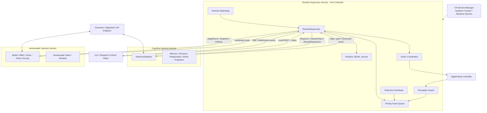
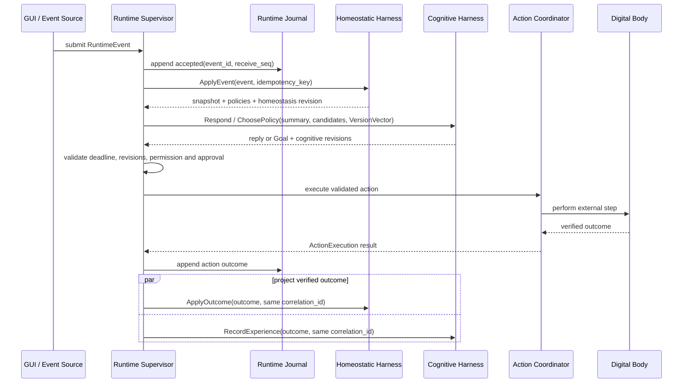
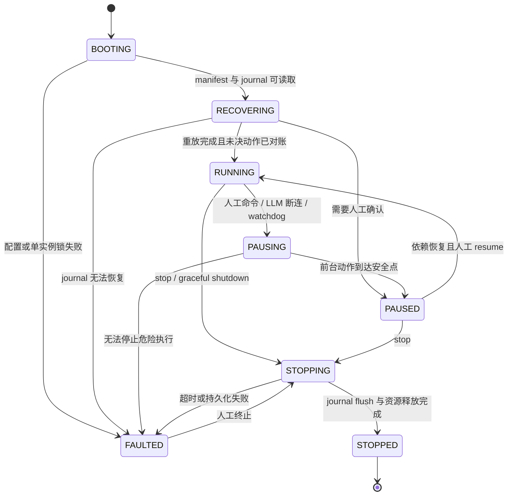
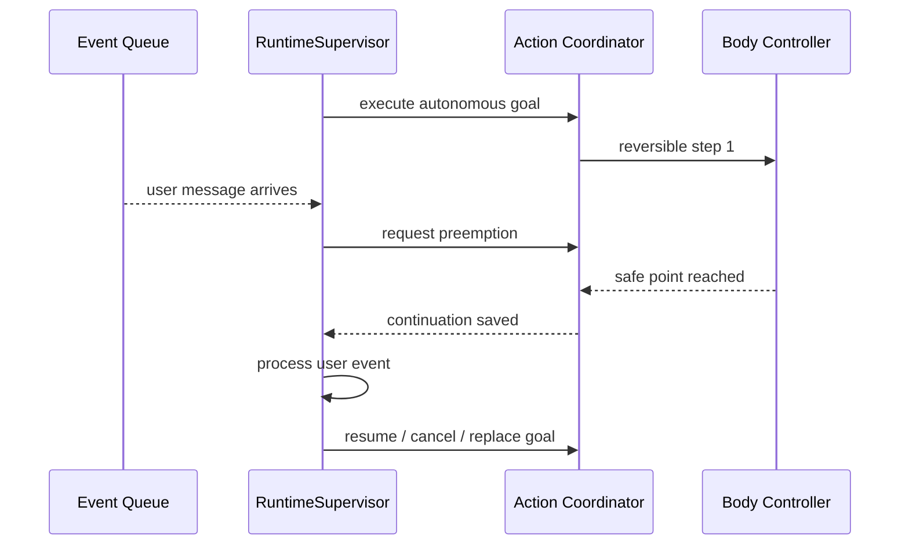
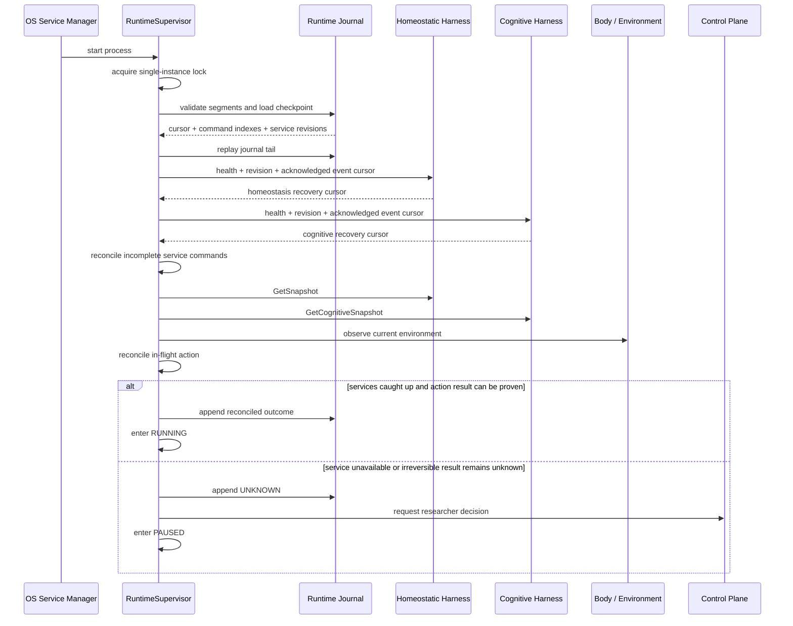

# 08 · Runtime Supervisor 架构设计

> **文档状态：V2 架构概念提案，尚未实现。** 本文定义把当前请求式 Harness 扩展为可持续运行角色所需的常驻 Runtime Supervisor。当前仓库中的 `InferencePipeline.respond()` 只处理单次输入，FastAPI GUI 只管理 Web 服务生命周期；事件循环、心跳、自主目标调度、抢占、持久化恢复和运行时 watchdog 均不是当前能力。
>
> **核心结论：** 需要一个独立于 GUI 的常驻 Runtime 服务，但不能使用持续占用 CPU 的裸 `while (1)`。首版采用 Runtime、Cognitive Harness、Homeostatic Harness 三服务拓扑；Runtime 掌握全局事件顺序与唯一外部执行权，另外两个服务分别拥有认知/记忆状态和内稳态状态。

---

## 1. 定位与目标

Runtime Supervisor 是角色的**生命周期所有者**。Cognitive Harness 回答“基于什么状态进行一次推理”，Homeostatic Harness 回答“什么需要正在变化以及应考虑哪些调节目标”，数字身体负责观察和执行；Runtime Supervisor 决定这些组件何时被调用、如何并发、何时暂停，以及崩溃后从哪里继续。

首版目标：

1. 在没有用户消息时，按真实时间推进心跳、感知与空闲自驱。
2. 在用户消息、环境变化和动作结果同时发生时，保持可追踪的处理顺序。
3. 允许耗时感知、检索和模型调用并行，同时避免无约束并发写状态。
4. 让用户消息在安全点抢占自主目标，而不把不可逆动作留在未知中间态。
5. GUI 关闭、客户端断连或 Runtime 进程崩溃后，角色生命周期仍有明确恢复语义。
6. 对七天持续运行提供 journal、checkpoint、watchdog、降载和人工控制面。

### 1.1 首版边界

- 一个 Runtime 进程只管理一个角色实例。
- 多角色通过多个进程或容器部署，不在首版进程内实现多租户。
- 只支持真实时间；加速时间、固定步长仿真与离线快照重放属于 `eval`。
- 默认心跳间隔为 60 秒；调整间隔需要重启并生成新的实验 manifest revision。
- 不修改现有 `InferencePipeline`、MemoryService、Persona 锁或数据库结构。
- 本文只定义概念边界，不固定完整 REST payload、Pydantic 字段或部署脚本。

---

## 2. 系统上下文



### 2.1 独立服务原则

- Runtime 进程拥有生命周期、事件总序、Goal/Action、审批、调度和恢复语义。
- GUI 是观察与控制客户端，不创建或销毁角色内部组件，也不持有唯一状态。
- GUI 退出或 WebSocket 断开时 Runtime 继续运行。
- OS service manager 负责进程异常退出后的重新拉起；Runtime 自己不 fork 或启动替身进程。
- 内部 watchdog 负责行为和数据层失稳，OS 守护负责进程级存活，两者不能相互替代。

### 2.2 三服务拓扑

三个服务不是平级自治体，而是以 Runtime 为中心的星形调用关系：

| 服务 | 拥有的状态与职责 | 明确禁止 |
| --- | --- | --- |
| Runtime Supervisor | `receive_seq`、生命周期、事件 journal、Goal、ActionExecution、审批、抢占、数字身体和控制面 | 不做人格判断，不直接写内稳态或长期记忆 |
| Cognitive Harness | Persona、Relationship、现有 L/M/S PsychState、Memory、Session、WorldState 投影、检索和角色推理 | 不直接调用 Homeostasis，不执行外部动作 |
| Homeostatic Harness | 七维 belief、目标带、CoreAffect、DerivedEmotion、drive、策略预测与本地 revision | 不直接调用 Cognitive，不联系用户或控制身体 |

Runtime 是唯一允许调用 Action Backend、发送消息或产生其他外部副作用的服务。Cognitive 与 Homeostasis 只返回结构化结果；任何结果都必须重新经过 Runtime 的 revision、权限、动作锁和高影响审批检查。

原始 Observation 先进入 Runtime journal，再发送给领域服务。Cognitive 暂时继续通过现有 MemoryService 维护物化 `WorldState`；Homeostasis 从同一事件建立自己的主观 belief。两种投影可以最终一致，但都必须引用相同的 Runtime event ID。

### 2.3 调用方向

- GUI、数字身体和外部事件源只连接 Runtime。
- Runtime 可以调用 Cognitive 和 Homeostasis。
- Cognitive 与 Homeostasis 不允许彼此直接同步或异步调用。
- 两个领域服务可以各自调用经过配置的 LLM endpoint，但不能因此取得 Runtime 控制权。
- 首版不要求 Kafka、NATS 或其他 broker；Runtime journal 提供全局顺序，服务命令使用本地 HTTP JSON。
- 将来引入 broker 时，仍保持 Runtime 是命令发起者和外部动作唯一所有者。

---

## 3. 核心组件

### 3.1 `RuntimeSupervisor`

负责生命周期迁移、事件调度、任务创建与取消、暂停/恢复、版本向量组装、动作串行化、恢复对账和运行状态广播。它不承担具体人格判断、记忆检索或 GUI 动作规划。

### 3.2 Priority Event Queue

所有会影响角色运行的输入先规范化为 `RuntimeEvent`。入口为每个事件分配永不复用的单调 `receive_seq`，队列另按优先级调度。journal 同时保存接收顺序和实际处理顺序，避免“优先处理”等同于“篡改历史顺序”。

### 3.3 Real-time Scheduler

维护下一次心跳和维护任务的 deadline。它等待“新事件到达”或“最近 deadline 到期”，不使用无条件短间隔轮询。首版只读取真实单调时钟与可审计的 wall clock，不提供时间倍率。

### 3.4 Perception Guard

长期运行感知后端并把观察写入事件入口。Runtime 处于 `PAUSED` 时它仍可记录原始环境事件，但这些事件不立即改变角色主观状态。

### 3.5 Subsystem State Managers

State Manager 位于拥有该状态的服务内部。Runtime 管理 Lifecycle、Goal、Action 和 journal revision；Cognitive 管理 World、Relationship、Memory 与 Session revision；Homeostasis 管理自己的 belief 与情绪 revision。耗时计算在锁外进行，提交时验证输入 revision。跨服务不使用分布式锁，而通过命令幂等、expected revision、版本向量和 reconciliation 实现最终一致。

### 3.6 Action Coordinator

确保同一时刻最多有一个可能改变外界的前台动作。它管理动作幂等键、执行状态、安全点、确认门、continuation 和结果对账；后台感知、日志、健康检查和只读验证可以并发。

### 3.7 Runtime Journal

分段追加 JSONL journal 是全局事件顺序、Runtime 生命周期、命令和外部动作的事实来源，与现有分析 trace 分离。Cognitive 与 Homeostasis 仍分别拥有自己的领域状态和 revision；Runtime journal 记录发给它们的命令、幂等键及返回 revision，但不冒充领域状态数据库。

### 3.8 Runtime Watchdog

监测队列积压、状态饱和、无进展目标循环、重复主动联系、动作超时、journal 故障和关键依赖不可用。watchdog 只产生结构化控制事件，由 Supervisor 执行状态迁移。

### 3.9 Control Plane

通过仅本机监听、带本地认证令牌的 REST 接收用户消息、暂停、恢复、停止和高影响动作审批；通过 SSE 或 WebSocket 广播生命周期、健康状态、事件、trace 与审批请求。

### 3.10 概念接口

本文使用以下概念接口描述模块边界，但不在本轮固定完整字段：

- `RuntimeSupervisor`：生命周期、调度、并发和恢复的总协调器；
- `RuntimeEvent`：进入优先队列和 journal 的规范事件；
- `RuntimeLifecycle`：受状态机约束的生命周期值与迁移原因；
- `RuntimeJournal`：事件接收、处理、提交、动作和恢复记录的事实来源；
- `VersionVector`：一次推理实际读取的各子系统 revision；
- `ActionExecution`：单个前台动作的执行、抢占、验证和对账状态；
- `ResumeObservation`：暂停期原始观察的恢复汇总；
- `WatchdogDecision`：watchdog 产生的暂停、降载或故障建议及其证据；
- `ControlPlane`：本地认证的命令接口和只读事件流。

### 3.11 服务命令契约

首版使用本地 HTTP JSON；实现层可以为测试提供同构的 in-process adapter。所有命令统一携带：

```text
event_id / receive_seq / correlation_id
character_id / runtime_instance_id / manifest_revision
idempotency_key / deadline
expected service revision or VersionVector
```

Homeostasis 服务提供的概念命令：

- `ApplyEvent`：应用消息、Observation 或控制事件；
- `ApplyHeartbeat`：推进一次真实时间心跳；
- `ApplyOutcome`：用验证后的动作结果更新 belief；
- `GetSnapshot`：返回当前内稳态、情绪和 revision；
- `ProposePolicies`：返回 drive、候选调节策略及评分。

Cognitive 服务提供的概念命令：

- `Respond`：根据 Situation、记忆和内感受摘要生成角色回复或高层 Goal；
- `ChoosePolicy`：在给定候选集和实验条件下做人格化选择；
- `RecordExperience`：按现有 evidence 规则写入事件与记忆管线；
- `GetCognitiveSnapshot`：返回 Persona、关系、世界、会话与记忆 revision。

Runtime 不允许领域服务自行回调 Action Backend。长耗时命令必须带 deadline；返回结果若超过 deadline 或依赖的 revision 已过期，Runtime 记录结果但不执行其中的动作建议。

### 3.12 三服务交互序列

一次包含外部动作的典型事件按以下顺序流动：



若本轮只产生内部调节或文本回复，动作阶段可以省略或由 Runtime 直接交付响应；领域服务之间仍不建立直接调用。所有分支沿用同一个 `correlation_id`，各条命令使用独立且可重放的 `idempotency_key`。

---

## 4. 生命周期状态机



### 4.1 状态语义

| 状态 | 允许的行为 |
| --- | --- |
| `BOOTING` | 读取配置、取得单实例锁、初始化 journal；不接受普通事件和外部动作 |
| `RECOVERING` | 加载 checkpoint、重放 journal、对账未决动作、重新观察环境 |
| `RUNNING` | 处理事件、心跳、推理、自主目标和动作 |
| `PAUSING` | 停止创建新目标，等待当前动作到达安全点，继续记录感知 |
| `PAUSED` | 冻结内稳态、推理、记忆固化和动作；继续保存原始观察与控制命令 |
| `STOPPING` | 拒绝新普通事件，完成有界 flush、取消后台任务并释放资源 |
| `STOPPED` | 无后台任务、锁或动作仍存活 |
| `FAULTED` | 禁止新外部动作，保留故障现场，只接受诊断、停止或明确恢复操作 |

LLM 不可用时 Runtime 进入 `PAUSING`，随后停在 `PAUSED`。模型健康检查恢复并不自动继续运行，必须由研究者显式发送 `resume`。

---

## 5. 事件模型与调度

### 5.1 `RuntimeEvent`

概念上每个事件至少携带：事件 ID、`receive_seq`、来源时间、接收时间、类型、优先级、幂等键、manifest revision、payload 引用和 journal 状态。具体 Pydantic schema 留待实现阶段固化。

### 5.2 优先级顺序

从高到低：

1. 紧急停止、暂停、权限撤回和 watchdog 控制事件；
2. 前台动作结果、审批结果和安全事件；
3. 用户消息；
4. 重要环境变化；
5. 普通感知事件；
6. 内稳态心跳与维护 deadline；
7. 空闲探索、反思和低优先级维护任务。

同一优先级按 `receive_seq` 调度。高优先级事件可以先处理，但已经接收的低优先级事件不会从 journal 中消失。

### 5.3 队列降载

队列必须有界。接近容量时：

- 控制命令、用户事件、审批结果和动作结果永不主动丢弃；
- 多个尚未处理的 heartbeat 合并为一个最新 heartbeat；
- 同一来源的重复普通感知合并为最新快照，并保留 first/last sequence 范围；
- 低价值遥测允许丢弃，但记录事件类型、数量和 sequence 范围；
- 无法继续降载时由 watchdog 进入 `PAUSING`，不能扩展为无界内存队列。

---

## 6. 主事件循环

Runtime 使用“队列事件或最近 deadline 二者先到”的等待模式：

```python
async def run(supervisor):
    await supervisor.boot_and_recover()

    while supervisor.lifecycle is not STOPPED:
        deadline = supervisor.scheduler.next_deadline()
        event = await supervisor.wait_for_event_or_deadline(deadline)

        if event is None:
            event = supervisor.scheduler.make_due_event()
            event = await supervisor.ingress.accept_scheduled(event)

        await supervisor.dispatch(event)

    await supervisor.close()
```

外部事件在进入队列前已经由 ingress 分配 sequence 并写入 journal；伪代码中的 deadline 事件因此显式经过 `accept_scheduled` 后直接调度，不重复入队。`FAULTED` 不退出主循环，只允许诊断、停止或明确恢复控制事件。这里的 `while` 只维持生命周期，不做 CPU 空转：没有事件或到期任务时协程处于阻塞等待。实际实现还需要处理 cancellation、journal 降级和有界 shutdown，伪代码只表达控制结构。

### 6.1 心跳

- 默认每 60 秒生成一次 Heartbeat。
- 用户消息、动作结果或环境事件立即处理，不等待心跳。
- 心跳可以推进内稳态、检查自主目标和安排维护，但不是每次都必须调用主 LLM。
- 进程休眠、暂停或停机期间漏失的 heartbeat 不补算、不逐条重放。
- 恢复后发出 `TimeDiscontinuity`，记录 `last_runtime_time`、`current_time` 和间隔原因，从当前真实时间继续。

### 6.2 空闲自驱

只有在生命周期为 `RUNNING`、没有前台动作、没有更高优先级事件、Homeostasis/Goal 状态允许时，Supervisor 才请求自主候选。空闲目标一旦开始，也必须通过 Action Coordinator，并可被用户消息在安全点抢占。

---

## 7. 并发、锁与最终一致

### 7.1 并行边界

可以并行：

- 感知采集和规范化；
- 只读记忆检索；
- 独立 LLM appraisal 或候选生成；
- journal/trace 读取、GUI 广播和健康探测；
- 不改变外界的验证任务。

必须受控串行或加锁：

- 每个子系统的状态提交；
- 前台外部动作；
- 生命周期迁移；
- 高影响动作的最终权限与一致性复核。

### 7.2 子系统锁

每个服务只管理本进程内的锁，不建立跨服务分布式锁：

- Runtime：Lifecycle、Goal、Action、Approval 和 journal append lock；
- Cognitive：World、Relationship、Memory、Session 和 Persona 版本锁；
- Homeostasis：belief、目标带、情绪和策略模型 revision 锁。

每个 State Manager 提供自己的 revision 和提交锁。任务读取不可变快照，在锁外计算，再以 `expected_revision` 尝试提交：

```text
snapshot_i = read(subsystem_i)
proposal = compute(snapshot_i, event)
commit(subsystem_i, expected_revision=snapshot_i.revision, proposal)
```

revision 不匹配时，不把旧结果强行写入；根据事件类型重新读取并重算，或产生 reconciliation 事件。

服务内部若需要多个锁，必须定义本服务的固定锁顺序。Runtime 不同时持有 Cognitive 或 Homeostasis 的进程内锁，也不在持有本地动作锁时等待无限期 RPC。跨服务操作采用“记录命令 → 幂等调用 → 记录结果 → 对比 revision → 必要时 reconciliation”的最终一致流程。

### 7.3 `VersionVector`

一次 Situation/Policy 推理记录它实际读取的版本：

```text
runtime.goal@31
runtime.action@84
cognitive.world@142
cognitive.relationship@77
cognitive.memory@2054
cognitive.session@19
homeostasis.state@908
```

输出、候选策略和动作计划都引用该版本向量。这样即使各子系统并非同一时刻提交，也能解释模型当时看到了什么。

### 7.4 高影响一致性屏障

普通回复和低风险目标可以使用记录了版本向量的最终一致快照。发送第三方消息、删除、支付、接受条款、修改凭据或安全设置前必须：

1. 停止对应动作进入执行器；
2. 等待当前 event ID 在 Cognitive 与 Homeostasis 中完成处理，或明确返回无法追平；
3. 分别读取 Cognitive snapshot、Homeostasis snapshot、Runtime Goal/Action 和当前环境，形成新版本向量；
4. 重新验证目标、授权、审批和幂等键；
5. 若语义或风险已变化，废弃原计划并重新提案。

屏障通过 revision 查询和 event acknowledgement 实现，不使用跨服务数据库事务或分布式锁。

---

## 8. 动作生命周期与抢占

### 8.1 `ActionExecution`

概念状态：

```text
PROPOSED
→ AWAITING_APPROVAL（按需）
→ READY
→ RUNNING
→ VERIFYING
→ SUCCEEDED / FAILED / CANCELLED / UNKNOWN
```

每个外部动作必须带唯一幂等键、风险类别、可逆性、当前步骤、安全点和验证方法。

### 8.2 安全点协作抢占



- 可撤销动作到达安全点后保存 continuation，随后暂停或取消。
- 不可逆步骤已经开始时先完成验证或标记 `UNKNOWN`，不能假装立即取消。
- 紧急停止阻止所有后续步骤；它不能撤销已经发生的外部效果。
- 抢占后的目标是否恢复由新状态和 Goal Manager 重新判断，不自动保证续跑。

### 8.3 单前台动作

一次只允许一个 `RUNNING` 的外部动作。多个自主目标可以处于 `PROPOSED` 或等待状态，但不能并发点击、发送、写文件或执行实体动作。只读验证和感知不占用前台动作槽。

---

## 9. 暂停与恢复

### 9.1 暂停过程

1. 接收 pause、LLM outage 或 watchdog 事件。
2. 生命周期进入 `PAUSING`，停止创建新目标和 LLM 任务。
3. 请求当前前台动作在安全点停止；未决不可逆动作进入结果对账。
4. 冻结 Homeostasis、Relationship 派生更新、记忆固化和 Session 推理。
5. 进入 `PAUSED`；Perception Guard 继续把原始观察写入 journal。

### 9.2 `ResumeObservation`

恢复时不逐条向角色重放暂停期观察。Perception Guard 根据该区间生成：

- 当前最新世界快照；
- 少量显著变化，例如关键窗口、文件或用户 presence 改变；
- 被合并观察的 sequence 范围和计数；
- 暂停开始、结束和时间间隔；
- `TimeDiscontinuity` 标记。

该汇总作为一个 `ResumeObservation` 进入正常事件流程。原始观察仍留在 journal 中供审计，但不制造恢复时的刺激风暴。

---

## 10. JSONL Journal 与 checkpoint

### 10.1 Journal 和 trace 分离

- Runtime journal：全局编排事实来源，记录事件接收、生命周期、调度、服务命令与结果、动作和对账。
- Cognitive store：Persona、Relationship、Memory、Session 和 WorldState 投影的领域事实来源，沿用其 evidence 与 revision 规则。
- Homeostasis store：七维 belief、目标带、情绪、drive 与模型 revision 的领域事实来源。
- Analysis trace：解释模型、检索、appraisal、自由能和生成结果，可用于 GUI 与训练数据。

Runtime journal 不复制领域数据库，也不宣称能单独重建领域服务的全部内部状态。它必须保存每条服务命令的 payload 引用、幂等键、预期 revision、返回 revision 和完成状态，使服务恢复时可以证明“哪些命令已提交、哪些命令尚待对账”。一个 Runtime 事件可以引用多个领域提交和分析 trace，但不能依赖分析 trace 才能恢复事件顺序。

### 10.2 写入顺序

正常路径遵循：

```text
receive event
→ assign receive_seq
→ append accepted record
→ enqueue/process
→ append service command intent
→ invoke idempotent domain command
→ append service result/revision
→ append processing/commit/action records
→ expose completion
```

分段文件只追加写；每条记录带 schema version、instance ID、character ID、manifest revision、sequence、事件 ID 和前一记录校验引用。启动时允许截断最后一条未完整写入的记录，但中间段损坏进入 `FAULTED`。

### 10.3 Derived checkpoint

checkpoint 是从 Runtime journal 推导出的启动加速文件，包含生命周期、版本向量、未决事件、目标与动作索引、journal cursor，以及 Cognitive/Homeostasis 最近确认的 event cursor 和 revision。它保存的是领域服务游标与引用，不把领域快照副本提升为权威状态。写入采用临时文件、flush、原子替换；checkpoint 损坏时可退回较旧 checkpoint 或完整 journal 重放。

checkpoint 不能覆盖或删除作为事实来源的 journal。日志分段归档和保留期限由实验数据治理另行规定。

---

## 11. 启动与崩溃恢复



### 11.1 领域服务对账

- Runtime 比较 checkpoint、journal 命令索引和领域服务返回的 acknowledged event cursor。
- journal 中已有 intent、但没有确定 result 的命令，使用原 `idempotency_key` 查询或重试；不得换键制造第二次领域提交。
- 领域服务已经提交而 Runtime 尚未记录结果时，以服务返回的稳定 revision 补写结果记录。
- Runtime 已记录成功但服务无法证明提交时，生成 reconciliation 事件；在相关状态追平前禁止依赖该状态的高影响动作。
- 领域服务从自己的 store 恢复，必要时可按 Runtime journal 中的命令顺序重建投影；重放仍必须经过幂等检查。

### 11.2 未决动作对账

- 先查询外界是否已产生目标效果，而不是直接重发命令。
- 使用消息 ID、文件 hash、交易/请求 ID、窗口状态或独立 evaluator 证明结果。
- 已证实成功则补写 `SUCCEEDED`；已证实未执行且动作可安全重试时才允许重新提案。
- 不可逆动作结果未知时标记 `UNKNOWN` 并进入人工确认，不自动重发。
- 对账本身必须写入 journal，并引用原动作幂等键。

### 11.3 时间恢复

Runtime 不模拟停机期间角色继续生活。重启后记录 `TimeDiscontinuity`，内稳态从最后持久状态和当前观察继续；停机期间的自然漂移、目标检查和心跳不补算。

---

## 12. 降级与 watchdog

### 12.1 LLM 断连

- 健康检查确认主模型不可用后产生 pause 事件。
- Runtime 冻结内稳态、推理和动作，Perception Guard 继续记录原始观察。
- 后续用户消息保留在 journal 和高优先级队列中，但不生成虚假回复。
- 模型恢复只更新健康状态；研究者显式 resume 后才生成 `ResumeObservation` 并继续。

### 12.2 领域服务断连

- Cognitive 或 Homeostasis 任一关键服务不可用时，Runtime 产生结构化 pause 事件，停止新的推理、状态推进与外部动作，继续 journal 和原始感知。
- RPC 超时、响应超过 deadline 或返回 revision 已过期时，Runtime 记录失败或迟到结果，但不执行其中的回复、Goal 或动作建议。
- 只有声明为幂等的领域命令可以自动重试；重试必须复用原 `idempotency_key`，并受最大次数与总 deadline 限制。
- 领域服务恢复后先执行 cursor/revision 对账；健康检查成功不等于状态已追平，仍需研究者显式 `resume`。
- Runtime 自身不可用时，Cognitive 与 Homeostasis 保持被动：可以响应健康和只读诊断，但不能自行推进心跳、联系用户或控制身体。

### 12.3 Journal 暂时不可写

- 生命周期进入 `DEGRADED_JOURNAL` 健康状态，但不新增独立生命周期枚举。
- 立即禁止高影响动作及新的审批执行。
- 普通对话、低风险动作和控制事件进入有界内存应急缓冲，并保留已分配 sequence。
- 持久化恢复后先按 sequence 补写缓冲，再恢复正常动作许可。
- 缓冲达到上限、进程收到 shutdown 或无法证明补写完整时进入 `PAUSING/FAULTED`。

这一选择明确接受短暂窗口内进程崩溃会丢失未落盘低风险事件的风险；GUI 必须显示降级状态，研究报告也要标出该区间。

### 12.4 Watchdog 触发条件

- 事件队列持续超过高水位；
- 单一目标或主动联系没有新证据地重复；
- Homeostasis 长期饱和或快速振荡；
- 前台动作超过 deadline 或无法到达安全点；
- 高影响一致性屏障长期无法完成；
- journal、感知、动作后端或 trace 连续失败；
- Cognitive/Homeostasis RPC 连续超时、返回迟到结果或 revision 长期无法追平；
- 版本冲突或 reconciliation 事件无限增长。

watchdog 的默认响应是发送结构化 pause 事件并保留现场，不直接回滚状态。

---

## 13. 控制面与可观测性

### 13.1 REST 控制能力

概念命令包括：

- 查询生命周期、健康状态、队列水位、版本向量和当前动作；
- 提交用户消息或显式外部事件；
- pause、resume 和 graceful stop；
- 批准或拒绝高影响动作；
- 查看未决动作、故障原因和 recovery 状态；
- 请求 checkpoint 或诊断包。

GUI 只调用 Runtime 控制面，不直接连接 Cognitive 或 Homeostasis。控制服务默认只监听 localhost，并要求本地认证令牌。角色模型、数字身体应用和普通网页不能读取或修改该令牌。

### 13.2 事件流

SSE/WebSocket 推送：生命周期迁移、事件接收和完成、队列降载、状态 revision、动作进度、审批请求、watchdog、journal 降级和恢复摘要。客户端断连只影响展示，不反向暂停 Runtime。

### 13.3 健康指标

- lifecycle 与持续时间；
- 最近一次成功 heartbeat、感知、模型调用和 journal append；
- 各优先级队列长度与 dropped/coalesced 计数；
- Cognitive/Homeostasis 健康、acknowledged event cursor、revision 和 reconciliation backlog；
- 各领域命令的 RPC 延迟、超时率、迟到结果数、幂等命中与冲突数；
- 当前前台动作、安全点和 deadline；
- LLM、Body、journal、trace 与控制面健康；
- 最近 checkpoint cursor 和未决动作数量。

### 13.4 服务间通信可靠性

- 首版使用私有 loopback 或容器网络上的 HTTP JSON；每个服务只暴露健康、命令和只读 snapshot 接口。
- Runtime 与领域服务使用不同于 GUI 控制令牌的 service token；服务拒绝普通网页和数字身体直接调用。
- `correlation_id`、`event_id`、manifest revision 和 deadline 必须端到端透传到日志与 trace。
- 自动重试只适用于幂等命令，并复用原幂等键；连接失败不能被解释为提交失败，也不能触发新键重发。
- 超过 deadline 的响应可用于诊断或 reconciliation，但不得进入当前决策或动作执行。
- 服务 API 采用显式 schema version；不兼容版本在 `BOOTING/RECOVERING` 阶段阻止 Runtime 进入 `RUNNING`。

---

## 14. 部署与进程边界

首版目标环境仍为 Windows 主机 + WSL2：

```text
Windows / WSL2 host
├── neuralcloud-runtime       常驻编排与唯一外部执行服务
├── neuralcloud-cognitive     Persona / Memory / Relationship / Inference 服务
├── neuralcloud-homeostasis   Belief / Affect / Drive / Policy 服务
├── neuralcloud-gui           可选控制与观察客户端
├── LLM endpoint              Windows 或 WSL2 服务
└── Digital Body container   Ubuntu/XFCE/noVNC 环境
```

- 单元测试可通过同构 in-process adapter 组合三模块；集成与长期实验必须以三个独立进程验证超时、重启和幂等语义。
- 本地集成推荐 Docker Compose 或等价进程编排，同时启动三服务、GUI、LLM endpoint 和数字身体。
- 长期实验由 Docker restart policy、systemd 或 Windows Service 管理各进程重启，不能由领域服务互相拉起。
- GUI 与 Runtime 使用本地 REST/事件流；Runtime 与领域服务使用私有 HTTP JSON，三者不共享 Python 对象生命周期或数据库连接。
- 每个服务拥有独立状态目录、写入权限、健康端点和 service token；Cognitive 与 Homeostasis 不能写 Runtime journal。
- Runtime 关闭前执行有界 graceful shutdown；超过期限由 OS 终止，下一次启动进入恢复对账。
- 多角色实例必须使用独立 character/instance ID、状态命名空间、journal 目录、控制端口、数字身体和认证令牌。首版推荐为每个角色部署一组三服务实例，不在共享服务内引入多租户。
- 本文不要求本轮拆包、迁移数据库或增加部署脚本；代码实现时可先保持 monorepo，再按上述进程边界拆出启动入口。

---

## 15. 正常验收场景

| 场景 | 预期 Runtime 行为 |
| --- | --- |
| 首次启动 | 取得实例锁，创建 journal，建立初始 revision，进入 `RUNNING` |
| 三服务首次握手 | Runtime 验证 Cognitive/Homeostasis API schema、身份、revision 与 event cursor；任一不兼容则不进入 `RUNNING` |
| 正常心跳 | deadline 到期产生一个 Heartbeat；无自驱需求时不调用主 LLM |
| 三服务事件链 | Runtime 先 journal，再调用 Homeostasis 与 Cognitive；所有结果引用同一 event/correlation ID，只有 Runtime 能提交外部动作 |
| 空闲自驱 | 队列空闲且无前台动作时生成候选目标，经 Action Coordinator 执行 |
| 用户抢占 | 用户消息优先入调度；自主动作在安全点保存 continuation 后让出前台槽 |
| 并发状态更新 | 各子系统独立提交 revision，推理记录完整 `VersionVector` |
| 部分更新 | 读取到旧 revision 的任务不强写，生成 retry/reconciliation 事件 |
| 重复领域命令 | Cognitive/Homeostasis 以同一幂等键返回原提交结果或等价 revision，不重复写记忆或推进 belief |
| 单领域服务重启 | Runtime 暂停决策，按 event cursor 对账；服务追平且人工 resume 后继续，不重放已提交副作用 |
| 高影响动作 | 执行前经过一致性屏障、权限和审批复核，环境变化时废弃旧计划 |
| 暂停恢复 | 状态冻结、观察留档；恢复时只应用一个 `ResumeObservation` |
| GUI 断开 | Runtime 不暂停，journal、心跳和动作继续，GUI 重连后读取当前状态 |
| 优雅停止 | 停止接收普通事件，动作到达安全点，flush journal/checkpoint 后退出 |

---

## 16. 故障与恢复验收场景

| 故障 | 预期 Runtime 行为 |
| --- | --- |
| 动作执行中崩溃 | 重启后先观察和对账；不可逆动作未知时不重发并进入 `PAUSED` |
| JSONL 最后一行残缺 | 启动时识别并截断未完成尾记录，保留诊断信息后继续恢复 |
| JSONL 中间段损坏 | 进入 `FAULTED`，不跳过损坏区间伪造连续历史 |
| 磁盘暂时不可写 | 禁止高影响动作，低风险事件进入有界内存缓冲；缓冲满则暂停 |
| LLM 断连 | 整体暂停主观状态与动作，继续原始感知；恢复后等待人工 resume |
| Cognitive 服务失联 | Runtime 进入 `PAUSING/PAUSED`，不生成替代人格回复或 Goal；继续记录事件，恢复后按 cursor 对账 |
| Homeostasis 服务失联 | Runtime 进入 `PAUSING/PAUSED`，不以旧 drive 继续自驱；继续记录事件，恢复后按 cursor 对账 |
| Runtime 服务失联 | Cognitive/Homeostasis 保持被动，不自行推进心跳或执行动作；OS 拉起 Runtime 后统一恢复 |
| RPC 结果迟到 | 记录迟到结果，但不把它合入当前决策；根据当前 revision 生成 reconciliation 或重新计算 |
| RPC 结果未知 | 使用原幂等键查询或有限重试，不以新键重复提交领域更新 |
| 事件队列超载 | 保留关键事件，合并 heartbeat/重复感知，记录丢弃计数与 sequence 范围 |
| 时钟大幅跳跃 | 记录 `TimeDiscontinuity`，不补心跳和内稳态漂移，从当前时间继续 |
| 感知缺失 | 标记后端不健康；依赖该观察的高影响动作不能通过一致性屏障 |
| 动作无法安全停止 | 保持 `PAUSING` 并升级 watchdog；不得同时启动替代前台动作 |
| Reconciliation 循环 | 达到阈值后暂停并保存相关事件、版本向量和状态提案 |

### 16.1 恢复不变量

- 已执行的不可逆动作不会因为重启被自动重复。
- `receive_seq` 在同一 instance 中不会复用；恢复后的新事件继续递增。
- 每个推理和动作都能追踪到读取的子系统 revision。
- 同一领域命令的网络重试不会产生第二次状态迁移，且命令与结果都能追踪到同一幂等键。
- Cognitive 与 Homeostasis 在失去 Runtime 时不会产生外部副作用或自行推进角色时间。
- 暂停或停机期间的内稳态演化不会被补算。
- 暂停观察可以审计，但恢复时只作为汇总事件进入角色状态。
- GUI、LLM 和 Body 的断连不会被误报为正常成功结果。

---

## 17. 与现有 Harness 的关系

- 当前 `InferencePipeline.respond()` 保持单次交互 API；未来由 Cognitive Harness 服务托管并响应 Runtime 命令，不由它管理常驻循环。
- 当前 FastAPI GUI 不再被视为角色生命周期所有者；未来改为 Runtime 控制面客户端。
- 当前 `MemoryService` 与 Persona、Relationship、L/M/S PsychState 继续位于 Cognitive Harness 所有权内；Runtime 只编排调用和记录 revision，不绕过 evidence 规则。
- [07-homeostatic-harness-research-design.md](07-homeostatic-harness-research-design.md) 定义的内稳态闭环未来由 Homeostatic Harness 服务托管；本文件定义 Runtime 如何产生真实时间心跳、传递事件、读取策略候选，以及停机、暂停时如何处理。
- [04-autonomy-and-data.md](04-autonomy-and-data.md) 定义自主目标与 trajectory，本文件定义空闲目标何时获得执行机会以及如何被抢占。
- [03-digital-body.md](03-digital-body.md) 定义感知与动作端口，本文件通过 Perception Guard 和 Action Coordinator 管理它们的长期生命周期。

这次设计只增加未来进程边界，不修改上述模块的当前代码接口、数据库或 Persona 锁。实现阶段应先为现有 Python 调用建立 adapter，再逐步替换为版本化 HTTP command；迁移过程中仍必须维持 Runtime 单一外部执行权和 Cognitive/Homeostasis 零直连两个不变量。
