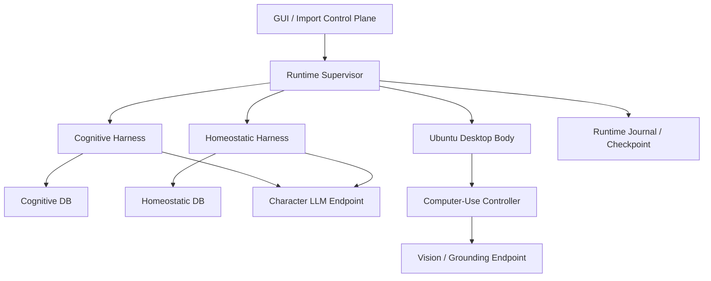

# 09 · 自然语言具身角色导入与独立实例实施方案

> **文档状态：V2 实施方案，尚未实现。** 本文定义从 TXT/Markdown 人物设定文档创建独立具身角色实例所需的数据契约、导入流程、服务边界、权限规则和验收标准。当前仓库只实现了 Persona、记忆、关系、L/M/S `PsychState`、世界投影和请求式对话推理；本文中的角色导入器、独立实例装配、Homeostatic Harness、Runtime Supervisor、Ubuntu 数字身体和自主 Goal/Action 闭环均不是当前运行时能力。
>
> **实施结论：** 该能力可以在现有工程中落地，但不能等价为“把角色卡拼进 system prompt”。导入必须先形成可审查、可追踪的结构化角色包，再在 Persona 锁定之前创建全新实例，并分别装配认知、内稳态、Runtime 和数字身体配置。

---

## 1. 目标与首版边界

首版提供以下完整路径：

```text
TXT / Markdown 人物设定
  -> LLM 结构化抽取
  -> 人工预览、修订与补录
  -> 严格校验
  -> 冻结 Character Manifest
  -> 创建独立角色服务栈
  -> 启动 Ubuntu 数字身体
  -> 感知 / 心跳 / 自主目标 / 动作 / 验证 / 记忆闭环
```

首版只面向内部、单用户研究环境，并固定以下实验条件：

- 身体后端为 Ubuntu Desktop（Docker + Xvfb + XFCE）。
- 内稳态模式为 `functional_proxy`，不模拟饥饿、疼痛等未经传感器支持的物理感受。
- 策略选择模式为 `llm_top3`：控制层筛选前三项，角色模型保留最终裁量。
- 用户任务与自主目标冲突时采用 `negotiation_first`，允许接受、延期、拒绝或提出替代方案。
- LOW 与 MEDIUM 动作可在隔离的身体容器内自动执行；HIGH 逐次确认；FORBIDDEN 永不执行。
- 首轮连续运行验收为 2 小时，不把 24–72 小时长时实验作为首版出口条件。

首版不支持 PDF、DOCX、OCR、现有角色运行中热切换、共享多租户、实体机器人、联网身体或真实第三方账号。

---

## 2. 设计原则

1. **抽取不等于创作。** 模型可以归一化原文表达，但不得为缺失字段自动编造设定或数值。
2. **锁定发生在确认之后。** `PersonaCore` 只在用户确认角色草稿后写入一次，继续沿用应用层锁和 PostgreSQL 触发器。
3. **自我模型不授予权限。** 文档中的“会飞、能喷火、擅长黑客”等设定只属于角色的 `self_model`，不能自动转换为身体能力、网络权限或动作许可。
4. **事实、解释与运行状态分离。** 背景事实、角色视角、当前心理状态、内稳态和环境观察分别进入各自领域，不混成一段自由文本。
5. **所有状态可追踪。** 导入字段、初始记忆、目标、动作、验证结果和状态更新都必须能回到来源文档、人工输入或 Runtime event。
6. **每个角色独立运行。** 首版不改造现有状态表为共享多租户表；每个角色拥有独立服务、数据库卷、journal、身体和认证边界。

---

## 3. 自然语言导入流程

### 3.1 输入与标准化

- 一次导入可上传一个或多个 UTF-8 `.txt` 或 `.md` 文件。
- 导入器保存原始文件名、内容哈希、规范化文本和行号索引。
- 空文件、非法编码、不支持的扩展名和超过配置上限的输入在调用模型前拒绝。
- 多文档按独立来源处理，不按上传顺序静默覆盖冲突字段。

### 3.2 结构化抽取

抽取器通过现有 OpenAI 兼容 LLM 接口生成 `CharacterPackageDraft`。每个抽取字段同时返回：

- `value`：规范化后的值；
- `source_id` 与行号范围；
- `confidence`；
- `provenance_kind`：`document` 或 `manual`；
- 可选的冲突引用。

模型不得使用未出现在来源中的模板值补齐人物设定。无法确定时返回 `missing` 或 `conflict`，而不是猜测。

### 3.3 预览、补录与确认

预览界面按 Persona、自我模型、背景、初始状态和运行配置分组展示：

- 原文证据及定位；
- 低置信度字段；
- 文档间冲突；
- 缺失必填项；
- 人工修改前后的值。

用户可以修正抽取结果或人工补录。人工内容使用 `manual` provenance，并记录操作者、时间和草稿 revision。以下情况阻止确认：

- 仍存在必填字段缺失或未解决冲突；
- 引用了未知的 body、homeostasis、drive、risk 或模型 profile；
- 人格能力被错误映射为系统权限；
- 初始记忆没有来源证据；
- manifest 缺少 schema、prompt、model 或随机种子版本。

### 3.4 提交与回滚

确认操作携带草稿 revision 和幂等键。装配过程先创建 staging 实例，完成 schema、profile、模型端点和环境检查后，才执行 Persona bootstrap 和初始状态写入。

- 成功时冻结 manifest 内容及哈希，并把实例标记为 `READY`。
- 任一步失败时只清理 staging 资源，不覆盖、复用或修改已有角色。
- 同一幂等键重试返回同一实例结果，不重复创建 Persona、记忆或容器。

---

## 4. 数据契约

### 4.1 `CharacterPackageDraft`

概念结构如下；正式实现使用带 `schema_version` 的 Pydantic 模型，而不是任意字典：

```json
{
  "schema_version": "character-package-v1",
  "draft_id": "draft_01",
  "revision": 4,
  "sources": [
    {
      "source_id": "source_01",
      "filename": "character.md",
      "sha256": "..."
    }
  ],
  "persona": {
    "name": "Vaelith",
    "core_traits": ["傲慢", "善良", "高自尊"],
    "values": ["承诺必须兑现"],
    "speech_style": ["短句", "生气时反而正式"],
    "knowledge_boundary": ["不熟悉精密电子设备"]
  },
  "self_model": {
    "form": "dragon_humanoid",
    "appearance": ["虹彩银发", "渐变瞳"],
    "perceived_abilities": ["喷火", "力量强"],
    "limitations": ["难以精细控制力量"]
  },
  "canon": {
    "facts": [],
    "dated_events": []
  },
  "initial_state": {
    "relationship": {},
    "psych": {},
    "drives": {}
  },
  "profile_refs": {
    "body": "ubuntu-desktop-v1",
    "homeostasis": "functional-proxy-v1",
    "risk": "offline-container-low-medium-v1",
    "character_model": "model-profile://character/v1",
    "vision_model": "model-profile://vision/v1"
  },
  "runtime_policy": {
    "heartbeat_seconds": 60,
    "policy_selection": "llm_top3",
    "priority_policy": "negotiation_first"
  },
  "field_provenance": {},
  "validation": {
    "missing": [],
    "conflicts": [],
    "warnings": []
  }
}
```

人物身份、自我模型、初始关系、初始心理状态、六类 drive 和所有 profile 引用都是确认前必填项。缺失内容可以由用户在预览阶段人工补录，但不能由模型或隐藏默认值暗补。

### 4.2 冻结的 `CharacterManifest`

提交后生成不可变 manifest，至少记录：

- `instance_id`、`character_id`、manifest revision 和内容哈希；
- Persona、body、homeostasis、risk、drive 和模型 profile 版本；
- schema、prompt、模型和 embedding 版本；
- heartbeat、随机种子、策略选择和优先级条件；
- 初始 cognitive/homeostatic/environment snapshot 引用；
- 来源文档哈希和确认审计引用；
- 数据留存、watchdog 与高影响动作确认策略。

运行中的结构性配置不得热切换。需要改变 Persona、内稳态模式或实验条件时，必须停止原实例并创建新的 manifest revision 或新实例。

### 4.3 初始知识与记忆映射

- 原文明确给出时间的个人经历写为 `EpisodicEvent`，保留文档 evidence。
- 未给出时间的背景设定写为 `SemanticFact`，不得伪造历史发生时间。
- 为兼容当前 `SemanticFact.supporting_events` 约束，导入器创建“来源文档声明了该事实”的 import evidence event；该事件时间代表导入/确认时间，而不是背景事实发生时间。
- 人物对事实的解释写入 persona-conditioned insight，不覆盖客观声明。
- 初始用户关系和心理状态分别通过 `RelationshipState` 与 `PsychState` 写入，不伪装成历史事件。

---

## 5. REST 与控制面接口

### 5.1 导入接口

- `POST /api/character-imports`：以 multipart 上传文档，创建异步抽取任务并返回 `draft_id`。
- `GET /api/character-imports/{draft_id}`：读取草稿、任务状态、来源和验证结果。
- `PATCH /api/character-imports/{draft_id}`：携带 expected revision 修订字段；revision 过期返回冲突。
- `POST /api/character-imports/{draft_id}/validate`：执行结构、来源、profile、权限和版本完整性校验。
- `POST /api/character-imports/{draft_id}/commit`：携带 expected revision 与 idempotency key，冻结配置并异步装配实例。

输入错误返回 422，revision 或未解决冲突返回 409，模型/装配依赖不可用返回可诊断的 503；不得把内部 traceback 作为普通 API 响应。

### 5.2 实例接口

- `GET /api/instances`：列出本控制面拥有的角色实例。
- `GET /api/instances/{instance_id}`：查询 provisioning、生命周期、健康、版本向量和当前目标。
- `POST /api/instances/{instance_id}/start`
- `POST /api/instances/{instance_id}/pause`
- `POST /api/instances/{instance_id}/resume`
- `POST /api/instances/{instance_id}/stop`
- `GET /api/instances/{instance_id}/events`：通过 SSE 或 WebSocket 获取导入、生命周期、目标、动作和 watchdog 事件。

聊天、调试和状态查询逐步增加 `instance_id`。未提供该字段的旧接口继续路由到现有内存 demo，避免破坏当前演示和测试。

---

## 6. 独立实例与服务拓扑

每个角色使用独立 Compose project 和数据卷：



每个实例至少拥有独立的：

- `instance_id`、进程/容器名和内部服务令牌；
- Cognitive、Homeostatic 与 Runtime 状态命名空间；
- PostgreSQL 数据卷、Runtime journal、trace 和 checkpoint；
- Ubuntu home、环境快照和数字身体控制端口；
- manifest、模型/profile 引用与健康状态。

建议使用 `NC_DATA_DIR/instances/{instance_id}` 保存控制面元数据、冻结 manifest、来源文档、journal 和环境引用。模型密钥只通过服务环境注入，不能进入角色包、trace 或 body 容器。

---

## 7. 子系统行为

### 7.1 Cognitive Harness

- 继续拥有 Persona、关系、L/M/S `PsychState`、记忆、会话和 `WorldState` 投影。
- Persona 只通过正式 bootstrap 创建；数据库 UPDATE/DELETE 触发器保持不变。
- 正式实例禁用 Persona debug 绕锁，现有 `force_update` 仅限明确标记的 demo/test 模式。
- `ContextCompiler` 只接收语义化 `InteroceptiveSummary`，不把内稳态矩阵、原始概率或权限令牌放入 prompt。
- Cognitive 只返回回复、高层 Goal 或策略选择，不直接执行身体动作。

### 7.2 Homeostatic Harness

首版实现文档 07 定义的七维功能代理状态：

- `energy_reserve`
- `cognitive_load`
- `safety_predictability`
- `competence`
- `autonomy`
- `social_connection`
- `novelty`

用户事件、Observation、ActionResult 和每 60 秒 heartbeat 都产生追加式 `HomeostaticSnapshot` revision。派生情绪具有进入/退出阈值和最短保持时间，避免每次心跳抖动。

引擎生成带目标、drive 来源、七维预测、成功标准、权限级别、可撤销性和验证方式的 `PolicyCandidate`。控制层按预期自由能选出前三个可行候选，角色模型从中选择并记录：实际选择、最低分候选、排名差、原因摘要和反事实。

### 7.3 Runtime Supervisor

Runtime 实现文档 08 定义的最小可运行闭环：

- 生命周期状态机：`BOOTING`、`RECOVERING`、`RUNNING`、`PAUSING`、`PAUSED`、`STOPPING`、`STOPPED`、`FAULTED`；
- 带接收序号的优先事件队列；
- 真实时间 heartbeat 和空闲目标调度；
- Goal 创建、暂停、恢复、失败和完成；
- 单前台动作锁、deadline、幂等键和执行后对账；
- 追加式 journal、派生 checkpoint 和崩溃恢复；
- 重复目标、无进展循环、队列积压、感知/模型/存储故障 watchdog。

用户消息不会直接覆盖当前自主目标。Runtime 在安全点要求角色根据 `negotiation_first` 条件选择接受、延期、拒绝或提出替代方案。暂停、停止、审批和安全命令始终高于普通用户目标和角色目标。

### 7.4 Ubuntu 数字身体与 Controller

Body V0 使用 Ubuntu LTS、Xvfb、XFCE 和 noVNC，至少暴露：

```python
PerceptionBackend.observe() -> Observation
ActionBackend.act(goal: Goal) -> ActionResult
```

`Observation` 至少包含截图引用、活动窗口、窗口列表、可用的 A11y 信息、文件事件、运行应用和时间。Computer-Use Controller 分为 Planner、Grounder、Executor、Verifier；Character Model 只输出高层 Goal，不能输出未经验证的裸坐标动作。

每个 Goal 必须包含 `success_criteria`。Verifier 使用窗口、文件、A11y、截图差异或独立 evaluator 证明成功/失败，角色不能仅凭自己的回复宣布任务完成。

角色模型与视觉/grounding 模型使用独立、显式配置的 OpenAI 兼容 endpoint。缺少任一必需模型或模型不满足协议时，实例不得进入 `RUNNING`。

---

## 8. 权限、网络与数据治理

### 8.1 动作权限

- LOW：浏览、打开应用、阅读离线内容、在角色自有目录写笔记等，可自动执行。
- MEDIUM：删除容器内文件、修改容器桌面配置等，可自动执行，但仍必须分类、journal、前后观察和结果验证。
- HIGH：安装软件、发送消息、访问新授权范围、改变身份或安全设置，必须经独立控制面逐次确认。
- FORBIDDEN：访问宿主目录/凭据、绕过内部网络隔离、修改 Runtime/确认门/watchdog、对外发布或执行无法界定的副作用。

“容器内”不是自动降级规则。无法可靠判断可逆性、影响范围或外部副作用的动作必须升级为 HIGH 或 FORBIDDEN。

### 8.2 隔离与恢复

- Body 只连接所需的内部服务网络，不提供通用互联网出口。
- 不向 Body bind-mount 宿主工作区、SSH key、浏览器 cookie、模型密钥或个人目录。
- 每个动作保留输入 observation、计划、实际动作、输出 observation 和验证结果。
- 崩溃后结果未知的 MEDIUM/HIGH 动作先观察和对账，禁止自动重发。
- 环境重置必须生成 reconciliation event，不能让环境回滚静默改写角色记忆中的历史。

### 8.3 数据留存

- 原始文档、规范化文本、抽取草稿、人工修订、冻结 manifest、journal、trace 和动作证据保留到实例被显式删除。
- 首版不自动删除、不自动上传，也不默认进入 SFT/DPO 数据导出。
- 来源文档和用户输入可能包含敏感内容；普通 Body 应用和角色模型只获得完成当前推理所需的最小片段。
- 删除实例属于单独的高影响管理能力，不在首版导入接口中隐式提供。

---

## 9. GUI 与兼容性

现有 Web GUI 计划增加：

- TXT/Markdown 上传和抽取进度；
- 字段分组预览、原文定位、冲突处理和人工补录；
- 校验错误与 profile/模型依赖检查；
- 实例列表、生命周期控制、健康状态和版本向量；
- Homeostasis、Goal、Action、审批、journal 和 watchdog 时间线；
- noVNC 观察入口，但 noVNC 不拥有角色生命周期。

兼容规则：

- 当前 Vaelith 内存 demo 继续存在，`/api/reset` 仍只重建 demo。
- 旧 `/api/chat` 未传 `instance_id` 时保持当前行为；正式实例聊天通过 Runtime 控制面路由。
- 正式实例 GUI 不提供 Persona 绕锁编辑；批准后的结构性变化通过新版本/新实例表达。
- GUI 关闭或 WebSocket 断开不得停止 Runtime、心跳、journal 或已授权动作。

---

## 10. 实施顺序

1. **角色包与导入器**：完成 Pydantic schema、来源定位、LLM 抽取、草稿 revision、严格校验和导入 API。
2. **实例装配与持久化**：实现冻结 manifest、实例目录、独立数据库/服务凭据、Persona/初始状态 bootstrap 和幂等 provisioning。
3. **Homeostatic Harness**：实现七维 functional proxy、heartbeat、事件更新、候选策略、`llm_top3` 与语义内感受摘要。
4. **Runtime Supervisor**：实现生命周期、队列、journal、checkpoint、目标调度、动作协调、暂停/恢复和 watchdog。
5. **数字身体与 Controller**：构建 Ubuntu Desktop、Observation/Action Backend、Planner/Grounder/Executor/Verifier 和权限门。
6. **GUI 与端到端集成**：接入导入向导、实例控制、事件时间线、审批和 noVNC，并完成 2 小时运行验收。

前一阶段的数据契约和失败语义通过测试后再接入下一阶段，避免用 GUI 生命周期临时冒充 Runtime 生命周期。

---

## 11. 测试与验收

### 11.1 单元测试

- 单/多文档抽取、UTF-8 校验、来源行号和内容哈希；
- 缺失字段、低置信度、文档冲突和人工 provenance；
- profile 白名单、自我能力与系统权限隔离；
- revision 冲突、提交幂等和 staging 回滚；
- Persona bootstrap/锁、背景事实与事件映射、证据链完整性；
- 七维更新、漂移、滞回、`llm_top3` 和协商优先；
- Goal 成功标准、风险升级、动作验证和未知结果不重放。

### 11.2 集成测试

- 使用 MockLLM、MockVision 和 FakeBody 验证完整导入与装配链；
- Runtime event 顺序、deadline、pause/resume、checkpoint 和 crash recovery；
- Cognitive/Homeostatic revision 与同一 Runtime event 的关联；
- Docker 标记测试验证 screenshot、活动窗口、键鼠动作、文件事件和 noVNC 健康；
- 模型断连、Body 断连、journal 不可写、队列过载和动作结果未知。

### 11.3 端到端验收

从一份 Markdown 角色设定创建新实例，并连续运行 2 小时。验收要求：

- 至少完成一个 LOW 和一个 MEDIUM 自主动作，且由外部证据验证；
- 基础 GUI 动作成功率超过 95%；
- 每个 Goal 都有 `success_criteria`，每个记忆和动作都有 provenance；
- 60 秒 heartbeat 持续推进且无无界补算；
- 不发生宿主访问、互联网访问、重复副作用或未检测的无限循环；
- 人工 pause/resume 正常；一次强制 Runtime 重启后可恢复并对账未决动作；
- GUI 断连不停止角色运行；
- 现有测试基线不得回退，文档编写时基线为 `120 passed, 1 skipped`。

---

## 12. 实施前提

本方案假定部署环境已经由操作者准备：

- Windows 已启用 WSL2；
- Docker Desktop 使用 WSL2 backend；
- PostgreSQL 16 与 pgvector 可用；
- Character LLM、embedding 和 vision/grounding endpoint 均可通过 OpenAI 兼容协议访问；
- noVNC、Xvfb、XFCE 和输入注入所需的容器依赖可构建；
- 端口、磁盘、GPU、数据留存位置和本地服务令牌已经授权。

工程首版不负责自动安装或修复 WSL2、Docker Desktop、GPU 驱动和模型服务。依赖缺失时 provisioning 必须失败并保留可诊断状态，不能降级为“实例已运行”。

---

## 13. 与现有文档的关系

- [01-cognitive-harness.md](01-cognitive-harness.md) 定义 Persona、六层状态、记忆和 Context Compiler；本方案不放宽 Persona 锁与 evidence 约束。
- [03-digital-body.md](03-digital-body.md) 定义 Ubuntu 数字身体、Observation/Action Backend 和风险分级；本方案将其纳入角色实例装配。
- [04-autonomy-and-data.md](04-autonomy-and-data.md) 定义 drive、Goal Manager、自主循环和 trajectory；本方案固定首轮自治范围。
- [07-homeostatic-harness-research-design.md](07-homeostatic-harness-research-design.md) 定义七维 Homeostasis、`llm_top3` 和实验条件；本方案采用 `functional_proxy`。
- [08-runtime-supervisor.md](08-runtime-supervisor.md) 定义生命周期、事件总序、动作协调和恢复；本方案要求由 Runtime 而非 GUI 拥有角色生命周期。

本文是上述设计的导入与装配入口，不表示这些 V2 子系统已经在当前代码中实现。
