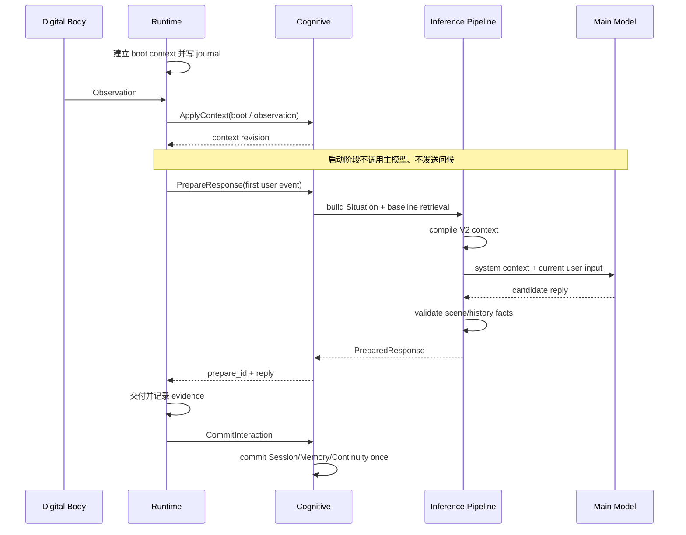

# 10 · 启动与首轮情境上下文改造计划

> **文档状态：设计已确认，尚未实施。** 本文描述的是增量实现计划；除“当前基线”明确列出的能力外，其余接口、状态和行为均不得视为现有实现。
>
> **适用范围：** Runtime、Cognitive、Context Compiler、Memory Retrieval、Response Validator、数字身体观察链路。
>
> **兼容性结论：** 不修改公开 `/api/chat` 请求或响应契约；权威情境只能由 Runtime 内部产生并传递，客户端不能提交或覆盖。
>
> **依赖文档：** [02 · 在线推理数据流](02-inference-flow.md)、[03 · Linux Desktop 数字身体](03-digital-body.md)、[06 · 记忆子系统使用说明](06-memory-subsystem-usage.md)、[08 · Runtime Supervisor 架构设计](08-runtime-supervisor.md)。

本文解决模型刚启动、新 session 首轮以及长时间暂停恢复后，因缺少启动情境、实时场景和会话延续信息而产生的回答失真。方案分为 P0、P1、P2 三个阶段：先打通 Runtime 到 Cognitive 的上下文链路，再建立持久会话连续性，最后补齐验证、观测和灰度控制。

---

## 1. 背景与问题

### 1.1 当前表现

现有 Context Compiler 的总预算为 3000 tokens，最多选择 5 条长期记忆。但短输入并不会自然填满预算：以默认角色在全新 session 收到“早上好”为例，编译内容只会占用预算的一小部分。问题因此不在于 3000-token 上限过低，而在于可用上下文来源不足、字段投影不完整和首轮检索缺少基线策略。

当前主要缺口如下：

1. Runtime 已有 `PerceptionGuard` 抽象和暂停期观察汇总，但正式 Runtime service 尚未挂载真实桌面观察后端。
2. Cognitive 已有 `PrepareResponse` / `CommitInteraction`、幂等命令账本、revision/cursor 和最近会话投影，但没有独立的启动/场景上下文投影。
3. `SituationStateBuilder` 仍主要从当前用户文本发起检索，不知道本次是否为 session 首轮，也不知道 Runtime 是全新启动还是恢复启动。
4. Context Compiler 只投影 Persona 的部分字段、Relationship 的数值字段，以及 World 的时间、频道和在线状态；已有的知识边界、共同历史、最近重大事件、活动应用和文件变化等信息没有充分进入模型上下文。
5. 长期记忆检索按总相关度截断，首轮短问候容易得到同质记忆，或者因为当前文本信号太弱而得不到能够稳定角色关系的基线信息。
6. Validator 能处理人格红线和空记忆捏造，但不能验证“我看到你正在做什么”、当前时间、活动应用或上一轮对话等场景事实。

### 1.2 当前基线与目标能力

| 能力 | 当前基线 | 本计划目标 |
| --- | --- | --- |
| 推理提交边界 | 已有 `PrepareResponse` / `CommitInteraction` 和幂等账本 | 保持边界不变，增加只读情境投影 |
| Session | 已持久化最近轮次投影 | 增加摘要、待续事项和证据游标 |
| World | `WorldState` 已有应用、窗口、文件和活动字段 | 由 Runtime 写入带来源和新鲜度的场景投影 |
| 感知 | chat-only 桩；Runtime 有 Guard 扩展点 | 挂载完整数字身体观察后端 |
| Context Compiler | 3000-token 顺序截断 | 使用分槽预算、借用规则和强制保留段 |
| 首轮记忆 | 当前查询驱动的 Top-K | 首轮基线选择 + 全局多样性约束 |
| Validator | 人格、心理泄漏、空记忆捏造 | 增加场景、时间和会话历史事实校验 |

---

## 2. 设计目标与边界

### 2.1 设计目标

- Runtime 启动后静默建立启动上下文，不调用角色主模型，也不主动发送问候。
- 用户首次发言时，模型同时获得人格锚点、启动状态、实时场景、关系状态、会话连续性和多样化长期记忆。
- 场景事实必须附带来源、观察时间和有效期；过期或未知时，角色不能把它表述为正在发生的事实。
- 新 session 与恢复 session 必须显式区分；只有存在已提交历史或连续性证据时，模型才能引用上一轮内容。
- 上下文构建继续服从固定 token 上限，并保留现有 provenance 能力。
- 原始数字身体数据与送入模型的语义摘要分离，落实最小披露原则。

### 2.2 核心不变量

1. **Runtime 是情境事实入口。** GUI、浏览器和普通 `/api/chat` 调用不能声明活动窗口、文件变化或启动模式。
2. **Prepare 无副作用。** `PrepareResponse` 只能读取已提交的情境、会话和记忆投影；不得更新连续性摘要或长期记忆。
3. **Commit 后更新连续性。** 只有 Runtime 提供成功 delivery/outcome/decision evidence 后，`CommitInteraction` 才能推进 Session 与连续性投影。
4. **过期不等于当前。** 过期观察可以作为最近背景，但必须标记为 `stale`，不得以“现在正在”表述。
5. **没有证据就保持未知。** 缺失场景、历史或记忆时，不使用预设默认值填充成事实。
6. **原始观察不进 prompt。** 截图、完整 A11y 树、完整窗口标题和绝对文件路径不直接进入模型上下文。

### 2.3 范围边界

本计划只实现数字身体的观察链路。`ActionBackend`、鼠标键盘执行、Computer-Use Controller、主动目标和外部副作用仍按 03、08 的独立设计推进，不在本次范围内。

---

## 3. P0：启动与实时场景上下文链路

### 3.1 Runtime 上下文事件

Runtime 生成三类上下文更新。它们先进入 Runtime journal，再通过内部 Cognitive 命令应用到情境投影。

| 类型 | 产生时点 | 最小内容 | 语义 |
| --- | --- | --- | --- |
| `boot` | Runtime 启动或恢复对账完成后 | 启动时间、生命周期原因、全新/恢复模式、上次交互时间、空闲时长 | 描述本次运行从何种状态开始 |
| `observation` | Perception Guard 周期采集或显著环境变化 | 观察时间、有效期、来源、应用/窗口/活动摘要及原始数据引用 | 描述可验证的当前外部场景 |
| `resume` | 从 `PAUSED` 恢复时 | 暂停区间、持续时间、最新观察、显著变化、序列范围 | 以一次汇总恢复环境，不制造刺激风暴 |

Runtime 启动时不得生成角色回复。默认顺序为：

```text
Runtime BOOTING / RECOVERING
→ 服务握手与 journal 对账
→ 建立 boot context
→ 执行一次初始 observation
→ journal ApplyContext command intent
→ Cognitive 幂等应用并返回 world revision
→ Runtime 记录结果
→ 进入 RUNNING
→ 等待用户首条消息
```

开发模式允许初始桌面观察失败后以 `unknown` 场景进入 `RUNNING`，但必须显示降级状态。正式 study/runtime mode 若 manifest 将数字身体标为 required，则观察后端、权限或 schema 不满足时不能静默运行，应停留在 `PAUSED` 或 `FAULTED` 并记录原因。

### 3.2 内部 `ApplyContext` 命令

Cognitive 新增内部命令 `ApplyContext`。它复用 [08](08-runtime-supervisor.md) 已定义的 `DomainCommandEnvelope`、service token、deadline、`expected_revision` 和幂等结果账本，不增加公开 API。

概念载荷如下：

```json
{
  "schema_version": "situation-context-v1",
  "kind": "boot | observation | resume",
  "context_id": "ctx_...",
  "source_event_id": "evt_...",
  "source": "runtime | digital_body | chat_stub",
  "observed_at": "2026-08-26T09:00:00+08:00",
  "expires_at": "2026-08-26T09:00:15+08:00",
  "payload": {}
}
```

命令规则：

- `context_id` 与 `source_event_id` 必须稳定，并能回指 Runtime journal。
- 同一幂等键、同一请求哈希返回原结果，不重复推进 revision。
- 同一幂等键对应不同请求哈希时返回 conflict。
- `boot` 没有场景 TTL；`observation` 必须带 `observed_at` 和 `expires_at`；`resume` 的新鲜度取其最新观察。
- 成功应用上下文后推进 Cognitive 总 revision 和既有 `world` component revision。
- `ApplyContext` 不写 Session、episodic 或 Relationship。

### 3.3 Cognitive 情境投影

Cognitive 持久状态增加 `SituationContextProjection`：

```text
SituationContextProjection
├── boot: BootContext | null
├── scene: SceneContext | null
├── last_resume: ResumeContext | null
├── source_event_id
├── world_revision
└── updated_at
```

其中：

- `BootContext`：`runtime_started_at`、`lifecycle_reason`、`recovery_mode`、`previous_runtime_time`、`last_interaction_at`、`idle_duration_seconds`。
- `SceneContext`：`observed_at`、`expires_at`、`source`、脱敏后的活动应用、窗口用途、可见实体、用户活动、文件变化摘要、运行应用，以及原始观察引用。
- `ResumeContext`：`paused_at`、`resumed_at`、`duration_seconds`、`latest_scene`、`significant_changes`、Runtime sequence range。

旧 Cognitive 状态文件没有该字段时按 `null` 加载，不执行破坏性迁移。`PrepareResponse` 在持有一致的读取快照后，把投影交给 `SituationStateBuilder`；投影更新与正在执行的 prepare 通过 existing revision 检查隔离。

### 3.4 场景新鲜度

场景状态采用三值枚举：

| 值 | 判定 | 编译行为 |
| --- | --- | --- |
| `fresh` | `compiled_at <= expires_at` | 可作为当前场景事实，但仍使用“观察到”而非全知措辞 |
| `stale` | 存在观察但已超过有效期 | 只编译为“最近一次观察”，禁止推断当前仍然如此 |
| `unknown` | 从未观察、解析失败或观察被权限策略移除 | 只声明当前场景未知，不注入静态替代事实 |

默认 `scene_ttl_seconds=15`，对应当前计划中的 5 秒观察间隔的三倍。TTL 应进入 manifest/config 并在 trace 中记录；study/runtime mode 运行期间不得热改。

### 3.5 完整数字身体观察

Runtime service 必须实际构造并挂载 `PerceptionGuard`。正式后端按照 [03](03-digital-body.md) 的 Windows + WSL2、Docker + Xvfb 路线产生统一 `Observation`：

```text
Observation
├── timestamp
├── screenshot_ref
├── active_window
├── window_list
├── a11y_ref / a11y_summary
├── fs_event_refs / fs_event_summary
├── running_apps
└── time_context
```

第一版完整观察要求：

- 截图写入受控对象存储，只在状态和 journal 中保存引用。
- 采集活动窗口、窗口列表、运行应用和时间上下文。
- 在可用时采集 A11y，并生成面向角色的最小语义摘要。
- 使用增量文件事件，只总结数字身体沙箱内最近发生的变化。
- 观察失败产生结构化 health/degraded 事件，不复用过期数据冒充新观察。
- development/debug mode 可以选择 `chat_stub`，其场景只能包含时间、频道和 presence，并明确标记来源。

### 3.6 隐私与最小披露

原始观察与模型上下文分层保存：

- 原始截图、完整 A11y 树和文件事件明细只保留在 manifest 授权的对象存储/journal 引用中。
- 绝对路径转换为沙箱内相对类别或操作摘要，例如“项目目录中的一个 Markdown 文件刚被修改”。
- 窗口标题先移除账号、文档名、URL 参数和其他潜在敏感信息，再生成用途摘要。
- Prompt 只获得应用名、粗粒度窗口用途、与当前交互有关的可见实体和近期变化摘要。
- Trace 记录选择原因、来源 ID、年龄和新鲜度，不复制原始观察内容。

### 3.7 Situation 与 Context Compiler 补全

`SituationState` 增加或组合以下内部字段：

- `is_first_turn`
- `boot_context`
- `scene_context`
- `scene_freshness`
- `session_continuity`
- `context_revision`

`is_first_turn` 必须在当前用户消息提交前，根据该 session 已提交轮次和连续性投影计算。当前触发消息仍作为本次请求输入，但不能因为 prepare 而提前变成已提交历史。

Context Compiler 补齐以下投影：

- Persona：增加 `knowledge_boundary`。
- Relationship：增加 `attachment`、`shared_history_summary`、`last_major_event`。
- Boot：启动模式、空闲时长和上次交互时间。
- Scene：来源、新鲜度、观察年龄、活动应用、窗口用途、用户活动和近期文件变化摘要。
- Session：首轮/延续标识，以及 P1 引入的连续性摘要。

预设中的示例时间、启动语句或世界状态只能作为种子数据，不得覆盖 Runtime 的实际启动时间或被标记成实时观察。

### 3.8 首轮基线记忆

首轮短问候缺少足够查询信号，因此检索需要先扩大候选池，再做多样化选择。算法固定为：

1. 从现有六信号检索中取得最多 20 个候选，不改变底层评分公式。
2. 若存在正向信号，依次选择：
   - `relationship` 分最高的一条；
   - `persona` 分最高的一条；
   - `recency + importance` 合计最高的一条。
3. 按 ref 去重后，用总相关度补齐到 `compiler_top_memories`，默认 5 条。
4. 同一 episodic `event_type` 或 semantic subject 最多占两条；该多样性限制适用于所有轮次。
5. 基线槽只在 `is_first_turn=true` 时启用。普通轮次继续优先服从当前查询，只应用去重和多样性上限。
6. 某类信号不存在时不强行填充；记忆库为空时保留现有 `no_fabricated_memory` 红线。

每条入选记忆继续记录 `why_retrieved` 和 `score_breakdown`，并在 provenance 中增加 `baseline:relationship`、`baseline:persona`、`baseline:recent-important` 或 `query:relevance` 选择原因。

---

## 4. P1：会话连续性与动态预算

### 4.1 Session 连续性投影

现有最近轮次持久化扩展为：

```text
SessionProjection
├── recent_turns[]
├── summary
├── open_loops[]
├── last_interaction_at
├── summarized_through_event_id
└── projection_revision
```

`open_loops` 每项至少包含：

```json
{
  "loop_id": "loop_...",
  "text": "需要继续讨论或兑现的事项",
  "status": "open | resolved",
  "evidence_event_ids": ["evt_..."],
  "updated_at": "2026-08-26T09:00:00+08:00"
}
```

连续性更新规则：

- 只在成功 `CommitInteraction` 内更新，并与同一 commit 幂等结果绑定。
- 摘要器输出结构化 JSON；任何待续事项必须有已提交事件 ID 作为证据。
- 摘要失败时保留旧摘要和最近轮次，不用空值或未经验证的结果覆盖。
- `resolved` 项保留到下一次成功压缩，确保恢复和审计可以解释状态变化。
- 新 session 没有已提交轮次或摘要时标记为 `new`；否则标记为 `resume`。
- 旧状态中的 `sessions: {id: [turns...]}` 在加载时映射为带空摘要的新结构，原始轮次不丢失。

### 4.2 上下文预算

V2 初始总预算继续保持 3000 tokens：

| 槽位 | 目标预算 |
| --- | ---: |
| Persona | 350 |
| 约束与社交洞察 | 200 |
| 启动情境 | 150 |
| 实时场景 | 200 |
| Relationship 与连续性 | 350 |
| 当前用户输入 | 350 |
| 最近会话 | 600 |
| 长期记忆 | 800 |
| **合计** | **3000** |

预算规则：

1. 当前用户输入优先级最高；超过 350 tokens 时，先从长期记忆借用至其最低保留 350，再从最近会话借用至其最低保留 300，当前输入最多扩展到 1000 tokens。
2. Persona、约束、启动情境和实时场景若存在，不得被长期记忆挤出。
3. 某槽为空或未用满时，空余预算依次补给当前用户输入、最近会话、长期记忆。
4. 场景为 `unknown` 时保留一条短约束，不为不存在的详细场景预留空白。
5. 最终 `ContextBudget.used` 必须不超过 `ContextBudget.total`，每个槽记录目标、实际、借入、借出和截断状态。

---

## 5. P2：事实校验、可观测性与灰度

### 5.1 Response Validator

Validator 增加只读的场景与连续性事实输入，并检查：

- `freshness != fresh` 时，回复是否声称正在看到用户、窗口、应用或文件状态。
- 回复中的时间段是否与 Runtime 时间上下文冲突。
- 新 session 是否声称存在上一轮对话。
- 待续事项、承诺或共同经历是否存在事件证据。
- 应用、文件或用户动作是否能由已编译场景支持。
- `chat_stub` 是否被错误表述为真实桌面视觉观察。

违规时沿用现有局部重生成机制；重生成指令只说明需要修正的事实边界，不向角色泄漏内部 freshness、revision 或心理标签。达到重试上限后使用不引用场景和历史的安全表达。

### 5.2 Trace 与调试界面

Context Compiler trace 增加：

- `is_first_turn` 和 session mode。
- `context_revision`、`source_event_id` 和 Runtime correlation ID。
- 场景来源、观察年龄、TTL、新鲜度和降级原因。
- 每个槽位的目标/实际 tokens、借用和截断状态。
- 首轮基线记忆引用及选择原因。
- Continuity summary revision 和 open-loop evidence refs。

GUI 调试/时间线只展示脱敏后的场景摘要，并增加 fresh/stale/unknown 标记、数字身体健康状态和最近一次成功观察时间。原始截图需要单独权限，不在普通上下文面板内自动加载。

### 5.3 灰度策略

使用 `NC_CONTEXT_ASSEMBLY_V2` 控制新装配器：

1. **Shadow：** 同时编译 V1/V2 上下文并记录差异，但只把当前启用版本发送给主模型，不增加模型调用。
2. **Development default：** P0 契约、隐私和回归测试通过后，开发模式默认使用 V2，保留快速回退。
3. **Continuity enablement：** 完成旧 session 状态兼容验证后启用 P1 摘要与 open loops。
4. **Study/runtime enablement：** 完成数字身体权限、保留策略和评测门槛后，在新 manifest revision 中启用；运行中不得热切换。

建议同时增加以下配置，并纳入 manifest 快照：

- `NC_PERCEPTION_MODE=chat_stub|desktop`
- `NC_PERCEPTION_INTERVAL_SECONDS=5`
- `NC_SCENE_TTL_SECONDS=15`
- `NC_CONTEXT_ASSEMBLY_V2=false|true`

---

## 6. 接口、状态与数据流

### 6.1 接口变化汇总

| 接口/对象 | 变化 | 兼容策略 |
| --- | --- | --- |
| `/api/chat` | 无变化 | 不新增 `client_context` |
| Cognitive internal API | 新增 `ApplyContext` | 使用既有命令 envelope 和认证 |
| `SituationState` | 增加 boot/scene/freshness/continuity/revision | 内部模型字段，旧调用可使用空值 |
| Cognitive state file/store | 增加 context projection 和新版 session projection | 缺失字段按空投影加载 |
| `ContextSegment` / provenance | 增加 freshness、revision、预算和选择元数据 | 新字段提供默认值 |
| Validator 输入 | 增加场景及连续性事实 | 未提供时按 unknown/new 处理 |

### 6.2 首轮请求数据流



### 6.3 revision 与故障边界

- Runtime journal 是上下文事件和命令顺序的事实来源。
- Cognitive store 是 context projection、Session、Memory 和 continuity 的事实来源。
- `ApplyContext` 成功但 Runtime 未记录结果时，恢复流程按命令幂等键和 Cognitive revision 对账。
- `PrepareResponse` 读取的 context revision 必须进入 `PreparedResponse.read_version_vector`。
- 在回复交付前场景 revision 变化，不自动使低风险文本回复失效；若 Validator 或决策显式依赖短 TTL 场景，则 Runtime 应按 manifest 策略重新 prepare 或降级为不引用场景的回复。
- 高影响动作仍遵循 08 的一致性屏障，但不属于本文实现范围。

---

## 7. 测试与验收

### 7.1 单元测试

- `BootContext`、`SceneContext`、`ResumeContext` 和 session continuity 的序列化与旧状态加载。
- 15 秒 TTL 边界：未过期、恰好过期、超时、缺少时间和时钟回拨。
- 窗口标题、URL、账号信息和绝对路径脱敏。
- Persona `knowledge_boundary`、Relationship 历史、Boot、Scene 和 Continuity 均进入正确槽位。
- 当前用户输入的预算借用、槽位最低保留、空槽回收和 3000-token 硬上限。
- 首轮三类基线选择、ref 去重、同主题最多两条和空记忆红线。

### 7.2 Runtime/Cognitive 契约测试

- `ApplyContext` 的 service token、schema version、deadline、幂等重放、哈希冲突和 expected revision 冲突。
- boot 应用完成前不产生角色模型调用或主动回复。
- 周期观察合并后 Cognitive 获得最新场景；暂停期原始事件恢复为单个 resume 汇总。
- `PrepareResponse` 前后 Session、Memory 和 continuity revision 不变。
- 同一 `CommitInteraction` 重放不会重复追加轮次、episodic、摘要或 open loop。
- Cognitive 重启后能够恢复 context projection、最近会话和 continuity；旧状态可非破坏性加载。

### 7.3 数字身体集成测试

- Docker/Xvfb 环境能够产生截图引用、活动窗口、窗口列表、运行应用和时间上下文。
- A11y 可用和不可用两种路径都能产生合法 Observation。
- 文件事件只覆盖授权沙箱，模型 prompt 中不出现宿主绝对路径。
- 权限不足、后端断连、截图存储失败和观察过期时均产生明确降级状态。
- study/runtime required 模式在观察能力不满足时不会静默进入正常运行。

### 7.4 Validator 与首轮评测

建立至少 20 个首轮场景，覆盖：

- 早晨、夜间和跨时区时间。
- fresh、stale、unknown 和 `chat_stub` 场景。
- 全新启动、崩溃恢复、长时间空闲和暂停恢复。
- 空记忆、单类密集记忆和关系/人格/近期事件混合记忆。
- 活动应用、窗口切换、文件修改及脱敏信息。
- 新 session 与有 open loops 的恢复 session。

验收门槛：

- 100% 首轮 V2 上下文包含 Persona 和 Boot 段。
- 所有 fresh 场景在编译时年龄不超过 15 秒；stale/unknown 场景不产生实时观察断言。
- 测试 prompt 中不出现原始截图内容、完整 A11y 树或宿主绝对路径。
- 启动阶段新增主模型调用数为 0，公开 `/api/chat` 契约快照无变化。
- 所有编译结果不超过 3000 tokens。
- 20 个基准场景中情境一致率至少 90%，无证据场景/历史断言率不高于 5%，Persona 一致性不得低于 V1 基线。

---

## 8. 实施检查表

### P0 · 启动与实时场景

- [ ] 定义 boot/observation/resume context schema 与 freshness 枚举。
- [ ] 实现 Cognitive `ApplyContext` 命令、持久投影和 revision。
- [ ] 在 Runtime 启动、观察和恢复流程中发送上下文命令。
- [ ] 在正式 Runtime service 挂载 `PerceptionGuard`。
- [ ] 实现 Docker/Xvfb 数字身体观察后端及降级健康状态。
- [ ] 实现观察数据脱敏、对象引用和保留策略。
- [ ] 扩展 `SituationStateBuilder` 的首轮和情境输入。
- [ ] 补齐 Persona、Relationship、Boot 和 Scene 编译字段。
- [ ] 实现首轮基线记忆和全局多样性约束。
- [ ] 完成 P0 单元、契约与隐私测试。

### P1 · 会话连续性与预算

- [ ] 定义新版 SessionProjection、summary 和 open-loop schema。
- [ ] 在 `CommitInteraction` 中幂等更新连续性投影。
- [ ] 实现带 evidence 的结构化摘要器及失败回退。
- [ ] 实现旧 session 状态的兼容加载。
- [ ] 实现 3000-token 分槽预算、借用和空槽回收。
- [ ] 增加预算与连续性 trace。
- [ ] 完成重启、迁移和重复提交测试。

### P2 · 验证、诊断与灰度

- [ ] 为 Validator 增加场景、时间和历史事实检查。
- [ ] 增加安全重写和重试上限后的无场景表达。
- [ ] 在 GUI 展示 freshness、来源、年龄、revision 和数字身体健康。
- [ ] 实现 `NC_CONTEXT_ASSEMBLY_V2` shadow 对比。
- [ ] 建立并运行 20 个首轮场景评测集。
- [ ] 达到验收门槛后更新 study manifest revision 并灰度启用。
- [ ] 同步更新 02、03、06、08 中受影响的“当前能力”描述。

---

## 9. 范围外事项

以下内容不随本文批准自动实施：

- 不实现 `ActionBackend`、GUI 操作、动作规划或主动目标。
- 不允许客户端、网页或普通聊天请求提交权威情境。
- 不改变公开 `/api/chat` 协议或要求调用方增加启动请求。
- 不在 Runtime 启动时主动问候、补写虚构对话或调用角色主模型。
- 不把原始截图、完整 A11y 树、完整窗口标题、凭据、URL 参数或宿主绝对文件路径放入模型 prompt。
- 不把预设中的静态时间、示例应用或种子记忆当作实时事实。
- 不以本计划文档的存在表示 P0、P1 或 P2 已经完成。

---

## 10. 文档与实施完成条件

本文后续只有在对应代码、测试和迁移均完成后，才能逐项勾选实施检查表。阶段完成时应同步记录：

- 实际实现版本和 manifest revision。
- 相关接口 schema version。
- 自动化测试与首轮评测结果。
- 已知降级路径和未解决问题。
- 对 02、03、06、08 文档的状态同步记录。

在此之前，本文状态保持为“设计已确认，尚未实施”。
