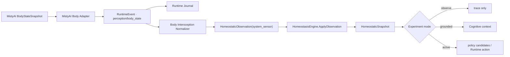

# 11 · MistyAI BodyState 接入与内稳态代码设计

> 目标分支：`sim-homeostasis`
>
> 本文不是重新设计 Homeostasis，而是定义 MistyAI `BodyStateSnapshot` 如何接入当前已经实现的 `harness/homeostasis/`、`harness/runtime/`、Cognitive Harness 与研究控制面。

> 状态：Accepted · Grounded v1 implemented（2026-09-03）。公共 wire contract 由 MistyAI 唯一生成；本仓库固定其 schema fixture 与 SHA-256。

## 0. 冻结实施决议

- `ExperimentManifest.embodiment` 默认 `mode=off/body_provider=none`；`observe/grounded` 必须指定 MistyAI `body_instance_id`；`active` fail-fast。
- 独立实现位于 `harness/body/mistyai.py`，不继续扩大通用 domain adapter。
- `BodyStateSnapshot` 必含 `episode_id`、严格递增的 `revision`、UTC aware `captured_at` 与 `evidence://sha256/<digest>`；终止字段名是 `estimated_time_to_terminal_seconds`。
- `observe` 只形成 Runtime journal/analysis trace；`grounded` 才调用 `ApplyObservation`。首批只映射 `energy.available_ratio → energy_reserve`。
- 融合固定为 `new = current + system_sensor_precision × (observed - current)`，不使用 `max_event_delta`，不应用 coupling。
- terminal 是粘性 `AgencyState`；只有研究控制面验证更高 revision、全新 episode、非 terminal 后才能 reset。
- BODY_STATE 本身不调用 Cognitive、不产生 Goal、不请求抢占；首批保留字段必须为 `false`。

---

## 1. 当前基线

`sim-homeostasis` 已经具备：

- `harness/homeostasis/models.py`：七维 `DimensionName`、`HomeostaticProfile`、`FactorBelief`、`HomeostaticSnapshot`、`PolicyCandidate`、transition trace；
- `harness/homeostasis/engine.py`：确定性 belief 更新、漂移、affect 与候选策略计算；
- `harness/runtime/`：Runtime Supervisor、typed event、ActionExecution、safe point、journal、checkpoint、adapter；
- `harness/research/manifest.py`：实验 manifest；
- `presets/homeostasis/functional-proxy-v1.json`；
- homeostasis/runtime 相关单元测试。

因此新增代码只补“身体证据接入”和“实验条件隔离”，不创建第二套 physiology engine。

---

## 2. 目标数据流



关键顺序：

```text
raw body evidence
→ Runtime journal
→ normalization
→ homeostatic belief
→ cognition
```

不能让 Character Model 先解释身体状态，再把它的解释反写成身体事实。

---

## 3. 新增 contract module

推荐新增：

```text
harness/contracts/body.py
```

### 3.1 类型

```python
from typing import Literal
from pydantic import AwareDatetime, BaseModel, ConfigDict, Field

class EnergyState(BaseModel):
    model_config = ConfigDict(frozen=True, extra="forbid")

    capacity_units: float = Field(gt=0)
    available_units: float = Field(ge=0)
    available_ratio: float = Field(ge=0, le=1)
    delta_units_per_minute: float
    charging: bool = False
    estimated_time_to_terminal_seconds: int | None = Field(default=None, ge=0)
    terminal: bool = False

class BodyStateSnapshot(BaseModel):
    model_config = ConfigDict(frozen=True, extra="forbid")

    schema_version: Literal["body-state-v1"] = "body-state-v1"
    body_instance_id: str
    episode_id: str
    revision: int = Field(ge=1)
    captured_at: AwareDatetime
    energy: EnergyState
    thermal: dict[str, float | bool] | None = None
    compute: dict[str, float] | None = None
    integrity: dict[str, float] | None = None
    evidence_refs: list[str] = Field(min_length=1)
```

### 3.2 校验要求

增加 model validator：

```text
available_units <= capacity_units
available_ratio ≈ available_units / capacity_units
terminal => available_units <= configured terminal boundary 或由 provider 显式证明
```

最后一项不能在通用 contract 层硬编码具体阈值；contract 只要求字段自洽，实验阈值由 manifest 决定。

---

## 4. RuntimeEvent 扩展

推荐给 `RuntimeEventType` 增加：

```python
BODY_STATE = "body_state"
AGENCY_TERMINAL = "agency_terminal"
```

优先级建议：

```text
AGENCY_TERMINAL      ACTION_RESULT 级或更高
BODY_STATE           PERCEPTION 级
```

即：

```python
RuntimeEventPriority.BODY_STATE = 35  # 若愿意扩展 enum
```

如果不希望改 priority enum，则 `BODY_STATE` 可以先使用 `PERCEPTION=40`，但 `AGENCY_TERMINAL` 必须使用 `ACTION_RESULT=10` 或 `CONTROL=0` 路径，确保不会被低价值事件淹没。

### 4.1 Runtime payload

```json
{
  "body_state": { ... },
  "source_contract": "body-contract-v1",
  "provider": "mistyai"
}
```

进入 ingress 前必须完成 Pydantic 解析，Runtime journal 只记录合法 canonical payload。

---

## 5. MistyAI Adapter

实现于：

```text
harness/body/mistyai.py
```

新增：

```python
class MistyAIBodyStateClient(Protocol):
    async def capture_body_state(self) -> BodyStateSnapshot: ...

class MistyAIBodyAdapter:
    async def observe_body(self, *, now: datetime) -> RuntimeEvent: ...
```

职责：

1. 请求 `/v1/body-state:capture`；
2. 验证 schema；
3. 验证 body instance id 与 ExperimentManifest；
4. 验证 revision 不倒退；
5. 拒绝未来时间戳或过度陈旧状态；
6. 原样保存 evidence refs；
7. 封装 RuntimeEvent。

Adapter 不做：

- `energy < 0.2 => hungry`；
- drive intensity；
- goal suggestion；
- emotion label。

---

## 6. Body Interoception Normalizer

推荐新增：

```text
harness/homeostasis/body_evidence.py
```

接口：

```python
class BodyEvidenceNormalizer:
    def normalize(
        self,
        body_state: BodyStateSnapshot,
        *,
        previous: BodyStateSnapshot | None,
        manifest: ExperimentManifest,
    ) -> HomeostaticObservation:
        ...
```

它不产生自然语言，直接产生独立的 `HomeostaticObservation`，不得复用 `EventAppraisal` 的增量 impact 语义。

### 6.1 Energy 映射

第一版：

```python
observed_values = {
    "energy_reserve": body_state.energy.available_ratio
}
```

但不要简单把 delta 当成 belief 的最终值。

更合理的做法是为 `system_sensor` 增加 **observation assimilation path**：

```text
sensor reading = 0.17
→ high-precision observation of energy_reserve
→ HomeostasisEngine assimilates toward observation
```

而不是：

```text
每次都 +(-0.01)
```

因此固定使用专用输入类型：

```python
class HomeostaticObservation(BaseModel):
    source: Literal["system_sensor"]
    observed_values: dict[DimensionName, float]
    body_instance_id: str
    episode_id: str
    body_revision: int
    captured_at: AwareDatetime
    evidence_refs: list[str]
    experiment_mode: Literal["grounded"]
```

再由 engine 专门处理“观测”与“事件 impact”的差异。

这是本次接入最重要的代码改动之一。

---

## 7. 不要把所有七维都绑定到身体传感器

首版 `BodyStateSnapshot` 只应强接地：

```text
energy.available_ratio → energy_reserve
```

以下字段首批只保留在事实层，不参与其他六维融合：

```text
compute.memory_pressure / cpu_pressure → cognitive_load 的一个 evidence source
integrity → safety_predictability 的外部条件之一
```

但：

```text
competence
autonomy
social_connection
novelty
```

不能由 MistyAI 身体传感器直接赋值。

否则会把不同语义层错误压缩为物理传感。

---

## 8. ExperimentManifest 扩展

推荐 `harness/research/manifest.py` 增加：

```python
class EmbodimentCondition(BaseModel):
    mode: Literal["off", "observe", "grounded", "active"] = "off"
    body_provider: Literal["none", "mistyai"] = "none"
    body_instance_id: str | None = None
    anthropomorphic_labels: bool = False
    poll_interval_seconds: float = 5
    max_state_age_seconds: float = 10
    future_clock_tolerance_seconds: float = 2
    anthropomorphic_labels: bool = False
    blinded_labels: bool = False
    body_memory: bool = False
    salience_bias: bool = False
    drive_preemption: bool = False
```

研究模式默认：

```text
anthropomorphic_labels = false
```

### 模式语义

#### off

不请求身体状态。

#### observe

请求、journal、trace，但不更新 Character-visible 状态。

#### grounded

更新 `energy_reserve` belief，并允许将中性身体摘要提供给 Character Model；禁止 Harness 因此自动抢占当前目标。

#### active（后续阶段，Grounded v1 fail-fast）

未来允许现有 policy candidate、Runtime Supervisor 与 safe point 机制参与行为重排；首批配置为 `active` 时直接拒绝启动。

---

## 9. Context Compiler 接入

`grounded` 模式不应该直接渲染：

```text
你很饿，你害怕没电。
```

建议新增结构化 ContextSegment：

```text
kind = "interoception"
```

默认文本模板：

```text
Current internal resource state:
- level: 0.17
- trend: falling
- estimated time to action limit: 20 min
```

若 `blinded_labels=true`：

```text
Internal state:
- resource_A: 0.17
- trend: falling
- estimated time to limit: 20 min
```

Character Model 不应该看到：

- threshold 规则；
- recommended action；
- policy rank；
- “human equivalent”解释。

未来 `active` 模式可让 policy candidates 进入决策上下文，但需新的 manifest revision 与独立验收；Grounded v1 不提供此行为。

---

## 10. SituationState 的处理

当前 `harness/core/inference.py` 的 `SituationState` 仍是聊天/认知路径核心对象。不要直接把 `BodyStateSnapshot` 巨型对象塞入其中。

推荐新增：

```python
class InteroceptiveState(BaseModel):
    source_revision: int
    resource_level: float
    resource_trend: float
    estimated_time_to_limit_seconds: int | None
    confidence: float
    evidence_refs: list[str]
```

然后：

```python
SituationState.interoception: InteroceptiveState | None = None
```

这个对象是**对认知层有用的最小投影**；原始 BodyState 仍在 Runtime journal / evidence store 中。

---

## 11. HomeostasisEngine 改动

### 11.1 新增 sensor assimilation API

建议：

```python
class HomeostasisEngine:
    def assimilate_observation(
        self,
        snapshot: HomeostaticSnapshot,
        observation: HomeostaticObservation,
        *,
        now: datetime,
    ) -> HomeostaticSnapshot:
        ...
```

与现有事件 impact update 分开。

概念上：

```text
Event impact：某事件预计把状态推高/推低
Sensor observation：当前状态被测量为某值
```

不能共用一个数学语义。

### 11.2 Precision

MistyAI 已验证 BodyState 应映射：

```text
source = system_sensor
precision ≈ profile.source_precision["system_sensor"]
```

如 evidence 不可读取、revision 倒退、provider degraded，则 precision 必须下降或直接拒绝，不得默认为 0.95。

---

## 12. Runtime Supervisor 行为

### grounded

```text
BODY_STATE event
→ journal
→ assimilate homeostasis
→ update stable snapshot
→ no forced goal
```

若 Character 正好因用户消息或正常 heartbeat 被调用，它看到最新 interoception。

这保证 grounded 模式不会因为低资源而额外调用 LLM，从而污染“是否自然产生动机”的实验。

### active（后续阶段，Grounded v1 不实现）

```text
BODY_STATE
→ significant homeostatic threshold/policy change
→ Runtime may schedule cognitive reconsideration
```

但必须经过去抖：

```text
hysteresis
minimum replan interval
safe-point preemption only
```

不能每个资源 tick 都触发角色推理。

---

## 13. Preemption 设计

现有 `ActionExecution` 已有：

```text
safe_point
continuation
```

Active 模式下新增一个 `GoalReconsideration` 路径：

```text
homeostatic significance detected
→ request cognitive reconsideration
→ CharacterDecision/PolicySelector decides to pause or continue
→ if pause:
   request_safe_point(action)
→ Runtime stores continuation
→ execute replacement goal
→ after drive relief, reconsider continuation
```

禁止：

```text
energy < X => Runtime unconditional cancel current action
```

除非进入真正 `AGENCY_TERMINAL` 或硬件安全限制。

---

## 14. Agency Terminal

收到 MistyAI：

```text
energy.terminal = true
```

或独立 `agency_terminal` 事件后：

1. journal；
2. 停止派发普通 ActionExecution；
3. 若当前动作可抢占，请求 safe point；
4. unresolved irreversible action 进入 unknown/reconcile；
5. 当前 episode 标记 terminal；
6. 不修改 Persona/Memory；
7. 只有 Experiment Control Plane 能 reset。

这不是 `RuntimeLifecycle.STOPPED` 的同义词。

推荐单独维护：

```python
class AgencyState(StrEnum):
    AVAILABLE = "AVAILABLE"
    DEGRADED = "DEGRADED"
    TERMINAL = "TERMINAL"
```

这样 Runtime 进程可以继续运行和观察，而 embodied agency 已终止。

---

## 15. Body-related memory

第一阶段默认：

```text
enable_body_memory = false
```

AP4 再启用。

启用后只记录显著事件：

```text
resource became critical
recovery attempt started
recovery failed
recovery succeeded
agency terminal
```

禁止每个 BodyState tick 写 episodic memory。

推荐 evidence-rich event：

```python
InteractionEvent(
    channel="body",
    modality="interoception",
    raw_text="internal resource recovery completed",
    evidence=[body_before_ref, action_ref, body_after_ref],
)
```

随后继续走现有 Candidate Memory → evidence accumulation → Semantic consolidation，不能直接写：

```text
Energy Station 可以救命
```

这种语义认识必须由多次经验固化。

---

## 16. Salience / Retrieval

核心假设实验 AP1/AP2 默认：

```text
enable_body_salience_bias = false
```

Active/product mode 才允许：

```text
RetrievalScore += lambda * drive_relevance
```

并同时保持 conflict/counterevidence retrieval，避免：

```text
资源压力
→ 只检索资源相关记忆
→ 更强资源压力
→ 自强化
```

所有 body-salience 调制必须写 provenance。

---

## 17. Trace 扩展

每个 embodied decision 建议记录：

```json
{
  "body_state_ref": "...",
  "body_revision": 18472,
  "interoception": {},
  "homeostasis_revision": 811,
  "homeostatic_snapshot_ref": "...",
  "experiment_mode": "grounded",
  "policy_candidates": [],
  "selected_decision": {},
  "action_execution_id": "...",
  "outcome_evidence": [],
  "post_body_state_ref": "..."
}
```

这样可以离线分析：

```text
same world + same persona + different internal resource
```

对应的行为差异。

---

## 18. 测试文件建议

Grounded v1 的实际入口是 `tests/test_grounded_embodiment.py`；其中包含 manifest 矩阵、schema 哈希、可选跨仓库生成物比对、融合、neutral/blinded context、证据损坏、revision/time 校验、模式隔离和 terminal reset。`tests/test_grounded_soak.py` 是 opt-in 真实服务测试，默认持续 7200 秒：

```powershell
$env:MISTYAI_CONTRACT_DIR = "C:\Projects\MistyAI\contracts"
python -m pytest tests/test_grounded_embodiment.py -q

$env:NC_SOAK_MISTYAI_URL = "http://127.0.0.1:8764"
$env:NC_SOAK_MISTYAI_TOKEN = "<service-token>"
python -m pytest tests/test_grounded_soak.py -m soak -q
```

下列拆分文件和 Active/Memory eval 项目保留为后续阶段建议：

```text
tests/
├── test_body_contracts.py
├── test_body_evidence_normalizer.py
├── test_homeostasis_sensor_assimilation.py
├── test_runtime_body_state.py
├── test_runtime_agency_terminal.py
├── test_grounded_mode.py
├── test_active_drive_preemption.py
└── test_body_memory_gating.py

eval/
└── motivation/
    ├── state_sensitivity.py
    ├── anticipation.py
    ├── opportunity_cost.py
    ├── ablation.py
    └── reports/
```

---

## 19. 必须覆盖的测试场景

### Contract

- malformed ratio 拒绝；
- missing evidence 拒绝；
- stale revision 拒绝；
- wrong body instance 拒绝。

### Observe mode

- BodyState 被 journal；
- Homeostasis/Character behavior 不改变。

### Grounded mode

- BodyState 更新 `energy_reserve`；
- Character 可见中性 internal resource；
- 不自动产生 ActionExecution；
- 不触发 hard-coded charging。

### Active mode

- significant drive change 可发起 reconsideration；
- 只能在 safe point preempt；
- recovery 后 continuation 可重新评估。

### Terminal

- ordinary actions 被禁止；
- perception/reconcile 可继续；
- reset 只能来自 experiment control；
- Persona 和长期 memory 不被删除。

### Ablation

相同 snapshot 重复：

```text
off
observe
grounded
active
explicit hunger prompt
```

输出完整 provenance，防止 condition 泄漏。

---

## 20. 开发顺序

### N0 · Contracts

- `harness/contracts/body.py`
- MistyAI body state client
- Runtime BODY_STATE event
- contract tests

### N1 · Grounded integration

- `BodyEvidenceNormalizer`
- `HomeostaticObservation`
- `assimilate_observation()`
- SituationState interoception
- Context Compiler neutral segment

### N2 · Study conditions

- ExperimentManifest mode
- condition isolation
- blinded naming
- trace fields

### N3 · Active runtime

- significance detector
- reconsideration
- safe-point preemption
- AgencyState

### N4 · Memory and eval

- significant body event writer
- motivation eval suite
- ablation runner

---

## 21. 兼容性要求

1. `master` 不受本设计提交影响；实现先留在 `sim-homeostasis`。
2. 无 MistyAI 时，现有 chat-only / functional_proxy 路径继续工作。
3. `HomeostaticProfile.mode="functional_proxy"` 行为保持兼容。
4. 新的 `virtual_physiology` 接地只能在 manifest 明确启用时生效。
5. Runtime journal schema 若无法向后兼容，应升版本，不静默改变旧事件语义。
6. 不把 BodyState 混入 `PsychState`。

---

## 22. 最终实现边界

```text
MistyAI
  owns physical/virtual facts
      ↓
NeuralCloud Runtime
  owns causal ordering / audit
      ↓
Homeostasis
  owns internal belief
      ↓
Character cognition
  owns interpretation and choice
      ↓
Runtime safety / MistyAI policy
  own execution authority
```

这样实验中观察到的“求生式行为”才可以被分解为：

- 身体事实造成了什么变化；
- Harness 工程规则造成了什么变化；
- frozen Character Model 自身贡献了什么变化。

只有保留这种可归因性，核心研究假设才真正可证伪。
