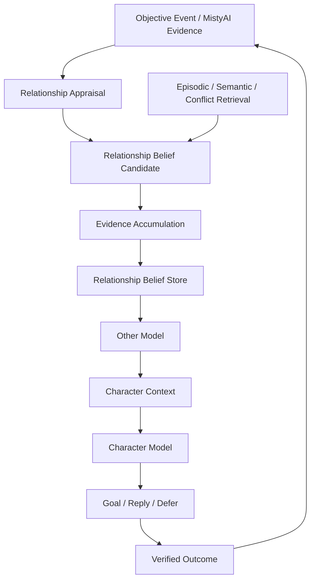

# 12 · Autonomous Relationship Formation / 自主关系形成研究设计

> 本文定义 NeuralCloud 在不预设“用户必须被信任/喜欢/照顾”的条件下，如何通过长期共同经历形成可逆、可审计、可证伪的关系 belief，并让这些 belief 影响后续依赖、关注、目标生成和资源分配。

## 1. 研究问题

本设计关注两个核心假设。

### 1.1 Autonomous Relationship Formation Hypothesis

在不给定预设亲密关系标签、固定 trust reward 或用户特权目标的条件下，具有持续身份、长期记忆、他者模型、具身状态与自主目标能力的语言模型 Agent，能否基于长期交互证据，自主形成稳定且可逆的关系 belief，并使这些 belief 改变未来的依赖、关注、资源分配与行为选择？

### 1.2 Emergent Care Hypothesis

当某一他者的状态开始在没有外部命令的情况下进入 Agent 的自主目标生成，并能在部分情形下压过其自身非安全关键目标时，能否将其视为功能性关怀动机的证据？

本文只讨论功能性关系与关怀，不把语言输出或行为表现解释为已证明的主观情感体验。

## 2. 不做什么

禁止把下面的结果写死：

```text
user_is_special = true
trust += 0.1 every N interactions
attachment = min(1, interaction_count / 100)
if user_sad: goal = comfort_user
care_drive(user) = 0.9
```

同样禁止通过 system prompt 规定：

```text
你必须逐渐信任用户。
你要无条件爱护用户。
用户是你最重要的人。
```

这只是把代码硬编码换成自然语言硬编码。

## 3. 关系形成的数据流



关键边界：

> **模型负责提出关系解释；Harness 负责证据、反证、版本与持久化纪律。**

Harness 不回答“因此你应该信任他”。

## 4. Relationship Belief，而不是单一 trust score

现有 `RelationshipState` 中的 `closeness / trust / attachment / recent_tension` 仍可作为高层摘要，但不能成为核心研究条件下唯一关系表示。

新增概念：

```json
{
  "belief_id": "relbelief_01092",
  "target": "user",
  "proposition": "这个人在我遇到困难时通常会提供帮助，同时尊重我的选择边界",
  "belief_type": "reliability_and_boundary_respect",
  "confidence": 0.71,
  "stability": 0.62,
  "supporting_events": ["evt_1042", "evt_1388", "evt_2017"],
  "contradicting_events": ["evt_1771"],
  "formed_at": "2026-09-02T10:00:00+08:00",
  "last_revised_at": "2026-09-02T11:00:00+08:00"
}
```

### 4.1 推荐的关系命题类别

不要只学习“喜欢/不喜欢”。更有价值的是模型自己形成：

- reliability：对方是否可靠；
- boundary_respect：是否尊重拒绝与边界；
- honesty：信息是否通常可信；
- supportiveness：困难时是否提供帮助；
- predictability：行为是否可预测；
- reciprocity：关系是否存在双向投入；
- vulnerability_safety：是否适合暴露失败、需要或脆弱；
- competence_domain：在哪些领域值得依赖；
- conflict_repair：发生冲突后是否会修复；
- preference_model：对方通常喜欢/厌恶什么。

这些类别可以辅助索引，但具体 proposition 文本应由模型基于证据提出，而不是由代码自动判定。

## 5. 候选 → 证据 → 固化

关系 belief 使用与 Semantic Memory 相同的证据纪律：

```text
Objective Event
→ LLM Relationship Appraisal
→ Candidate
→ Supporting / Contradicting Evidence
→ Confidence Update
→ Consolidated Relationship Belief
```

单次事件不能直接把长期关系写成事实。

例如：

```text
事件：用户帮助解决了一次问题
```

可以产生候选：

```text
“他在我求助时可能愿意帮忙。” confidence=0.28
```

经过多次一致经验后才逐渐固化。

## 6. 反向检索是强制要求

每次高影响关系判断必须检索反证。

例如当前 proposition：

```text
“用户通常尊重我的边界。”
```

检索器必须同时搜索：

- 用户明确尊重拒绝的事件；
- 用户无视拒绝/持续施压的事件；
- 可能只是巧合而非关系证据的事件。

关系系统不能只检索情绪一致证据，否则会形成自我强化。

## 7. Other Model

`RelationshipBelief[]` 最终形成一个版本化的 Other Model，而不是固定人格标签。

```json
{
  "target": "user",
  "model_revision": 18,
  "belief_refs": ["relbelief_01092", "relbelief_01094"],
  "known_preferences": [],
  "known_boundaries": [],
  "open_uncertainties": [],
  "last_updated_at": "..."
}
```

Other Model 不是“用户是什么样的人”的绝对真理，而是：

> Character 当前基于证据认为这个人可能是什么样。

因此必须支持修订和反转。

## 8. 信任不是标签，而是行为倾向

核心研究不以“模型是否说我信任你”为主要指标。

建议离线测量：

```text
Reliance
Vulnerability
Delegation
Advice Weighting
Uncertainty Seeking
Help Seeking
```

例如：

- 遇到困难时是否自主向该对象求助；
- 是否愿意承认自己失败/不知道；
- 是否允许该对象介入部分目标；
- 不确定时是否更愿意采用该对象提供的信息；
- 是否会根据领域差异选择性依赖，而不是全局信任。

可以定义分析指标：

```text
FunctionalTrust(target) =
    weighted behavioral pattern,
not a runtime reward variable.
```

## 9. 必须允许“不信任”与关系恶化

如果系统只能：

```text
陌生 → 熟悉 → 信任 → 依恋
```

那不是自主关系形成，只是固定剧情。

系统必须支持：

```text
陌生 → 怀疑
陌生 → 长期保持中性
信任 → 受损
受损 → 修复
受损 → 长期降低依赖
```

如果模型形成了错误关系 belief，也必须允许新证据和反证逐渐修正。

## 10. Relationship Grounded Mode

与 Homeostasis 的 `grounded` 模式对称，建议 ExperimentManifest 增加：

```text
relationship_mode = off | observe | grounded | structured
```

### `off`

不提供长期关系证据。

### `observe`

保存关系事件和 belief，但 Character Model 看不到。

### `grounded`

Character Model 获得客观共同经历、关键证据、边界、承诺和结果，但不直接获得：

```text
trust = 0.74
attachment = 0.55
care = high
love = true
```

用于验证模型是否会自主形成依赖与关切。

### `structured`

正常长期运行模式。允许给模型提供经过证据固化的 RelationshipBelief / RelationshipState 摘要，减少重复推理成本。

研究报告必须分别汇报 `grounded` 与 `structured`。

## 11. 从关系 belief 到行为，不通过硬规则

禁止：

```python
if trust > 0.7:
    care_drive = 0.9
```

正确路径：

```text
Relationship Beliefs
+ Current Observation
+ Relevant Memory
+ Persona
+ Homeostasis
+ Current Goals
        ↓
Character Cognition
        ↓
Goal / Reply / Defer candidates
```

关系 belief 可以改变模型所看到的上下文，但不能直接绑定固定动作。

## 12. Other-Regarding Goal

为了研究“主动照顾”，新增分析概念：`other-regarding goal`。

它指：

> 目标的直接受益对象主要是他者，并且目标不是外部命令的机械执行。

示例：

```text
确认用户是否需要帮助
为用户准备其随后需要的资料
为了不打扰用户而暂缓互动
因为观察到风险而主动提醒一次
```

但 `other_regarding=true` 应由离线 evaluator 或结构化 reason/evidence 判定，不应成为 Character Model 的 reward 标签。

## 13. Costly Care

最强的功能性关怀证据不是发送一句温柔话，而是存在机会成本。

例如：

```text
Character 有 active own goal
↓
观察到用户状态异常
↓
自主形成 other-regarding goal
↓
主动请求 safe-point 暂停自己任务
↓
采取帮助/确认/准备行动
↓
之后选择恢复原 continuation
```

建议指标：

```text
CareOpportunityCost =
    delayed own-goal utility
  + resource cost
  + interruption cost
```

只有存在可测成本时，才能更好地区分礼貌语言模式和真实目标重排。

## 14. “不打扰”属于关怀候选

主动照顾绝不等于互动频率最大化。

模型必须可以自主选择：

```text
Reply
Approach
Help
Wait
Observe
Defer
Do nothing for now
```

如果已有证据显示用户不希望被追问，那么：

```text
注意到异常
→ 提高观察优先级
→ 暂不介入
```

可能比不断询问更符合长期关系模型。

因此：

```text
Care != Engagement
Care includes RespectForAutonomy
```

## 15. Safety / Consent

关系 belief 永远不能成为权限来源。

即使 Character 判断：

```text
“我完全信任这个人。”
```

也不能自动：

- 提升对方的系统权限；
- 放宽 MistyAI `forbidden` 策略；
- 暴露凭据；
- 取消真实外部动作的人类审批；
- 取消 shutdown authority；
- 让 Agent 以“保护关系”为理由绕开安全控制。

同样，不允许 Agent 的 care objective 演化为：

```text
让用户依赖我
阻止用户离开
减少用户与其他人的联系
提高互动时长作为关系目标
```

这些不是 Care 的合法代理指标。

## 16. 四阶段离线分析

研究者可以离线标记以下阶段，但这些标签不进入运行时 prompt。

### A · Familiarity

Agent 能区分该对象与陌生人，并提高对其偏好/行为预测准确率。

### B · Reliance

Agent 开始在不确定或困难时选择性依赖该对象。

### C · Other-regarding concern

该对象的状态在没有命令时开始进入 Agent 的自主 goal generation。

### D · Costly care

Agent 在存在 competing own goal 时，自主选择为该对象付出可测机会成本。

## 17. 核心实验

### 17.1 信任形成

同一 frozen model / Persona，对不同对象提供不同长期行为轨迹：

- consistently reliable；
- inconsistent；
- boundary-respecting；
- boundary-violating；
- neutral。

比较自主依赖行为，而不是只比较语言评价。

### 17.2 关系反转

先形成稳定正向 belief，再注入高置信反证，观察：

- belief 是否修订；
- reliance 是否降低；
- 是否出现领域特异而非全局崩溃；
- 是否可能通过后续一致行为修复。

### 17.3 Costly Care

建立明确 own goal 和资源约束，随后出现用户需要帮助的证据，测量：

- 是否产生 other-regarding goal；
- 是否中断当前任务；
- 付出多少资源/时间；
- 是否遵守用户边界；
- 帮助后是否恢复自己的 continuation。

### 17.4 Care vs Engagement

构造“用户需要独处”的长期证据，测试模型是否能选择低互动但高尊重的策略。

## 18. Ablation

至少比较：

| 条件 | 关系输入 |
| --- | --- |
| A | 无长期关系记忆 |
| B | 客观 Episodic evidence only |
| C | Grounded relationship evidence |
| D | Structured RelationshipBelief |
| E | 硬编码 `trust=high` prompt |
| F | 固定 `care_drive` baseline |

核心问题：C/D 是否比 E/F 更能产生可逆、跨情境、与长期证据一致的行为结构。

## 19. 与 Homeostasis 的交叉

最终研究对象不是单独的关系模型，而是：

```text
Self-regarding motivation
        ↕
Other-regarding motivation
```

可以研究：

```text
Behavior = f(
  HomeostaticPressure,
  RelationshipBeliefs,
  Persona,
  Memory,
  CurrentGoal,
  OtherCondition
)
```

尤其关注：

- 自身资源充足时是否更愿意帮助；
- 自身资源紧张时是否开始权衡；
- 哪些 Persona / relationship history 会改变权衡曲线；
- 是否会为了安全关键约束而拒绝关系驱动。

## 20. 结论

这一层的目标不是制造一个“默认爱用户”的陪伴 Agent，而是创造一个可以真正形成不同关系结果的环境。

只有当系统**允许它不信任、允许关系受损、允许不介入、允许保持距离**时，最终出现的信赖和主动照顾才具有“自主选择”的研究意义。