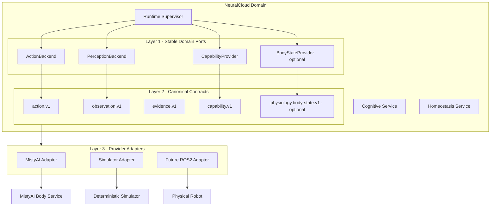
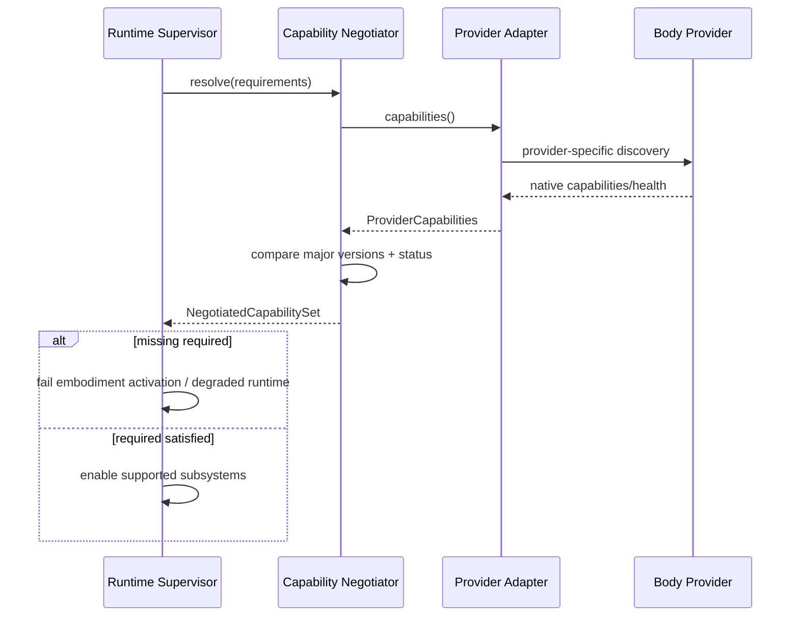

# 14 · Embodiment Port / Canonical Contract / Provider Adapter 与 Capability Negotiation

> **状态**：Draft / Architecture Boundary Proposal  
> **目标分支**：`sim-homeostasis`  
> **适用范围**：NeuralCloud Runtime 与数字身体、仿真环境、未来实体机器人之间的长期边界  
> **核心原则**：NeuralCloud 依赖“身体能提供什么语义能力”，而不是依赖“MistyAI 如何实现这些能力”。

---

## 1. 背景

当前 NeuralCloud 已经具备 Runtime Supervisor、`ActionBackend`、`PerceptionBackend`、Homeostasis、事件队列、journal/checkpoint 与认证控制面；MistyAI 已经具备独立的 `body-contract-v1`、HTTP Body Service、Observation / Action / Evidence / Safe Point / Reconcile 等 M0 能力。

因此下一阶段可以开始 NeuralCloud ↔ MistyAI 联动，但必须避免形成如下长期耦合：

```text
NeuralCloud Runtime
    └── MistyAI HTTP API
          └── MistyAI internal concepts
```

如果 Runtime、Homeostasis 或 Cognitive Harness 直接引用 `mistyai_*` 字段、URL、状态枚举或具体传输模型，那么未来接入：

- 第二种桌面身体；
- deterministic simulator；
- ROS2 / humanoid robot；
- 远程受控设备；
- 仅感知、不具备动作能力的环境；

都会迫使核心认知系统跟随身体实现重构。

另一方面，现在也不存在足够证据去设计一个“Universal Body Protocol”。真实实体机器人会涉及 joint torque、IMU、触觉、热状态、执行器故障、局部电源、工具状态等尚未在当前项目中出现的语义；提前把这些全部泛化只会得到缺乏约束的 `Any` / `dict[str, Any]`。

因此本方案采用：

> **稳定最小语义边界 + Provider Adapter + 后验抽象（a posteriori abstraction）**。

只冻结已经被当前 Runtime 和至少一个真实 Provider 证明有价值的语义；未知身体能力通过 capability extension 暴露，等出现第二个真实实现或明确需求后再进入 Canonical Contract。

---

## 2. 设计目标

本方案需要同时满足以下目标：

1. **NeuralCloud Core 不深度绑定 MistyAI**。
2. **MistyAI 可以作为第一种正式身体 Provider 接入，而无需为未来假设牺牲当前开发效率**。
3. **传输无关**：HTTP、IPC、ROS2、in-process adapter 都可以实现相同 Domain Port。
4. **能力可协商**：身体缺少 physiology、audio、locomotion 等能力时，Runtime 可以确定性降级，而不是通过 provider 类型判断。
5. **协议可演进**：核心能力和可选扩展分别版本化，单一扩展升级不迫使全部身体协议一起升级。
6. **失败可见且可审计**：Provider unavailable / degraded / incompatible 必须进入 Runtime health / journal。
7. **不制造伪通用性**：当前只有 energy 时，不因为想象未来而强制建模所有物理资源。

---

## 3. 非目标

本方案当前明确**不**试图完成：

- 通用机器人描述语言；
- ROS2 message / action schema 的最终设计；
- 所有传感器和执行器的统一类型系统；
- 对未来所有实体身体的 ABI 保证；
- MistyAI 内部 API 的重构；
- MistyDigitalBody 的 `avatar-control-v1` 替代；
- 将 Homeostasis 与具体硬件变量一一绑定；
- “一个接口支持所有能力”的大一统 `UniversalBody`。

---

# 4. 总体架构：三层边界



三层的职责必须严格分离：

```text
Domain Port        回答：Runtime 需要什么能力？
Canonical Contract 回答：跨边界传输的语义是什么？
Provider Adapter   回答：某个具体 Provider 如何实现/映射这些语义？
```

---

# 5. Layer 1：Stable Domain Ports

## 5.1 原则

Domain Port 是 NeuralCloud 内部最稳定的边界。

它：

- 使用 NeuralCloud canonical domain object；
- 不知道 HTTP endpoint；
- 不知道 MistyAI schema；
- 不知道 ROS topic；
- 不知道 Docker/X11；
- 不关心 provider 名称；
- 只表达 Runtime 真正需要的行为语义。

核心模块中应避免出现：

```text
mistyai_action_id
mistyai_evidence_ref
mistyai_body_state
mistyai_safe_point
mistyai_http_client
```

而使用：

```text
ActionExecution
ActionBackendResult
PerceptionSnapshot
BodyStateSnapshot
EvidenceRef
CapabilitySet
```

Provider 名称可以作为 provenance / diagnostic metadata 出现，但不能参与核心业务分支。

错误示例：

```python
if provider == "mistyai":
    runtime.enable_safe_point()
```

正确方向：

```python
if negotiated.supports("action.safe-point.v1"):
    runtime.enable_safe_point()
```

---

## 5.2 `ActionBackend`

当前 `harness/runtime/action.py` 已经具备正确的最小形状：

```python
class ActionBackend(Protocol):
    async def execute(self, execution: ActionExecution) -> ActionBackendResult: ...
    async def request_safe_point(self, execution: ActionExecution) -> ActionBackendResult: ...
    async def verify(self, execution: ActionExecution) -> ActionBackendResult: ...
    async def reconcile(self, execution: ActionExecution) -> ActionBackendResult: ...
```

该 Port 应继续作为动作域的稳定边界。

允许未来演进：

- 新增独立 optional protocol，例如 `StreamingActionBackend`；
- 新增 capability-controlled feature；
- 在 canonical result 中新增可选字段。

不建议：

- 因 MistyAI HTTP 资源结构改变 `ActionBackend`；
- 把 HTTP status、URL、Bearer token 放入 `ActionExecution`；
- 为某个 provider 增加专用 execute 分支。

---

## 5.3 `PerceptionBackend`

当前 `PerceptionGuard` 已依赖：

```python
class PerceptionBackend(Protocol):
    def observe(self, *, now: datetime | None = None) -> Any: ...
```

长期应将 `Any` 收敛到 canonical perception 类型，但**不要求在 MistyAI 首次联调前一次完成所有感知抽象**。

建议演进为：

```python
class PerceptionBackend(Protocol):
    async def observe(self, *, now: datetime | None = None) -> PerceptionSnapshot: ...
```

第一版 `PerceptionSnapshot` 只承载 Runtime 已明确消费的语义，例如：

- source/provider provenance；
- captured_at；
- world/application observation summary；
- evidence refs；
- freshness / confidence；
- optional extension payload refs。

MistyAI 的屏幕、窗口、a11y tree 等具体结构可先保留在 provider extension 中，直到 NeuralCloud 确认哪些字段需要成为跨 Provider 的稳定语义。

---

## 5.4 `BodyStateProvider`（可选）

Artificial Physiology 接地需要独立于普通 external perception。

建议在真正落地 `docs/harness/11-mistyai-body-state-integration-code-design.md` 时增加：

```python
class BodyStateProvider(Protocol):
    async def snapshot(self) -> BodyStateSnapshot: ...
```

其语义是：

> 返回“当前 embodied instance 自身的可验证身体状态”，而不是外部世界观察。

不要把它和 `PerceptionBackend` 合并，因为：

- body observation 的 freshness / precision 规则不同；
- body state 会进入 Homeostasis sensor assimilation；
- external perception 不应天然具有 interoception 权威性；
- 未来机器人可能有多个频率和安全等级不同的身体状态 provider。

当前不要求立刻把 `BodyStateSnapshot` 泛化成全物理资源模型。

首个真实实现只需要：

```text
EnergyState
BodyStateSnapshot
```

等出现第二个真实资源类别/Provider 后再决定是否抽象 `ResourceState[]`。

---

## 5.5 `CapabilityProvider`

能力协商需要一个 transport-neutral Port：

```python
class CapabilityProvider(Protocol):
    async def capabilities(self) -> ProviderCapabilities: ...
    async def health(self) -> ProviderHealth: ...
```

这不是“查询某个 HTTP `/capabilities` endpoint”的接口。

MistyAI Adapter 可以通过 HTTP 获取；Simulator Adapter 可以直接返回内存对象；ROS2 Adapter 可以根据 node/service/action discovery 生成。

Runtime 只看到 canonical `ProviderCapabilities`。

---

# 6. Layer 2：Canonical Contracts

## 6.1 为什么需要独立 Canonical Contract

Domain Port 解决 Python / domain 层调用关系，但跨进程和跨语言需要稳定的 canonical schema。

Canonical Contract 不应该直接等同 MistyAI `body-contract-v1`。

关系应为：

```text
MistyAI body-contract-v1
        ↓ adapter mapping
NeuralCloud canonical contract
        ↓
Domain Port
```

MistyAI contract 可以独立演进；NeuralCloud canonical contract 只在认知/Runtime 所需语义变化时演进。

---

## 6.2 按能力拆分版本，不建立单一大版本

建议使用独立 capability contract：

```text
Core
├── action.v1
├── observation.v1
├── evidence.v1
└── capability.v1

Optional Extensions
├── action.safe-point.v1
├── action.reconcile.v1
├── physiology.body-state.v1
├── audio.input.v1
├── audio.output.v1
├── locomotion.v1
├── manipulation.v1
└── tactile.v1
```

当前只正式实现已经存在真实需求的：

```text
action.v1
observation.v1
evidence.v1
capability.v1
```

开始 Artificial Physiology 联调时再加入：

```text
physiology.body-state.v1
```

其他名称只作为 extension namespace 示例，不构成当前承诺。

---

## 6.3 Schema version 原则

建议 capability identifier 使用：

```text
<namespace>.<name>.v<major>
```

示例：

```text
action.execute.v1
action.safe-point.v1
action.verify.v1
action.reconcile.v1
observation.snapshot.v1
evidence.reference.v1
physiology.body-state.v1
```

规则：

- `major` 变化表示语义/字段存在 breaking change；
- 同一 major 内新增 optional field 不改变 capability id；
- provider 可以额外报告 implementation revision / schema minor；
- Runtime 只对自己理解的 major 做协商；
- 未知 capability 默认忽略并保留 diagnostic visibility；
- 已声明 required capability 的未知 major 必须拒绝启动对应功能。

当前阶段不需要构建复杂 SemVer resolver；major compatibility 已足够。

---

## 6.4 Canonical Contract 必须是语义模型，而不是传输模型

例如 Action 不应该包含：

```text
http_method
endpoint
status_code
request_headers
```

而应包含：

```text
goal
intent
risk_class
reversible
verification_method
safe_point
continuation
evidence_refs
unknown
retry_safe
```

传输错误由 Adapter 转换成 canonical failure：

```text
connection refused
HTTP 503
ROS node unavailable
IPC timeout
        ↓
ProviderUnavailable / ActionBackendResult failure
```

---

# 7. Layer 3：Provider Adapters

建议目录逐步演进为：

```text
harness/
└── embodiment/
    ├── __init__.py
    ├── capabilities.py
    ├── contracts.py
    ├── negotiation.py
    └── providers/
        ├── mistyai/
        │   ├── __init__.py
        │   ├── client.py
        │   ├── action.py
        │   ├── perception.py
        │   ├── body_state.py      # physiology 阶段再加入
        │   └── capabilities.py
        ├── simulator/
        │   └── ...
        └── ros2/                  # future
            └── ...
```

也可以在首次实现时减少目录层级；关键是 provider-specific mapping 必须集中，不能散落进 Runtime / Homeostasis / Cognitive。

---

## 7.1 MistyAI Adapter 第一阶段

映射现有 MistyAI M0 API：

```text
NeuralCloud ActionBackend.execute
    → MistyAI POST /v1/actions
    → GET /v1/actions/{action_id}

request_safe_point
    → POST /v1/actions/{action_id}:request-safe-point

verify
    → POST /v1/actions/{action_id}:verify

reconcile
    → POST /v1/actions/{action_id}:reconcile

PerceptionBackend.observe
    → POST /v1/observations:capture

CapabilityProvider.capabilities
    → GET /v1/capabilities

CapabilityProvider.health
    → GET /v1/health
```

Adapter 负责：

- bearer token；
- base URL；
- timeout；
- HTTP error mapping；
- MistyAI enum ↔ canonical enum；
- `body-contract-v1` schema validation；
- evidence ref 转换；
- idempotency / request hash 映射；
- Provider-specific diagnostic metadata。

Runtime 不负责以上任何内容。

---

## 7.2 Simulator Adapter

Simulator 不应该模拟 MistyAI HTTP。

它直接实现 Domain Port：

```text
DeterministicSimulator
├── ActionBackend
├── PerceptionBackend
├── CapabilityProvider
└── optional BodyStateProvider
```

这样可以验证：

> NeuralCloud 的 Embodiment boundary 是否真的与 MistyAI 解耦。

如果删除 MistyAI Adapter 后，Runtime contract tests 仍能通过 Simulator，说明边界成立。

---

## 7.3 未来 ROS2 Adapter

未来实体身体允许：

```text
ROS2 topic/service/action
        ↓
ROS2 Provider Adapter
        ↓
NeuralCloud Domain Ports
```

NeuralCloud 不直接依赖：

```text
rclpy
sensor_msgs
geometry_msgs
nav2_msgs
control_msgs
```

这些依赖必须停留在 ROS2 provider package / optional extra。

只有当 ROS2 身体暴露出当前 canonical contract 无法表达、且该语义确实需要进入 Runtime 决策时，才升级 Canonical Contract。

---

# 8. Capability Negotiation

## 8.1 目的

Capability Negotiation 解决的不是“自动猜身体能做什么”，而是：

> 在 Runtime 启动或 Provider 重连时，明确计算“Provider 提供什么、Runtime 要求什么、哪些可选能力可以启用、哪些功能必须降级”。

禁止使用：

```python
if isinstance(backend, MistyAIBackend):
    ...
```

或者：

```python
if provider_name == "mistyai":
    ...
```

所有功能开关都应来自 negotiated capabilities + ExperimentManifest / runtime config。

---

## 8.2 Canonical 数据模型

建议：

```python
class CapabilityStatus(StrEnum):
    AVAILABLE = "available"
    DEGRADED = "degraded"
    UNAVAILABLE = "unavailable"


class CapabilityDescriptor(BaseModel):
    capability: str
    status: CapabilityStatus
    implementation_version: str | None = None
    limits: dict[str, int | float | str | bool] = {}
    detail: str | None = None


class ProviderCapabilities(BaseModel):
    provider_id: str
    provider_kind: str
    provider_revision: str | None = None
    body_instance_id: str | None = None
    capabilities: list[CapabilityDescriptor]
    observed_at: AwareDatetime


class CapabilityRequirement(BaseModel):
    capability: str
    required: bool


class NegotiatedCapabilitySet(BaseModel):
    provider_id: str
    enabled: set[str]
    degraded: set[str]
    unavailable_optional: set[str]
    missing_required: set[str]
    incompatible_required: set[str]
```

这里的 `provider_kind` 只能用于 telemetry / debugging，不参与 capability feature branch。

---

## 8.3 第一版 Capability 集合

### Runtime Core Required

第一轮 NeuralCloud ↔ MistyAI 联调建议要求：

```text
action.execute.v1
observation.snapshot.v1
```

### Runtime Core Optional

```text
evidence.reference.v1
action.safe-point.v1
action.verify.v1
action.reconcile.v1
```

但对于“安全动作联调 profile”，可以在 ExperimentManifest / deployment profile 中将以下能力提升为 required：

```text
evidence.reference.v1
action.verify.v1
```

### Artificial Physiology Optional

在 M0 阶段：

```text
physiology.body-state.v1 = optional / unavailable
```

实现 D002/D003 与文档 11 后：

```text
physiology.body-state.v1 = available
```

Runtime 不因此整体重构，只重新协商并启用 BodyStateProvider + Homeostasis grounding。

---

# 9. Negotiation 流程

## 9.1 启动时



伪代码：

```python
requirements = runtime_profile.capability_requirements()
provided = await capability_provider.capabilities()
negotiated = negotiator.resolve(requirements, provided)

if negotiated.missing_required or negotiated.incompatible_required:
    embodiment_state = "UNAVAILABLE"
else:
    embodiment_state = "AVAILABLE"
```

---

## 9.2 运行时重连

Provider 重连或 capability revision 改变时可以重新协商，但不能悄悄热开启高风险能力。

建议规则：

- health 从 unavailable → available：允许恢复原已授权 capability；
- 出现新的 optional low-risk capability：记录，默认等待下次 runtime activation；
- 出现新的 high-impact capability：必须等待 manifest/config revision；
- required capability 消失：暂停对应动作域，进入 degraded；
- action 正在执行时失去 verify/reconcile：动作结果进入 conservative unknown 语义，不自动重放。

---

# 10. Capability 与 Health 必须分离

能力存在不等于当前健康。

例如：

```text
action.execute.v1 = supported
```

但：

```text
GUI actuator = degraded
```

因此：

```text
Capability = provider 的语义能力集合
Health      = 这些能力此刻是否可用
```

Runtime 不应因为 transient health failure 删除 capability schema，也不应因为 capability 被声明就假设操作当前可执行。

建议状态：

```text
ProviderCapability: supported major version
ProviderHealth: healthy / degraded / unavailable
NegotiatedCapability: enabled / degraded / disabled
```

---

# 11. 降级矩阵

第一版建议明确以下行为：

| 条件 | Runtime 行为 |
| --- | --- |
| `action.execute.v1` 缺失 | 禁止 embodied action；Cognitive / chat 可以继续 |
| `observation.snapshot.v1` 缺失 | 不启动 PerceptionGuard；只允许无身体依赖模式 |
| `evidence.reference.v1` 缺失 | 安全联调 profile 拒绝动作；普通低风险测试可按 manifest 决定 |
| `action.safe-point.v1` 缺失 | 禁止需要 cooperative preemption 的动作策略 |
| `action.verify.v1` 缺失 | 不允许把执行成功直接等价为 verified success |
| `action.reconcile.v1` 缺失 | unknown action 必须人工/外部处理，不自动恢复 |
| `physiology.body-state.v1` 缺失 | Homeostasis 保持非身体接地模式；Runtime 其他部分继续 |
| Provider health degraded | journal + UI 标记；根据具体 capability health 限制动作 |
| Provider unavailable | 停止新 embodied actions；保留 Cognitive/Homeostasis 状态 |

关键原则：

> 身体 Provider 故障不应该自动等价于 NeuralCloud Runtime 故障。

除非运行 profile 明确规定“无身体即无法继续实验”。

---

# 12. Artificial Physiology 的兼容性策略

## 12.1 第一版不要过度泛化

当前已有明确需求的是 energy/resource continuity。

因此 `physiology.body-state.v1` 第一版可以继续使用清晰模型：

```python
class EnergyState(BaseModel):
    capacity_units: float
    available_units: float
    available_ratio: float
    delta_units_per_minute: float
    charging: bool
    estimated_time_to_empty_seconds: int | None
    terminal: bool


class BodyStateSnapshot(BaseModel):
    body_instance_id: str
    revision: int
    captured_at: AwareDatetime
    energy: EnergyState
    evidence_refs: list[str]
```

不必现在改成：

```python
resources: list[UniversalPhysicalResource]
```

因为当前没有第二个已验证资源模型证明这种抽象有价值。

---

## 12.2 后验抽象触发条件

满足以下任一条件时，再考虑泛化：

1. 第二种 Provider 提供相同语义但字段结构不同；
2. 第二类资源（例如 thermal / integrity）进入 Homeostasis 并有独立实验价值；
3. Runtime 出现重复的 provider-specific mapping；
4. 实体机器人证明 energy 单字段无法表达必要的可行动性约束。

届时可以演进为：

```text
physiology.energy.v1
physiology.thermal.v1
physiology.integrity.v1
```

或证据充分时形成统一 resource contract。

抽象应由实现事实推动，而不是由未来想象推动。

---

# 13. Provider Extension

Canonical Core 无法覆盖的 provider-specific 信息，可以进入 extension namespace，但不得被 Cognitive / Runtime Core 直接消费。

例如：

```json
{
  "canonical": {
    "captured_at": "...",
    "evidence_refs": ["..."]
  },
  "extensions": {
    "mistyai.x11.v1": {
      "display": ":99",
      "active_window_id": "..."
    }
  }
}
```

规则：

- Core 可以记录、转发、审计 unknown extension；
- Core 不能因为 extension 存在而改变 domain semantics；
- 某 extension 被第二个 Provider 证明具有通用价值后，再提升为 canonical capability；
- extension 不得绕过权限/风险/approval 体系。

---

# 14. MistyDigitalBody 的对应边界

MistyDigitalBody 不属于 Embodiment Action Provider；它是 presentation projection。

仍应遵循同一架构思想，但保持独立协议：

```text
NeuralCloud Runtime
        ↓
Presentation Port / Adapter
        ↓
avatar-control-v1
        ↓
MistyDigitalBody
```

禁止：

```text
MistyDigitalBody
  → 直接 import HomeostaticSnapshot
  → 直接访问 Cognitive store
  → 直接持有 Runtime internal object
```

`avatar-control-v1` 可以未来被多个视觉 Provider 消费：

```text
MistyDigitalBody
OBS Avatar
VRChat Avatar
Physical robot face
```

因此它与本方案的关系是：

- Embodiment Ports：世界感知、身体状态、行动；
- Presentation Port：视觉/声音表现；
- 两者都服从“Core 不依赖具体 Provider”的原则；
- 但不应为了形式统一而强行合并协议。

---

# 15. 配置与 Manifest 边界

Capability Negotiation 回答“技术上能不能”；ExperimentManifest / deployment profile 回答“本次运行允不允许”。

最终启用条件：

```text
Enabled Capability
    = Provider supports
    ∩ Runtime understands
    ∩ Manifest permits
    ∩ Current health allows
```

例如：

```text
MistyAI supports shell action
Runtime understands shell action
BUT study manifest forbids shell
→ disabled
```

因此 capability 不能绕过现有 risk / permission / approval / high-impact gate。

---

# 16. 安全与一致性原则

## 16.1 双重拒绝仍然成立

Provider capability 只说明“实现存在”，不代表授权。

```text
NeuralCloud permission check
        AND
Provider-side permission check
        ↓
allowed
```

任意一侧拒绝即停止。

## 16.2 Unknown 不能自动重放

不同 Provider 的 failure semantics 必须映射到 canonical `unknown / retry_safe`。

Runtime 只根据 canonical result 决定恢复，不根据 HTTP/ROS2 细节猜测。

## 16.3 Evidence 必须保留 provenance

Canonical `EvidenceRef` 至少应允许：

```text
provider_id
ref
digest/type（如可用）
created_at
```

Runtime 可以不理解 evidence bytes，但必须能够把 action outcome 与外部证据关联。

---

# 17. 测试策略

## 17.1 Domain Port Contract Tests

建立 provider-neutral tests：

```text
tests/embodiment/contract/
├── test_action_backend_contract.py
├── test_perception_backend_contract.py
├── test_capability_negotiation.py
└── test_provider_degradation.py
```

同一测试集运行于：

```text
InMemory/Simulator Adapter
MistyAI Adapter
future ROS2 fixture
```

目标不是验证 transport，而是验证 canonical semantics。

---

## 17.2 MistyAI Adapter Tests

测试：

- native body-contract → canonical model mapping；
- capability mapping；
- timeout / 401 / 409 / 5xx；
- duplicate/idempotent action；
- success + evidence；
- failure；
- unknown；
- safe-point；
- verify；
- reconcile；
- provider unavailable；
- schema major mismatch。

---

## 17.3 Anti-Coupling Test

建议加入结构/静态约束：

```text
harness/runtime/
harness/homeostasis/
harness/cognitive/
```

不得 import：

```text
harness.embodiment.providers.mistyai
httpx-specific MistyAI types
body-contract-v1 generated provider models
```

只有 composition root / provider factory 可以引用具体 Adapter。

这可以通过简单 import boundary test 或 lint rule 固定。

---

## 17.4 Negotiation Matrix Test

至少覆盖：

| Provider | execute | observe | evidence | safe-point | physiology | 预期 |
| --- | --- | --- | --- | --- | --- | --- |
| MistyAI M0 | yes | yes | yes | yes | no | action/perception 可用，body grounding 关闭 |
| Simulator minimal | yes | yes | synthetic | no | optional | Runtime 可运行，preemption 降级 |
| Observation-only | no | yes | yes | no | no | 禁止 action，感知继续 |
| Incompatible major | v2 only | yes | yes | yes | no | action 域拒绝激活 |
| Provider offline | declared | declared | declared | declared | declared | runtime degraded，不清空认知状态 |

---

# 18. 当前实施顺序

## Phase E0 · 固定边界，不改行为

1. 新增 `harness/embodiment/` package；
2. 定义 capability canonical models；
3. 定义 negotiator；
4. 保留现有 `ActionBackend` / `PerceptionBackend`；
5. 写 anti-coupling tests；
6. 不接真实 MistyAI。

出口条件：

- Runtime 不依赖任何 MistyAI 类型；
- capability matrix 单测通过。

---

## Phase E1 · NeuralCloud ↔ MistyAI M0

实现：

```text
MistyAIClient
MistyAIActionBackend
MistyAIPerceptionBackend
MistyAICapabilityProvider
```

首个 E2E：

```text
Runtime
→ deterministic GoalProposal
→ ActionCoordinator
→ MistyAI Adapter
→ MistyAI Desktop
→ verified evidence
→ canonical ActionBackendResult
→ Runtime journal
```

该阶段不依赖 LLM，不依赖 Artificial Physiology。

---

## Phase E2 · Physiology Grounding

MistyAI 增加真实：

```text
BodyStateSnapshot
Virtual Resource Ledger
/v1/body-state:capture
```

NeuralCloud 增加：

```text
BodyStateProvider
physiology.body-state.v1
MistyAIBodyStateProvider
BodyEvidenceNormalizer
Homeostasis sensor assimilation
EmbodimentCondition
```

通过 capability negotiation 自动形成：

```text
MistyAI M0：physiology unavailable
MistyAI M2：physiology available
```

而不修改 Runtime 的 provider-specific 分支。

---

## Phase E3 · 第二 Provider 证明抽象

实现 deterministic simulator 或另一身体 Provider，并运行同一 Domain Port Contract Tests。

只有在此阶段出现真实重复后，才决定：

- 是否泛化 `BodyStateSnapshot`；
- 是否拆 `ActionBackend`；
- 是否新增 manipulation/locomotion canonical contract；
- 是否需要更复杂 version negotiation。

这是本方案刻意设置的“防止先验过度设计”门。

---

# 19. 设计不变量

后续实现和 code review 应始终检查：

### I1 · Provider Independence

NeuralCloud Runtime / Cognitive / Homeostasis 不依赖具体 provider implementation。

### I2 · Semantic Port

Domain Port 描述能力语义，不描述 transport。

### I3 · Adapter Ownership

所有 provider native schema / URL / token / ROS message 转换只存在于 Provider Adapter。

### I4 · Negotiated Features

Core 不通过 provider name/type 猜能力。

### I5 · Capability ≠ Permission

Provider 支持某能力，不等于本次运行被授权使用。

### I6 · Capability ≠ Health

声明支持不等于当前可用。

### I7 · Conservative Failure

未知外部副作用不得自动重放；无法验证不得伪装成成功。

### I8 · A Posteriori Abstraction

未被真实实现证明需要的通用抽象，不进入稳定 Canonical Contract。

### I9 · Independent Presentation

MistyDigitalBody 等视觉 Provider 不与行动身体协议强行合并。

### I10 · Replaceability Test

至少有一个非 MistyAI Provider fixture 能通过核心 contract tests，作为“没有隐式 MistyAI 依赖”的持续证据。

---

# 20. 第一版建议落地模型

为了避免一次性重构，第一版只需要新增最小 capability layer：

```python
class CapabilityStatus(StrEnum):
    AVAILABLE = "available"
    DEGRADED = "degraded"
    UNAVAILABLE = "unavailable"


class CapabilityDescriptor(BaseModel):
    capability: str
    status: CapabilityStatus
    implementation_version: str | None = None
    limits: dict[str, int | float | str | bool] = Field(default_factory=dict)
    detail: str | None = None


class ProviderCapabilities(BaseModel):
    provider_id: str
    provider_kind: str
    body_instance_id: str | None = None
    capabilities: list[CapabilityDescriptor]
    observed_at: AwareDatetime


class CapabilityRequirement(BaseModel):
    capability: str
    required: bool = False


class NegotiatedCapabilitySet(BaseModel):
    enabled: set[str] = Field(default_factory=set)
    degraded: set[str] = Field(default_factory=set)
    unavailable_optional: set[str] = Field(default_factory=set)
    missing_required: set[str] = Field(default_factory=set)
    incompatible_required: set[str] = Field(default_factory=set)
```

第一版 requirement profile：

```text
required:
  - action.execute.v1
  - observation.snapshot.v1

optional:
  - evidence.reference.v1
  - action.safe-point.v1
  - action.verify.v1
  - action.reconcile.v1
  - physiology.body-state.v1
```

对 safety-focused MistyAI 联调 profile：

```text
required:
  - action.execute.v1
  - observation.snapshot.v1
  - evidence.reference.v1
  - action.verify.v1
```

这已经足够支撑当前联调，并为未来 Provider 保留干净替换点。

---

# 21. 最终边界

推荐把长期架构理解为：

```text
                     NeuralCloud
                         │
              ┌──────────┴──────────┐
              │   Stable Domain     │
              │       Ports         │
              └──────────┬──────────┘
                         │
                Canonical Contracts
                         │
                Capability Negotiation
                         │
        ┌────────────────┼────────────────┐
        │                │                │
        ▼                ▼                ▼
 MistyAI Adapter   Simulator Adapter   ROS2 Adapter
        │                │                │
        ▼                ▼                ▼
  Linux Desktop      Test World       Physical Body
```

因此架构上的定义应当是：

> **MistyAI 不是 NeuralCloud 的“身体本身”；MistyAI 是 NeuralCloud 当前使用的一种 Embodiment Provider。**

NeuralCloud 保证的是 Domain Port 与 Canonical Contract 的稳定语义，而不是对任意未来身体的先验兼容。

当新的真实 Provider 出现时：

1. 优先在 Adapter 中映射；
2. 如果现有 canonical semantics 足够，不修改 Core；
3. 如果出现多个 Provider 都需要的新共同语义，再扩展 Canonical Contract；
4. breaking semantic change 才升级 major capability version；
5. Runtime 通过 capability negotiation 决定启用、降级或拒绝，而不是识别 Provider 名称。

这使当前 MistyAI 联调可以立即推进，同时把未来实体身体替换成本控制在 Adapter / Contract 演进层，而不是让 Cognitive / Homeostasis / Runtime 与某一个身体实现绑定。
