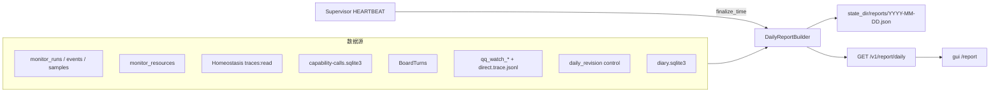

# 18 · 每日运行报告与主动日记

> **文档状态：设计已确认，正在实施。** 本文是增量实现计划；除“当前基线”明确列出的能力外，其余接口、状态和行为均不得视为现有实现。
>
> **适用范围：** Runtime Monitor、DailyReport 聚合器、Homeostasis 转移轨迹只读接口、主动日记能力、共享 GUI `/report` 页面、Linux 发布与回滚。
>
> **依赖文档：** [08 · Runtime Supervisor](08-runtime-supervisor.md)、[07 · 内稳态研究设计](07-homeostatic-harness-research-design.md)、[LINUX_DEPLOYMENT.md](../LINUX_DEPLOYMENT.md)、[DAILY_REVISION.md](../DAILY_REVISION.md)、[THOUGHT_BOARD.md](../THOUGHT_BOARD.md)、[AUTONOMOUS_CAPABILITIES.md](../AUTONOMOUS_CAPABILITIES.md)。

本文为共享 Runtime 增加一份按自然日聚合的运行报告，并补齐主动写日记能力。报告面向运维与主人回看：运行时长、资源占用、内稳态变化与主动意图、推理链路倾向与耗时、每日记忆整理、token 与缓存命中、是否主动写日记。日记为角色私密内容，正常 GUI 只显示是/否。

---

## 1. 背景与当前基线

现有数据源已经能覆盖报告的大部分字段，但分散在多个进程/存储里，且有三处空白必须先补：

| 能力 | 当前基线 | 本计划目标 |
| --- | --- | --- |
| 运行时长 | `monitor_samples` 每 10s 记录 lifecycle；`RuntimeStatus.lifecycle_since` | 按自然日汇总各状态时长、采样缺口、重启次数 |
| 资源占用 | 无 CPU/RSS 采集，无 `psutil` | Runtime 心跳采样本进程与已知子进程，写入 `monitor_resources` |
| 内稳态历史 | Homeostasis 本地 `transition_traces` / `transitions.jsonl`；Runtime 只能 `get_snapshot()` | 只读 `POST /v1/traces:read`，日报按日聚合七维与 salience |
| 主动意图 | marked journal、capability-calls、BoardTurns、QQ idle ledger | 日报按通道汇总尝试次数与结果 |
| 推理链路 | `monitor_runs.path` / `latency_ms` / `stages_json` | 日报 fast/deep 倾向与分阶段耗时分布 |
| 记忆整理 | `DailyRevisionWorker` 03:00 调度，`daily_revision.*` 控制面 | 日报嵌入当日 jobs、usage、diff 摘要 |
| Token / 缓存 | `monitor_runs` 的 prompt/completion/cache_*；QQ `direct.trace.jsonl`；`daily_revision_usage` | 分来源汇总命中率，附估算成本 |
| 写日记 | 无独立日记能力 | 仿 Board 两阶段：窗口内 salience 触发，`write/wait`，私密落盘 |
| 日报产品 | `GET /v1/monitor/overview?window=24h` 为滑动窗口，非自然日归档 | `DailyReportBuilder` + `state_dir/reports/YYYY-MM-DD.json` + GUI `/report` |



---

## 2. 报告核心

### 2.1 模块与配置

新建 `harness/runtime/daily_report.py`：

- `DailyReportSettings`：环境变量 `NC_DAILY_REPORT_CONFIG` 指向绝对路径 JSON。默认 `timezone=Asia/Shanghai`、`finalize_time=04:00`（晚于日修订 03:00）、`retention_days=365`。可选 `qq_trace_path` 指向 watcher 的 `direct.trace.jsonl`。
- `DailyReport`：按章节的 pydantic 模型。
- `DailyReportBuilder.build(day)`：聚合指定自然日。
- `DailyReportStore`：落盘 `state_dir/reports/`，meta 记录 `last_finalized_day`，重启不重复 finalize。

触发：`RuntimeSupervisor` 处理 `HEARTBEAT` 时，在 `board.heartbeat()` 旁调用 `daily_report.heartbeat()`。到点则 build 前一自然日并落盘。任意日期可按需实时 build；未落盘返回 `finalized=false`。

路由（DIAGNOSTIC 权限）：

- `GET /v1/report/daily?day=`
- `GET /v1/report/days`
- `POST /v1/report/daily:finalize`

### 2.2 章节字段

**运行时长。** 用 `monitor_samples` 的 lifecycle 序列计算当日各状态时长、采样缺口（视为停机）次数与总时长、当前 `lifecycle_since` 连续运行时长、重启次数。

**资源占用。** 用新增 `monitor_resources`：各进程角色 CPU% 均值/峰值、RSS 均值/峰值、主机 CPU/内存占用、`state_dir` 与各 sqlite 文件大小。`psutil` 缺失时记录 `unavailable`，不静默为 0。

**内稳态。** 通过 `read_traces(since, until)`：七维 `energy_reserve`、`cognitive_load`、`safety_predictability`、`competence`、`autonomy`、`social_connection`、`novelty` 的起止/最小/最大/净变化；salience 分布；`dominant_needs` 频次；episode 数；`core_affect` 日均。主动尝试意图：

- marked：`monitor_events` 中 `journal.homeostatic_marked_trigger_{scheduled,reused,failed,deferred_lifecycle,stale}`
- 能力机会：`capability-calls.sqlite3` 按 channel 统计 `act/wait/defer/no_action` 与 status
- Board：`BoardTurns` 当日 write/wait/失败
- QQ：`qq_watch_idle_opportunities` 与 `initiated_by="homeostasis"` 的决策及发送结果
- IDLE：`event.completed` 中 `event_type=idle` 的 completed/deferred/failed

**链路汇总。** `monitor_runs`：`path` fast/deep 占比、整体与分路径 latency p50/p95/p99、`stages_json` 各阶段均值与 p95、status 分布、revisions 总数；按 event_type（chat/qq/board/idle/capability）分组次数。复用 `_percentile`。

**每日记忆整理。** 内部调用 `cognitive.control("daily_revision.history"/"detail")`，取 `day==报告日` 的 jobs：status、attempts、last_error、source_count、usage（reserved/actual tokens）、receipt、diff 摘要（episodic/semantic/impressions/relationships 变更条数）。

**Token 与缓存。** 分来源 prompt/completion/cache_hit/cache_miss；命中率 = hit/(hit+miss)；无缓存字段时按 `tools/qq_cache_report.py` 的回退规则。来源：主链路/Board/能力选择走 `monitor_runs`，QQ 决策走 `direct.trace.jsonl`，日修订走 control。附估算成本并标注为估算。

**是否主动写日记。** `DiaryStore.count(day) > 0` → 仅输出 `true/false`，不输出正文。

**补充项。** 当日 warning/error 与前 20 条 alert、`monitor_actions` 状态分布、goals 触发/预算、QQ reservation/delivery 成功率、watchdog 次数、monitor `ingest_dropped`、LLM 错误/超时/截断计数。

---

## 3. 资源采样

`pyproject.toml` 增加 `psutil` 依赖并更新 `uv.lock`。

`MonitorStore` 新表：

```
monitor_resources(
  observed_at, role, pid, cpu_percent, rss_bytes, num_threads,
  host_cpu_percent, host_mem_percent
)
```

`MonitorRecorder` 现有 10s 采样循环同时调用 `ResourceSampler.sample()`。自身进程角色为 `runtime`；其他角色优先读启动器 `.neuralcloud.pids.json`，否则按 cmdline 关键字匹配 `harness.cognitive`、`harness.homeostasis`、`harness.qq`、`gui`。`cleanup` 一并清理，保留期与 monitor 一致（默认 7 天）。日报 JSON 不受该保留期约束。

---

## 4. 内稳态轨迹只读接口

`create_domain_service_app` 为 homeostasis 增加 `POST /v1/traces:read`，参数 `since` / `until` / `limit`。底层 `CommandLedger.iter_traces` 按 `occurred_at` 过滤。`HomeostasisServiceClient` 与 `HttpHomeostasisClient` 增加 `read_traces`。只读，不新增命令类型。通用 `/v1/events` 不能伪造该入口。

---

## 5. 主动日记

日记为角色私密内容。正常 GUI 不展示正文，只暴露是否写了、条数、暂停状态。正文读取需要 `development_debug` 权限。

- `harness/diary/store.py`：`DiaryStore` 落在 Runtime `state_dir/diary.sqlite3`。表 `entries(entry_id, decision_id, day, written_at, body, body_hash, homeostatic_summary_json, revision)`；同 `decision_id` 幂等。
- `harness/runtime/diary.py`：`DiarySettings`（`NC_DIARY_CONFIG`：`autonomous_enabled=false`、`window_local="21:00-02:00"`、`max_entries_per_day=1`、`quiet_seconds=60`、`autonomous_model_seconds=12`）；`DiaryController` 复制 Board 两阶段：heartbeat 机会判定（安静期 + salience noticeable/marked 或当日有活动 + 时间窗口 + 未达上限）→ `DIARY_REFLECTION` → Cognitive `PrepareDiaryEntry` / `CommitDiaryEntry`。路由：`GET /v1/diary`、`POST /v1/diary/pause|resume|invite`。
- `RuntimeEventType.DIARY_REFLECTION`；控制面 `/v1/events` 与 `BOARD_REFLECTION` 同样拒绝外部伪造。
- Cognitive：`prepare_diary_entry` 规则为第一人称、给自己看的当天回顾与感受，JSON `write|wait`；`commit_diary_entry` 写入 `SharedMemoryStore` kind=`diary_entry`，visibility 限 self，QQ 群上下文不可见。
- `AutonomousCapabilitiesCondition.owners` 增加 `diary: legacy|off`（默认 `legacy`）。共享框架 intent `expression.diary.write.v1` 留作后续，本次不接入 capability catalog。

Linux 正式部署不新增 `deploy.json` 绑定。需要自定义路径时才加 `NC_DAILY_REPORT_CONFIG` / `NC_DIARY_CONFIG`。日记默认不主动写。

---

## 6. GUI

- `GET /report` → `static/report.html`
- `GET /api/report/daily`、`/api/report/days`、`POST /api/report/finalize` 同源代理 Runtime
- `GET /api/diary` 与 `POST /api/diary/{pause|resume|invite}` 仿 `/api/board`
- 页面：日期选择 + 卡片章节（运行时长 / 资源 / 内稳态 / 链路 / 记忆整理 / Token / 日记 / 告警）。日记仅显示是/否。
- `index.html` 导航增加 `/report`

---

## 7. 测试与文档

- `docs/DAILY_REPORT.md`：配置、字段释义、未覆盖项。
- `docs/AUTONOMOUS_CAPABILITIES.md` 追加日记段落。
- 隔离模式测试：`tests/test_daily_report.py`、`tests/test_monitor_resources.py`、`tests/test_homeostasis_traces_read.py`、`tests/test_diary_controller.py`、`tests/test_report_routes.py`。测试显式 opt-in 隔离 development 模式，不从 pytest/mock/backend 名称推断绕过。

全量 `pytest tests -q` 通过后才允许发布。失败则停止，不发布、不推送、不关机。

---

## 8. Linux 更新、推送与关机

服务器：`ssh -p 54849 qiuyu@frp-fan.com`，当前 release `20260915-linux-2`，配置 `/etc/neuralcloud/deploy.json`。

普通更新流程：`package → install → backup_job → activate → verify/status → 业务检查`。release id `20260916-linux-1`。打包必须包含更新后的 `uv.lock`，以便服务器 `uv sync --locked` 安装 `psutil`。失败则 `rollback --release 20260915-linux-2`。

业务检查：SSH 隧道访问 GUI `/report` 与 `/api/report/daily`；`monitor_resources` 开始有采样；`/v1/traces:read` 可读；`/v1/diary` 状态可读。Runtime 若为 `PAUSED` 先查原因，不盲目 resume。

推送：`git push origin codex/grounded-agency`。核对 `git status -sb` 无 ahead，且 `git ls-remote` 的 SHA 等于本地 `HEAD`。不提交 `.venv/`、私有数据或打包产物。

关机：仅在测试门禁、Linux 更新、推送核对全部成功后执行 `shutdown /s /t 60`。关闭本 Windows 电脑；Linux 服务器继续运行。任一步失败则跳过关机并汇报。

---

## 9. 本次不做

- 记忆写入面：每日 episodic/semantic/candidate 新增数与 `memory_ops_log` CONSOLIDATE 次数。
- 情绪导演输出分布、语音/Web 身体独立耗时。
- QQ watcher LLM 错误重试细分。
- 主机磁盘 IO / 模型端点网络延迟。
- `DailyRevisionWorker._scheduled_day` 持久化。
- 共享能力框架 `expression.diary.write.v1`。
- 日记正文在正常 GUI 展示，或经 QQ/留言板推送日报。
