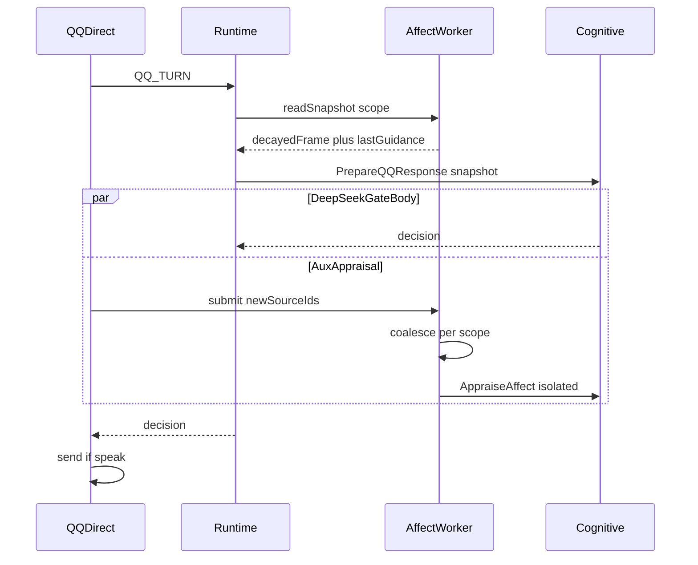

# 19 · 情绪模块解耦为身体能力

> **文档状态：阶段 A 已落地（AffectWorker、QQ 读快照、sidecar 拆除）。** GUI / 留言板 / 能力与目标表达仍走既有嵌套 `ObserveEmotion`，直到阶段 B。本文其余接口若与实现冲突，以代码为准。
>
> **适用范围：** QQ Direct 回合、Runtime Supervisor、Cognitive `EmotionService`、embodiment capability 协商。GUI / 留言板 / 能力与目标表达仍走既有嵌套 `ObserveEmotion`，直到后续阶段显式迁移。
>
> **依赖文档：** [14 · Embodiment 能力协商](14-embodiment-port-and-capability-negotiation.md)、[08 · Runtime Supervisor](08-runtime-supervisor.md)、[EMOTION_DIRECTOR.md](../EMOTION_DIRECTOR.md)、[17 · Qwen 情绪导演评测](17-qwen-emotion-director-evaluation.md)。

把短期情绪从「每次 `PrepareQQResponse` 先等两段 Qwen」改成身体能力：**读窗口快照是同步、便宜的；评估与演绎是异步、可合并的。** 计算（appraisal JSON → 余额合成 → guidance）保持不变。QQ 与 GUI 仍共用同一个 Cognitive 所有者、同一份 `emotion` 状态区块，不新增 systemd 单元，也不在共享服务不可用时回退到进程内脑。

---

## 1. 背景与当前基线

| 能力 | 当前基线 | 本计划目标 |
| --- | --- | --- |
| 窗口 | `EmotionService._window`：30 分钟 / 最多 20 条；QQ `build_qq_emotion_messages` 同样取 20 条核验观察 + 真实发送回执 | 保持同一窗口与来源规则 |
| 计算 | appraisal → 动态占比 → guidance；半衰期 600s；`emotion-director-v4` | 公式、模板、校验版本不变 |
| QQ 时序 | 工作区已跳过嵌套 `ObserveEmotion`，Prepare 结束后 sidecar 调 `attach_emotion_context(isolated=True)` | 回合开始读快照；与外界交互后异步提交；sidecar 被 AffectWorker 取代 |
| 门控 / 正文 | `_QQScopedLLM` 在官方 DeepSeek V4 注入 `reasoning_effort=low`；门控另加 `response_format=json_object` | 保留；与情绪解耦正交 |
| 所有权 | Runtime 经 RPC 调 Cognitive；`SharedDomainLease` 单正常所有者 | 不新增所有者；能力失败时报 unavailable，不静默降级为进程内评估 |
| 隔离测试 | 测试显式选择 isolated development | 继续禁止从 pytest / mock / `demo` 推断绕过 |

当前 sidecar 只做到「不堵塞本轮 DeepSeek」。它**不**把上一轮 guidance 注入本轮门控/正文，失败被吞掉且无合并，Qwen 仍可能与下一轮抢 aux。本文的读快照 + 合并提交就是补这两点。

线上已观察到的代价：门控 completion 可达 1.3k–3.8k tokens（思考链），情绪评估约 8s 超时，串行 Direct worker + 60s `QQDeadline.from_first_seen` 会把突发消息打成 `direct_newer_context`。门控/正文 low-thinking 是第一刀；情绪离开关键路径是第二刀。

---

## 2. 设计约束

1. **计算不变。** 不改 `EmotionService` 的窗口裁剪、同事件一次应用、半衰期、动态占比、guidance 校验（`emotion-guidance-guard-v2`）或跨会话只共享类别/强度/时间。
2. **情绪是身体能力，不是第二条脑。** Runtime 调度；Cognitive 仍是唯一持久化与模型调用所有者。GUI 是 Runtime 门面，QQ 是通道/身体驱动。
3. **读与写分离。** QQ 调用只读当前已提交窗口经衰减后的 Frame + 最近一份 guidance。新刺激的评估在与外界交互之后异步提交。
4. **本轮允许差一拍。** 本轮正文看到的是提交前的窗口状态；新刺激的 guidance 最早出现在后续回合。零刺激或尚无 Frame 时沿用现有语义降级提示，不编造原因。
5. **提交必须限流。** 每个 scope 同时最多 1 个 in-flight 与 1 个 pending；pending 合并 `new_source_ids`；最小间隔 2s；超预算丢弃并记 journal，而不是无限排队。
6. **失败可见。** 评估超时或 aux 不可用不得把 Runtime 打成 PAUSED，也不得假装评估已完成。读快照失败则本轮无新 guidance，并记录 `affect_snapshot_unavailable`。
7. **自己的发送不是新刺激。** 送达回执进入窗口只作解释上下文（`processed=True`），不产生外部增量。wait、生成失败、发送失败不回滚已提交余额。

---

## 3. 能力契约

在 [harness/embodiment/capabilities.py](../../harness/embodiment/capabilities.py) 增加：

| 能力 | 语义 | 同步性 | 失败 |
| --- | --- | --- | --- |
| `affect.window.read.v1` | 读取指定 `scope` 在 `as_of` 的衰减 Frame、最近 guidance、窗口哈希 | 本地/RPC 快路径，不调 Qwen | `degraded`：返回空 Frame + 降级提示；`unavailable`：本轮不注入情绪段 |
| `affect.appraise.v1` | 提交 `new_source_ids`（及已核验消息指纹）做评估+演绎并提交 | 异步；调用方不等待 | 超时/冲突进入 journal；不升格为 QQ 回合失败 |

`RUNTIME_CAPABILITIES` 纳入这两项。QQ provider 在协商时声明依赖 `affect.window.read.v1`（可选：缺则 QQ 仍可说话，只是没有情绪段）。`affect.appraise.v1` 同样可选；不可用时只停止更新余额，不阻止发送。

载荷要点：

- **read：** `{scope, as_of}` → `{revision, frame, guidance_text, window_hash, source_ids, degraded}`。`guidance_text` 已是程序拼好的 ≤300 字提示，编译器只渲染、不再二次调模型。
- **appraise：** `{scope, as_of, new_source_ids, message_fingerprints, homeostasis_projection}` → `{accepted_ids, merged, dropped_reason}`。实际评估在 Cognitive 内走现有 `observe` / `guidance`。

不把原始对白经 GUI 控制面暴露给其他客户端；能力调用走既有 Runtime journal 与 Cognitive 账本。

---

## 4. AffectWorker

放在 Runtime 进程内，例如 [harness/runtime/affect.py](../../harness/runtime/affect.py)，由 Supervisor 持有。参照现有 `_social_appraisal_tasks` / `_qq_emotion_tasks` 的 drain，但**有合并、有间隔、有输入预算**。

每个 `scope`（`qq:group:<id>` / `qq:<private>`）状态：

| 字段 | 规则 |
| --- | --- |
| `in_flight` | 0 或 1；进行中的 `AppraiseAffect` |
| `pending` | 0 或 1；等待合并的提交 |
| `last_submit_at` | 上次真正发出评估的时间 |
| `last_window_hash` | 避免窗口未变时重复评估 |

合并规则：后到的 `new_source_ids` 并入 pending；指纹冲突拒绝该条 id，不整单失败。pending 在 `in_flight` 结束且距 `last_submit_at` ≥ 2s 后发出。

关闭 / pause / 持有 `SharedDomainLease` 的维护路径必须 drain AffectWorker，超时则 `RuntimeStateError`，与现有 entity appraisal 一致。

Cognitive 侧新增隔离命令 `AppraiseAffect`（或保留 `ObserveEmotion` 但强制 `isolated` 且**禁止**再挂到 `PrepareQQResponse` 的 deadline 上）：

- 独立 deadline，默认 appraisal 6s + guidance 3s。
- **不**扣除 `emotion_main_reserve_seconds`（那是给同回合正文预留的；本路径已离开回合）。
- `degrade_on_failure=True` 对 Runtime 生命周期：失败只记 journal，不 PAUSED。
- 输入仍由 Cognitive 所有者从核验观察库重读，Runtime 只传 id/指纹，不传不可信原文作为权威。

QQ 输入构造继续用 [harness/qq/emotion_window.py](../../harness/qq/emotion_window.py) 的 `build_qq_emotion_messages`。

---

## 5. 时间与 token 预算

目标：突发群聊时评估队列可跟住，且不饿死门控/正文的 aux 与主模型。

| 限制 | 初值 | 理由 |
| --- | --- | --- |
| 每 scope in-flight | 1 | Qwen 4B 两段调用串行约 4–8s；并行同 scope 会写同一份 `emotion` 区块 |
| 每 scope pending | 1（id 集合合并） | 10 条突发消息变成 1 次评估，而不是 10 次 |
| 最小提交间隔 | 2s | 低于窗口半衰期，高于一次 HTTP 往返 |
| 单次 `new_source_ids` | ≤20，且不得超过窗口容量 | 与 `emotion_window_messages` 对齐；超出则 `emotion_new_sources_exceed_window` |
| 评估输入字节 | ≤6000 UTF-8（窗口原文 + 人格投影 + 内稳态投影） | 沿用现有过大输入降级；超限省略旧窗口并记录 `omitted_window_messages` |
| 隔离超时 | appraisal 6s / guidance 3s | 略紧于现网 8s/4s，因不再与 60s QQ deadline 抢时间 |
| 并发 scope | 先不设全局锁；QQ Direct 本就串行 | 若 GUI 同期评估，靠 Cognitive `_lock` 串行提交状态 |
| 丢弃策略 | pending 被更新的提交替换时，被挤掉的 id 若仍在窗口内会进入下一次合并；若已滑出窗口则永久跳过并 journal `affect_source_dropped_expired` | 窗口滑出本就不清余额，只是不再评估该条 |

禁止：

- 为「赶进度」对同一 `source_id` 重放评估。
- 用主模型（DeepSeek）顶替 aux Qwen。aux 不可用则本轮降级，与现网 `aux_unavailable` 一致。
- 把评估塞回 `PrepareQQResponse` 的 `command_emotion_deadline`。

遥测（只记计数与耗时，不记原文）：`affect_read_ms`、`affect_submit_merged`、`affect_dropped`、`affect_appraisal_ms`、`affect_guidance_ms`、`affect_in_flight`。可进现有 `QQTurnTrace` / Runtime journal，不新建日志文件。

---

## 6. QQ 回合接线

改 [harness/runtime/supervisor.py](../../harness/runtime/supervisor.py) 与 [harness/cognitive/service.py](../../harness/cognitive/service.py) 的 `PrepareQQResponse`：

1. **读：** `QQ_TURN` 受理后、调用 `PrepareQQResponse` 前，Runtime 经 `affect.window.read.v1` 取快照，写入 payload 的 `emotion_snapshot`（Frame + `guidance_text` + `revision`）。不再 nested `ObserveEmotion`。
2. **用：** `_prepare_qq_response` 把快照交给 `decide_qq_reply` 的 `emotion_guidance`。`adapter.emotion_guidance(command)` 在无 `emotion_context_ref` 时不要再等 guidance 模型；有快照则直接渲染。
3. **提交：** Direct 在本轮与外界交互落定后调用 `affect.appraise.v1`：
   - 触发消息及本轮新核验观察为 `new_source_ids`（外部作者）；
   - 调用时机：观察已写入记忆库且本轮决策已返回（speak 或 wait 均可）。**不要**等到 OneBot 发送成功——发送失败不回滚刺激；
   - 自己的发送回执另作窗口追加，`processed=True`。
4. **拆除 sidecar：** 删除 `_schedule_qq_emotion_sidecar` / `_qq_emotion_tasks` 对 Prepare 的 `finally` 挂钩，drain 改走 AffectWorker 任务集。

[harness/runtime/emotion.py](../../harness/runtime/emotion.py) 的 `with_emotion_context` 对 `PrepareQQResponse` 继续短路。GUI 的 `PrepareResponse` 等暂仍 nested，直到阶段 B。

门控/正文加速（已在工作区，与本文并行保留）：

- [harness/qq/decision.py](../../harness/qq/decision.py) `_QQScopedLLM` 注入 `deepseek_low_reasoning_options`；
- 门控 `response_format={"type": "json_object"}`；
- 仅官方 `api.deepseek.com` + `deepseek-v4-flash` / `deepseek-v4-pro`。

---

## 7. 实施阶段

### 阶段 0 — 已落地的过渡（工作区，非本文验收）

- 门控/正文 official DeepSeek `reasoning_effort=low`。
- QQ Prepare 不 nested 等待 `ObserveEmotion`；sidecar 隔离 12s、失败不 PAUSED。

过渡代码在 AffectWorker 合并后删除 sidecar，避免两条异步评估路径。

### 阶段 A — QQ 读快照 + AffectWorker（本文必须完成）

1. 声明 `affect.window.read.v1` / `affect.appraise.v1`。
2. Cognitive：只读 snapshot RPC（衰减后的 Frame + 缓存 guidance，**不**调 Qwen）；`AppraiseAffect` 走现有 `EmotionService.observe` + `guidance`。
3. Runtime AffectWorker：单飞、合并、2s 间隔、预算。
4. QQ Prepare 带 snapshot；Direct 在决策返回后 submit。
5. 去掉 sidecar。
6. 测试见第 8 节。

### 阶段 B — 其他表达入口（本文不实施）

本地对话、留言板、能力/目标/日记仍 nested `ObserveEmotion`，直到 QQ 在线延迟与丢弃率可接受。迁移时同样「先读后写」，不要把 GUI 回合重新绑上 Qwen 关键路径。

### 阶段 C — 发布

- 不回滚 Linux 已超前的 prompt 版本（当前生产闲聊分句为 v21/v9 量级 overlay）。叠加本改动用新 release id。
- `emotion_mode=off` 与 grounded-agency 研究条件保持关闭情绪。
- 回滚：停用能力后 QQ 只少情绪段，门控/正文 low-thinking 可独立保留。

---

## 8. 测试与验收

必须有测试显式 `isolated=True` / 独立 state_dir，禁止靠 pytest 文件名推断开发绕过。

| 用例 | 期望 |
| --- | --- |
| QQ Prepare 在 appraisal 挂起时仍在 deadline 内返回 | 不 `qq_turn_expired`；journal 先 `PrepareQQResponse` 后 `AppraiseAffect` |
| 读快照把上一轮已提交 guidance 注入本轮 | 门控/正文 user 或 compiler 段含该提示；本轮新消息尚未进入余额 |
| 10 条突发同一 scope | 评估次数 ≤ 2（in-flight + 一次合并 pending），且遵守 2s 间隔 |
| `new_source_ids` > 20 或输入 > 6000 字节 | 有记录降级或拒绝，不撑爆 aux |
| 指纹冲突 | 只拒绝冲突 id |
| 自己的发送回执 | 窗口可见、`processed`，不产生增量 |
| sidecar 残留 | 不存在对 Prepare 的 `finally` 评估挂钩 |
| aux 不可用 | 读路径 degraded；写路径 journal；Runtime RUNNING |
| `emotion_mode=off` / grounded-agency | 不注册写路径，不读出伪造 Frame |
| 门控/正文 low-thinking | 官方 DeepSeek 注入 `reasoning_effort=low`；非官方 endpoint 不注入；正文不带 `response_format` |

离线假模型通过不等于表达质量或 QQ P95。在线门槛仍沿用 [EMOTION_DIRECTOR.md](../EMOTION_DIRECTOR.md)：QQ 端到端 P95 ≤ 30s；本改动的工程目标是把「情绪」从该 P95 的关键路径拿掉，使 P95 近似等于门控+正文+发送。

---

## 9. 非目标

- 新的情绪公式、标签集、或把余额写回 Homeostasis。
- 独立情绪进程 / 独立端口 / 第二条 Cognitive。
- 把 GUI 控制面做成情绪 API 网关。
- 并行同 scope 双写 `emotion` 区块。
- 用 DeepSeek 做 appraisal/guidance。
- 为赶速度降低 guidance 校验或取消窗口指纹冲突检查。
- 修改闲聊句号分句与正式回复分段（已在 Direct 投递层，与情绪无关）。

---

## 10. 关键代码锚点

| 模块 | 文件 | 本计划动作 |
| --- | --- | --- |
| 窗口与 QQ 来源 | [harness/qq/emotion_window.py](../../harness/qq/emotion_window.py) | 复用；submit 前仍要 Runtime 核验来源 |
| 计算 | [harness/emotion/service.py](../../harness/emotion/service.py) | 增加只读 snapshot；隔离路径跳过 `emotion_main_reserve_seconds` |
| 能力名 | [harness/embodiment/capabilities.py](../../harness/embodiment/capabilities.py) | 新增两项并纳入 `RUNTIME_CAPABILITIES` |
| Runtime 调度 | [harness/runtime/supervisor.py](../../harness/runtime/supervisor.py) | 读快照、提交、drain；删除 sidecar |
| 过渡 sidecar | [harness/runtime/emotion.py](../../harness/runtime/emotion.py) | QQ 继续短路 nested；GUI 暂不改 |
| QQ 准备 | [harness/cognitive/service.py](../../harness/cognitive/service.py) `_prepare_qq_response` | 消费 snapshot，不再 `await emotion_guidance()` 调 Qwen |
| 门控/正文 | [harness/qq/decision.py](../../harness/qq/decision.py) | 保留 low-thinking；guidance 仅渲染 |
| 编译器 | [harness/compiler/compiler.py](../../harness/compiler/compiler.py) `render_emotion_guidance` | 已是纯渲染，保持 |

Linux overlay 发布流程见 [LINUX_DEPLOYMENT.md](../LINUX_DEPLOYMENT.md)。激活会弹 Direct；不要为腾 GUI 8790 去停 8766 的 QQ Agent。
