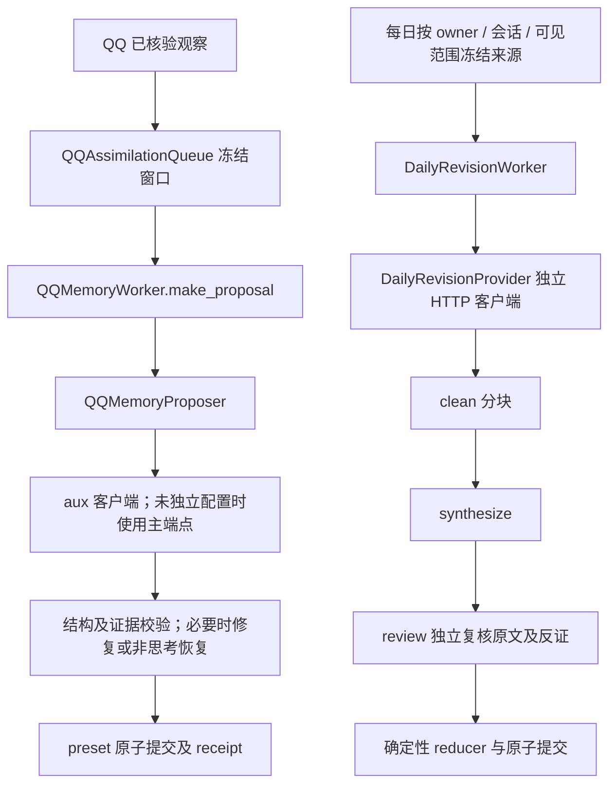

# 记忆整理外部 API 缓存优化实施方案

调研日期：2026-09-20。范围按本次需求限定为 **QQ 消息窗口整理**与**每日 clean → synthesize → review 整理**。本文是实施方案；没有修改业务调用、切换模型、部署或调用付费 API。

## 1. 结论与优先级

**可以提高缓存复用，但两条链路的收益来源不同。** QQ 优先解决“动态消息与动态 schema 打断固定前缀”，每日整理优先补齐计量、核验 DeepSeek 接口适配、减少不必要的阶段重算，再优化同阶段请求布局。不能承诺统一的命中率目标，尤其不能把每天都不同的原文算成可复用输入。

推荐按以下顺序实施，每个阶段独立验收和回退：

| 顺序 | 工作 | 预期作用 | 估计工程量，非承诺 |
|---|---|---|---|
| P0 | 两条记忆链路的请求归因、缓存计量；核验有效 endpoint/model/API 格式 | 得到可信基线，防止把本地模型、未知用量或无效请求混入 DeepSeek 数据 | 1–2 人日 |
| P1 | QQ 固定 schema 与动态约束拆分；专用提示词序列化；修复请求追加消息 | 增大跨窗口稳定前缀，保留修复前完整请求 | 1–2 人日 |
| P2 | 每日整理专用布局；缩小阶段结果缓存的失效范围 | 增大同阶段复用，减少相同输入的重复付费调用 | 2–3 人日 |
| P3 | 同一冻结数据集离线验证、有限在线对照、逐步发布 | 用每批成本与质量决定是否上线 | 观察时间另计 |

不把聊天、发言 gate/persona 合并或 validator 改造纳入此方案。已有 [全链路缓存记录](deepseek-cache-optimization.md) 可作背景，但其“已实现”内容不能直接代表记忆整理也已优化。

## 2. 两条真实代码链路



### 2.1 QQ 消息窗口整理

- [QQMemoryWorker.make_proposal](../../harness/cognitive/qq_memory.py) 创建 LLM 客户端，再交给 [QQMemoryProposer](../../harness/memory/qq_assimilation.py)。Proposer 显式优先取 `llm._aux`；所以修改主聊天模型配置未必改变整理端点。实时与 [历史回填](../../harness/memory/qq_backfill.py) 都需要覆盖。
- 默认窗口为空闲 30 秒、最长 120 秒、最多 32 条；同一会话前一任务未完成时不会放行后续任务。原始来源被冻结，成功提案持久化，旧印象基线变化会使未提交提案失效。这些正确性与恢复机制已经存在。
- `_SYSTEM` 是固定整理规则；user 载荷包含人格、当批原文、旧印象和 schema。旧印象由 `proposal_context` 按相关性选出，最多 24 项、12,000 字符；不是整个记忆库。
- `schema` 动态嵌入本批 `source_ids`、作者 `subject_refs`；私聊还缩小 impression kind 集合。
- `_json()` 对所有对象递归 `sort_keys=True`。最终根字段顺序实际为：

  `conversation_id → conversation_kind → frozen_sources → group_id → old_impressions → persona → schema → self_id`

  因此在 Python 字典构造时先写 schema 并不能让 schema 出现在发送前部。
- 结构/证据校验失败后，`_propose_validated` 把 `rejected_proposal`、`validation_feedback`、`repair_request` 塞回原 payload，再重新排序发送。共享的原请求不再是完整消息前缀。
- 已有 `length` 后一次非思考恢复，以及任务重试时恢复该模式的逻辑。降低重复输入不能通过放宽来源覆盖、接受截断 JSON 或增加无限重试实现。

### 2.2 每日记忆整理

- [DailyRevisionWorker](../../harness/cognitive/daily_revision.py) 使用独立 [DailyRevisionConfig](../../harness/memory/revision/config.py) 和 [DailyRevisionProvider](../../harness/memory/revision/provider.py)，直接 `httpx.Client.post('/chat/completions')`，不经过 `OpenAICompatClient`。
- 仓库默认是 Moonshot/Kimi，实际生产端点由 `NC_DAILY_REVISION_CONFIG` 指向的文件决定。本次本地检查未取得生产有效配置，因此**不能断言每日整理已使用官方 DeepSeek**。以下 DeepSeek 适配项以实际目标端点为条件；通用计量与布局优化仍适用。
- 调用次数约为 `clean 分块数 + 1 次 synthesize + review 分组数 + 物理重试`。review 为检查跨块证据可能扩大分组；不能假设它与 clean 一一对应。
- clean 输入是不同原始块，跨块主要共享固定规则；synthesize 默认只有一次；review 输入同时包含原文、候选修订和原有结论。三个阶段的 system 各不相同，只共享 `_COMMON`，不能承诺整个原文跨阶段命中。
- 当前 `_encoded()` 同样递归排序：synthesize 为 `cleaned → context → sources`；review 为 `context → current_source_ids → proposal → sources`。context 内部的 `active_revision_ids`、`allowed_*` 等动态字段又排在人格之前。
- 已有持久化阶段结果缓存：同一 run 相同请求可以不再调用 API；复核否决保留清洗、废弃综合/复核；重基线可复制按内容寻址的阶段缓存。应完善已有机制，而不是再建一套无边界的回复缓存。

## 3. 核验结果与证据限度

本地没有找到 `traces/model_requests.jsonl`；现有普通 generate 日志多数来自 mock，不能用来计算这两条记忆链路的真实命中率。本次结论依据代码、官方契约和合成数据的离线结构探针。

可复现材料：[探针脚本](evidence/memory_api_cache_probe.py)、[结果 JSON](evidence/memory-api-cache-offline-2026-09-20.json)。脚本调用现有提示词构造与序列化逻辑，截获中间 payload；仅使用合成来源和临时 SQLite，不发送 HTTP，不读取生产密钥。

| 离线检查 | 结果 | 含义 |
|---|---|---|
| QQ 两个合成窗口，当前 user 公共前缀 | 366 字符 | 原文变化很早打断复用 |
| 仅把人格/会话/schema 放到原文前 | 542 字符 | schema 内的动态 enum 仍会提前变化，单纯重排收益有限 |
| 分离固定 schema 与当批 enum 后 | 3,380 字符 | 固定 schema 本身 2,770 字符可以前置；本样本旧印象相同 |
| 上述分离前/后 user 总长度 | 3,943 / 3,899 字符 | 不是靠填充无效内容做大前缀；尚未计入正式新增的绑定说明 |
| QQ 首次失败后当前修复请求 | 与原 user 仅共享前 894 字符 | 改成追加修复消息后可保留整个原请求消息列表 |
| 每日仅修改 `schedule_time` | 当前阶段 cache key 改变 | 非推理参数导致可避免的本地结果缓存失效 |
| 给每日 `queue.account` 输入 hit=80、miss=20 | 存储只剩 prompt=100、completion=10、total=110 | 当前记账确实丢弃供应商缓存字段 |

**以上都是字符级结构结果，不是 provider token、线上命中率、质量提升或账单节省。** QQ 的固定 system 另有 2,504 字符，上表只比较 user；真实人格大小、旧印象变化、来源数量会改变结果。schema 分离探针验证了动态约束可完整还原，没有验证模型理解新布局的能力。

现有相关回归已运行：`test_qq_assimilation.py`、`test_qq_memory_model_budget.py`、`test_qq_memory_worker.py`、`test_daily_revision_provider.py`、`test_daily_revision_queue.py`，**107 passed**，两条既有依赖弃用警告。它们验证当前功能基线，不等于候选改造已实现或通过验收。

## 4. DeepSeek 机制与接口前提

DeepSeek 自动启用前缀缓存，命中依赖服务端已落盘的完整前缀单元；公共前缀检测与缓存构建需要时间。`A+B` 后发送 `A+C` 不应预设第二次就命中；第三次 `A+D` 才可能复用检测出的 `A`。缓存尽力而为，因此自然流量是主实验，不能仅用一次冷调用下结论。[官方缓存指南](https://api-docs.deepseek.com/zh-cn/guides/kv_cache/)

以下不是有效的默认方案：按旧公告凑 64-token 填充、固定 IP 绑节点、每批更换 `user_id`、为了提高比例把全部旧原文重复输入。`user_id` 有 KVCache 隔离语义，若生产使用它，应在真实隐私域内稳定；不能为了命中合并不同隐私域。Responses 的 `prompt_cache_key` 和 `prompt_cache_retention` 不受支持。[隔离说明](https://api-docs.deepseek.com/quick_start/rate_limit/)、[Responses 兼容表](https://api-docs.deepseek.com/guides/responses_api/)

**每日链路有接口适配前提。** 当前代码发送 `response_format.type=json_schema`；官方 Chat Completions 文档列出的类型是 `text/json_object`。所以不能只把每日配置 URL/model 改成 DeepSeek，就假设严格 schema 解码可用。建议增加显式 provider 能力适配：

1. 已兼容严格 schema 的现有服务保持原模式。
2. 官方 DeepSeek Chat Completions 使用 `json_object`，把该阶段固定 schema 写入固定提示前缀，保留 `_parse` 严格解析、全部语义校验及 review 拒绝即不提交。该模式只保证 JSON 语法，必须单独评估无效输出率。
3. 如果需求必须包含供应商侧 schema 约束，官方 Responses 文档提供 `text.format=json_schema`；这需要独立响应/usage 适配，不能作为只改 base URL 的小变更，也不能宣称迁移本身增加缓存。

[Chat Completions 格式约束](https://api-docs.deepseek.com/api/create-chat-completion/)、[JSON Output](https://api-docs.deepseek.com/guides/json_mode/)、[Responses 格式约束](https://api-docs.deepseek.com/api/create-response/)

此外，`deepseek_low_reasoning_options` 目前只接受旧 `deepseek-v4-flash/deepseek-v4-pro` 名称。若整理端点改为官方现推荐的 `deepseek-flash`，会丢失预期 low 配置，QQ 的非思考恢复资格判断也会失败。应先扩展受支持模型契约测试，再迁移别名；同一对照实验固定 thinking/effort，避免输出成本变化污染缓存结论。[模型说明](https://api-docs.deepseek.com/zh-cn/quick_start/pricing/)、[思考模式](https://api-docs.deepseek.com/guides/thinking_mode/)

## 5. P0：记忆专用计量与基线

### QQ

在 `make_proposal`、历史回填及 Proposer 的每次实际模型尝试绑定明确元数据：`memory_pipeline=qq_assimilation`、`stage=propose/repair/nonthinking_recovery`、任务关联标识、实际 `model_role=aux/main`、布局版本、有效 endpoint/model、thinking/effort、来源数量、旧印象数量及字节量。

当前 Proposer 直接取底层 `_aux.complete_chat_result`，绕过 RoutingLLMClient 的 aux 归因作用域；没有显式覆盖时底层 span 默认 role 为 main。因此应根据实际选中的客户端标记角色，不能直接使用旧 role 总计作为基线。新增 trace 字段需同步扩展 `infra/trace/request_spans.py` 的白名单。

给每次物理调用记录 hit/miss/unknown、prompt/completion 来源、finish_reason、reasoning tokens、耗时和错误类型。诊断只保存摘要、长度和不可逆关联标识，不保存 API Key 或原文。

### 每日

在 `DailyRevisionProvider._call` 接入统一的无正文请求 span，或等价的每日专用 attempt 表，并让报表可读取。现有 durable reserve/account 继续承担预算权威；新增报表不能再次扣减或相加重复请求。

扩展 `DailyRevisionQueue.account`：保留经验证的 `prompt_cache_hit_tokens`、`prompt_cache_miss_tokens` / `cached_tokens`、未知量和 reasoning tokens。缺字段、矛盾字段以及未知传输分别标记；旧记录不能回填为零命中。每个 reservation 对应一次物理请求，阶段缓存命中单独记为 `stage_result_cache_hit`，API 调用次数为零。

报表至少按 pipeline、stage、endpoint、请求/响应模型、布局版本、模式分组；附小时或价格时段。现有 `tools/qq_cache_report.py` 的分组不含 endpoint/布局版本，需要扩展，不能把不同供应商同名模型混在一起。每日还要补出本地阶段复用次数、阶段重算原因与每个成功分区总成本。

首轮收集自然运行数据：QQ 建议至少 200 个已结束窗口、覆盖多个会话与 1/8/32 条等不同窗口规模；每日取 3–7 天或足够多的同阶段分块。数量是试验起点，不是统计充分性的保证。低流量时延长观察，不为凑样本主动刷 API。

## 6. P1：QQ 提示布局与修复复用

### 6.1 用专用 model 编码器，保留持久化 digest 语义

不要修改整个文件通用 `_json()`：它也服务 `_digest()`、job 身份及持久化绑定。新增模型提示专用编码器，根字段按明确顺序输出，值内部保留 canonical JSON；不按字母重新排序整个根对象。

建议初始布局仍保持现有 system/user 角色数量：

```text
system: 固定整理规则 + 固定的 schema_bindings 解释规则
user JSON:
  schema                 固定结构，不含当批 enum
  persona                当前人格，版本变更时立即更新
  conversation_kind
  conversation_id
  group_id
  self_id
  old_impressions        本轮重新检索的旧印象
  schema_bindings        本批 source_ids / subject_refs / impression_kinds
  frozen_sources         当批完整、带归属的来源投影
```

`schema_bindings` 的协议必须明确：其 `source_ids` 同时约束 episode/impression 的来源；`subject_refs` 约束真实作者；`impression_kinds` 保留私聊禁用 group 的限制。内部保留完整 job-specific schema，并测试“固定 schema + bindings 可还原原动态 schema”。`validate_proposal` 仍校验来源恰好覆盖一次、对象归属、私聊限制、证据种类、旧目标合法性与 continuation 引用。

人格和旧印象继续作为 user 数据；不能为了稳定前缀把来源文字升级为 system 指令。旧印象原有检索集合与预算先保持不变；若额外按稳定 ID 排序，只能在选集确定后做，并单独验证对主题判断的影响。不可冻结旧 impression 内容、confidence 或 evidence。

### 6.2 修复只追加

首次请求的两个消息完整保留。修复请求在末尾追加一个 user 消息，内含拒绝的提案、校验反馈与修复要求，并在固定规则说明这些是待审数据。禁止重新生成或改写前两个消息。

这样能够保留第一次的完整输入边界，实际命中仍受落盘时间影响。一次修复、统一 deadline、`length` 的一次恢复、非思考恢复后的停止条件均保持原逻辑；不能把此优化变成更多重试。

### 6.3 版本与失效

新增独立 `memory_prompt_layout_version`，不要仅为改排版提升 `PROCESSING_VERSION` 而让全部原始来源重新入队。已持久化、已校验的提案按现有恢复逻辑处理；新调用使用新布局。同批修复固定布局版本；模型参数、人格、证据或历史基线变化必须产生不同输入。

## 7. P2：每日整理的阶段布局与本地结果复用

### 7.1 明确优化上限

clean 原文块通常互不相同，synthesize 每分区通常一次，所以不能期待所有输入都有重复。固定任务规则和 schema 是主要可复用部分；同日多分区、历史补跑和同阶段重算比跨天复用更有观察价值。不要专门预热每日任务或重传全部前序 clean 块。

### 7.2 按阶段构造固定前缀

保持 clean/synthesize/review 的独立任务规则，使用专用布局编码器，不改变用于数据身份、cache key 和 source hash 的 `_encoded/digest`。

| 阶段 | 推荐顺序 | 保持的约束 |
|---|---|---|
| clean | 固定 `_CLEAN`；DeepSeek json_object 模式所需的固定 schema；当前原文块 | 每条来源恰好分类一次，自身表达不提升为独立事实 |
| synthesize | 固定 `_SYNTHESIZE` 与 schema；context 内当前人格/固定范围在前；当前 existing、historical、allowed 集合与 active IDs；cleaned；sources 元数据 | 历史只能作基线，结论仍引用原始 source_id |
| review | 固定 `_REVIEW` 与 schema；本复核组完整原文及 current IDs；本组 context；最后 proposal | 审核独立、完整原文及反证不省略；拒绝不自动放行 |

review 把 candidate 放末尾主要利于**同一原文组再次复核**；首次处理两个不同组时原文也变，不应报告为跨组大幅提升。支持 `response_format=json_schema` 的供应商无需为了缓存把 schema 再复制到提示词；其服务端序列化和缓存行为另行测量。

### 7.3 缩小本地 stage cache 的无效失效范围

当前 key 包含几乎整个 config，修改 schedule、超时、预算等也会使相同请求失效。改为由实际推理请求身份决定：provider/API 类型与版本、稳定账户隔离域标识、endpoint、model、完整出站 messages、response_format、thinking/effort、max_tokens、阶段 prompt/validator 版本。不同历史基线会改变 synthesize/review payload，自然失效。

调度时刻、轮询间隔、请求超时、重试次数和预算上限不应单独改变成功结果的语义身份；但缓存复用前仍检查任务有效、未撤销、权限有效、输入绑定一致并重新执行当前校验。保留现有否决时只复用 clean 的规则，不能重新使用已被否决的 synthesize/review。

先限定在现有 run/rebase 范围，不新增跨 owner、跨会话或全局缓存。进一步跨 run 复用 clean 必须绑定 source hash、权限域及处理版本，并处理撤销和失效传播，作为后续独立项目。

### 7.4 分块与调用次数单独评估

`chunk_input_tokens` 当前实际上用 UTF-8 字节加固定余量做保守上界，并非精确 token。先将观测中的 byte/token 单位说明清楚，记录每块真实 usage，再尝试调整分块大小。大块可以减少固定规则重复发送及调用次数，但可能增加输出截断、超时和 review 扩组成本。

首轮不改块大小、不合并 clean/synthesize/review，也不改 high/low thinking。若随后调整，按同一冻结来源集单独实验，同时保持来源覆盖和跨块反证检查。

## 8. 对照、指标与上线门槛

### 8.1 三层验证

1. **离线结构验证：**QQ 不同 source ID、作者、群/私聊、人格版本与旧印象变化；修复时前两个消息逐字节不变；新增 schema 绑定可还原旧约束。每日不同原文块、review 分组扩展、重基线与撤销均保留正确输入。预算计算使用最终出站布局。
2. **质量回放：**按同一冻结原文和旧状态分别生成候选，保存独立结果，不提交正式 preset。覆盖第三方评价、自述、同源重复、玩笑、否定/纠正、跨窗口 continuation、历史反证及私聊归属。人工对照关注漏记、错误合并、虚构、反证丢失与印象过度强化。
3. **有限在线对照：**同一 provider、有效模型、隐私域、thinking 和输出上限；自然任务做按会话/分区分配的对照，保留首次、第二次、第三次相似前缀请求及间隔。冷启动/稳定期/修复/重试分别报告。离线配对调用会互相预热，需固定并平衡执行顺序，单列实验额外费用；不要临时改生产 `user_id` 制造实验分组。

### 8.2 指标

供应商缓存命中率：`sum(hit) / sum(hit + miss)`，只在缓存分区可靠的请求中计算；同时展示 prompt 总量、缓存字段覆盖率、未知输入量及实际用量覆盖率。不能平均每次请求的百分比，不能把 estimate/缺字段当成 miss。

本地阶段复用率：`复用成功的阶段数 / 本可执行的阶段请求数`，并报告避免的 API 调用次数；它不属于供应商 KV 命中率。

主要业务指标：每个成功 QQ 窗口/每日分区的物理请求数、hit/miss/completion/reasoning tokens、失败与修复次数、总成本、排队时长、处理时长 p50/p95。拒绝或失败的任务费用进入总账，并单列成功任务归因；非流式路径不报告未经测量的 TTFT。

建议预先约定的发布门槛：确定性和证据边界测试全部通过；人工标注未发现严重归属/反证回归；每批成本下降且 p95 不出现不可接受退化。可把“每批成本降低至少 10%、p95 退化不超过 5%”作为首轮业务目标，但它不是效果预测；样本不足或置信区间跨过退化区间时继续观察，不宣布成功。

### 8.3 成本口径

`单批成本 = Σ(hit × 命中输入价 + miss × 未命中输入价 + completion × 输出价) / 1,000,000`。

2026-09-20 官方 Flash 空闲时段价格为每百万 token：hit ¥0.02、miss ¥1、输出 ¥4；高峰时段分别 ¥0.04、¥2、¥8。按请求适用价格记录账单口径，价格可能变化。[官方价格页](https://api-docs.deepseek.com/zh-cn/quick_start/pricing/)

仅作算例：输入量固定、命中率从 40% 到 80% 时，空闲时段输入成本由 ¥0.608/M 降到 ¥0.216/M，输入部分下降约 64.5%；输出成本未变。一个 10,000 输入 token 的批次若仅提升 20 个百分点，节省约 ¥0.00196；少生成 1,000 输出 token 则约省 ¥0.004。因此应追踪修复与 reasoning 输出，不能只追求漂亮的命中比例。

## 9. 具体交付拆分

| 交付 | 主要文件 | 必要验收 |
|---|---|---|
| 记忆计量 | `harness/cognitive/qq_memory.py`、`harness/memory/qq_backfill.py`、`harness/memory/revision/provider.py`、`queue.py`、`infra/trace/request_spans.py`、报表工具 | 每次物理请求恰好一次；失败用量不丢；未知不算 miss；aux 归因正确 |
| DeepSeek 能力适配 | `harness/memory/revision/config.py`、`provider.py`、`harness/llm/client.py` | endpoint/model 能力明确；Chat JSON 模式严格本地验证；新别名 low/恢复契约 |
| QQ 布局 | `harness/memory/qq_assimilation.py` 与专用编码器 | job/digest 不变；来源/对象/私聊约束不丢；修复只追加；预算/deadline 不变 |
| 每日布局/阶段 key | `harness/memory/revision/provider.py`、`queue.py` | 非推理 config 调整仍复用；模型/输入/基线/校验版本变化必失效；否决与撤销不复活 |
| 回放与发布 | 现有测试、隔离回放工具、记忆专用报表 | 样本清单、版本、费用、质量标注、回退开关齐全 |

建议使用相互独立的 QQ 与每日布局开关，按会话/分区稳定选择，默认保留基线。发布只影响新出站请求；遇到格式错误率、错误记忆或成本上升时切回旧布局。不要删除已成功提交的记忆，也不要通过重跑全部来源来回退提示布局。

本次完成的是可审阅的调研、合成结构证据和现有回归验证。实际生产端点核验、基线采集、候选实现及在线收益验证属于上述后续实施阶段。
