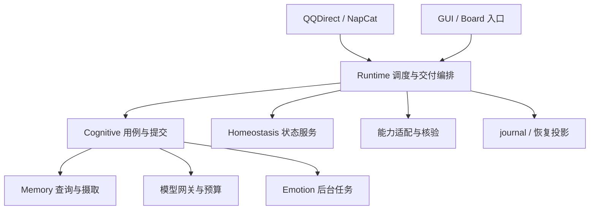

# Grounded Agency 全面重构：现状调研与实施方案

> 状态：**调研完成 / 方案待实施**。本提交只增加文档，不修改业务代码、数据库、线上配置或运行实例。
>
> 调研日期：2026-09-22（Asia/Shanghai；UTC 为 2026-09-21）。
> 仓库：`QiuYuAkiGO/NeuralCloud`。
> 来源分支：`codex/grounded-agency`（用户简称 grounded-agency）。
> 冻结提交：`835d902ed5601137b504524400cff7c64aeafbab`。
> 调研分支：`codex/grounded-agency-rebuild-plan`。

## 1. 建议采用的重构方向

重构目标是：**保留 Misty 已有的连续状态、记忆、人格、QQ 收发和已接入能力，重写职责混杂、全局串行及依赖历史规模的实现，最终收敛为一套生产路径。**

建议继续使用 Python、同一仓库及现有 Cognitive / Homeostasis / Runtime / GUI 四服务部署边界。先把每个服务内部改为清晰的领域模块、应用用例和基础设施适配器；QQDirect/NapCat、Board 等仍是通道或能力适配器。首轮不同时改语言、数据库体系、消息中间件和部署拓扑。

最优先的五项工作：

1. 把 Runtime 的“取一条事件并等到全部处理结束”改成短调度循环和可恢复任务；心跳、控制命令不再依赖前台推理完成。
2. 把 Cognitive 与情绪处理的长持锁改成 **读取冻结快照 → 锁外计算 → 校验版本后短事务提交**。并行计算仍服务于同一个 Misty 状态权威。
3. 把共享记忆全量同步、历史回复全表扫描移出请求路径，改成有消费游标的增量投影与有界检索。
4. 提炼唯一 QQ 请求、修订、期限、交付状态机，保留已完成的去重和不确定交付恢复；逐步移除桌面历史实现对协议主链的依赖。
5. 将研究实验、兼容入口、可选身体能力从生产核心的装配与依赖中分离。以可验证的功能清单决定退役，不以“当前默认 off”替代使用情况调查。

本次“完全重构”描述的是最终结构与退役目标；实施按垂直切片替换，任何时刻仍只有一个生产状态写入者和一个 QQ 发送权威。不能先删旧实现，再补功能或数据迁移。

## 2. 调研证据和适用范围

### 2.1 本次做了什么

- 通过 GitHub 接口读取来源分支 HEAD，取得完整递归目录树，并将重点源码、配置、测试与历史执行文档固定到同一提交审阅；完整树未被截断。
- 并行审查 Runtime/恢复、QQ/交付、内稳态/记忆/情绪；交叉核对部署、LLM、Compiler、通用 Pipeline 和 CI。
- 阅读仓库内 Linux 迁移、无回复故障、配置变更、journal 增量恢复及 Grounded Agency/连接组研究记录。
- 逐项区分代码事实、配置能力、历史实机证据和本方案建议。读取文件清单与远端 blob SHA 见 [audit-inventory.json](audit-inventory.json)。

本次没有在线服务器连接，没有读取当前 `/etc/neuralcloud` 的有效配置、活动数据库或实时日志；没有运行项目测试、真实模型调用、QQ 发送或生产压测。因此下文的瓶颈是有源码依据的结构风险，性能目标是待验证目标，不是已经测出的优化收益。

### 2.2 代码规模与集中度

冻结目录树包含 307 个 `harness/infra/gui` Python 文件、361 个 `tests/` Python 文件。`eval/` 下有 2,279 个文件、约 88.9 MB，包含历史结果，不能把该目录体积等同于运行时复杂度。

| 文件 | 远端文件字节数 | 主要混合职责 |
| --- | ---: | --- |
| `harness/runtime/supervisor.py` | 235,322 | 生命周期、分发、QQ、动作、目标、身体、研究、恢复及监控 |
| `harness/qq/decision.py` | 128,735 | 上下文、决策、历史查重、模型协议与落盘 |
| `harness/runtime/adapters.py` | 91,437 | 领域适配、认知准备、持锁、模型计算与持久化 |
| `harness/qq/watch_ledger.py` | 88,720 | 桌面来源的通用请求、分段、交付账本 |
| `harness/homeostasis/engine.py` | 66,250 | 状态演化、动作结算、幂等、投影和持久化 |
| `harness/memory/qq_assimilation.py` | 57,574 | 观察窗口、提炼、证据、任务和写入 |

文件大小只是拆分导航。是否改善要由职责、依赖方向、事务时长、性能与回归行为衡量。

### 2.3 不应重复实现或误删的已有成果

| 已有成果 | 核实来源 | 对重构的影响 |
| --- | --- | --- |
| Linux 四核心 + Board + QQDirect，单份共享状态 | `docs/LINUX_INSTANCE_20260915.md` | 保留部署与状态身份；这是 9 月 15 日记录，不是今日巡检 |
| QQ 原始期限、修订、冻结上下文、发送前核验、UNKNOWN 对账 | `harness/qq/reply_requests.py`、`direct.py`、`direct_store.py` | 从现有契约提炼，不改成简单的重试队列 |
| Cognitive 增量 SQLite 持久化 | `harness/runtime/cognitive_store.py`、`runtime/adapters.py` | 不把兼容 JSON 和导出副本误认成必须全部合库的多个权威 |
| Runtime journal 增量恢复及可重建恢复索引 | `runtime/recovery.py::RecoveryStore/RecoveryProjector`、`docs/harness/20-runtime-journal-recovery.md` | 改善启动应先验收现有 fast 模式；不能重新开发相同缓存 |
| 日报后台任务、监控紧凑查询、QQ 无 ACK 恢复等修复 | `docs/milestones/linux-response-recovery-2026-09-16.md` | 保留修复，不将旧故障笼统描述为“目前都还未解决” |
| 研究 GA-01～08 及新的连接组研究方案 | `docs/research/grounded-agency/README.md`、`09-connectome-dynamics-feasibility-plan.md` | 保留研究资产并独立装配；连接组仍为计划，不是生产前置条件 |

9 月 16 日记录中的排队 48～58 秒、完整聊天约 51 秒及启动约 220 秒，说明曾发生过何种故障，不是冻结 HEAD 的性能基线。9 月 20 日 fast 恢复基准只覆盖暖缓存下 journal 打开、投影和 pending 查询，不能宣传为完整应用毫秒级启动。

## 3. 功能保留、隔离与退役清单

分类含义：**保留**是必须保持可见能力与数据；**重做**是保留契约、替换内部实现；**隔离**是不进入必需生产装配，但保留可显式启用的模块；**退役候选**须在 R0/R7 证实无活动绑定且依赖迁完后才删除。

| 功能/实现 | 处置 | 理由、证据和边界 |
| --- | --- | --- |
| Persona 身份、版本与不可随意覆写约束 | 保留 | `memory/service.py`、`cognitive/service.py`；现有 Misty 不应因重构变成新角色 |
| Homeostasis 状态演化、profile/revision、幂等结算 | 保留 + 重做内部拆分 | `homeostasis/engine.py`、`ledger.py`；不能重置状态，也不能复制出第二个写入权威 |
| 普通 Runtime 的语义内稳态与表达 | 保留现有效果，隔离策略实现 | `shared-misty-emotion-on-v1.json` 使用 `qq-social-drive` 和 `responses`；不能套用研究禁令整段删除 |
| Opaque interoception、body belief、GA 研究条件 | 保留为研究模块 | `research/`、`body_belief/`、GA 契约；盲化、模型自主选择等不变量继续有效 |
| 长期/短期记忆、冲突检索、生命周期、来源 | 保留 | `memory/service.py`、`retrieval/`、`tier.py`；不得用一份聊天摘要替代 |
| QQ 原文、私聊/群聊记忆、身份/作者/可见范围 | 保留 | `qq_memory.py`、`shared.py`、`qq_assimilation.py`；跨渠道共享不等于跨受众任意披露 |
| 每次查询前全量镜像与 Python 全候选扫描 | 重做并最终移除热路径实现 | `CognitiveSharedMemory.qq_binding`、`SharedMemoryStore.import_qq_database/query` |
| Memory Writer、QQ assimilation、daily revision | 保留 + 后台有界化 | 延迟提交必须可恢复；不能在发出消息后只留进程内任务 |
| QQDirect/NapCat 群聊与私聊、授权与身份验证 | 保留为主通道 | Linux 部署记录、`qq/direct.py`；连接状态和可发送状态分别判断 |
| QQ 图片、动图、视觉证据缓存与生命周期 | 保留为可选通道功能 | `direct_source.py`、`direct_images.py`；某次上线 images=off 不表示功能废弃 |
| QQ revision/TTL、优先级、公平性、分段/checkpoint | 保留 + 提炼 | `reply_requests.py`、`watch_ledger.py`、`decision.py` |
| UNKNOWN/attempted/outbox、消息回读核验 | 保留 | `direct.py`、`direct_store.py`；没有证据时不重发，重启不清除不确定性 |
| Windows 桌面 watcher、UI 点击/OCR 发送 | 退役候选/独立兼容包 | Linux 历史记录已停旧 writer，但 Direct 仍复用其账本、配置和辅助类型；先抽共享协议再删 |
| 桌面 QQ idle/自主能力 | 单独盘点，不能宣称已完整迁到 Direct | Direct 路径拒绝 `idle_intent`，其通用能力目录并非完整桌面 send 替代；活动能力需保留原适配或补协议实现 |
| Board 留言、日记/日报、运维查看 | 保留，移出前台等待 | 有历史数据和部署证据；可关闭定时计算，不能删除已有内容或回读入口 |
| Goal regulation、预算、无进展限制、持续任务 | 保留 + 后台调度 | `runtime/goals.py`、`regulation/`；保留自主性边界及用户输入优先级 |
| EmotionDirector 与现有表达效果 | 保留 + 去掉模型期间持锁 | 生产存在启用记录/配置；简化性能路径不能通过把情绪永久设为 off 达成 |
| 主模型/辅助模型分工、Context Compiler 与来源归因 | 保留 + 请求契约统一 | `llm/client.py`、`compiler/compiler.py`；精简调用不等于删除事实边界 |
| 可选 LLM validator/rewrite | 从必经路径移出，保留独立能力 | 9 月 15 日停用记录只证明当时配置；与 QQ 身份/权限/期限/交付校验分开 |
| 对话前联网准备 | 配置化可选阶段 | 历史 `conversation_enabled=false` 同时 `autonomous_web_enabled=true`；不能删除全部 Web 能力 |
| MistyAI/desktop/server/web/voice provider | 保留契约，按需装配 | 当前使用程度不同；不从未在线确认推导“无用”，不修改另一个仓库的实现 |
| GA 固定对照 policy、EFE、simulator、社会泛化评测 | 隔离到研究装配 | 研究对照仍需保留；普通生产仍有语义 profile，须按模式区分 |
| 旧 relationship 数值、care/social drive 遗留 | 逐字段退役候选 | GA 核心不应引入指定社会奖励；普通状态/GUI/记忆 ranking 仍读取相关字段，每日修订仍生成 RelationshipState；需数据兼容映射和引用检查 |
| 单进程 GUI 兼容入口、旧 launch 模式、旧 preset | 退役候选 | `README.md` 明确 `start.sh/stop.sh` 为兼容路径；先统一入口并验证支持矩阵 |
| PostgreSQL store、Mock/InMemory | 可选后端/测试工具 | 当前 Linux 以 SQLite/文件为主；不要为了减少文件数删掉离线测试替身；PG 移为 optional extra 后再评估维护需求 |
| 大批历史 eval 报告、旧方案及重复导航 | 归档索引，排除生产发布包 | 不修改既有实验结果；保留最小验收 fixtures 和对应版本/校验信息 |
| 果蝇连接组方案 | 保留研究文档，默认无生产依赖 | 09 文档尚未实现；本次重构不给连接组新增业务决策权限 |

**删除门槛**：同时具有“无有效配置/入口/动态装配绑定”“核心依赖已抽取”“数据可读/迁移完成”“兼容窗口结束”“保留能力回归通过”的证据。代码里没有直接 import 只是其中一部分，还要查命令入口、注册表、GUI、脚本、RPC 与持久化字段。

特别注意：`cognitive/qq_memory.py::build_commit` 将稳定印象投影为 `CandidateMemory + SemanticFact`，`memory/revision/reducer.py` 仍生成带证据的 `RelationshipState`。`semantic` 是记忆事实类型，不等于研究条件禁止的“语义内稳态”。可以停止旧分值驱动、合并重复派生投影，但必须迁移原 ID、来源、反证、修订与撤销链；不能通过重跑模型重建过去的印象，更不能直接删 semantic 表。

## 4. 当前主要问题及源码依据

### F1：优先队列不是可中断调度，心跳可能被业务饿死

`RuntimeSupervisor.run()` 顺序 `await self.dispatch(event)`；仅当 `queue.get()` 没取到事件才通过 scheduler 生成到期心跳。`PriorityEventQueue.get()` 会优先返回已有可处理事件，持续有流量时这一分支可能长期不发生。优先级只能决定下一条，不能让控制命令插入当前的长认知等待。依据：`runtime/supervisor.py::run`、`queue.py::PriorityEventQueue.get`、`control.py::submit_control`。

改造：独立轻量计时生产者生成可合并心跳；调度器只做接纳、版本判断和任务启动；模型工作放在受管理的任务执行器。暂停/撤销必须先通过短控制路径阻止新提交和发送，然后取消可取消计算，外部已发生副作用进入对账。

### F2：异步外观下，owner 锁仍覆盖慢操作

`cognitive/qq_turn.py::_run_locked` 与 `runtime/adapters.py::_prepare_response` 在 owner 锁生命周期内进行上下文、模型调用及持久化。已有 `to_thread`/shield 保护释放了事件循环，但不会自动缩短领域互斥时间。盲目去锁会破坏共享 owner、ledger、Persona、会话状态及请求冻结语义。

改造：冻结读取结果和必要版本，锁外纯计算，短锁内校验提交；模型工作不得持有可写 store。普通聊天还需统一请求 deadline 传递，不能只依赖默认 `llm_timeout`；QQ 已有端到端 deadline，不应重复另起一个更长 TTL。

### F3：QQDirect 跨会话串行且存在账户级交付约束

`qq/direct.py` 的工作循环逐个 `await process`，长会话会阻塞其他会话；`direct_store.py` 有全局不确定交付检查、发送预留和互斥。把 worker 数字增大，不能解决 Cognitive owner 锁，也可能打破账户交付约束。

改造：纯准备任务按会话公平调度，先限全局 2 个计算位做实验，每会话 1 个活跃提交槽；发送由唯一账户 executor 执行，保留 UNKNOWN 的现有账户级保护。第一阶段不缩小不确定性的阻断范围，待独立证明安全后再讨论按会话隔离。

### F4：历史规模进入 QQ 决策与冷却事务

`decide_qq_reply()` 在事务内读取同群历史 deliveries/completed decisions，解析、排序和建立去重集合；`DirectStore` 冷却查询读取历史 sent JSON。长历史扩大事务和 CPU 时间。

改造：维护 last successful delivery、cooldown、handled observation、已完成 segment、历史指纹等有索引投影。近期上下文可 LIMIT，完整幂等查询必须查唯一索引，不能用“只看最近 N 条”代替历史查重。投影需可从原账本重建，状态与游标同事务推进。

### F5：共享记忆同步与检索不是按增量/候选量计费

`CognitiveSharedMemory.qq_binding()` 先执行 `sync_qq()/sync_local()`；QQ DB/WAL 的变化可能触发 `SharedMemoryStore.import_qq_database()` 重新镜像验证。`SharedMemoryStore.query()` 对已按 scope 限定的行继续做 Python 解码匹配，候选仍随历史增长。

改造：在 memory 子系统内用来源 sequence/revision/tombstone 驱动增量摄取，后台校验全量一致性；前台读取已提交检索投影并携带 watermark/lag。先通过 scope、作者、时间、词项索引缩小候选，再做向量/混合重排与 conflict sibling 扩展。最终范围与来源校验不省略。不能仅按新增 rowid 同步而漏掉修订、撤销和删除。

同化提交还存在全量 owner preset 复制/安装成本：`cognitive/qq_memory.py` 会把模型 proposal 应用到提交时最新的 current 状态，保存后再发布到 adapter，并用 `publication_pending` 保护失败重试。这些 rebase/receipt 保障必须继承。目标是以变更集原子写入派生对象 revision、job receipt 和 publication outbox；发布失败只补发布，不重复强化记忆，也不覆盖模型计算期间新到的本地 turn。原始档案可独立，但不能将 queue ack 当成记忆已提交。

### F6：情绪模型调用持全局锁，超时不等于后台线程结束

`EmotionDirector.observe()`、`guidance()` 持 `threading.RLock` 等待 `_model()`；后者创建 daemon thread 并等待队列结果，读 snapshot 也会竞争该锁。调用超时后底层模型线程可能继续运行，若持续超时会占用资源。

改造：锁内 reserve job，锁外调用，锁内以 event/version/idempotency 校验提交；限制并发与排队，记录超时残留任务。**Appraisal 首期保留全局单序列 actor**：当前输入包含 `reservation.global_before`，前序结果会影响后序输入，按会话并行后随意提交并不等价。锁外执行主要用于让已提交快照读取和控制路径不等待模型。Guidance 基于冻结 frame 可按 scope 做 single-flight 和有界并行。未来要并行 appraisal，须另行定义 global_before/version、超时顺序和有序提交，并验证回放语义。复用 `runtime/affect.py` 的现有异步处理与有效快照，不在每条回复前强制等待两轮完整情绪计算。

### F7：持久化与“已接受”语义需分层

Homeostasis 已有 SQLite 权威状态与 ledger；Runtime journal 默认逐条 flush/fsync，有可靠性价值但可能产生磁盘阻塞。`RuntimeIngress.accept()` 调用的 `_append_journal()` 允许日志暂时失败时进入有界 emergency 内存 buffer，因此不能把所有 accepted 都等价为“已耐久接收、重启不丢”。

改造：对外定义 `durable / buffered / rejected` 接纳状态，或对要求耐久的请求只在 durable 后确认；内部继续保留明确标记的 emergency 模式。将不可恢复损失敏感的写入交给单写入器、短事务和受控批提交，必须等所需 durable barrier 才交付成功状态。不能通过删除 fsync 或把所有写入异步丢给内存队列来追求延迟。

### F8：兼容与研究逻辑侵入生产装配

`supervisor.py` 同时知道 QQ、agency、body belief、研究 contract、报告与能力细节；`watch_ledger.py` 名义属于桌面 watcher，实际承载 Direct 仍用的通用交付数据。大文件拆成若干名字不同的文件但继续互相传 owner，不会改善边界。

改造：领域模块只依赖类型/ports；应用用例编排，composition root 选择实现；研究通过显式 hook 读取已提交事件和快照。保留原有唯一事件权威，不增加第二套总线。先移走核心对 legacy 的反向依赖，再删除旧入口。

另一个具体反向依赖是 `CognitiveServiceHost._initialize` 从 GUI 的 settings、PresetLibrary、HarnessChatService 获得人格、配置和持久化。应将 ApplicationConfig、PersonaRepository 和 ConversationService 提到独立应用/领域层，让 GUI 依赖它们。四服务拓扑保留不意味着 Cognitive 业务必须依赖 GUI 服务对象。

### F9：开关来源、默认值和线上配置容易混淆

`Settings`、manifest、GUI persisted settings、会话 rollout 和 launch bindings 都影响行为；已有 `_configuration_sources` 是可复用基础。普通 profile 与 GA profile 的表达/策略约束不同，历史上 validator 和联网准备曾单独关闭。

改造：启动时生成脱敏的 `ResolvedConfiguration`，逐字段保留来源、profile 和版本；每个请求冻结其策略版本，热变更有明确重启或新请求生效边界。合并重复开关，但不直接重命名环境变量后静默回落默认值。

### F10：已有恢复能力尚不等于整机高可用

systemd 有 `Restart=on-failure`、启动健康检查、按序停启；journal、领域 store、快照/恢复工具已存在。历史部署记录同时明确本机备份、异机位置未配置，NapCat 可能需重新扫码。单机磁盘、主机、电源、QQ 桥或唯一模型提供商故障，不能靠增加线程或重启 unit 消除。

改造：先完成单机可恢复性、故障隔离和有效就绪，再单独评估冷备/主动被动容灾。不可让两台机器共同写活跃 SQLite、同一人格或同一 QQ 账户，也不能假定整个 QQ 发送能达到外部端到端 exactly-once。

## 5. 目标架构和唯一权威

### 5.1 服务部署先保持稳定，服务内部重建

这是逻辑模块图。Memory 与 Emotion 首轮属于 Cognitive 内部模块/受管 worker，不新增独立服务。Research 通过显式装配使用既有事件与快照接口；日记、日报、索引维护是有界后台任务。

| 权威 | 唯一负责的事实 | 其他组件允许做的事 |
| --- | --- | --- |
| Runtime | 生命周期、接纳事件、任务安排、取消/期限、动作编排日志 | 查询状态、提交命令；不能替代领域状态库 |
| Cognitive | Persona/会话/认知提交、共享记忆写入协调、情绪与维护任务状态 | 用冻结快照计算候选，不直接改 owner 内部对象 |
| Homeostasis | 当前状态/profile 及幂等动作结算 | 读取版本化快照、提交有 action/event ID 的结算 |
| QQ protocol executor + 现有交付库 | 发送预留、attempted、ACK、协议核验证据、不确定性 | Runtime 引用 receipt；Cognitive 按真实交付内容提交互动 |
| 记忆原始来源库/条目 | 原事件、scope、作者、修订/撤销与证据 | 检索库/向量/镜像都是带 watermark 的投影，不升级为来源权威 |
| Recovery / monitoring 数据库 | 可重建索引、诊断 | 丢失可重建；不反向覆盖 journal 或领域状态 |

事务边界不同不意味着必须合成一个巨型数据库。跨服务操作采用业务幂等键、耐久待办与回执对账，承认不存在跨 HTTP、SQLite 与 OneBot 的单一原子事务。

### 5.2 推荐的代码边界

在既有 `harness/` 包内逐步形成下列职责；旧 import 保留一段兼容期。目录名可在 R1 最终确定，职责和依赖约束必须先固定。

| 模块 | 内容 | 禁止依赖/副作用 |
| --- | --- | --- |
| `contracts/` | Event、RequestSnapshot、ModelCall、DeliveryReceipt、版本与错误类型 | 不 import 服务实例、GUI、SQL 或 provider |
| `runtime/` | scheduler、jobs、control、recovery、delivery coordinator | 不拼 prompt、不执行具体 SQL 检索、不按 provider 字符串分支 |
| `cognitive/` | PrepareTurn、CommitDeliveredTurn、维护用例 | 不执行 QQ 协议发送，不直接访问 Runtime 私有成员 |
| `memory/` | scope、evidence、检索、冲突、摄取、生命周期 | 不知道 QQ UI 控件，不自动扩展受众 |
| `homeostasis/` | 纯状态演化、结算、服务端持久化与读投影 | 不调用模型决定身体真值 |
| `emotion/` | appraisal/guidance、版本化快照、有界任务 | 不持领域锁等待模型，不拥有另一套人格 |
| `qq/` | 协议 ingress、规范化请求、交付/对账、媒体 | 不创建新的独立认知 owner |
| `embodiment/` | 已有 ports、provider、capability 协商 | 不接管人格/长期记忆 |
| `research/` 与独立评测入口 | GA、simulator、可选连接组实验 | 未显式启用时不构造数据库、模型任务或事件订阅 |
| composition roots / deploy | 配置解析、对象装配、服务生命周期 | 不承载业务判断；保留可验证配置来源 |

不设置“每个类最多几行”作为验收。新核心文件建议保持单一职责、通常不超过约 500 行；超出时说明原因。对核心模块建立 import 边界检查，核心不能依赖 legacy/GUI/research 实现，测试替身从统一 ports 注入。

### 5.3 可恢复 CognitiveJob，而不是新的一套消息系统

建议任务数据包含：`job_id`、`owner_id`、`session_scope`、`source_event_ids`、`request_revision`、`owner_epoch`、`policy_revision`、必要状态版本、`accepted_at`、原始 `expires_at`、单调时钟剩余预算、`status`、`attempt`、`idempotency_key`、冻结输入引用、结果/回执引用。

状态流：`accepted → queued → computing → prepared → delivering → committed`；可终止为 `superseded / expired / cancelled / failed`。`delivery_unknown` 是需对账状态，不能当成普通可重试失败。`delivered_pending_commit` 表示已产生外部事实、等待幂等本地提交；不能因为稍后的 TTL 到期就抹掉这条交付。

- Job 的 Runtime 编排事实复用既有 journal；任务查询索引复用或扩展 RecoveryStore 投影，不新增第二份权威工作流日志。
- Cognitive 准备结果与耐久维护待办归它自己的 store，提交幂等键跨 RPC 传递。
- QQ 原始 `first_seen`、请求修订和 frozen delivery plan 继承自既有 reply request/ledger，Job 只绑定它们，不另起一个请求时钟。
- 定时任务使用有上限 mailbox、合并键、watermark；普通感知可按既有规则合并，用户请求、权限撤销、已尝试交付事实不能静默丢弃。

单调时钟预算只在同一进程生命周期内使用，不持久化一个剩余时长并在重启后重新起算。恢复始终受原始 `expires_at` 约束；时钟异常无法证明仍有效时保守到期。事件已 durable 而内存队列入队失败时，保留 journal 的 pending 并补排，状态应明确为“已接纳待调度”；不能按普通 rejected 删除已经确认接收的事实。

当前 `DirectStore.start_run` 会让旧 run 的 received/bound/preparing/ready 过期，attempted 转为 unknown。这是现有保守恢复策略，新 Job 方案不能宣称它已经支持恢复所有未发请求。首版保持旧 run 不自动复活；若要恢复仍新鲜的任务，须增加来源、原 TTL、owner epoch 和 lease 校验并独立验收，不重置 first_seen，也不续发旧分段后缀。

### 5.4 并发和提交协议

1. **Snapshot**：短锁内验证来源/scope/权限，读取不可变 Persona、必要会话/记忆/Homeostasis/Emotion 快照，记录版本与证据引用。持久登记任务后释放锁。
2. **Compute**：在受管 worker 中检索、编译和调用模型。禁止写 Persona、会话、身体状态、QQ 账本或发送消息；线程兼容阶段必须使用无副作用的计算接口。
3. **Prepare commit**：校验 owner epoch、请求是否仍有效、权限与相关状态版本；在 Cognitive 权威库的短事务中保存冻结结果、幂等 receipt 和发布 outbox。Runtime 取得耐久 prepare 回执后才投递交付命令，丢失 RPC 回应时按同一键查回。每会话顺序提交，全局 Persona/配置变更按明确规则失效。
4. **Deliver**：唯一执行器在真正发出前再次检查期限、修订、目标、权限和发送预算；先耐久记录 attempted，再进行网络副作用与核验。
5. **Finalize**：QQ 权威库先耐久保存已核验的实际正文/分段与交付回执，并有可恢复的回执发布待办；Cognitive 在自身事务中原子写入“已消费该回执”、会话变更及记忆维护待办。跨库用稳定 receipt ID、发布水位和幂等重放衔接，不能假定两个库能一起 commit；恢复时从已核验 ledger 补查未消费回执。此阶段允许对已发生的事实补提交，不重新发送已交付片段。

版本校验必须按依赖拆分：Persona/权限/账户 epoch 是强约束；每 5 秒 Homeostasis tick 或无关群新消息不能令所有回复永远 CAS 失败。对普通读快照定义最大年龄，对高风险动作使用更严格的现场复核。收到同会话新消息时，沿用现有“真实点名、原作者更正、其他作者插话”的差异语义。

取消只对无副作用计算实施。已开始的线程不能靠取消 await 强行终止；过渡期保留有限线程池、响应超时、late-result discard 和提交 fencing，最终使用可取消异步 HTTP。Python 的任务取消和运行中 Future 的限制见 [asyncio 任务文档](https://docs.python.org/3.12/library/asyncio-task.html#task-cancellation) 与 [Future.cancel](https://docs.python.org/3.12/library/concurrent.futures.html#concurrent.futures.Future.cancel)。一个后台任务失败不能因使用同一个 TaskGroup 而意外取消全部独立会话。

## 6. 快响应的具体实施

### 6.1 前台路径

前台只保留：协议与权限核验、必要上下文读取、参与/路由决定、正文生成、确定性交付核验、最小耐久提交。完整记忆提炼、日报、全量一致性检查、研究采样和非必要情绪更新放入后台。

- 保留 rule-first Parser/Fast Path；低歧义请求不新增辅助模型往返。需要解释时再启用 Deep Path。
- QQ 是否参与及正文生成维持各自契约；先核对现有 direct/compact/brief/frozen request 路径，避免在外层重复做 parser、gate、emotion 和 retrieval。
- 将 `ModelCall` 明确为目的、角色、schema、token budget、deadline、idempotency/trace；复用当前 RoutingLLMClient。不能仅凭“返回 JSON”推断必然应该使用辅助模型。
- 用连接池和异步 HTTP；全链路预算取原始 deadline 剩余值，每阶段开始前预留发送与持久化预算，网络 timeout 不是唯一端到端期限。
- 保留人设稳定前缀，动态证据按需输入；命中缓存不是正确性来源。缓存键至少绑定 owner、scope、会话 revision、源修订与策略版本，不跨受众复用。
- 情绪读取最新有效冻结快照；可选新 appraisal 使用受控等待上限，超时按约定降级，不制造新情绪事实。前台“没有等待”不能伪称后台“已经更新”。
- 当前 `OpenAICompatClient.complete_chat_result(stream=True)` 直接抛 `NotImplementedError`，因此 TTFT 暂无完整实现。网页流式可单列阶段；QQ 仍使用核验后的完整片段，不边生成边发送未经定稿的 token。

### 6.2 内稳态与记忆

内稳态拆为纯演化 reducer、串行 command handler、状态/ledger store、异步诊断投影。相同 tick/action/event 与 profile 输入应产生相同结果；重复 action 不重复扣费，重启不重复推进。耗时数据库写入避免占用 async loop，但同一连接/事务必须由明确执行线程拥有，不能随意跨线程共用。

记忆采用“可靠来源摄取 → 授权范围索引 → 有界候选 → 冲突补全 → evidence 输出”。预期检索开销应主要随候选数增长；向量不可用时可在声明降级后使用现有词项/实体策略，不假装有完整历史。权限撤销与数据删除必须同步使旧缓存失效；不能等后台索引慢慢追上后才生效。需要最新原文时从有界 source window 补读，而不是临时导入整个 QQ 库。

SQLite WAL 仍只有一个同时写入者，长读事务也可能拖延 checkpoint；因此增加连接数量不能替代短事务和正确索引。见 [SQLite WAL](https://sqlite.org/wal.html)。不在同一改造阶段引入 Redis/Kafka 或强迁 PostgreSQL；只有指标证明单机状态/吞吐不能满足约定负载时再做独立 ADR。

### 6.3 目标指标和测量口径

以下是 R0 后校准的工程目标，**不是当前性能或已承诺结果**。默认测试条件：单实例、本地 SSD、三个授权会话；两个会话同时请求、另一个持续普通消息；固定数据集、模型/provider、prompt、输出长度与冷/暖状态分别测量。

| 指标 | 首轮目标 | 口径/不能省掉的条件 |
| --- | --- | --- |
| 本地事件 durable 接纳 | p95 ≤ 100 ms，p99 ≤ 250 ms | 从本机接收至实际耐久确认，不含 NapCat 之前的网络 |
| 控制面状态查询/暂停阻止新工作 | p95 ≤ 200 ms / ≤ 500 ms | 主模型故意延迟 30 秒时仍测试；已发送事实不能撤回 |
| 5 秒心跳调度延迟 | p99 ≤ 250 ms | 连续非空队列、普通模型慢响应下，无遗漏或无限积压 |
| 已决定要回复的 foreground 排队 | p95 ≤ 500 ms | 约定容量内；超载单列 rejected/expired，不隐藏分母 |
| 10 万条授权记忆的检索与编译 | p95 ≤ 300 ms | 不含新 embedding 网络时间；固定候选与冲突预算，冷缓存另报 |
| 除模型及外部协议外的请求开销 | p95 ≤ 700 ms | 包括 queue、lock、检索、编译、最小提交，不只计函数 CPU |
| 总体首个已核验 QQ 片段 | 常见短回复目标 p95 ≤ 8 秒 | 关键路径全部模型/外部准备（含 gate、body 及必要 embedding/web/guidance）合计预算约 5 秒、协议核验约 2 秒的目标分组；有图片/联网等请求另分组 |
| 1.5 秒极低延迟 | 作为另行验证的挑战目标 | 当前非流式云模型链路无依据保证；不得用空 ACK/无内容消息达标 |
| 新增核心编排函数复杂度 | 不新增无解释的大型混合职责函数 | 以依赖、事务与职责审查为主，行数为辅助 |
| 同机 warm restart 至业务 ready | p95 ≤ 30 秒目标 | 使用匹配副本、包含四服务与待办对账；扫码/主机故障独立报告 |

需记录 `received → durable → queued → snapshot → model-start/end → prepared → attempted → ack → verified → committed` 时间点、lock wait、内存/线程数、模型调用数与 token、缓存命中、索引 lag、UNKNOWN 数及每种 terminal reason。复用 `infra/trace/request_spans.py`、`qq/telemetry.py`、`tools/qq_latency_report.py`。

所有到期、取消、主动沉默、权限拒绝、提供商错误和成功样本都纳入分布/原因表；“允许沉默”不能记成传输错误，也不能把超时样本删掉后计算成功率。对比旧版和新版时固定同一输入与模型替身；真实模型评测另列，不把 deterministic fixture 当人格/情绪效果证明。

各阶段预算用于调度，不是分位数等式：不能把阶段 p95 相加当成端到端 p95，后者必须从同一批完整请求轨迹独立计算。若真实 gate/body 等总时延超过预算，先如实报告外部耗时与功能分组，再调整阶段设计或目标，不能只报告正文生成的一段时间。

## 7. 高可用、降级与恢复

### 7.1 故障域与处理

| 故障 | 目标行为 | 恢复策略 |
| --- | --- | --- |
| 一个模型请求慢/失败 | 其他会话、心跳、状态查询继续；该任务按原期限结束 | 有界重试且不重置 deadline，按角色/provider 熔断 |
| 辅助模型或情绪更新失败 | 可采用已批准的 rule-only/有效旧快照降级 | 记录 freshness 和降级原因；不替代缺失事实 |
| 记忆维护失败 | 已可靠提交的对话仍可查看，维护任务积压可见 | 耐久待办 + 幂等重试；权限/来源缺失时禁止越权回忆 |
| NapCat 断线/未登录 | ingest/send readiness 为 false，后台状态仍可查询 | 有界重连与身份重核验；需扫码时明确操作状态 |
| 发送成功但 ACK 丢失 | 保持 attempted/UNKNOWN，不重发 | 沿用 get_msg/唯一回声/有界历史核验，补记回执 |
| Runtime/Cognitive 崩溃 | 重启后按原幂等键恢复，已交付不再次发送 | journal/领域状态/QQ ledger 对账；过期未发送任务终止 |
| 派生恢复/监控索引损坏 | 重建/回退，报告 lag，不覆盖权威 | 保留 strict/fast 行为与诊断语义 |
| 权威日志/数据库不可写 | 禁止宣称耐久成功、阻止需要新事实的副作用 | 容量告警、明确 degraded/paused，人工或受控恢复 |
| 主机或磁盘丢失 | 单机不能自动保证服务继续 | 验证过的异机副本、恢复演练；另立容灾阶段 |

UNKNOWN 的自动核验有明确覆盖差异：群消息丢 ACK 且无 message_id 时，可用唯一实时本人回声加独立协议读取作为候选证据；私聊的本人 WS 回声不能证明对端，当前不支持用它补全无 message_id 的交付。此类私聊必须保留 unresolved 状态和只读人工核对入口，不能承诺所有丢包都自动恢复。

另外，OneBot WS reader 与 dispatcher 已分离，队列溢出/断线有 observation gap；有界历史回填不保证补全任意长断线。耐久接纳保证只覆盖本系统已收到并落盘的事件，不能扩大成对 QQ 服务端所有消息零丢失。

现有 journal 后台 audit 是诊断，不改变健康或执行权限。本重构不偷偷把 audit 报告改为自动暂停/重启信号；前台直接遇到权威读写故障与后台发现的历史问题分别处理。

### 7.2 SLO、RPO 和 RTO

- 建议可用性目标：30 天业务 ready 比例 ≥ 99.9%，同时分别报告基础服务、QQ 通道、模型供应方和端到端请求成功率；尚未测量，未达到前不能宣称完成。
- 单进程崩溃：仅对**已耐久确认**事件及账本事实要求 RPO=0；内存 emergency buffer 不包含在该声明内。单机磁盘损坏的 RPO 由异机复制/备份间隔决定。
- 单服务崩溃恢复目标 ≤ 30 秒，整机恢复目标 ≤ 5 分钟作为待验证指标；NapCat 要求人工扫码时另列人工恢复时间。
- 当前按停写流程做一致性快照是可保留的恢复基础，但频繁停机备份会消耗 99.9% 的可用性预算。缩短停写窗口、业务 checkpoint 后复制或经过验证的恢复日志方案，必须先证明跨库一致性；不能仅逐库在线 backup 就宣称拥有同一逻辑时刻的整实例快照。
- SQLite backup API 可取得单个库的一致副本；跨服务/跨数据库仍需本项目的停写或一致性游标协议。见 [SQLite Backup API](https://sqlite.org/backup.html)。

跨主机主动被动切换至少需要 writer fencing、账户排他、状态复制、权限和版本兼容、未决发送对账；本轮不实现双活，也不复用活跃网络盘上的 SQLite。备份必须定期恢复到新目录并核对状态与交付事实，不以“备份文件存在”代替可恢复性。

## 8. 数据与配置迁移方案

### 8.1 先做状态清单

R0 从实际部署只读导出脱敏 manifest：release/commit、schema、owner/persona、各 DB/path、profile/manifest revision、消费游标、最后已确认交付、UNKNOWN/pending、配置来源和启用通道。不要把 QQ 内容、账户密码、API key、原始私聊或生产快照提交到本仓库。

至少覆盖 Cognitive state/control 与增量 SQLite、Homeostasis state/ledger、Runtime journal/checkpoint/recovery、goal/agency/body belief 模块库、QQ 原文与记忆库、共享检索投影、reply_requests/交付/segment、Direct source/evidence/media、Board/diary、配置与登录资料。历史“15 个库”或“18 个库”不能当作固定迁移名单。

### 8.2 迁移顺序与事务边界

1. **离线基线**：在受支持的一致性快照上校验 schema、条目数、来源范围、哈希/游标与未决交付。生产源只读，不从活跃数据库随手复制单个主文件。
2. **扩展 schema**：先增加新字段、索引、游标与适配器，明确 old/new schema read/write 支持矩阵；每个迁移编号一次执行、可重复检查，不在 module import 时执行。
3. **构建投影**：原来源与 ledger 不改写，批量初始化可重建索引，记录水位；新旧检索在离线/只读 shadow 比较，禁止 shadow 发送或写正式领域状态。
4. **单写切换**：维护窗口阻止新入口，排空可完成任务并标记无法完成者；冻结外部执行，保存原 writer 状态/交付水位，切换 owner/epoch 后才启动新版 writer。
5. **追平与验证**：对照 Persona 身份、内稳态数值/profile、记忆 scope/来源/删除、已交付正文/分段、pending/UNKNOWN、目标和恢复游标。不把行数相等当成全部语义相等。
6. **恢复流量**：协议身份、授权与唯一 writer 验证后按会话 rollout；旧代码保留只读或停机回退能力，不与新版同时消费发送。
7. **收缩 schema/退役**：经过稳定观察及回退窗口后才删旧字段/入口/表；原始证据与有引用的数据先归档，不执行无依据清库。

初期不合并所有物理数据库。先确定每份数据的权威/投影身份、读写契约与游标；独立迁移某一存储时必须能说明跨库中间状态如何恢复。

### 8.3 代码回退与数据回退不同

- 新版尚未写入时可按现有 release 指针回退代码。
- 新版已经写入、发生 QQ 交付或 schema 升级时，先保存新状态并核对旧版兼容性；不可直接恢复旧快照丢掉新事实。
- 已交付的 message ID、attempted/UNKNOWN、segment 完成事实和消费水位必须保留。不能通过清账本解除阻断。
- 不可逆 schema 收缩放到最后；如需要专用回迁转换器，在测试副本证明新旧语义保持后再进入上线计划。

## 9. 实施切片、产物和退出条件

下列工作量为单名熟悉项目的工程师有效开发日估算，含回归与文档，不含等待真实流量或外部模型/QQ 登录问题。可并行研究，不可跳过共享状态的依赖顺序。总体约 32～52 个有效开发日，加至少 7 天稳定观察；应在 R0 后修订。

| 阶段 | 预计 | 具体产物 | 必须通过的退出条件 |
| --- | --- | --- | --- |
| R0 基线与功能冻结 | 3～5 天 | 脱敏有效配置/状态 manifest、功能矩阵、代表性回放、当前延迟与恢复报告 | 已用功能均有保护项；数据/交付身份可核对；未确认功能不被删 |
| R1 契约与依赖边界 | 3～5 天 | RequestSnapshot/Job/Receipt/错误类型；抽取 QQ 通用账本接口；核心 import 约束；配置解析清单 | 默认业务行为等价；旧入口通过兼容适配；无新双写权威 |
| R2 非阻塞 Runtime | 5～8 天 | 独立心跳、受管 jobs、有界公平调度、端到端 deadline、控制通道与取消 fencing | 慢模型/持续流量不饿死心跳；暂停生效；任务按恢复策略收尾；到期后不启动新外部尝试，已尝试结果继续对账 |
| R3 Cognitive/Emotion 快照计算提交 | 5～8 天 | 短锁快照、无副作用 compute、CAS/finalize、异步模型网关、情绪有界 worker | 两会话并行准备而 owner 提交一致；迟到结果不能越过修订/权限；线程不增长 |
| R4 记忆与历史查询增量化 | 5～8 天 | QQ/shared 摄取游标、索引/候选预算、删除撤销传播、历史去重/冷却投影 | 10 万/100 万规模报告；检索相关性/冲突/scope 不退化；投影可重建 |
| R5 QQ 垂直切换 | 4～6 天 | per-session 准备调度 + 唯一 protocol executor；新旧状态适配；故障对账报告 | 原 TTL/revision/分段/身份全部保留；任意崩溃点不重复发送；授权群/私聊回归通过 |
| R6 Homeostasis 与后台能力整理 | 3～5 天 | 纯 reducer、短事务命令、异步投影；Board/diary/goals/维护统一生命周期 | 原轨迹、幂等结算、重启游标一致；后台任务不占前台预算 |
| R7 退役与上线验收 | 4～7 天 | legacy 退役清单、研究装配隔离、CI 支持矩阵、部署/回退/恢复报告 | 满足删除门槛；保留能力无回归；指标达标；完成稳定观察与恢复演练 |

R2/R3 共享取消和提交契约，R4 可在 R1 后并行；R5 必须等 R2/R3。每个切片都更新“已实现/未验收/已上线”状态，不以本调研文档或合并 PR 本身代表生产完成。

第一轮可直接执行的任务是 **R0 + R1 的最小切片**：建立固定离线回放和有效配置导出格式，抽取 `reply_requests/watch_ledger` 共用的纯契约与错误类型，在既有入口中适配；此时不改发送策略、数据库布局、prompt 或默认开关。之后再单独实施心跳生产者和短调度循环，便于定位回归。

## 10. 验收矩阵与测试迁移

优先复用现有测试，将对私有属性/实现形状的断言逐步改为契约断言；废弃行为的测试随退役清单归档，不能为了让新版全绿而删掉失败的保留能力测试。

| 风险/能力 | 必测场景 | 可复用的现有入口 |
| --- | --- | --- |
| Persona/共享 owner | 角色锁定、跨通道同身份、并发提交、重启不换 preset | `tests/test_persona_lock.py`、`test_shared_ownership.py`、`test_shared_cognitive.py` |
| QQ 真实身份与受众 | 群/私聊、伪造 @、他人插话、原作者更正、权限撤销 | `test_qq_direct_addressing.py`、`test_qq_private_actor.py`、`test_memory_scope.py`、`test_qq_private_contracts.py` |
| 修订与原期限 | 60 秒原 TTL、不因重试延长、快照过期、分段中修订 | `test_qq_reply_requests.py`、`test_qq_request_revision_delivery.py`、`test_runtime_qq_deadline.py` |
| 不确定交付 | reserve 后、attempted 后、ACK 丢失、verified 后 commit 前崩溃 | `test_qq_direct_actor.py`、`test_qq_segment_ledger.py`；将 `test_qq_process_crash_recovery.py` 的桌面故障点移植到新的 OneBot 进程测试 |
| 记忆范围与事实 | 私聊不漏到群、conflict sibling、撤销/删除、重复摄取、无历史 | `test_memory_scope.py`、`test_shared_memory.py`、`test_memory_evidence_context.py`、`test_qq_private_shared_memory.py` |
| 维护任务 | 发出后崩溃、commit 重放、worker 超时、相同窗口重复消费 | `test_qq_memory_commit.py`、`test_qq_memory_worker.py`、`test_qq_memory_lifecycle.py` |
| 内稳态与情绪 | 同轨迹结果、重复动作、profile版本、过期快照、并行情绪超时 | `test_runtime_homeostasis_api.py`、`test_shared_qq_homeostasis.py`、`test_runtime_affect_worker.py` |
| 调度与取消 | 模型挂起、持续队列、pause/resume、跨会话公平、迟到线程结果 | `test_runtime_supervisor.py`、`test_runtime_recovery.py`；新增契约测试覆盖 F1/F2 |
| 恢复一致性 | strict/fast 相等、cache 缺失/损坏、旧checkpoint、UNKNOWN | `test_runtime_journal_bounded.py`、`test_runtime_command_index.py`、`tools/verify_runtime_recovery.py` |
| 已有能力 | Board/diary/goals/web/voice/provider 按已启用矩阵回归 | `test_voice_runtime.py`、`test_web_runtime.py`、`test_shared_domain_services.py` 及相应模块测试 |
| 实验隔离 | 未启用研究时零额外任务、GA字段盲化、连接组默认无接入 | `tests/research/`、`tests/agency/`、`tests/body_belief/` |
| 部署/迁移 | 副本恢复、schema 升级失败、停写失败、版本回退兼容 | `test_linux_deploy.py`、`test_deploy_snapshot.py`、`test_deploy_backup_job.py` |

上表现有文件均按冻结目录树核对；新增场景仍需编写测试。桌面崩溃用例不能证明 OneBot 的真实进程恢复，模型替身也不能证明真实提供商性能。现有 `.github/workflows/ci.yml` 包含 Linux Ruff/pytest、Windows 启动器和可选 MistyAI 跨仓库校验；重构需保留仍支持的平台，新增核心依赖检查、独立离线回放与恢复/性能作业。缺少跨仓库权限导致的 skip 必须显式报告，不能视为接口已通过。

发布门槛：

1. 保留功能契约回归通过，新增 schema/错误码兼容矩阵完整。
2. 代表性数据、无历史、大历史、断线、超时、磁盘不可写、进程崩溃都验证；写入/消息测试用隔离替身，不发送合成生产 QQ 流量。
3. 不出现重复交付、跨受众记忆泄露、Persona 意外变更、内稳态重复结算；这些不以平均成功率抵消。
4. 性能对照使用同一数据、负载和模型；短回复时延改善不能靠缩短人格表达、永久禁用记忆/情绪或放宽交付核验得到。
5. 在可恢复副本完成迁移与回退演练；随后按既有授权通道逐步 rollout，观察至少 7 天的错误原因、状态增长、线程/内存及任务积压。

## 11. 仍需在 R0 核实的问题

这些是实施前的具体证据任务，不阻塞本次调研和新分支提交：

- 当前生产 release 是否包含 `835d902` 的全部代码；strict/fast 是否启用，实际 journal 与各库规模多少。
- 当前有效 manifest/profile、情绪模式、validator、对话/自主联网、图片、brief/direct/compact、会话授权及各 capability binding。
- Windows/桌面 watcher 是否仍有任何活动消费者；Direct 替代未覆盖的自主 send/私聊 capability 是否仍在使用。
- 需要保留的 Web、voice、server、MistyAI 身体操作，以及 Board/diary/goals 的真实使用与恢复要求。
- 可用性目标是否只覆盖单机进程，还是包含主机故障；异机资源、备份间隔与人工扫码容忍时间。
- 约定峰值并发、目标模型服务时延与输出长度。必须先测再决定并发位、缓存/候选预算和是否需要更换存储后端。

本方案默认保留这些尚未证明废弃的能力并隔离其依赖。最终删除以 R0 的有效配置、调用证据与依赖清单为准；核心重构先解决调度、事务和历史规模问题，不等待“全部功能是否常用”的主观判断。

## 12. 主要源码与记录导航

所有源码判断固定于页首 SHA；后续分支变化时应更新审计清单，而非沿用旧结论。下列路径均相对仓库根目录。

- 调度与任务：`harness/runtime/supervisor.py`、`queue.py`、`scheduler.py`、`control.py`、`supervisor.py::RuntimeIngress`。
- 认知边界：`harness/runtime/adapters.py`、`harness/cognitive/service.py`、`qq_turn.py`、`harness/runtime/cognitive_store.py`、`shared_memory.py`。
- QQ 契约与执行：`harness/qq/direct.py`、`direct_store.py`、`direct_source.py`、`reply_requests.py`、`watch_ledger.py`、`decision.py`、`draft.py`、`policy.py`。
- 内稳态与情绪：`harness/homeostasis/engine.py`、`ledger.py`、`harness/emotion/service.py`、`harness/runtime/affect.py`。
- 记忆：`harness/memory/service.py`、`shared.py`、`retrieval/`、`qq_assimilation.py`、`tier.py`、`harness/cognitive/qq_memory.py`。
- 模型链：`harness/llm/client.py`、`deadline.py`、`harness/pipeline/pipeline.py`、`parser.py`、`harness/router/gate.py`、`harness/compiler/compiler.py`。
- 恢复与部署：`harness/runtime/journal.py`、`recovery.py`、`harness/deploy/systemd.py`、`backup_job.py`、`snapshot.py`。
- 当前架构说明：`README.md`、`docs/LINUX_DEPLOYMENT.md`、`docs/LINUX_INSTANCE_20260915.md`、`docs/harness/20-runtime-journal-recovery.md`。
- 历史故障/配置：`docs/milestones/linux-response-recovery-2026-09-16.md`、`qq-reply-resilience-2026-09-16.md`、`evidence/qq-validator-off-2026-09-15.json`、`evidence/qq-web-preparation-off-2026-09-15.json`、`evidence/qq-participation-rollback-2026-09-17.json`。
- 研究边界：`docs/research/grounded-agency/README.md`、`01-neutral-experiment-contract.md`、`09-connectome-dynamics-feasibility-plan.md`。

本次验证仅覆盖调研文档自身、引用文件的存在性和远端提交内容；代码回归、性能、迁移和生产验收均属于上述后续阶段。
