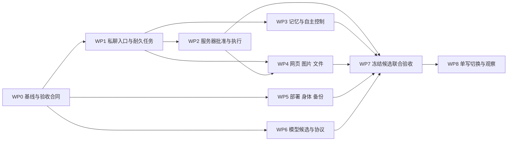

# 首发实施顺序 · 2026-09-29

输入：[已确定的首发范围](production-launch-scope-20260929.md)。代码核对基线：`ee5eb86e31c2817f3b4e8d0f4e543e31e595c9c0`。验收清单：[首发验收用例](production-launch-acceptance-20260929.md)。

状态更新（2026-09-30）：WP0/WP1 已有部分实现和本地验证，详情见[开发交接](production-launch-handoff-20260930.md)。完整回归仍有未解决失败，真实业务任务尚未接线，工作包尚未全部完成或通过上线验收。以下保留最初实施设计；没有执行真实模型、QQ、服务器或部署操作。数值默认值标为建议，不能当成用户新增承诺。

## 结论与关键路径

先建立纯私聊入口、耐久任务与可信通知，再接服务器批准、记忆管理、文件处理和 Web 控制。部署/身体/备份可并行修复，模型筛选也应尽早进行；最终模型必须在完整生产合同上复验，不能直到上线前才发现协议不适配。

WP4 的接收/回传可与 WP2 并行，需执行服务器修改的文件任务必须等 WP2 批准链完成。WP6 可先做隔离筛选，最终接线随 WP2–WP4 的合同稳定后收敛。

## 核对代码后新增确认的差距

- **纯私聊配置不可直接表达。** `DirectQQSettings.group_roster` 和 `QQSessionSettings.allowed_group_ids` 均要求至少一个群；不能通过保留虚假群配置满足校验。需要明确支持“零群 + 一个已授权私聊”。[direct_config.py:33](../../harness/qq/direct_config.py:33)、[session.py:35](../../harness/qq/session.py:35)
- **只有 high_risk 才批准。** routine 修改目前直接执行；按命令名判断只读也可被写操作参数、shell 替换和同名程序路径绕过。[server.py:270](../../harness/runtime/server.py:270)、[server_policy.py:146](../../harness/runtime/server_policy.py:146)
- **批准目前可从 Web 发起，QQ 未接通。** 首发指定 QQ 是唯一批准入口，不能只新增 QQ 按钮而保留 Web 批准旁路。[server_routes.py:96](../../harness/runtime/server_routes.py:96)
- **现有发送能力不能直接承担冻结通知。** 主动联系需要模型重新选择正文；固定审批方案与任务结果不能被模型重写后才发送。[direct_capabilities.py:324](../../harness/qq/direct_capabilities.py:324)
- **长任务不能占住普通回合。** 当前同会话仅允许一个前台工作，短对话有绝对回复期限；等待人批准应持久化后释放前台槽。[production/runtime.py:395](../../harness/production/runtime.py:395)、[direct_source.py:63](../../harness/qq/direct_source.py:63)
- **文件协议链缺失。** 消息只结构化 text/image，文件 notice 与文件相关 OneBot API 未接入，正文发送目前构造 text 段。[direct_store.py:67](../../harness/qq/direct_store.py:67)、[onebot.py:18](../../harness/qq/onebot.py:18)、[direct.py:493](../../harness/qq/direct.py:493)
- **全局暂停会连聊天一起停。** 现有 Runtime 暂停取消任务且仅派发控制事件；需要独立自主活动暂停，不能复用该按钮。[supervisor.py:1085](../../harness/runtime/supervisor.py:1085)、[supervisor.py:4663](../../harness/runtime/supervisor.py:4663)
- **“停用一条认识”不等于撤销整条来源。** 现有来源撤销会影响依赖它的多条认识；需提供目标明确的 record/claim 级退出召回。[production.py:657](../../harness/memory/production.py:657)

## WP0 · 固定基线和可复用验收合同

依赖：无。建议作为第一个独立改动单元。

工作：

- 将首发账号、会话类型、消息用途、普通回复/长任务/内部自主活动的边界形成可复用测试夹具。
- 为回复统计规定稳定请求 ID、实际发送回执、完成状态和失败分类；纠正自检把 wait 或未写日记算成功的判定。
- 修复审查时发现的 21 项 Ruff 错误，记录正式锁文件环境与 Python 版本；不以仅检查修改文件代替 CI 范围。
- CI 固定双仓版本/制品信息，正式发布所需 MistyAI 合同和跨进程测试不可降级为 warning 后跳过。
- 保留旧研究回放、旧失败报告及评估工具历史身份。新增首发评估版本，不改变旧报告分母或修补历史响应。

复用位置：[CI](../../.github/workflows/ci.yml:39)、[自检](../../tools/selfcheck/probes_production.py:81)、[QQ 计时](../../harness/qq/telemetry.py:169)、[固定错误分类](../../harness/qq/failures.py:1)。

交付：可信的判定与测试入口、基线版本清单、通过的静态检查；新增失败用例确实能使自检失败。关联用例 A00、A40–A42。

## WP1 · 纯私聊入口、耐久任务和消息用途

依赖：WP0。所有面向 QQ 的新增功能共用这一层。

- 允许空群名单，并要求启用的收发对象至少有一个；正式首发配置只能包含 `2285027817`。接收、历史抓取、模型输入和最终发送均检查白名单，其他会话既不采集新内容也不发送；已存历史保留并按受众授权使用。
- 新增 Runtime 所有的耐久任务记录，至少保存 task ID、原始消息、受众、发起类型、阶段、子步骤、制品、失败和恢复信息。任务执行状态与 QQ 交付状态分开。
- 任务流程建议：`queued → running → awaiting_approval → succeeded/failed/cancelled/uncertain`；受理消息和结果消息各有独立 outbox/回执。状态字段按既有 DTO 风格实现，不强制沿用此处字符串。
- 持久化成功后才能确认收到；等待批准、联网或文件后台处理不长期占用普通私聊回合或前台计算槽。独立限制后台执行并发，不能绕过两个前台槽和自主预算。
- 发送用途明确区分：普通回复、普通主动聊天、用户任务受理、用户任务结果、批准请求、用户询问状态。内部目标变化、思考和后台维护进度只更新 Web。
- 固定批准通知和任务结果使用受信任的服务消息合同，绑定 task/plan 和真实调用来源，不让模型自行赋予“这是审批通知”的权限，也不再次交给模型任意改写。
- 复用 DirectStore 唯一发送者、发送意图、真实回执和 UNKNOWN 对账；不另建 QQ sender。重启恢复与消息队列重复投递不重复任务副作用或已验证交付。

复用位置：[DirectStore](../../harness/qq/direct_store.py:215)、[发送与核验](../../harness/qq/direct.py:493)、[生产调度](../../harness/production/runtime.py:386)。

交付：仅私聊的模拟四服务闭环；新用户消息可在长任务等待时正常响应；通知用途均有正反向用例。关联 A01–A05。

## WP2 · 服务器只读、方案冻结、QQ 批准和执行恢复

依赖：WP1。建议按 2a 只读/修改合同、2b 批准通知、2c 执行恢复三个独立单元提交。

### 2a · 只读例外与所有修改批准

- 所有服务器修改均需批准，不再由 `routine/high_risk` 决定是否批准；风险分类保留用于说明影响及突出删除。
- 免批准的只读能力采用结构化操作与参数允许列表，由执行器选择可信程序路径和构造参数。未知命令、自由 shell、解释器、重定向、命令替换，以及无法证明只读的选项全部进入批准路径。
- 不能只修补几个正则后继续将任意 shell 当作可证明只读。整机范围保持不变；结构化只读只是限定免批准路径。
- 识别删除、清理、截断、覆盖等可能丢失数据的行为。删除方案列出解析后的目标路径、范围、可恢复性及恢复方法；动态目标无法明确时先生成具体方案，不能声称范围已核验。

### 2b · 不可变方案与批准身份

- 扩展既有 `ServerCallStore`，将 task/step、主机、操作参数、cwd、配置修订、目标前置条件、展示内容、删除说明、方案版本/哈希和通知回执绑定。
- 指定账号的真实私聊事件进入确定性的批准路由；身份来自经认证的 QQ 传输元数据，不来自模型、正文自称、引用、转发、图片 OCR 或工具输出。
- 建议语法：`批准 <方案编号>`、`拒绝 <方案编号>`；删除使用 `批准删除 <方案编号>`。普通“好的”不匹配任意待批准方案。
- 首发服务端禁用 Web 直接批准旁路，Web 可显示只读批准状态；内部执行入口仍统一验证 QQ 批准证据。
- 批准生效前必须确认完整方案已交付。方案变化、目标对象变化、配置/授权变化时旧批准失效，不能换命令继续使用旧批准。

### 2c · 效果与交付分开恢复

- 使用数据库原子状态转换领取执行，重复批准只回放状态。子步骤获得稳定 operation ID；本地事务配合耐久 outbox，跨服务依靠幂等回执与对账，不宣称已有统一分布式事务。
- 执行前重新核对主机、权限、目标对象和方案；实际 dispatch 后超时、断连或崩溃统一标为结果不确定，禁止自动重跑修改或删除。
- 统一命令账本和工具结算中 `failed/uncertain/unknown` 的含义。非零退出码按操作合同验收，不能笼统报成功。
- 自身服务/网络重启等操作在派发前固化批准和操作 ID；恢复后查询事实。若远端不支持耐久作业回执，保留不确定待处理，不能把失联当作未执行。
- 已完成动作的 QQ 结果发送失败，只恢复交付，不重做动作。

复用位置：[命令事务与指纹](../../harness/runtime/server.py:59)、[派发与记账](../../harness/runtime/server.py:283)、[批准与过期](../../harness/runtime/server.py:338)、[能力恢复](../../harness/runtime/capabilities.py:697)、[工具计量](../../harness/production/tool_accounting.py:19)。

交付：查询 → 修改提案 → QQ 展示 → 本人批准 → 精确执行 → 真实结果回传的闭环；所有反向批准与崩溃用例通过。关联 A10–A18。

## WP3 · 私聊记忆管理、一次重评与 Web 自主控制

依赖：WP1。记忆管理与 Web 控制可分开实现，但共用操作者、任务来源、控制修订和审计合同。

- 私聊查询只返回当前受众可见认识，不能直接转发 operator snapshot。区分 conversation key 与 memory audience 的前缀；分页并明确结果范围。
- 更正沿用 v2 新陈述、版本、明确替代及生效时间规则，不改原话。模糊的“忘掉那个”先返回候选，明确目标后才提交。
- 增加 record/claim 级退出召回及审计；不得以来源级撤销误停同一来源支撑的其他认识。统一作用于查询、缓存、已准备响应、重建和再摄取。
- 失败组至多再发起一次自动模型重评，根 task ID 和尝试次数持久化。重评使用新的合法来源清单与当前版本，原失败记录不改写。
- 预算不足、暂停或缺少基础条件时延后，不消费尚未实际发出的重试；已经派发但丢回执的尝试按已使用处理，不能重启后再获得一次。
- 重评产生的新拒绝任务须关联同一根，不能递归获得额外重试。只重评失败组，不重复已接受组、QQ 回复或服务器动作。
- Web 待办覆盖 QQ 受众，提供分页、总数、最老年龄、原/重评尝试、失败原因和可审计人工处置。不能只显示本地最多 32 条。
- 新增持久化“暂停自主活动”与人工目标状态修订，保持 Runtime `RUNNING`。派发、模型调用、能力执行和主动发送前检查；停止新自主工作，保留普通聊天、用户任务、事实摄取和已发生效果的对账。
- 背景自主重评跟随自主暂停；前台对话与事实保全不因自主暂停丢失。模型不能用新的 `goal_update` 覆盖人工暂停/取消。
- Web 目标页改接生产目标库和明确 DTO；QQ 状态查询仅作概述，不能执行目标暂停/恢复/取消，也不自动广播内部状态。

复用位置：[v2 待办](../../harness/memory/evidence_v2.py:527)、[拒绝后交付保护](../../harness/cognitive/production.py:252)、[生产目标存储](../../harness/production/store.py:200)、[旧目标路由](../../harness/runtime/goals.py:652)。

交付：记忆管理、一次重评、QQ 受众待办，以及“暂停自主仍能聊天”的真实 API/GUI 链路。关联 A20–A27。

## WP4 · 网页、图片和文件的实际传输链

依赖：WP1；需执行服务器修改的步骤依赖 WP2。

- 网页搜索/读取复用现有 provider、来源记录和计量；结果引用和网页内容保持数据身份，不得变成批准或操作者指令。
- 图片接收、缓存、失效和描述链已有实现；确认独立 vision 客户端的每次实际请求进入生产用量账本，图片内容不能改变当前 QQ 作者/批准身份。
- 接入文件消息与对应通知，进行协议能力探针；补齐下载、受控保存、类型/大小校验、处理产物及回传。具体 OneBot API 以目标 NapCat 的实际能力验证，不把方法名存在当成功。
- 输入和输出使用 task 关联的制品记录（文件 ID、原名、哈希、大小、来源、受众、处理结果），不直接信任消息中的本机路径或文件名。
- 文件处理使用任务工作区；接收、生成结果、业务日志和数据库的内部写入按对应业务合同执行，不逐个触发服务器运维批准。修改系统/任意宿主路径、安装软件、执行自由 shell 等仍走 WP2，不能借文件处理绕过批准。
- 回传继续由唯一 sender 执行。区分传输接口接受、可核对交付与用户实际接收；协议没有可核验文件回执时，真实试点需收件端确认，不虚称已核验送达。

复用位置：[图片描述](../../harness/qq/direct_images.py:402)、[OneBot 允许表](../../harness/qq/onebot.py:18)、[消息规范化](../../harness/qq/direct_store.py:67)、[发送核验](../../harness/qq/direct.py:493)。

交付：文字、图片、文件真实往返；长任务期间正常聊天；网页/附件不能授予执行权限。关联 A30–A35。

## WP5 · 部署、真实身体与配套备份

依赖：WP0，可与 WP1–WP4 并行。

- 部署配置显式表达身体 provider、URL、独立服务/结算凭据，保持环境清理而补齐明确白名单；正式 manifest 与控制模式一致，不靠开启开发模式绕过。
- 验证四服务连接到预期身体实例/episode；真实用量、休息、恢复及断连受限行为需要独立证据。单纯 health=RUNNING 不算完成。
- 配套备份纳入 NC 状态、独立身体账本和外部凭据；现有额外 writer 停启能力与额外数据来源要同时配置。普通目录内已有 spool/账本覆盖不得退化。
- 正式制品使用锁文件环境；备份/恢复、迁移、体外读取工具要包含在发布运维制品中。当前 package allowlist 不包含全部 `tools/production_acceptance`，需明确单独签名/哈希的运维包或调整受控清单。
- 旧格式 reader 与新 v2 数据兼容策略落实到可执行恢复方案；回退代码不覆盖新经历、修订、撤销、交付和身体结算。

复用位置：[runner](../../harness/deploy/runner.py:41)、[部署配置](../../harness/deploy/config.py:146)、[备份协调](../../harness/deploy/backup_job.py:255)、[快照来源](../../harness/deploy/snapshot.py:659)、[制品白名单](../../harness/deploy/package.py:13)。

交付：生成配置、冻结制品、备份清单及真实隔离环境恢复演练。关联 A50–A54。

## WP6 · 模型候选、生产协议与 30 秒目标

依赖：WP0 可开始离线/隔离筛选；最终接线需 WP1–WP4 的合同稳定。

- 不预先指定赢家。建议最多三个有可用端点的候选，从小型门槛场景筛到最终候选；真实调用前冻结输入和请求上限，费用无硬上限不等于无限评测。
- 角色选择、记忆证据、工具调用和图片理解分别评价。自然语言质量与 schema/权限通过率不能互相替代。
- 若选择原生数据工具协议，新增生产适配器，明确数据工具与可执行工具的区分；保留响应元数据、用量、拒绝/截断检查，不直接放宽现有 `finish_reason` 门禁。
- 原来隔离原生诊断、GLiNER、Qwen 转换工具不直接标记为生产接入完成；不使用评测金标修补答案。
- 测量排队、上下文准备、模型、记忆提交、发送与核验分段耗时，优先削减重复准备和串行等待。30 秒是成功回复 p95 目标，不是简单把 timeout 改成 30 秒；超时和失败不能从统计分母消失。
- 记忆的一次重评依 WP3 执行；不得追加未声明的通用模型/服务器/交付重试改善通过率。
- 主/辅/图片/重评用量统一记录，估算和供应商报告分开。金额无限制，既有自主尝试、目标和并发上限仍保留。

复用位置：[生产调用](../../harness/cognitive/production.py:181)、[模型门禁测试](../../tests/test_production_json_mode.py:73)、[用量账本](../../harness/production/metering.py:65)、[旧隔离 QQ 工具](../../tools/production_acceptance/qq_latency_ten.py:1)。

交付：生产可用适配器、冻结模型配置与完整原始结果；最终模型选择以 WP7 的实际整链路通过为准。关联 A40–A42。

## WP7 · 同一冻结候选的联合验收

依赖：WP2、WP3、WP4、WP5、WP6。

- 最终源码、双仓合同、锁文件、manifest、测试输入与评估器均记录哈希；执行后核验无变化。
- 在正式锁文件环境运行静态检查、全套必需回归、配对 MistyAI 合同和跨进程测试。预先声明的无关集成跳过可解释，首发必需项不得静默 skip。
- 依次做真实模型语义场景、真实四服务/身体/QQ/附件链路、故障注入、当前历史副本负载和普通文字批次。
- 按验收清单保留全部尝试、失败、等待、拒绝和实际用量；不将历史测试、模拟 QQ 或单进程指标冒充当前真实结果。
- 输出 Go/No-Go 报告：所有上线前功能与权限硬门禁通过（A00–A53 及 A54 的隔离预演），普通回复成功率至少 95%，成功回复 p95≤30 秒。99% 为目标；95%～99% 明确标注为单人试点条件，不能称作达到目标。A54 的真实切换和七天观察在 WP8 完成，不倒置为第一次切换的前提。

交付：可复查的候选验收包、实测分母、完整失败列表与已演练回退方案。详细执行顺序及指标定义见验收清单。

## WP8 · 单 writer 切换、观察与恢复

依赖：WP7 通过，且发布候选与拟上线制品相同。

- 现场只读复核 release、配置、身体实例/账本、待发送/待批准/未决操作，取得当前事实而不是沿用 9 月历史状态。
- 按执行方案暂停其他会话与所有相关 writer，取得最新一致副本、核对备份和迁移；在另一状态目录恢复验证后切换唯一 writer。
- 新链路只开放目标私聊；先核验启动、受众、真实回执、身体计量和 Web 控制，再放行普通主动联系。
- 按既有要求，试点后至少观察七天，再决定扩量和旧路径退役。期间记录成功率/延迟、失败组、自动重评耗尽、人工待办年龄、UNKNOWN、资源和实际用量。
- 实际错误执行、越权交付、不可恢复状态损坏或 writer 冲突时立即停止受影响执行；普通性能下降按验收文件的观察规则处置。
- 恢复先保全新状态、待办和未知事实，核实之后恢复兼容版本或前滚修复；不把旧快照覆盖新事实当作普通回滚。

交付：切换记录、观察报告与恢复记录。扩量、其他会话恢复和旧路径退役在观察后另作发布决策，不混入首次单人切换。

## 工程默认值建议

这些是为了使实施可落地的起点，配置需版本化；不需要重新询问已确定的功能范围。

- 批准等待沿用现有 **30 分钟**量级，从完整方案实际交付开始记录绝对到期时间；到期即失效，永不自动批准。
- SSH 步骤沿用 **60 秒默认、300 秒上限**的已有合同。超时后的未知效果必须对账；较长任务拆成有回执的步骤，不能仅延长普通 QQ 回合。
- 用户长任务先受理；建议受理反馈目标 **3 秒**。建议主动执行预算 **15 分钟**，等待人批准另计；具体网页/文件子步骤期限在实现中根据 provider 能力固定。
- 文件首批建议支持 UTF-8 文本、Markdown、JSON、CSV、代码文本，以及经专用解析器处理的 PDF/DOCX/XLSX；PNG/JPEG/WebP 沿图片链。建议单文件 **20 MiB**、每任务 **5 个**，公开明确支持列表；不执行附件中的脚本/宏，也不把未知格式伪装成已读取。
- 任意服务器修改仍要批准；文件处理工作区内的受控业务产物写入与宿主机运维操作分开建模，避免每个临时文件都要求批准，同时防止工作区成为任意命令通道。
- 模型评测与附件处理限额均是操作预算/资源边界，不是本次用户取消的模型金额上限。

## 建议的第一批实施

先完成 **WP0 + WP1 的纯私聊配置、可信通知及耐久任务最小闭环**，同时并行 WP5 的部署接线与备份来源修复。随后以 WP2 的一个可逆演练操作贯通“提案 → QQ 批准 → 执行 → 回执”，再扩展文件、记忆和 Web 控制。

任何功能单元通过自己的测试后才合入联合候选；只有 WP7 的同一候选通过，才进入 WP8。不要以文档写完、单个测试通过或模型能输出 JSON 代替完整上线条件。
