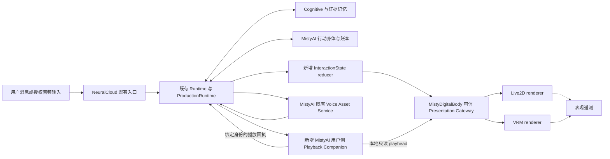

# Misty 实时交互与持续表现架构

- 文档版本：0.1.0
- 日期：2026-09-29
- 状态：**Proposed — 待实现、待验证；本次只提交架构文档，不切换部署或模型配置。**
- 目标仓库与分支：NeuralCloud / `codex/grounded-agency-rebuild-plan`
- 适用工程：NeuralCloud、MistyAI、MistyDigitalBody。
- 关联方案：[生产系统重构方案](grounded-agency-rebuild-plan.md)、[生产验证记录](production-validation.md)。

> 核心决策：保留认知、行动身体、视觉身体的分工，在既有 Runtime 上补齐交互阶段、可取消输出、真实播放证据和非阻塞表现投影。持续在线不等于持续调用大模型；迅速表现“注意到了”不等于已经理解、同意、完成任务或生成了正文。

## 阅读导航

1. [目的](#1-目的)
2. [审计基线与证据边界](#2-审计基线与证据边界)
3. [三仓库现状与关键判断](#3-三仓库现状与关键判断)
4. [修改内容](#4-修改内容)
5. [状态模型与协议](#5-状态模型与协议)
6. [交付、打断与恢复](#6-交付打断与恢复)
7. [本地表现控制](#7-本地表现控制)
8. [预期呈现的方式](#8-预期呈现的方式)
9. [如何验收](#9-如何验收)
10. [性能开销评估](#10-性能开销评估)
11. [实施顺序与回滚](#11-实施顺序与回滚)
12. [风险、未决项与交付清单](#12-风险未决项与交付清单)
13. [来源索引](#13-来源索引)

## 1. 目的

### 1.1 解决什么问题

Misty 的主要使用方式是持续在线的即时交互，而不是按剧情节点播放预制表情。工程需要同时满足四种不同要求：

- **接触反馈及时**：消息到达、用户开始讲话、交互被打断时，不必等待一次完整推理才有可见反馈。
- **语义和事实可靠**：不因追求速度而跳过身份、受众、来源、权限、版本和交付校验。
- **表现连续但克制**：无正文输出时仍有自然的注视、眨眼、呼吸和姿态连续性；也允许安静不动。
- **故障隔离**：渲染器、浏览器、语音设备或网络故障不能拖住 Runtime 控制、QQ 交付、身体动作与事实记账。

本方案将“实时”分成可分别测量的接触反馈、正文生成、音频准备、实际播放和身体行动。不得把低延迟动画包装成低延迟认知。

### 1.2 保留什么

保留 Misty 已冻结的身份和视觉风格、既有 QQ 发送执行器、人格和共同经历、生产证据机制、身体幂等账本、权限边界，以及生产与研究模式隔离。生产重构已选择的“普通消息不机械终止所有自主活动”同样保留。

Misty 可以结束当前一句话的播放而继续保留原任务，也可以关注新消息后选择等待、延后或拒绝。表现控制器无权替她作这些语义选择。

### 1.3 不做什么

本次不新增第二个认知智能体，不为每帧或每个微动作调用 LLM，不重新设计人格，不恢复已退出生产写入的七维固定社交收益，不实现实体机器人控制，不宣称已经具有主观意识。光环等表现可以映射经授权的运行指标，但不能把其数值称为经过验证的意识测量。

语音输入、TTS 资产、播放设备、Live2D 成品、VRM 成品分别按能力启用。没有麦克风输入能力时不显示“正在听真实语音”；没有正在播放的音频时不动口型。

## 2. 审计基线与证据边界

### 2.1 仓库基线

| 仓库 | 本次读取分支 | 分支头短标识 | 返回的提交时间，UTC | 用途 |
| --- | --- | --- | --- | --- |
| NeuralCloud | `codex/grounded-agency-rebuild-plan` | `ee5eb86` | 2026-09-29 08:22:11 | 主要设计与提交基线 |
| NeuralCloud | `codex/grounded-agency` | `6e5173f` | 2026-09-22 01:28:11 | 旧路径与兼容性对照 |
| MistyAI | `main` | `309c59a` | 2026-09-14 03:15:14 | 当前远端可读取的行动、身体及语音资产实现 |
| MistyDigitalBody | `main` | `91fb64c` | 2026-09-28 04:09:23 | 视觉边界、资产与控制契约 |

GitHub 分支比较返回重构分支相对 `codex/grounded-agency` 为 ahead 3、behind 0。不能因为分支名字含 `plan` 就认定它只有文档：它已增加 `harness/production/`、生产认知与 evidence-v2 记忆实现。根 README 仍保留旧九阶段介绍，不能用它替代生产入口源码。

### 2.2 本次完成的审计

本次实际读取了运行调度、事件发布、队列、生产认知、准备与提交、语音调度、身体动作与契约、视觉控制规范及已有验证记录。第 13 节列出文件和关键函数。分支比较用于确认哪些旧路径仍保留，以及生产路径增加的位置。

**这是静态源代码与仓库文档审计，不是部署巡检或性能实验。** 本次没有运行三仓库测试、真实 QQ 网络、GPU 推理、音频回环或 Live2D/VRM 渲染。引用仓库内历史实验时明确注明范围，不将其算成本次验证，也不把测试文件存在等同于测试通过。

### 2.3 必须先处理的跨仓库版本缺口

生产重构文档提到 MistyAI 的独立本地 worktree、`codex/embodied-production` 以及生产休息/结算实现；但本次远端分支列表只返回 `main`。已读取的 `src/mistyai/contracts/body_state.py` 有 `episode_id`、`revision`、`sample_sequence`，没有生产专用的 `physiology_mode`、`resting` 等字段。

另一方面，NeuralCloud `ProductionRuntime.refresh_body()` 明确要求 `physiology_mode == production_v1`，并检查身体身份、episode、采样顺序和时效。**本次不能证明远端 MistyAI main 就是已有隔离实验使用的生产身体版本。** 本地 worktree 的存在或历史联调记录不构成可复现的远端交付。

因此，生产身体联调前必须提供并核验匹配的 MistyAI 提交与部署工件，执行真实双方合同测试。未通过时保留 unknown/受限对话，不伪造生产字段；presence-only 模式可以独立推进，不要求开启生产身体。

## 3. 三仓库现状与关键判断

### 3.1 NeuralCloud：不是缺少持续运行，而是缺少面向表现的完整事实接口

#### A. 既有基础

`harness/runtime/` 已有持久 journal/checkpoint、生命周期、优先级队列、调度器、watchdog、领域 RPC 和动作/交付协调。`RuntimeIngress.accept()` 先写接受记录，再进行用户事件登记、发布及排队。[NC-R1][NC-R2]

`PriorityEventQueue` 默认容量 1024、高水位比例 0.8；可合并 heartbeat、同来源 perception、同身体 body-state，保护控制事件容量。部分合并与选择操作使用线性扫描和 heapify。这里应该处理语义事件，不应接收每帧眼睛位置、音量包络或音频采样。[NC-R3]

`RuntimeEventStream.publish()` 默认每个订阅者容量 256，满时丢弃最旧消息；它还依次等待异步 listener。结合入口先 publish 后 queue.put 的顺序，新增一个慢表现监听器可能延迟用户事件入队。该风险来自调用顺序，不代表已测得某个延迟值。[NC-R1][NC-R4]

**结论：**不能把通用诊断事件流直接当成必须确认的动作/播放回执队列；也不能通过无界 `create_task()` 隐藏背压。

#### B. 新生产 Runtime 已解决的一部分问题

`harness/production/runtime.py` 不是另一套独立 Runtime，而是建立在现有 supervisor/journal 上的生产扩展。[NC-P1]

- `_produce_heartbeats()` 独立产生心跳；`run()` 用受管任务执行工作，控制事件单独处理。
- `_eligible()` 限制 foreground slots，同一 session 不同时运行普通工作，heartbeat 不与另一个 heartbeat 重叠。
- `cancel_jobs()` 增加 epoch、撤销相关授权并请求取消任务。
- `dispatch()` 在模型返回后检查 epoch 和生命周期，再处理决策。
- `context_snapshot()` 提供不等待网络的冻结投影；过期身体读数不冒充新事实。
- 休息、用量、工具执行与协议交付分别持久化，并保留原身体/episode 的结算归属。

所以不应再造一个高频“意识主循环”、另一套全局调度器或平行目标系统。应把交互反馈放到不等待计算槽、身体刷新和模型的轻路径，同时保留同会话有序和现有控制 fence。

需要专项检查而非直接定罪的点：`context()` 在缓存不新鲜时会等待身体刷新；Cognitive 虽然把模型调用移到线程，部分快照、证据操作和兼容保存仍可能增加锁持有时间。必须用分阶段耗时确定瓶颈，不能仅凭函数为同步函数就断言 Runtime 被阻塞。

#### C. 生产认知不能按旧九阶段图理解

`harness/cognitive/production.py` 的 `prepare()` 在短 owner lock 内冻结人格、近期对话、证据和生产上下文，再锁外调用模型，返回前检查 Runtime fence、人格/会话签名、来源清单和认识版本。[NC-P2]

主模型输出 `ProductionChoice`，可以同时包含选择、正文、情绪解释、方向倾向、记忆提案和目标变更。`_ask()` 当前 `stream=False`，要求完整 JSON 和正常结束元数据；无效、截断、拒绝或带工具调用的返回不能被当成正常决策。

QQ 还有独立的来源解释 `appraise_qq()` 与既有发言/交付链。旧 `prepare_qq_response()` 已避免再次执行完整 parser/gate/retrieval，并限制连说和修复；因此“所有消息都重复跑九阶段”并不符合源码。[NC-P2][NC-L1]

这意味着实时优化不能只换模型或增加动画。结构生成负担、解释阶段与发言阶段串行、上下文预算、严格证据校验和绝对期限都会影响正文可用时间。

#### D. 记忆与交付不是同一个提交点

生产代码允许在准备回复前后提交有合法来源的经历解释、情绪和认识；其中 evidence-v2 的独立组可以部分成功，失败组不会让已经合法提交的组自动回滚。与之不同，“Misty 已经说出/发送了什么”必须依据实际交付记录。[NC-P2][NC-P3]

本方案必须分开三类事实：

1. 用户输入已经接收：可以持久化真实输入及归属。
2. Misty 对经历的解释：通过来源、权限和版本检查后可形成可修订认识，不要求先发言。
3. Misty 的输出已经交付：只能由相应通道回执建立，生成成功不能替代。

不得为加速而把三者混在同一条“reply done”事件中，也不得把所有记忆都延迟到音频播放完毕。

#### E. 生产情绪与旧七维表现的兼容

生产情绪是带来源、scope、revision 的可修订解释；旧 homeostatic expression / goal regulation 在生产配置中应关闭，研究机制仍保留回放。表现层必须先识别机制版本，不得同时订阅两套数据并混合写回。[NC-P2][NC-P3]

生产 `activation` 与旧接口 `arousal` 的显示映射必须版本化。生产源没有的 dominance/confidence 不得凭空填写“可靠值”；v1 降级所需中性值只能标为表现默认，不得传回认知或身体。

### 3.2 MistyAI：实际动作和实际声音的证据边界

已发布 main 提供隔离 Linux Desktop、typed intent、权限、证据、恢复、身体采样、认知用量接口，以及独立 Voice Asset Service。[MA-1]

`ActionController.submit()` 要求规范化请求哈希、typed intent 与 success criteria，执行身体侧策略和幂等检查；前台动作租约、人工接管、资源对账互锁均可能拒绝请求。`reconcile()` 对 unknown 只根据独立验证改变结论，不自动重放不可逆副作用。[MA-2]

`request_safe_point()` 在请求停止后最多轮询 100 次，每次间隔 0.05 秒，另有存取开销。它是“请求动作到安全点”的合同，不是 200 毫秒内物理停止的保证。

Voice Asset Service 与 Body Service 的 API、存储和 GPU worker 独立；它生成声音档案、完整 WAV、分段时间线和来源记录，不负责自动播放。NeuralCloud VoiceController 同样明确区分生成成功与播放/交付。[MA-1][NC-V1]

**结论：**保留独立语音资产生产；实时播放应增加专门、可取消、可回报 playhead 的 I/O 组件，而不是把播放状态猜测塞进视觉层或桌面动作控制器。

### 3.3 MistyDigitalBody：契约底座已有，但不能把草案当运行系统

README 明确角色资产和生产工具链已推进，但视觉适配器、正式 renderer 及 Misty 身份模型的完成情况不能由非身份 VRM 金丝雀替代。[MDB-1]

已有 `avatar-control-v1` 草案已经包含完整快照、runtime_instance_id、sequence、presentation_state、affect、emotion、speech、gaze、cue nonce、状态合并、断连与重连规则。[MDB-2]

尤其需要纠正：现有方案并非只有“情绪 → 表情”。它已经允许 `presentation_state=acting` 同时 `speech.phase=speaking`。缺口是输入回合、注意目标、真实播放、并发任务及控制权限如何从后端事实稳定映射出来，而不是从零增加一组动画枚举。

旧草案“上游尚无 TTS”的文字也需要按当前独立语音资产能力更新；但“尚无自动播放/实时流式输出”的边界仍需保留。

### 3.4 设计判断

| 判断 | 处理 |
| --- | --- |
| 三仓职责分离总体合理 | 保留，不合并成一个大进程或单体 Agent |
| Runtime 已有持续运行、控制和恢复 | 增量接入，不重新发明 |
| 普通对话与自主活动不应互相机械清空 | 分离话轮、输出、目标和身体动作生命周期 |
| 视觉协议已有良好草案 | 兼容投影，补运行证据和新契约，不直接破坏 v1 |
| 生成、发送、播放、听见并不等价 | 分开记录；设备回执最多证明设备侧播放情况 |
| 当前完整正文延迟与可靠性仍有缺口 | 动画优化和认知优化分开验收 |
| NC 生产身体与远端 MA 版本未完全闭合 | 列为真实生产联调门禁，不用文档假定兼容 |

## 4. 修改内容

### 4.1 目标组件图



四个约束：

- InteractionState 是既有事件的派生交互事实，不是第二份人格或情绪数据库。
- Gateway 只取得表现所需的授权投影，不取得完整 prompt、记忆、控制 token 或身体 token。
- Playback Companion 属于 **MistyAI 的实际 I/O 能力**，不是不可信 renderer；它只能播放明确授权的声音，不决定台词、情绪或身体资源。
- 一副行动身体可以没有 renderer；一个 renderer 也可以在 chat-only 模式运行，不以开启生产身体为前提。

### 4.2 三仓修改清单

以下“新增”表示拟建文件，不暗示本次已经实现。

| 仓库/位置 | 修改 | 完成判据 |
| --- | --- | --- |
| NC `harness/runtime/supervisor.py` | 在已有接受、开始、准备、交付、控制边界产生最小交互事件；不等待网络渲染 | 无 viewer 时原链路行为不变 |
| NC `harness/production/runtime.py` | 复用任务、epoch、scope、身体快照；暴露 queued/running/waiting-tool 与真实动作引用 | 不新增平行目标调度器，不改变生产预算 |
| NC 新增 `harness/runtime/interaction/` | models、reducer、turn_control、projection、playback、api、metrics | 纯状态归约可回放；I/O 与 reducer 分离 |
| NC `harness/runtime/control.py` | 增加最小权限的交互快照接口，或独立路由；表现订阅使用有界非阻塞 mailbox | 慢消费者不能阻塞旧控制与入队 |
| NC `harness/cognitive/production.py`、`harness/cognitive/qq_turn.py` | 提供有限阶段标签；后续按实验增加轻量表达路径 | 不输出内部推理、隐私来源或未校验正文 |
| NC `harness/runtime/voice.py` | 保留资产 attempt/哈希；衔接独立 playback 生命周期和既有工具记账 | 生成重试、播放重试、成本 ID 不混用 |
| NC 新增 `contracts/interaction/` | interaction-state-v1、playback-control-v1、playback-receipt-v1 | schema 与两端 fixture 同步校验 |
| MA 新增 `src/mistyai/playback/` | 用户侧播放器、独占设备租约、取消、played-samples、耐久最终回执 | 断连限时静音，重复命令不重播 |
| MA 既有 `src/mistyai/voice/` | 通过能力声明暴露已校验资产和可用时间线；流式分段后续另门禁 | 无音素时不声称存在精确 viseme |
| MA `src/mistyai/controller/service.py` | 优先复用现有 action/verify/safe-point/reconcile；必要时增加只读生命周期通知 | 不缩短安全点合同来伪造即时终止 |
| MDB 新增 `adapters/neuralcloud/` | 可信 Gateway，受众过滤、版本映射、快照重同步 | 无任意 Runtime 控制权限 |
| MDB 新增 `controllers/presence/` | attention、姿态混合、微行为、cue 去重、参数仲裁 | 0 LLM 调用，不写认知或身体 |
| MDB 新增 `renderers/live2d/`、`renderers/vrm/` | 共用语义、各自参数映射与帧更新 | 缺能力可降级，单 renderer 故障隔离 |
| MDB 设计与 spec | 新契约说明、旧 v1 兼容、持续状态/瞬态归零澄清 | 不静默修改 Frozen v0.2.0 |

新增 playback host 可作为独立轻量进程部署在实际连接扬声器的用户设备上；它不等于在隔离 Linux 桌面内播放。部署必须明确输出设备、授权用户、运行账号与 token。即使 Gateway 与播放器同机，也保持独立权限，不把 Body/控制凭据交给 Web 前端。

### 4.3 不阻塞的表现发布

Runtime 内新增的投影监听器只允许执行有界字段复制和 `put_nowait`，禁止网络、磁盘 flush、模型、截图、TTS 或等待 renderer。mailbox 满时覆盖旧持续状态，记录合并计数；任务结束、播放最终回执等事实仍走既有持久化/专用确认通道。

只隔离新增的表现订阅，不把所有现有 listener 都未经分析地改成 detached task。事实提交监听器与可丢弃表现监听器必须显式分类。后台 drain task 由服务生命周期持有、关闭和收集异常，不形成无界任务集合。

### 4.4 认知优化与表现工程分开交付

P0–P2 只增加交互投影，不改变生产认识、情绪或正文决策。这能验证“同一认知结果，表现是否更及时”，避免混淆变量。

随后可实验一个受限、默认关闭的快速表达合同：仅允许 reply/wait/defer，读取已合法冻结的人格、近期对话、当前受众记忆及既有情绪，不在同一返回中生成新行动、目标、认识和情绪修订。只对明确限定的寒暄等测试域启用；更正、长期承诺、复杂事实、工具和不确定路由继续使用完整路径。路由不必新增一次辅助 LLM；优先确定性规则，保守回退。

这不是把失败 JSON “修成能发的文本”，也不是绕过校验。新的快速合同仍需 finish reason、正文、来源/受众、版本、权限、期限和输出世代校验。更正和撤销必须先使旧证据失效，不能为了快回复把它们无限推迟。

把纯候选提取或无关维护移到后台前，需要证明该候选不构成本轮正文成立的前提。已经在准备阶段合法提交的认识继续保留；对拒绝组有依赖的正文不能无条件发送。既有维护公平性、耐久任务和自主模型预算不得被微行为或快速回复重置。

## 5. 状态模型与协议

### 5.1 不用一个巨大枚举描述所有并发情况

| 轴 | 示例 | 权威来源 |
| --- | --- | --- |
| lifecycle | booting/running/paused/faulted/offline | Runtime |
| input | none/detected/accepted/listening/ended | 可信通道输入与 Runtime 接受记录 |
| attention | none/user/channel/task，含目标与有效期 | 授权输入、当前话轮和任务事实 |
| cognition | idle/queued/running/waiting-tool | 实际任务生命周期，不是动画计时器 |
| output | silent/preparing/ready/playing/stop-requested/unknown | 准备事实与播放器回执 |
| activity | none/running/stop-requested/unknown/terminal | 身体或工具回执 |
| affect | mechanism/revision/scope/授权显示参数 | 当前机制下的 Cognitive 或旧 Homeostasis |

`interrupted` 是转换原因/事件，不作为永久状态；`background_active` 是 activity 与 foreground attention 的组合，不必加入新的全局状态枚举。

例如“动作执行中、用户在讲话、Misty 已经闭嘴”可以同时表示为 activity=running、input=listening、output=silent，而不伪造身体动作已经停止。

### 5.2 三种版本不能混用

- **control_epoch**：复用生产 Runtime 的控制 fence；暂停、停止、撤权等使旧授权失效。旧模式通过适配层获得等价 fence，不再维护第二个生产 epoch。
- **output_generation**：新增的每会话输出世代；仅在输出被取代、明确打断或失效时增加。它不能自动取消另一会话、长期目标或身体动作。
- **projection_epoch + sequence**：表现发布者的流身份与顺序；Gateway 重启、重建流时换 epoch，避免 Runtime 未重启但表现序号归零后被客户端永久拒绝。

所有标识都由可信服务生成。客户端不能通过提交更大的 epoch/sequence 获得权限。跨受众不可仅用相同昵称或裸 session 字符串合并。

### 5.3 新增 interaction-state-v1

以下为提议结构示例；示例值不是实测状态。

```json
{
  "schema_version": "interaction-state-v1",
  "character_id": "misty",
  "audience_id": "local:main",
  "runtime_instance_id": "runtime-example",
  "control_epoch": 4,
  "projection_epoch": "projection-example",
  "sequence": 108,
  "state_revision": 72,
  "turn_id": "turn-example",
  "output_generation": 9,
  "lifecycle": "running",
  "input": {"phase": "accepted", "event_id": "event-example"},
  "attention": {"kind": "user", "target_ref": "local-user", "valid_for_ms": 1500},
  "cognition": {"phase": "queued", "job_id": "job-example"},
  "output": {"phase": "silent", "response_id": null, "playback_id": null},
  "activity": {"phase": "none", "action_id": null},
  "affect": {"mechanism": "production-v1", "revision": 12, "available": false},
  "capabilities": {"audio_input": false, "playback": false, "visemes": false},
  "source_versions": {"manifest": "example", "cognitive": null, "body": null}
}
```

正式 Schema 使用有限枚举、长度/数量/数值上限和明确的 nullable；未知主版本拒绝，新增字段行为需在该协议中明确，不借用另一个资产 manifest 的宽松规则。输入、输出、任务字段只传稳定引用，不传 prompt、私有记忆、完整 source manifest 或鉴权信息。

受众由认证绑定决定，不信任请求 JSON 自报的 audience。生产通用 prepare 当前有 `local:main` 的专用使用方式，QQ 则有 conversation audience；新前端不能把任意群聊请求直接转送到通用 local 入口。多窗口、多设备、多群映射必须有合同测试。

### 5.4 与 avatar-control-v1 兼容

不在旧 `avatar-control-v1` 中直接塞入一批可能被严格解析器拒绝的新字段。Gateway 消费新 interaction-state-v1，然后输出现有 avatar-control-v1；需要新细节的 renderer 显式协商 companion presence 通道。

旧投影顺序继续保留 faulted/offline/paused/booting 等生命周期优先级。acting 与 speech 并存规则不变。queued/running 可保守映射为 attentive/thinking，但 `speech.phase=speaking` 必须有当前有效播放证据；生成中、文本展示或资产 ready 都不能映射成正在发声。

生产 affect 缺失时采用中性表现并标记不可用。视觉默认值只在 Gateway 内使用，不形成“情绪已改变”的新事实。未来改变角色表情语义、姿态范围或 frozen 设计，必须单独形成决议并升级设定包。

### 5.5 播放合同

新增能力名建议为 `expression.playback.v1`，与现有语音资产生成能力分离。输入语音未来另定义 `perception.audio-turn.v1`，不把两者默认为已实现。

播放命令至少包含：runtime_instance_id、control_epoch、audience/device 绑定、output_generation、response_id、playback_id、幂等键、已校验音频 digest、sample rate、当前允许播放范围、有限有效租约。不得允许任意文件路径、任意 URL 或 renderer 自造台词。

```json
{
  "schema_version": "playback-receipt-v1",
  "playback_id": "play-example",
  "response_id": "response-example",
  "device_instance_id": "speaker-example",
  "output_generation": 9,
  "receipt_id": "receipt-example",
  "receipt_sequence": 3,
  "status": "interrupted",
  "played_samples": 26400,
  "sample_rate_hz": 24000,
  "audio_digest": "aaaaaaaaaaaaaaaaaaaaaaaaaaaaaaaaaaaaaaaaaaaaaaaaaaaaaaaaaaaaaaaa",
  "reason": "confirmed_user_barge_in"
}
```

24 kHz 只是示例，实际以工件和设备协商为准。回执经独立 scoped 凭据验证，并与此前 Runtime 授权的播放绑定；未知播放、错误 digest、超长 played_samples、世代不符、身份不符、冲突终态均拒绝或进入对账。

回执证明设备端报告的播放范围，不证明人实际听见或理解。端点是软件音频时钟时应保留测量类型和误差边界，不能将“加入缓冲区”当作“已经出声”。

## 6. 交付、打断与恢复

### 6.1 正常流

```text
可信输入检测
  -> 本地无语义 orienting（可以尚未被 Runtime 接受）
  -> Runtime 耐久接受与输入归属
  -> 非阻塞交互投影：accepted / queued
  -> 既有生产认知：冻结、推理、证据和版本校验
  -> PreparedResponse
  -> 既有发送器或新增播放协调器再次校验
  -> 文本发送回执，或声音工件准备及播放授权
  -> 实际交付/播放回执
  -> 对应输出经历与成本处理
```

检测反馈与接收确认必须在协议和界面上区分。Journal 不可用时不能让视觉层宣称“消息已经可靠接受”。输入拒绝、排队过载和超时要能转换回明确状态，不永久保持 listening/thinking。

### 6.2 语音资产、播放和口型

首版复用完整 WAV 和合法时间线，先实现可取消播放闭环；不要把完整资产系统未经验证地宣称为流式 TTS。

后续分段播放只接受**已经校验的完整语义段**。每段有独立 segment_id、正文哈希、音频哈希、顺序和交付状态；后段失败时不得将前段已播放事实回滚，也不能把未校验 token 直接读出。代词指代、否定、承诺或跨段约束未完成的段必须等候校验，不用句号机械切分代替语义边界。

口型跟随实际播放时钟，不跟随 token 到达速度、wall clock、请求发送时间或动画累计帧数。无音素时只按已播放音频的 amplitude 驱动中性嘴形；音频缓冲不足立即合拢，不循环旧 viseme。

### 6.3 三类打断

| 事件 | 立即处理 | 不能推断 |
| --- | --- | --- |
| 用户普通新消息 | 登记新输入、更新注意；按通道/话轮策略决定是否替代输出 | 所有自主目标和休息已取消 |
| 已确认语音插话或明确停止发声 | 用户侧播放器快速停止当前音频；废止该输出世代的后续段，形成回执 | 桌面任务已经到安全点 |
| 暂停、停止、撤权 | 现有控制 epoch 生效；拒绝新授权；请求计算/播放/动作各自停止 | 已产生的副作用不存在或用量为零 |

语音插话检测必须来自授权输入，不能仅由头像动画或一次噪声判断。VAD 检测耗时、误触发率与检测后停止耗时分别评估；没有已实现 ASR/VAD 时只提供明确的本地停止按钮。

旧 HTTP/线程/模型调用即使收到取消，也可能已经发生远端计算。`asyncio` 取消是协作式机制，不能替代提交前 fence 或实际副作用回执。[EXT-1]

普通 QQ 消息不一律增加全局 control_epoch。需要重生成的同会话回复仅更新 output_generation；旧结果仍须经过当前受众、来源、期限和控制校验，过时输出不能在恢复连接后突然补发。目标是否继续由既有生产决策决定。

### 6.4 播放租约与失联

播放器只接受当前授权设备的一份活跃输出租约，默认同一语音会话一个 speaker owner，多个 renderer 不会导致重复播放。建议初始播放租约 1000 ms、活跃时每 250 ms 续约，具体值纳入故障测试；此控制通道独立于低频状态快照。

租约以播放器本地 monotonic 时钟限制剩余有效期，结合服务端授权序号和设备启动身份防重放；不能靠客户端可修改的 wall clock 续命。断连或续约失败时到期静音；重连不自动续播旧音频，先重同步授权和终态。

这不是“网络故障都在 200 ms 内结束”的保证。确认的本地插话和失联租约到期是两个不同 SLO。

### 6.5 三种消息通路

| 通路 | 内容 | 拥塞规则 |
| --- | --- | --- |
| 持久事实/控制 | 输入接受、授权、交付/动作终态、实际用量、撤销 | 稳定 ID、幂等、耐久 outbox/spool；失败明确，不静默丢失 |
| 持续表现状态 | attention、交互阶段、授权 affect、最新 playhead 摘要 | latest-value，可合并旧值，满载不拖住上游 |
| 瞬态 cue | 点头、招呼、短确认动作 | nonce 去重、TTL、有限队列；过期明确丢弃，不重连回放 |

可靠通路不能与可丢弃帧共用一个队列。离线 spool 也必须有容量/保留策略：未对账终态不能为腾空间自动删除；达到上限则停止接受新的播放，不影响已有事实的导出和对账。当前方案不承诺端到端 exactly-once；使用可重试传输、幂等应用与 unknown 对账实现不重复副作用。

### 6.6 快照与重同步

初次连接必须在同一订阅握手中得到快照及其游标，之后只接受该游标之后的状态，避免“先快照后订阅”丢失中间变化。

同一 projection_epoch 的 sequence 只接受递增；乱序和重复丢弃。检测缺口时不逐帧补播，申请最新完整快照。Runtime 或 Gateway 实例变化，清除旧 cue 和已撤销输出缓存，重建来源版本映射；只恢复有效持续状态，不恢复过时的 greet、nod 或语音段。

旧 v1 renderer 的顺序限制由 Gateway 兼容适配。不能因为 Runtime 没重启，就将 Gateway 重启后的序号从零继续发给仍持有旧游标的客户端。

### 6.7 记忆和计费

文字发送成功、文字已显示、音频 ready、设备开始播放、设备播放完毕、用户确认听到分别保留不同证据。语音中途停止时记录已播放样本区间；不能把一整段未播完的文本记成全部已经说过。没有可信词级对齐时不猜测精确已说字数。

输入与合法认识解释继续遵循生产证据机制；输出经历按相应通道回执提交。跨文字/语音表达通过同一个 response_id 关联，但不把两次媒介状态重复记为两次独立对话。

现有模型实际尝试、NC 工具执行、MA 身体动作及 QQ 协议交付的成本边界保留。[NC-P3] 播放回执不得再次扣除已经按 voice.render 或原身体动作记过的同一成本；未来确需新增播放成本，先定义独立版本化成本类别和计费授权，不能由视觉帧或每次心跳计费。

已发生但被取消的推理仍保留实际用量；缺少用量不是零。新 episode 不接收旧 episode 的历史账单。代码回退不回退这些事实。

## 7. 本地表现控制

### 7.1 控制器只做表现，不做认知

输入是授权状态快照、语音 playhead、已批准 cue、资产能力和短期动作历史。输出是各 renderer 的参数；不得产生新的情绪解释、人物认识、信任分数、身体资源或任务成功事实。

不把私聊原文、关系理由、内部思考、错误堆栈或模型提示词传入 renderer。生产 orientation 可以影响认知表达，不意味着它的私有理由可以展示在群聊头像或公共调试 overlay 上。

### 7.2 参数仲裁

建议按参数域处理，而不是让所有动作抢同一个角色状态：

1. 离线/暂停/输出撤销对嘴部和交互 cue 具有覆盖权。
2. 音频口型拥有说话期间嘴部开合；表情只叠加经限制的嘴角，不覆盖 viseme 时钟。
3. 注意目标给出眼睛与头部目标，既有 gaze 配置负责跟随、限速和回中。
4. 有效 cue 使用有限权重和时间窗；结束时清零自己的增量。
5. 持续 affect、基础姿态、呼吸与物理继续存在，除非权威状态或安全降级改变它们。

“动作归零”不是“情绪重置为 neutral”。例如点头结束恢复当前持续表情，而不是消除已授权的 sad/engaged。应在 MDB 原规范中澄清此语义，保留 frozen 设计的变更纪律。

### 7.3 微行为规则

眨眼、呼吸、轻微姿态变化可在本地使用有种子的有界规则。固定 seed 和同一输入轨迹应能复现，便于排查重复动作和参数污染；线上也不能为了随机而突破动作幅度和冷却限制。

不预设“每两秒必须点头”。长时间输入中可提供少量注意反馈，但不能用点头、笑脸、安抚语或预录“嗯”暗示已经理解或同意未处理内容。首版以眼神转向、轻微姿态和自然眨眼为主；带语言或明确赞同语义的 backchannel 需要认知授权或严格限定的策略。

安静是合法输出。用户没有新输入、没有授权任务变化时，不制造新的情绪事件或强迫主动发言；也不通过不断显示 lonely 向用户索取陪伴。

### 7.4 资产与浏览器降级

缺少某表情时沿用 v1 映射，例如 strained 不直接变 angry。缺少 gaze/cue 时忽略该能力并记录，不使整个角色失效。正式身份模型尚未完成时，先使用非身份调试 renderer 验证时序；其通过不等于 Misty 美术验收通过。

浏览器后台时 requestAnimationFrame 可能暂停，不能用动画帧循环承担播放租约、控制或事实回执。[EXT-3] 页面重新可见时从最新快照和真实 playhead 恢复，不追赶过去几分钟的动作。

## 8. 预期呈现的方式

下表时间是后续性能目标或行为顺序，不是当前成品演示结果。

| 场景 | 用户预期看到/听到 | 后端必须成立的事实 | 禁止表现 |
| --- | --- | --- | --- |
| 桌面安静常驻 | 低幅呼吸、偶尔眨眼，可长时间不主动动作 | Runtime 在线；无新的发言义务 | 为“活着”持续调 LLM 或随机说话 |
| QQ/文本消息到达 | 轻微聚焦；可显示已接收或排队；随后是正式文字回复 | 输入已被接受，正文按现有发送链交付 | 没有音频也嘴巴不停动 |
| 用户只叫名字 | 先转向；是否发出“嗯？”由有效话轮/认知策略决定 | 检测与语义答复分离 | 用缓存句伪装已理解后续请求 |
| 有授权语音输入 | 说话期间保持倾听姿态；停顿后转处理态 | 输入能力存在；partial/final 明确区分 | 在没有麦克风链路时宣称实时倾听 |
| 推理较慢 | thinking/queued 保持克制，有可解释等待状态 | 真实任务正在排队或计算 | 循环点头、空口型掩盖几十秒延迟 |
| 工具或桌面动作进行中 | 保持任务姿态，也能对新输入转移注意 | action_id 对应动作仍运行 | 新消息出现就声称动作取消成功 |
| 用户打断语音 | 本地声音停下、嘴闭合、注意转回；旧段不突然续播 | 对应 playback_id 已停止或正在对账 | 用 TTS job cancelled 代替播放停止回执 |
| 明确暂停 | 停止新输出授权，视觉进入 paused；动作按安全点合同处理 | control_epoch 已失效化旧授权 | 先等主模型返回才响应暂停 |
| 休息/耗尽/身体断连 | 可保持受限交流；身体读数不可用时明确未知 | 当前生产配置和合法身体证据 | 一段“休息了”的文字直接增加资源 |
| 浏览器掉帧或关闭 | QQ/Runtime 继续工作；再次打开获得最新状态 | renderer 非关键依赖 | 回放所有旧 cue 或阻塞认知提交 |
| 两个 renderer 同时打开 | 共享同一语义状态，各自本地渲染 | 只有一个被授权 speaker owner | 双设备重复读出同一句话 |
| 记忆被撤销或权限改变 | 过期回答被阻止；可以等待新的合法结果 | 提交前重新验证来源与受众 | 为了“自然”继续播放已失效段 |

## 9. 如何验收

### 9.1 验收分层

- **合同层**：状态、顺序、幂等、权限与重同步的确定性正确性。
- **集成层**：真实 Runtime/Cognitive、QQ 发送器、匹配 MA 身体与播放器、Gateway 的交付闭环。
- **性能层**：同一硬件和配置下的延迟、尾延迟、CPU/GPU/RSS、队列和新增模型调用数。
- **体验层**：克制、注意变化、口型同步、是否造成误解；不能替代前三层。

### 9.2 必须成立的不变量

I-01：渲染器任意断开、慢消费和非法消息不改变认知/身体事实，不阻塞暂停。

I-02：无正在播放的有效音频时 amplitude 为零；文本输出不冒充声音。

I-03：同一 playback_id 的重复命令/回执不造成重复播放、经历或计费。

I-04：过期 control_epoch、output_generation、来源版本、受众授权任一不匹配，不产生新输出副作用。

I-05：普通消息与输出打断不自动清空长期目标、休息和另一会话的工作。

I-06：动作 stop-requested 不等于 stopped；unknown 不变成 success 或 retry-safe。

I-07：微行为与 renderer 运行造成的新增 LLM 调用数为零。

I-08：所有队列、缓存、cue 去重集合和离线 spool 有可验证的容量与清理规则。

I-09：合法输入/解释与已交付输出分开，未播完正文不被记为完整已说。

I-10：生产与研究情绪/身体模式不混写，断连不借旧读数冒充新事实。

### 9.3 测试矩阵

| 编号 | 注入或场景 | 检查 |
| --- | --- | --- |
| T01 | 连续两次状态、重复和乱序 sequence | 只应用最新合法状态，重复不触发 cue |
| T02 | Gateway 重启而 Runtime 不重启 | 新 projection_epoch 可恢复，不永久拒收 |
| T03 | 快照获取时正好发生状态变化 | 快照加游标无事件窗口丢失 |
| T04 | 同时 listening、playing、acting | 正交轴可表达；口型只归播放控制 |
| T05 | 生成完成但音频未加载/未授权 | 保持 silent/preparing，不标 playing |
| T06 | 已播放部分音频后插话 | 停播区间可核验；后续旧世代段被拒绝 |
| T07 | 音频取消响应丢失、服务重启 | 不重播；按原播放 ID 对账 |
| T08 | 旧模型结果在暂停/撤权后返回 | 记录实际用量，拒绝新输出/行动 |
| T09 | 一个慢会话加另一个会话和控制请求 | 保留生产槽位策略，控制不等待慢模型 |
| T10 | renderer 每次读取暂停两秒 | Runtime 延迟不随其排队累积 |
| T11 | 持久化失败/磁盘满 | 不伪造 accepted 或已交付；禁止新播放而非删未知回执 |
| T12 | MA safe-point 超时 | 状态仍 pending/unknown，不能称动作已停止 |
| T13 | 私聊来源进入群聊请求、错误 audience | 过滤或拒绝；0 私有原文/理由/凭据泄漏 |
| T14 | 主模型返回非法 JSON、截断、缺主体、错引文 | 保留失败，不能改算 wait 或发送未校验片段 |
| T15 | 认识组部分合法、部分拒绝 | 保留合法已提交事实；依赖拒绝组的正文不发送 |
| T16 | 撤销来源、更新人格、解绑身份发生在慢推理期间 | 旧结果提交 fence 生效 |
| T17 | 重复身体采样、旧 ledger revision、换 episode | 不重复情绪解释/计费；旧账不转扣新 episode |
| T18 | 浏览器隐藏五分钟后恢复 | 不播放过期 cue；同步最新音频时钟 |
| T19 | 不含 viseme、缺表情或 gaze 能力 | 按冻结语义降级，不抛出整个 renderer |
| T20 | 真实身体版本不支持 production_v1 | production 能力门关闭，presence-only 仍可运行 |
| T21 | 连续前台流量与后台维护积压 | 保留维护公平性，不无限推迟撤销/学习 |
| T22 | 多 renderer/多扬声器设备 | 独占播放租约、scope 隔离、不会重复说话 |

新增测试建议放置于 NC `tests/interaction/`、MA `tests/playback/`、MDB `tests/presence/`。这些路径属于本方案待建部分，不声称当前仓库已有。

现有 `tests/test_runtime_supervisor.py`、`tests/test_production_runtime.py`、`tests/test_production_commit_fence.py`、`tests/test_qq_production_deadline.py` 等应纳入回归；实际执行前用测试收集确认选中的分支和测试路径。MA 既有 voice/行动/身体专项也必须回归。不能把旧实验结果相加成新的唯一测试数量。

### 9.4 性能实验设计

使用同一冻结提交、配置、输入集、模型、数据副本和设备，建立 A/B/C 三组：

- A：当前选定运行模式，无表现订阅。
- B：仅 InteractionState + Gateway + 调试 renderer，认知策略不变。
- C：B 加真实 Playback Companion；TTS 冷/热分别测量。

至少包括低频文本、连续对话、两个并发会话、100 个语义事件/秒持续 60 秒的故障压力、慢模型、慢 renderer、丢回执和重连。高频压力是人工压力样本，不冒充正常流量。规模与失败注入后再进行至少 8 小时运行；生产切换后的观察沿用原重构方案，不以一次 soak 代替长期验收。

为每次运行记录：设备/系统/驱动、代码与配置哈希、模型/量化/服务商、输入与输出长度、缓存冷热、音频采样率、屏幕刷新率、数据库规模、后台维护、网络和测量工具。所有样本保留状态和失败原因。

### 9.5 指标定义

| 指标 | 起止点 |
| --- | --- |
| ingress latency | 通道接收至 Runtime 耐久接受 |
| attention latency | 同一可测链路的耐久接受至首次合格注意画面 |
| queue wait | 接受至实际认知工作开始 |
| validated response latency | 接受到完整合法正文可交付 |
| time to first audio | 音频输入结束或文本接受，至设备端首个实际输出音频块；分别报告 |
| interrupt latency | 本地确认插话/停止命令至设备端音频停止 |
| body safe-stop latency | 身体停止请求至可核验安全点结果 |
| lip-sync error | 画面 viseme/amplitude 与实际播放音频时间轴的偏差 |
| projection overhead | B 相对 A 的入口、调度、控制与资源增量 |

以 monotonic 时钟测本地耗时。不同机器不能直接相减未校准的时间戳；跨端用同一采集端的回环/录屏或经校准的测量，报告误差。软件音频提交时间与真实出声时间分别标记，关键语音验收使用音频回环。

报告 p50/p95/p99、最大值、样本量、成功率、超时与失败分布。成功回复与全部尝试分开，不能用超时更快来降低平均值。组件 p95 不能直接相加当作整体 p95。

### 9.6 主观体验验收

使用相同音频与正文，随机顺序比较 A/B/C 或不同微行为参数，评审注意响应、动作重复、是否显得同意未理解内容、等待期间是否误导、同步程度和疲劳感。至少保留原始评分、场景、评审人数与负面例子；不把少量听评包装成普遍统计结论。

首次体验门允许无正式 Misty 模型的调试画面通过机制验收，但正式身份、发卡、脸型、色板与 gaze/cue 语义仍须单独对照 frozen 包验收。

## 10. 性能开销评估

### 10.1 已有证据与本次未知项

仓库 `production-validation.md` 记录过真实模型、模拟 QQ 回执的首轮十次样本：4/10 成功，成功回复 p50 32.433 秒、p95 36.003 秒；未包含真实 QQ 网络和完整四进程 RPC。后续复测提高到 7/10，但仍有失败，报告明确禁止据成功样本构成变化宣称提速。[NC-P3]

同份记录中的 GLiNER 隔离实验有约 0.6 秒的抽取加校验延迟，但引用匹配并不等于主体/反证语义通过。它不能被当作免费且可靠的前置步骤，直接加到每次实时问候前。

这些是已有仓库报告，不是本次新跑的结果；也不是线上当前服务的测量。本次没有证据证明完整生产正文已经满足 1.5 秒目标，更没有实际 renderer 的帧率或显存结果。

### 10.2 初始性能预算

以下是实现阶段的**候选验收目标**，需要在指定设备与正常负载下实测，不是当前达成值。

| 项目 | 初始目标 | 适用条件/边界 |
| --- | --- | --- |
| Runtime 新投影 hook | p95 ≤1 ms，p99 ≤3 ms | 有界内存操作；不包含既有 journal I/O |
| B 相对 A 的入口附加延迟 | p95 增量 ≤5 ms | 同设备、同输入、含真实持久化链路，不扣掉不利样本 |
| 耐久接受至注意画面 | p95 ≤150 ms | 可见窗口、已加载资产、本机或固定低延迟局域网 |
| 确认插话至实际停播 | p95 ≤200 ms | 已具备本地输入检测；检测耗时另列 |
| 失联自动静音 | 不迟于租约到期加设备缓冲排空 | 候选租约 1000 ms；不是上述 200 ms |
| 口型/音频时间偏差 | p95 绝对值 ≤80 ms | 有真实播放时钟；无音素只测开合包络而非音素准确率 |
| 本地表现控制器 | 每帧 p95 ≤2 ms | 不含模型绘制/GPU；正式整帧另测 |
| Runtime 心跳/暂停 | 不劣化既有生产目标 | 原方案心跳调度 p99 ≤250 ms、暂停阻止新工作 ≤500 ms；不等于动作已停止 |
| 新表现模块 LLM 调用 | 0 | 任意帧率、任意常驻时长 |

最终文本、完整语音以及工具回复分别建立服务等级。1.5 秒可作为后续限定快速表达域的候选目标，但必须满足正文语义、成功率和交付门，不能靠一声预录“嗯”宣称达成。当前几十秒的实验链路需要另行优化，不能在本次架构文档里保证消失。

### 10.3 频率与带宽

建议持续状态按语义变化发布，正常上限 10 次/秒；空闲只保留约 2 秒一次的轻量健康信息或已有连接心跳。关键播放停止/租约走独立控制通道，不等待普通快照限速。帧插值为 renderer 本地 30/60 Hz，不跨网逐帧驱动。

估算场景：平均一条快照 1536 bytes、10 条/秒、4 个客户端，则单客户端 15,360 bytes/s，四客户端约 61,440 bytes/s，未含传输/TLS 及控制消息。若连续八小时始终按 10 Hz 发送，单客户端约 442 MB 原始负载；因此不能把最高频率当作空闲默认频率。

这是参数化容量估算，不是实际序列化大小。实现必须测真实 wire bytes，并对单快照设置初始 4 KiB 上限；超限字段缩减或引用化，不无界扩展。

浏览器 WebSocket 不自动提供应用级背压，需要显式检查积压并合并/断开慢消费者。[EXT-2] 仅改用 WebSocket 不能解决尾延迟。

### 10.4 内存与队列

建议初始配置：4 个 renderer 客户端、32 个活动受众投影；每受众最新状态最多 4 KiB；每客户端最多 64 条 cue，每条最多 512 bytes。

仅按上述 payload 计算：状态约 128 KiB，cue 约 128 KiB，合计约 256 KiB；这不包含 Python/JavaScript 对象、TLS、进程、音频和图形资产开销，不能据此声称 RSS 只有几百 KiB。

音频不进入 Runtime journal 或状态快照，只传 digest 和必要索引。播放器采用有限缓冲/文件读取，已取消段立即释放；资产缓存、回执 spool 和 nonce 去重各自有容量、TTL、淘汰规则。未决副作用回执不适用普通 LRU 删除。

Runtime 增量 RSS、Gateway 基线 RSS、播放器缓冲、renderer GPU/纹理内存分别测。正式模型尚未完成，不能凭当前图片大小给出可信显存承诺。

### 10.5 CPU、GPU 与存储

reducer、字段映射和微行为应主要是确定性 CPU 操作，不增加 LLM 推理。声音设计等离线资产生产不进入日常回复关键路径。TTS 推理与主模型共享 GPU 时，必须分别评估排队、显存、并发和冷启动，优先预加载已批准声音档案；不假设多开 worker 一定更快。

30 FPS 的整帧预算约 33.3 ms，60 FPS 约 16.7 ms。控制器的 2 ms 预算不代表渲染、纹理上传、物理、浏览器合成及 GPU 也能装进剩余时间。头像尺寸、ArtMesh/顶点、材质、骨骼和物理能力应进入统一性能报告。

不能把高频表现采样逐条 durable 落盘：10 条/秒、每条 1024 bytes 已约 885 MB/天，未算索引和副本。永久记录授权、重要交互转换、交付与成本事实；高频帧/包络只在短时诊断缓冲中采样，默认输出聚合指标。所有保留策略避免记录不必要的私有正文和音频。

### 10.6 正文延迟分解与优化顺序

```text
正文可交付耗时
  = 通道与耐久接受
  + 排队 / 会话顺序等待
  + 身体上下文刷新（仅需要且缓存失效时）
  + 合法记忆检索与上下文编译
  + 本轮所需的来源解释 / 模型决策 / 正文生成
  + 格式、语义、版本与权限校验
  + 准备持久化与交付

首音频耗时
  = 正文已合法可交付耗时
  + TTS 排队和音频准备
  + 传输 / 解码 / 播放缓冲
```

先测串行模型调用次数、输入输出 token、每阶段绝对 deadline 与缓存命中，再做路由精简。复用已冻结快照和合法既有解释，不能把过期身体或被撤销记忆缓存为新事实。辅助抽取只能在其收益大于新增延迟且语义通过时进入热路径。

正文、TTS、渲染分层降级：先关装饰微行为/降低帧率，再停止新语音保留文字，必要时只保留受限合法对话。任何降级都不关闭权限、证据和交付校验。

## 11. 实施顺序与回滚

### 11.1 里程碑

| 阶段 | 交付 | 放行条件 |
| --- | --- | --- |
| P0 基线与合同 | 分支/部署模式清单、源事件表、schema、受众和 token 设计、A 组测量 | 明确 production 与 legacy 路径，解决 MA 版本证明 |
| P1 Shadow 投影 | reducer、非阻塞 mailbox、快照/游标、独立调试面板 | T01–T04/T08–T13；不改变任何交付 |
| P2 视觉闭环 | Gateway、调试 renderer、基础 gaze/眨眼、v1 投影 | B 组开销通过，慢 renderer/断连不拖住 Runtime |
| P3 可取消播放 | MA 用户侧播放器、独占租约、实际 playhead、耐久回执 | T05–T08/T18/T22 与音频回环通过 |
| P4 快速表达实验 | 受限表达合同、阶段耗时/绝对期限、必要缓存 | 语义与成功率不回退；不将失败改成 wait |
| P5 完整实时语音 | 授权音频输入、VAD/ASR、已校验分段、插话与恢复 | 单独输入隐私、误触发率、时延及来源测试通过 |
| P6 正式身份与常驻 | Live2D/VRM 资产、受限微行为、长时测试 | 身份/动作语义、美术、资源与长期体验各自通过 |

P1/P2 可以在现有 chat-only/legacy 运行模式推进，不自动启用生产重构；生产身体或生产认识的切换仍遵循原迁移方案。P3 不以 P5 已存在为前提，先用明确停止按钮验证回执闭环。

### 11.2 拟议配置

以下字段是设计示例，不是当前可直接粘贴的既有配置：

```yaml
interaction_presence:
  enabled: false
  mode: shadow
  maximum_viewers: 4
  maximum_audience_projections: 32
  snapshot_max_bytes: 4096
  state_rate_limit_hz: 10
  idle_health_interval_seconds: 2
  cue_capacity_per_viewer: 64
  cue_ttl_ms: 1500
  micro_behaviors_enabled: false
  playback_enabled: false
  playback_lease_ms: 1000
  playback_renewal_ms: 250
  audio_input_enabled: false
  fast_expression_enabled: false
```

Shadow 不播放音频、不发送额外语义消息、不更新身体或认知状态。开关与版本纳入 manifest/config 哈希和诊断报告，但不原地修改冻结研究 manifest。

### 11.3 回滚

先撤销新播放授权并请求停播，等待有限租约到期；关闭新输出入口和 Gateway，再切回已有文本表现。保留所有已发生输入、认识修订、输出回执、unknown、成本 spool/outbox 及身体账本。

仅新鲜持续投影、微行为种子和过期 cue 可丢弃重建。不得用旧快照覆盖上线后事实，不得为“恢复体验”自动重放未决发送或音频。旧版本不认识新回执时，以暂停/只读对账方式恢复，不清库。

## 12. 风险、未决项与交付清单

### 12.1 风险与默认决策

| 风险/未决项 | 本方案默认决策 | 生产门禁 |
| --- | --- | --- |
| MA 生产 worktree 未形成可核验远端版本 | 不假定 main 匹配，presence-only 先行 | 提交/工件/合同一致性证明 |
| 当前主模型 JSON 与引文生成仍失败 | 保留拒绝和诊断，不绕过来源 | 固定语义集与真实端到端复测 |
| 正式视觉资产尚未完成 | 调试 renderer 验证机制 | Misty 身份资产和两种格式各自验收 |
| 用户设备、音频输出设备与网络未固定 | 配置驱动，不承诺硬件数值 | 测量基线冻结 |
| 输入音频权限与存储 | 默认关闭，partial 有界短期缓存 | 明确授权、撤销与不必要录音清理 |
| 两端时钟不同 | 使用本地 monotonic/回环测量 | 不接受未校准跨端时间差作为精确结论 |
| 内部态度或 source_refs 泄漏 | Gateway 只发最小、同受众投影 | 隐私负例必须零泄漏 |
| 稍后恢复旧输出造成突兀或误导 | 旧世代拒绝，重连不自动续播 | 断连和重复回执测试 |

### 12.2 不采用的方案

不把整套 Runtime 推倒重来；不把每个 backchannel 交给小模型；不从文字长度估计精确口型；不在浏览器保存 Runtime bearer；不把普通新消息等同于全局急停；不把数据库检索性能当成端到端回复性能；不承诺任务取消等于远端计算和物理副作用立即停止。

### 12.3 后续实施的完成清单

- 三仓对应提交、协议 Schema、兼容表和 deployment profile 可定位。
- 每项交互状态都有实际事件来源和终止/超时路径。
- 身体、文本、音频、认知解释分别拥有清晰的事实来源。
- 所有新任务有 owner、容量、deadline、取消和恢复规则。
- 在无 renderer、无音频、无身体以及任意组合下均能按能力降级。
- 文档与实际测试结果分开存档，包含失败、未测项和测量环境。
- 冻结人格与角色资产不因工程便利被静默修改。
- 功能发布前完成权限、对账、版本失效化和保留新增事实的回退演练。

## 13. 来源索引

源码链接以本次读取分支提供；复现时应同时核对第 2 节的提交基线，不把未来分支变化当成本次观察。旧分支源码通过分支比较确认保留的部分仍有参考价值；生产行为以明确的 production 入口为准。

### NeuralCloud

- **[NC-R1]** [`harness/runtime/supervisor.py`](../../harness/runtime/supervisor.py)，重点 `RuntimeIngress.accept()`：耐久接受、生产观察、发布与入队顺序；本次重构分支读取的 blob 为 `eb2fbfd16100489b1f09d8d04b92a48b815c2e32`。
- **[NC-R2]** [`README.md`](../../README.md)：四进程、Runtime/domain store 边界和当前未实现项；README 的旧九阶段图不是 production 路径的完整说明。
- **[NC-R3]** [`harness/runtime/queue.py`](../../harness/runtime/queue.py)，`PriorityEventQueue`：容量、控制预留、合并和降载。
- **[NC-R4]** [`harness/runtime/control.py`](../../harness/runtime/control.py)，`RuntimeEventStream.publish()`、`ControlPlane`：监听器等待、订阅队列和认证；monitor stream 与原始事件流不是同一合同。
- **[NC-P1]** [`harness/production/runtime.py`](../../harness/production/runtime.py)，`context_snapshot/dispatch/run/_eligible/cancel_jobs/rest/flush_usage`；blob `6aba2444f686afcf672ee9a4682b6eeb46362685`。
- **[NC-P2]** [`harness/cognitive/production.py`](../../harness/cognitive/production.py)，`ProductionChoice/_ask/prepare/appraise_qq/validate_runtime_fence/_commit_memory`；blob `2334116b24c6f6d5cdd581d353ea30f566438369`。
- **[NC-P3]** [重构方案](grounded-agency-rebuild-plan.md)、[已有生产验证记录](production-validation.md)：生产/研究隔离、MistyAI worktree、计费、迁移、成功率及测量限制。历史报告日期为 2026-09-22，不视为本次新测结果。
- **[NC-L1]** [`harness/pipeline/pipeline.py`](../../harness/pipeline/pipeline.py)，`prepare/prepare_qq_response/_respond/_speak`；[`harness/core/inference.py`](../../harness/core/inference.py)：旧路径、QQ 简化路径和证据对象。
- **[NC-V1]** [`harness/runtime/voice.py`](../../harness/runtime/voice.py)：VoiceController 的资产调度、attempt、幂等、工件校验；生成不证明播放。生产分支另接工具结算，见 [NC-P3]，不能套用旧分支推断无成本。

### MistyAI

- **[MA-1]** [README](https://github.com/QiuYuAkiGO/MistyAI/blob/main/README.md)：行动身体、独立语音资产服务、部署与权限边界。
- **[MA-2]** [ActionController](https://github.com/QiuYuAkiGO/MistyAI/blob/main/src/mistyai/controller/service.py)，`submit/request_safe_point/verify/reconcile`；blob `bd520c20a94b93f0d0deeebf2388b8ef761b8ddd`。
- **[MA-3]** [BodyStateSnapshot](https://github.com/QiuYuAkiGO/MistyAI/blob/main/src/mistyai/contracts/body_state.py)：episode、revision、sample_sequence 和公开字段；blob `c555037addee50c73441125167836b0cea3bce2e`。

### MistyDigitalBody

- **[MDB-1]** [README](https://github.com/QiuYuAkiGO/MistyDigitalBody/blob/main/README.md)：只读视觉职责、故障隔离、工具链与 renderer/身份模型状态。
- **[MDB-2]** [角色资产与控制契约](https://github.com/QiuYuAkiGO/MistyDigitalBody/blob/main/docs/spec/0001-avatar-control-contract.md)：Draft 的 snapshot/sequence/speech/cue/backpressure/fallback；blob `93d0036cf0111136a52e7d167be0de472740c99a`。
- **[MDB-3]** [Misty v0.2.0 设定包](https://github.com/QiuYuAkiGO/MistyDigitalBody/blob/main/design/misty/v0.2.0/README.md)及[表情、口型、注视与动作语义](https://github.com/QiuYuAkiGO/MistyDigitalBody/blob/main/design/misty/v0.2.0/expression-and-motion-semantics.md)：冻结设计和后续变更纪律；具体 gaze 数值继续以包内引用的既有配置为准，本方案不重新估角。

### 外部实现约束，核对于 2026-09-29

- **[EXT-1]** [Python 3.12 asyncio Tasks](https://docs.python.org/3.12/library/asyncio-task.html)：取消传播、任务生命周期和受管并发。用于实现约束，不证明本项目端到端时延。
- **[EXT-2]** [MDN WebSocket](https://developer.mozilla.org/en-US/docs/Web/API/WebSocket)：应用层必须管理背压和缓冲。
- **[EXT-3]** [MDN requestAnimationFrame](https://developer.mozilla.org/en-US/docs/Web/API/Window/requestAnimationFrame)：后台页面的帧回调可能暂停，不适合作为可靠控制或音频事实时钟。

---

**本次交付边界：架构、源码对照、协议提案、验收方法和性能预算。没有执行实现、部署切换、数据库迁移、真实性能验收或角色资产发布。**
